# Sunny Savita【中英⚡生成式AI：从初学者到专家｜Generative AI In-Depth Roadmap from Beginner to E】 p71 P71 LangGraph：13 Corrective RAG for Real Time AI Application #llm #genai #aiagen [BV1Uht8zDENA_p71]

Hey hi， everyone。 welcomelcome to my do channel。 My name is Sunny Savita。

 and I'm back with another exciting and important video。 Gu。

 this is 13th video of this end to end la graph course。 and inside this video。

 we're gonna discuss about the corrective rag。 Yes， guys。 So from this video onwards。

 Im going to start with a different different agent rag。 So in order to that first。

 I will discuss about the corrective rack。 Then I will discuss about the agent rag than adaptive rag。

 And then。😊，Selfreg okay so4 to5 video I'll be recording with respect to this particular topic。

 And first of all， let me do one thing。 let me show you the syllabus。 So guys。

 this is the entire syllabus of this lagra codes。 So instead the first slide I discuss all the fundamental concept related to the agents as you know if you are following to me then in the second slide basically I discuss all the basic and the necessary concept of the la graph then in the third slide guys I covered up to this common agenttic pattern。

 Now only two main concept are remaining。 The first one is the rack the rag with the la graph like C and selfre。

 whatever I told you just now and the third one basically sorry the second one is multiageenttic system So guys after completing this two topic will be good will be like good for creating any kind of application using the la graph because this two concept is a very important concept and Ive seen on the other YouTube like many videos you will find out related to。

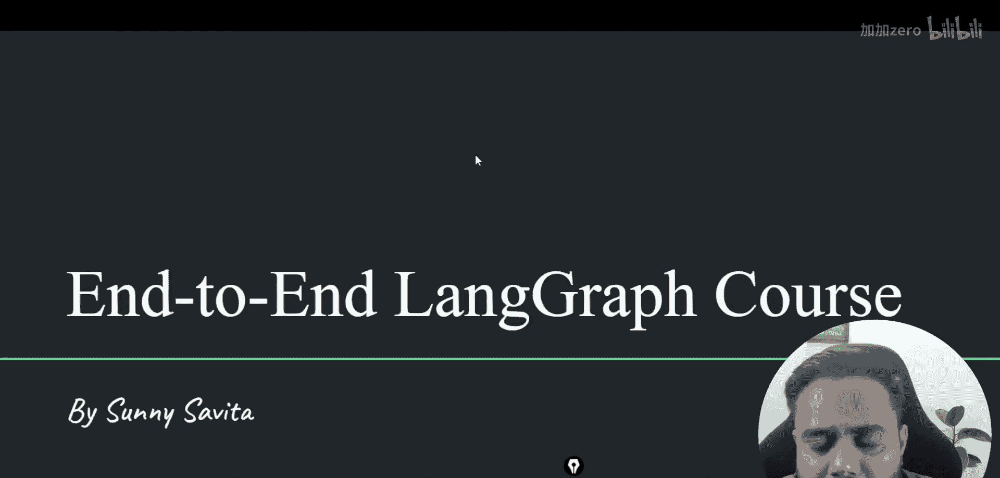

multiulageent and all but no one is giving you the indepth understanding and no one is giving you this type of understanding with respect to the la graph and all guys。

 if you want to understand the la graph la and this AI application building and all everything So my channel it might be one stop solution for all of you and here inside the video section you might get all the videos I created a different different playlist also so if you will go and check with the playlist section you will be getting the playlist with respect to each and every topic whatever is required and I'm trying to create many more playlist in the future so yeah without wasting a time let's start with the topic so first of all guys let me explain you the pro statement and then I will come to the coding so I hope so you are familiar with the syllabus you are familiar with the title of the video you are familiar with like the content and all everything so here guys I return the pro statement on my blackboard itself So first let's try。

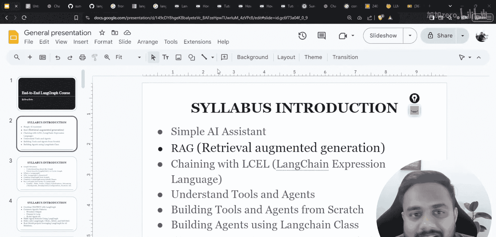

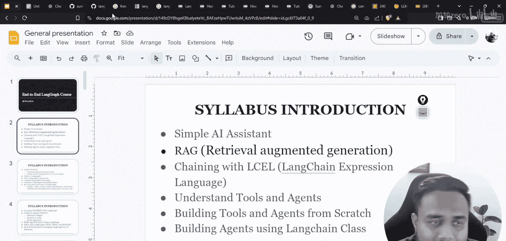

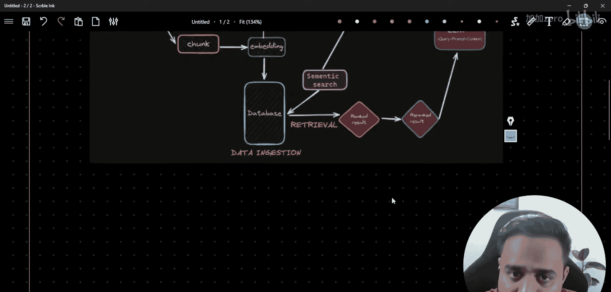

to discuss about it and then step by step one by one will try to implement it。 So first of all。

 let me do one thing let me stop my video so that you can access the entire board。

I hope so it is visible now here to see what is the topic name the topic name is like a very simple it is a corrective rag。

 so let me write it down over here。

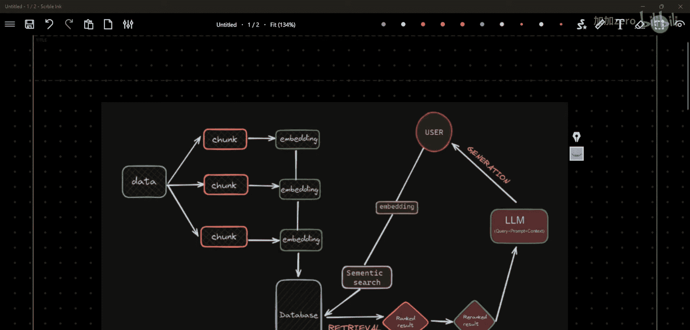

Corrective。Right。But before starting this corrective rag we'll have to understand about the rag。

 guys， this rag actually， I already cover so many videos on top of this rag。

 So inside this particular video， I will just give you a glimpse of it。

 And if you want to understand in detail， you can check out with my YouTubetu channel。 Now。

 this is the architecture of the rag。 Now， what's the full form of the rag tell me retrieval argument generation。

 So inside the rag there is a three stages。 So the first stages called the data engine means we gather the data from somewhere we divide into the multiple chunks。

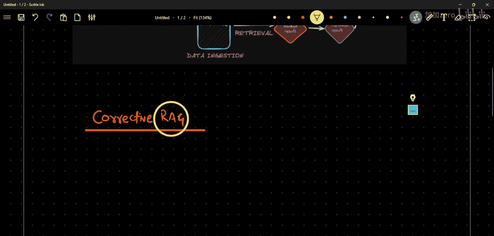

We perform the embedding out of it and then we store inside the database so this particular process is called the data engine now whenever user comes so user what it does it asks any sort of a query and here this query basically it convert into the embedding and we perform the similarity search or semantic search and then we retrieve the rank result so rank result or you can see the rerank result both are fine okay and this refined data okay this retrieved data actually we pass to the LLM along with what along with my query and the required prompt the context basically it is called the relevant data okay prompt basically I can give any sort of a prompt for generating the output according to my requirement and query actually it's an actual question and then finally we get the output so inside this rank we have three stages first is this data engine second is the retrieval and the third is a generation part I hope so this architecture clear and it's a pretty straightforward architecture。

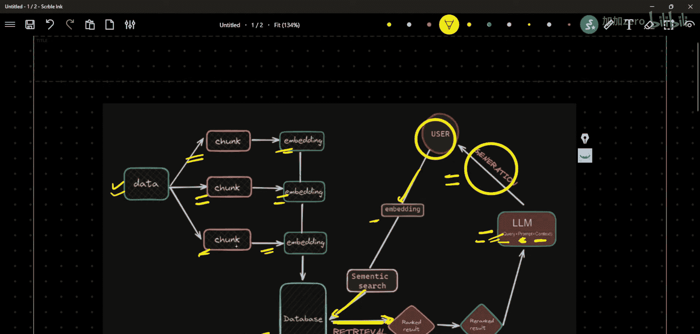

Whenever we talk about the corrective rag okay so what is the meaning of this corrective so the corrective basically here what we are going to do see if my rag is giving me a wrong answer。

😊。

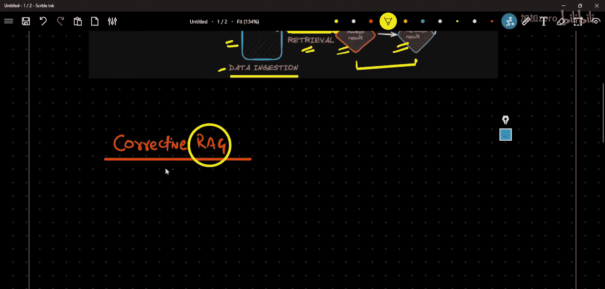

Okay， so what we can do， we can correct that particular answer。We can correct that particular answer。

 so here the corrective correct basically is representing to this knowledge correction。Knowledge。

Ection。Okay。Now， how it is possible， how we are going to perform this knowledge correction and all everything I will let you know I have architecture with me okay so guys here this corrective drag basically we are going to implement using what using the length graph。

Now， why I am choosing this la graph， the la graph basically see it give you the flexibility so inside the la graph what you can do see you can define the functions okay in the form of nodes。

9。You can make a connectivity between these nodes， right， this is called ages。

And guys here you will find out one more thing that we can。Loop， okay。

 we we can create a loop out of it means lets say we are going from first node to the second node。

And second note to the third node then again if I want to come to the third second node again I can come over here and then again I can go back to the third node okay。

 so this is called direct cyclic graph which I already explain you so this will help to us for creating this corrective rack。

O。This will help us to creating a corrective rag means lets say we are getting a wrong information using the rag I can correct that particular information and inside my solution from where actually I am able to correct my information from the internet。

Okay， from the Internet， if my rag is not giving me any correct answer， what I will do。

 I will fetch the data from the Internet。 And based on that， I will be generating my final output。

 I hope so you got some sort of idea over here， but let me give you the comprehensive idea。

 So over here guys， you can see this the architecture of the corrective rag。

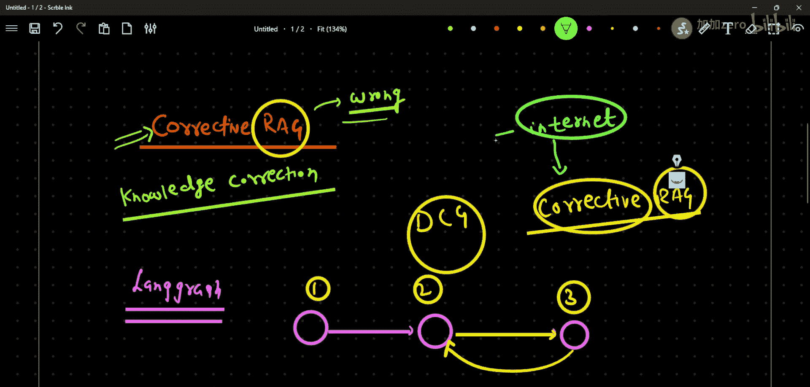

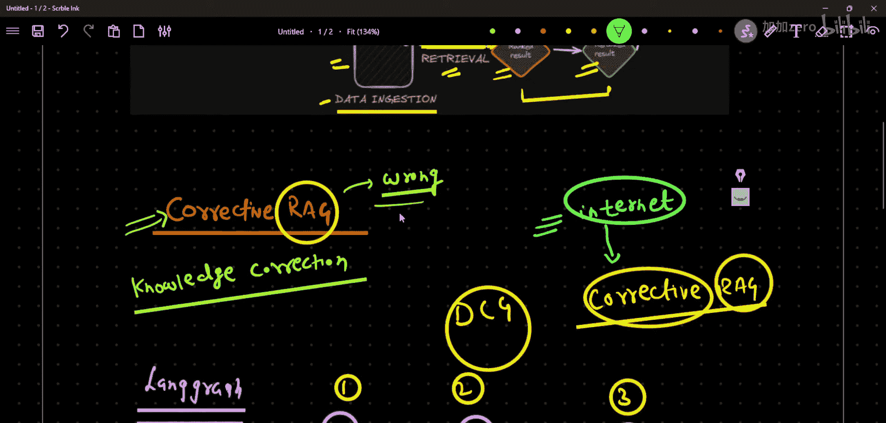

Okay， now let us try to understand about this corrective rack like how it is working。So。

 inside the corrective rack see what is happening and this architecture basically we have defined or we have created using the la graph and the same architecture we are going to implement okay in some time I will show you the code and all everything so we have a question guys so whatever question my user is asking。

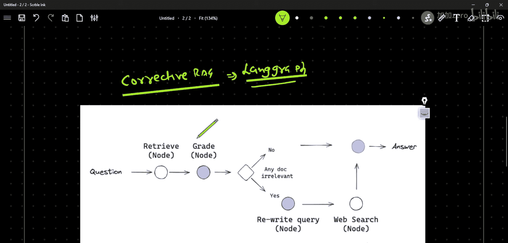

It will go to the retrieval node okay， it will retrieve the relevant document now my greater node actually is checking okay this grade node actually is checking whether my relevant document is correct okay or it is not correct means yes means correct no means not correct Okay so guys lets say I am giving my document to the greater note so if。

There is not any irrelevant document means everything is fine So what I will do I will go to this particular condition and finally I will be generating my answer understood okay now guys。

 let's say if my document is an irrelevant document means my document is not correct So in that case I will come to this particular site and I will be rewriting my query so again I will be defining one note for that Ill be rewriting my query and then based on that I will perform the web search okay from the web actually from the internet I will fetch the information and based on that we are going to generate answer so here guys this web search is nothing it is a way okay it is a way for correcting the information So how we are going to correct the information if my retriever actually after the data in the retriever。

 whatever retrieve I'm going to create okay if this retriever is not able to answer for anything。

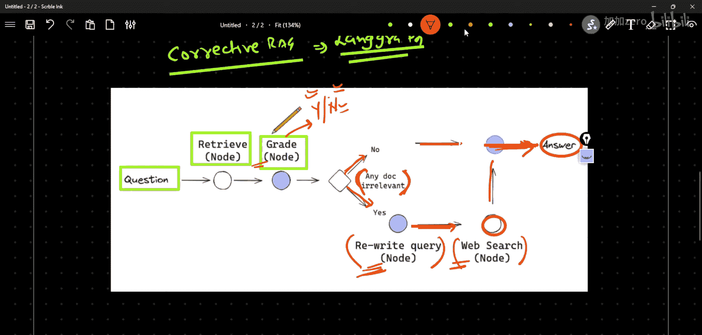

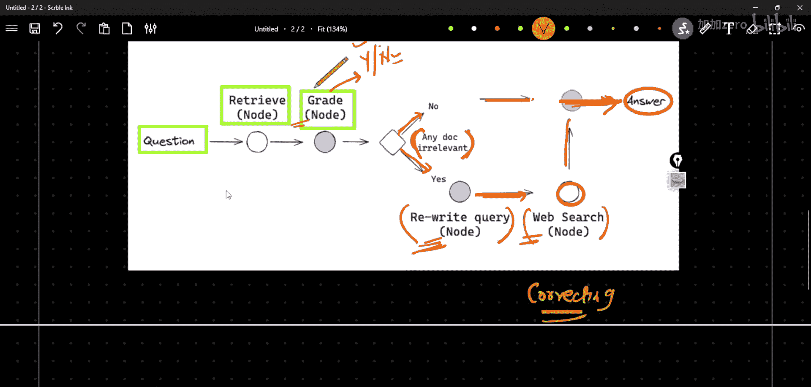

If this retriever is not able to answer anything so what I will do I will be going through the web and from this web actually we are going to fetch the correct answer and then we are generating the final answer understood guys so in my case in my scenario in my solution I cap this web okay this web search but guys in your case it could be anything it could be any database you can fetch the correct answer from the database it could be any other knowledge base okay wherever you cap the data of the cloud and all somewhere right it could be any API specific API you can define any sort of a logic。

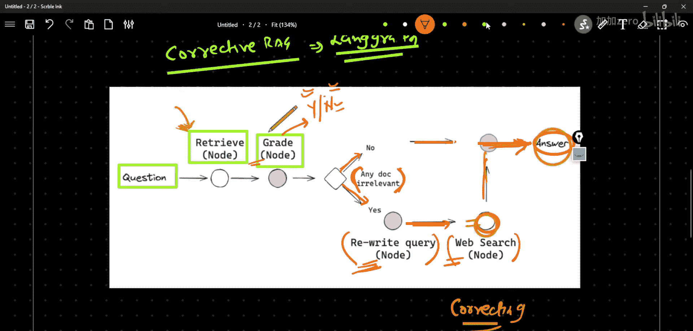

Under ato。So this is the complete architecture of the corrective rank now again let me give you the let me give you the like revision of it so this is the implementation of the land graph which we are going to implement as I told you guys we are going to start with a quot so here I created a retriever note this retriever node actually it is going to keep the retriever okay retriever basically which we are going to create from the vector database understood I will be writing the entire code over here don't worry then grade document we are going to create our document whether my document is correct or not means yes or no okay then basically after this yes or no let's say my document is the correct document。

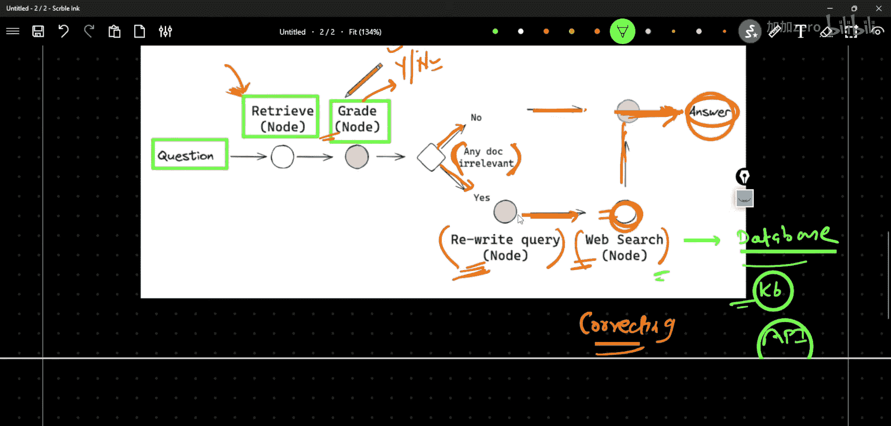

What I will do， I will be going to this generate node and finally I am generating my answer and I am giving the output understood。

 but let's say my。Great， okay， is no means Im saying this document actually it a ir relevant document。

 whatever right document I am going to capture now， so its a ir relevant。

Document in that case what I will do if it is an in relevant document again I will transform my query whatever query I was asking and then I will perform the web search and from the web search I will be fetching the relevant data。

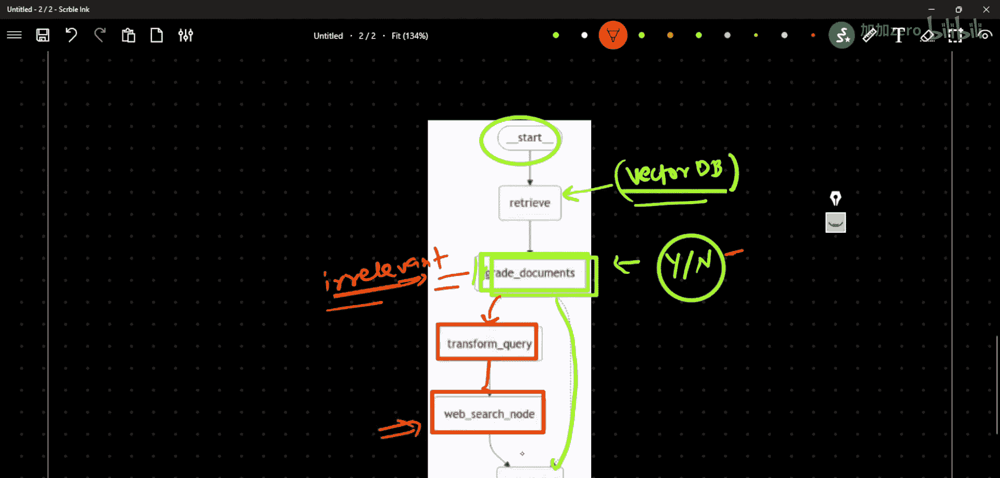