# Sunny Savita【中英⚡生成式AI：从初学者到专家｜Generative AI In-Depth Roadmap from Beginner to E】 p72 P72 LangGraph：14 Agentic RAG for Real Time Agentic AI Application #llm #genai #a [BV1Uht8zDENA_p72]

He hi everyone。 welcomelcome to my channel。 My name is Sunny Savita and I'm back with another exciting and important video。

 guys， from past few days， I couldn't upload any video on my channel it's not a days actually it's been around one and a half month。

 I haven't uploaded any sort of a video since I was busy with some of my family commitment。

 some of my other work and all， I just took a break for one month。

 but it extended till one and a half month， but don't worry guys again I'm back and again I'm going to start with my previous playlist itself。

 So in my previous video I discussed about the corrective rack。

 which was part of this landgra course only So as planned I will complete this land graph course and I will try to discuss a different different multiage system at all because currently multi agent AI or agent actually it is in a very like a buzzword right It's a very important。

Well to all of you everyone wants to know about it everyone wants to understand about it right so that's why I picked up this language of course and I hope so you learned so many things with respect to this agent takeI and all agents how you can create agents and before that I uploaded so many video with respect to the rag L and all so without wasting a time let's start without video let's start up like wherever we left so first of all let me give you a quick recap okay。

So if you will go and check with my YouTube channel you'll find out that the last video actually which I uploaded I think in I think in November right so it was about the corrective rack okay we reached to the rack part there we have to create a different different agent rack base pattern if you will look in the spers guys so sperss voice I already completed this first slide then I completed this second slide as well where I discuss the basics of the la graph okay basics of the basically this land graph like graph state notes ages trackpointing breakpointing is streaming memory everything then I came to the next one so I discuss about the different different atic pattern also how you can search a output how you can create a react agent how you can keep human in the loop human intervention in the loop and even I shown you on chatboard also how you can create a chatboard using the la graph now it's time to discuss about the rack agent。

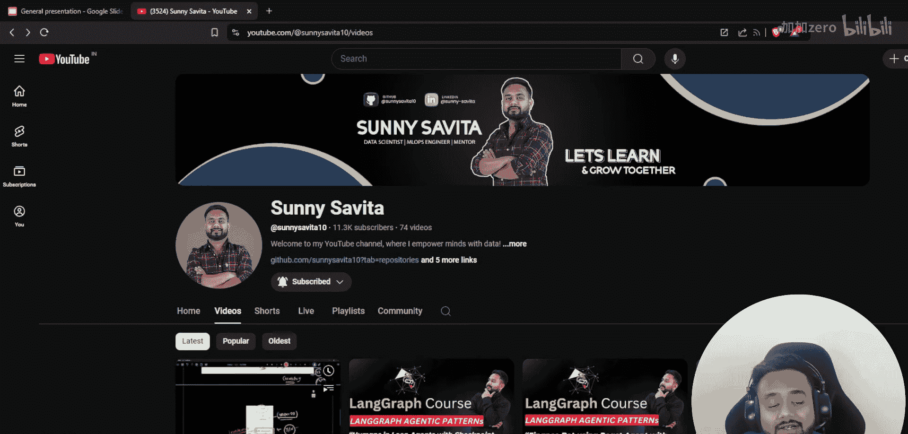

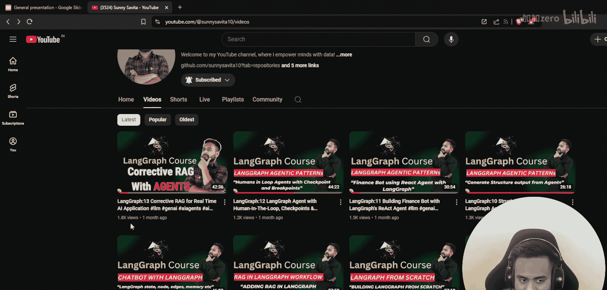

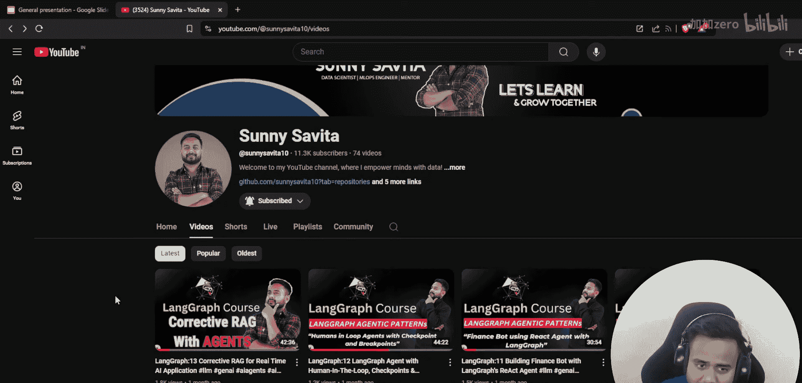

Agent base rag and I already started with a corrective rag so if you will go and check with my previous video。

 you will get them。

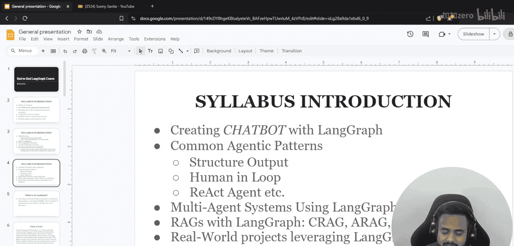

Then after that， after this rag， I will come to the multigenictic system and I don't want to wrap up this topic in a very short manner。

 I want to discuss this thing in a very detailed way。

 so definitely will try to discuss about this multiagetic system and all in a very detailed manner and will try to solve a couple of projects as well。

 So you can expect around 10 to 15 videos from my end And par I was thinking to start about the fine tu as well so。

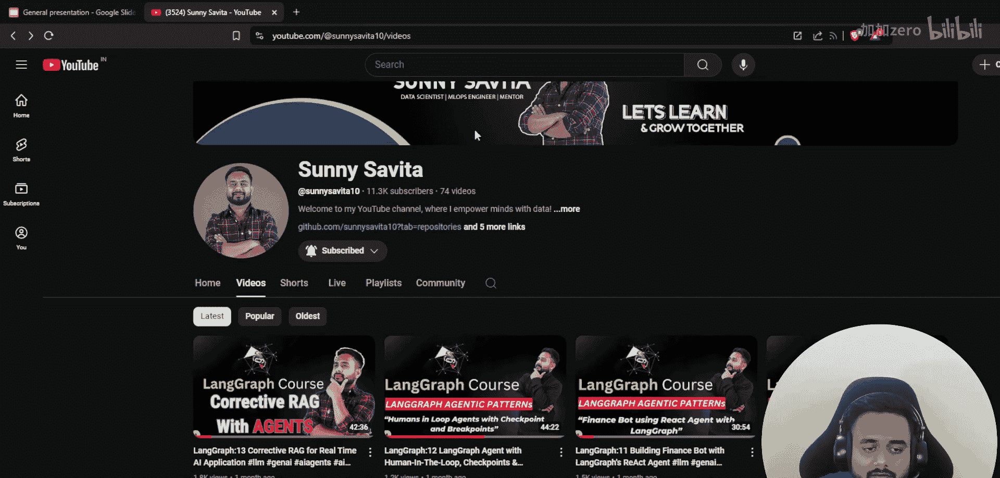

Will try to start one more series that would be related completely related to the fine tu Okay so guys。

 many more things are about to come on my YouTube channel and yeah thank you for your trust。

 Thank you for your support guys so recently I completed my 10000 subscriber also and now it is to the 11000 So yeah because in between I got so many messages why you are not uploading video why you left this YouTube okay your content was good。

 it was helping a lot。 So guys I haven't left the YouTube I will be regular on my YouTube don't worry。

 but I just took a break because of some family responsibility which I had to complete okay recently I become a father so yeah and even I posted also in my community if you will look into my community posts So there you will find out I posted that again Im going to again I will be back So Ill be uploading the video from wherever I left right and。

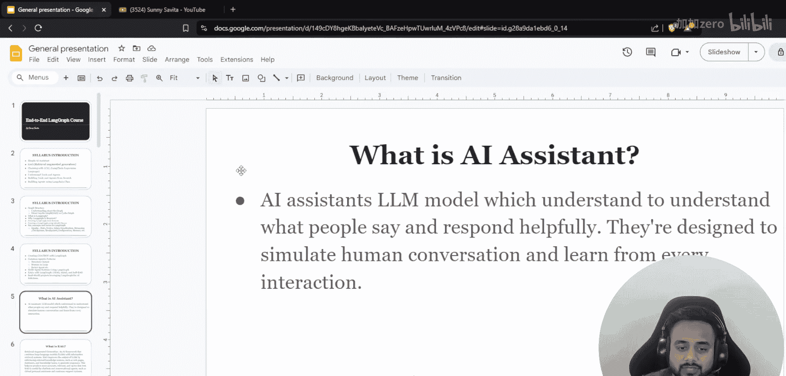

I already informed to you but last week even last week I got busy and I couldn't upload the video find not an issue let's start again but today's video so today we are going to discuss about the agent rack okay correct rack I already discuss now we'll try to discuss the agent rag and then one more type of rag is there that is cell rank okay and after this three rack will try to complete one project as well that project actually is going to be based on the sQL agent right so first of all let me show you the architecture of this agent rank how this architecture looks like and then basically step by step1 by1 I will show you the complete implementation of it。

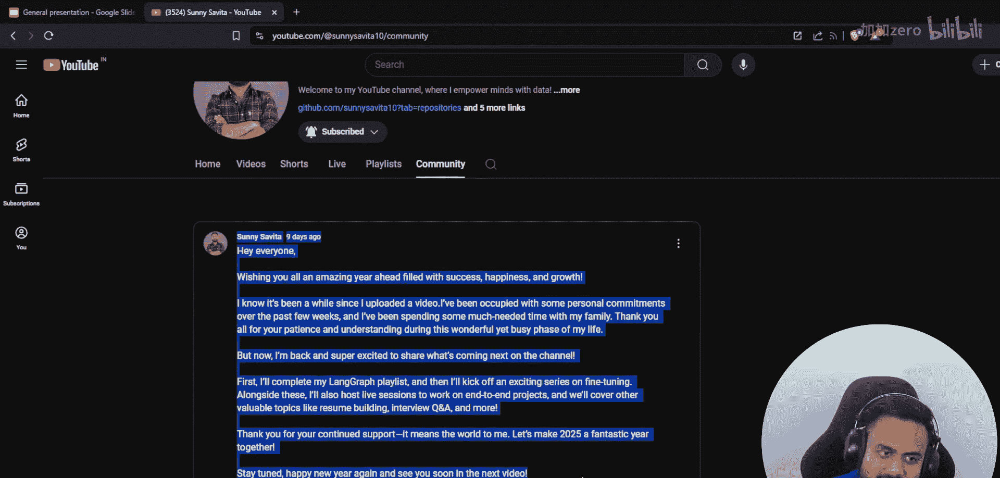

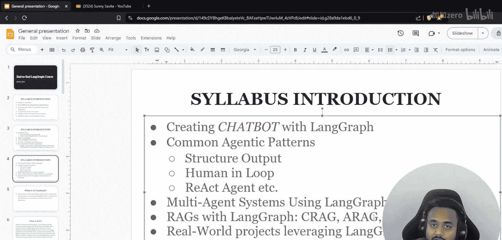

So this is the architecture guys， which we have implemented in our previous session and now we are going to implement this particular architecture。

 But before starting this architecture， let me give you a quick recap。 Okay。

 and if you want to understand in detail you can go and check with my previous video So in the recap what Im doing so here I am going to write about the agents。

 I think everyone knows and knows about the agents what is the agent。

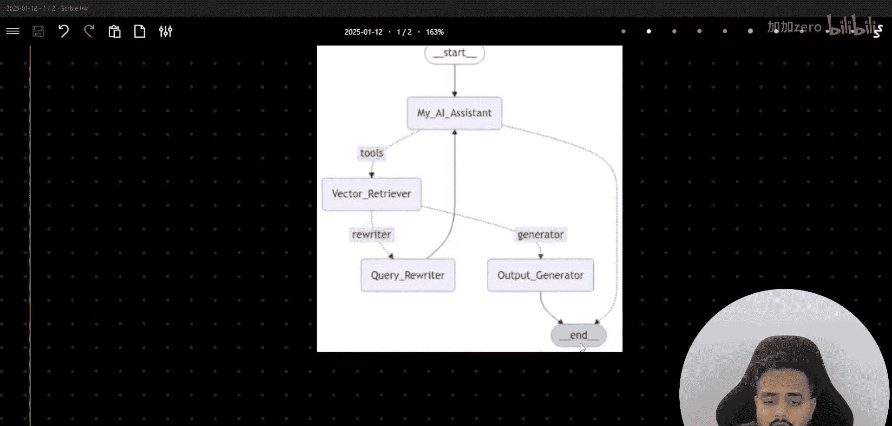

Though agents are nothing。 again， I'm saying agents are the。Powerful， A I assistanted。

What does that agent？So agents are nothing itself。Powerful。一二一。As suspect。

Now why I'm saying it's powerful， so。It is powerful because we are going to write we are going to court this agent in such a way we are going to use the capability of LLM in such a way so that it can think in their own way okay。

 in short I can say agents are nothing okay we are going to use the capability of the LLM in such a way so we are going to create a autonnomous system autonomous。

Theyst okay， or we are going to create a cop pilot system。

Oil system using the capability of the LLM understood， I can give you the very basic example。

 let's say。We have an input any sort of input we are passing to the LLM right so what will happen you know。

 so first this input will come to the LLM and input okay based on this input LLM will think。

Right LLM will think then based on this thinking， okay， so here what we have we have a LLM。

We are going to use the capability of the LLM。Okay， then based on this thinking， what will happen。

 you know， it will take action。Okay， it will take a action then based on this action。

 okay whatever action， whatever output is coming， so again what it will do it will do the observation means interpretation of the output。

Understood， so it's happening until。 And unless we are not getting a reliable output。 Okay。

 just everything is working in the loop。 we are trying to write our code。

 We are trying to write our logic in such a way。So this thing actually is working into the loop and once this condition is going to be satisfied me it is able to think about the quotient。

 it is taking a appropriate action， appropriate action。Okay， a row， create action。

It me right over here。And whenever we are talking about action guys， so in the action。

 it's calling a tool。Okay， and this tool are nothing。

 So I think now you can see the tools are nothing。 tools are the functionality。

Whose are the custom functionality and inside this function， you can code anything。

 Anything means any。Or it。Understood so guys this， if this all the thing， right。

 if this entire process is going to be satisfied。That is why。Then only we generate our final output。

Understood so here what we have done， we have given a capability to the LLM that can think it can make a reasoning Okay。

 it can take appropriate action based on the given code given logic and then it can do the interpretation also interpretation of what interpretation of the。

Interpretation of what interpretation of the generated output Now if the condition is going to be satisfied。

 then only we are saying this output is my final this output is my final output Okay I hope this thing is cleared all of it now let me give you one very good blog so that you can go through with that particular block and you can understand more about the agent okay so guys this blog actually I will give you the link inside the description this blog actually you will find out over the Lang hub okay over the Lang block inside the Lang blog post so they are talking about the LLM powered autonomous agent and if you will look into the image So this is I guys which will tell you most of the thing I think just a circuit。

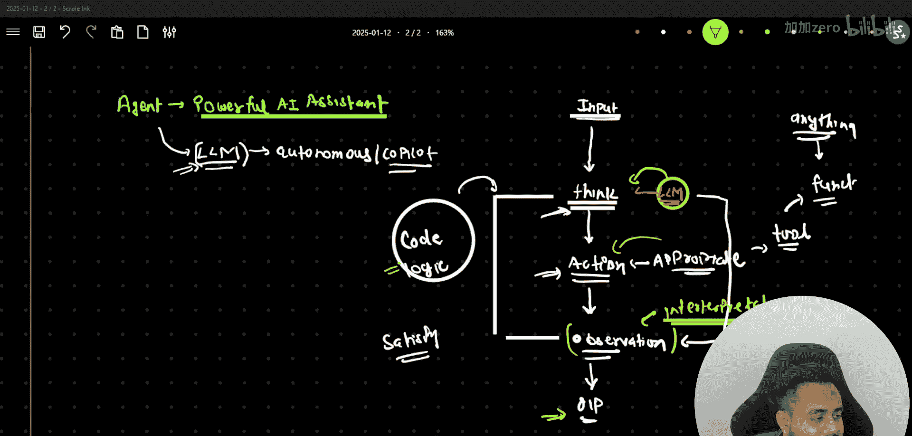

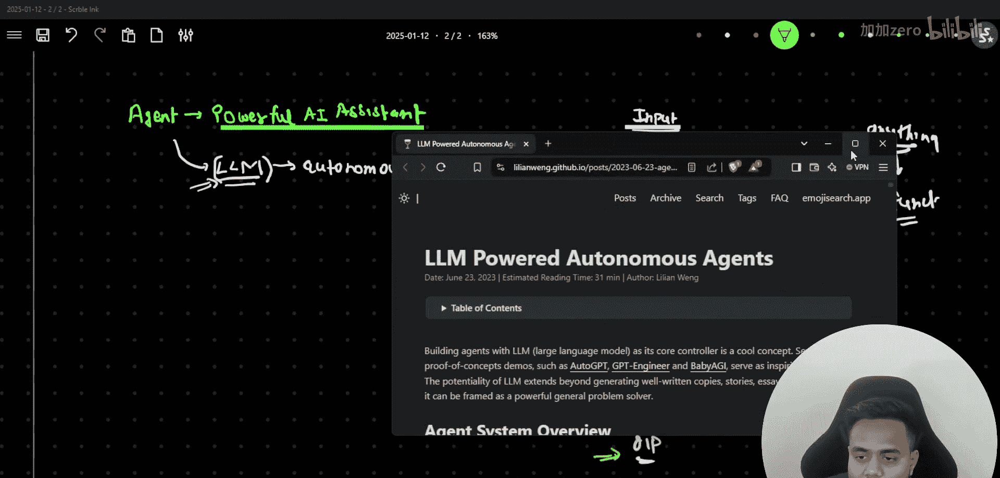

I seen one image inside this particular block。They are not。然后。So yeah， so okay。

 it is is like reflecting the same thing like plan， execution and all， okay。

Where is that image Re to the auton agent。Yeah， this one guy。 So this is the image。

 and now inside this particular image you can see agents are nothing。 it's a capable LLM。

 So Cap LLM how it is a capable， let me do one thing。

 Let me copy this image and I'm going to post it on my。

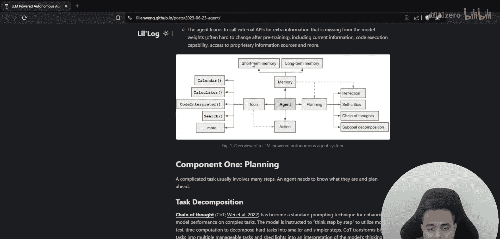

Flybo itself。 So see， this is the image。 And agents are nothing。 This agents are the LL M only。

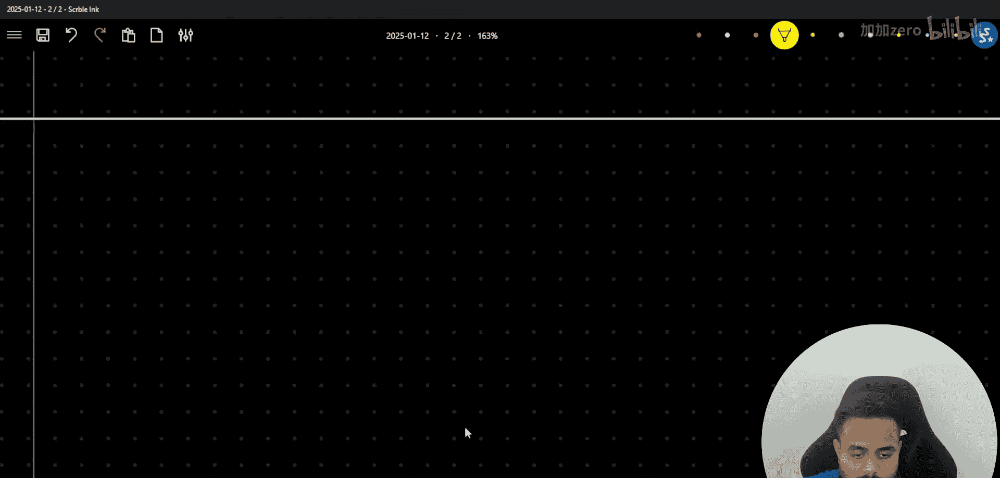

O， what does。LLM it is able to do the planning it is able to do the take a action Okay tools tools basically it is always representing to the action if I am saying action means I am calling any sort of a tool but this tool could be anything this one。

RightAnd if we are saying like planning， so planning means nothing， planning means thinking。

Observation。Of derivation。

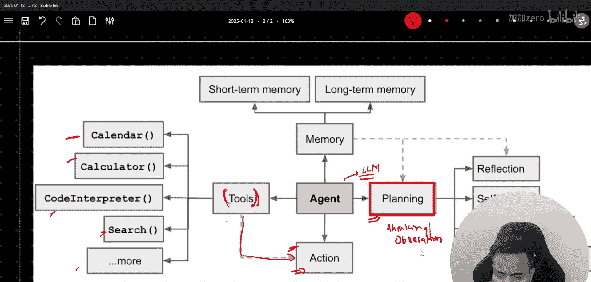