# Sunny Savita【中英⚡生成式AI：从初学者到专家｜Generative AI In-Depth Roadmap from Beginner to E】 p73 P73 LangGraph：15 Self-RAG for Real Time Agentic AI Application #llm #genai #aiag [BV1Uht8zDENA_p73]

He hi， everyone。 welcomelcome back to my do channel。 My name is Sunny Savita。

 and I'm back with another exciting and important video。 guys。

 today in this particular video we're gonna discuss one more agent pattern inside a rag pipeline and that is going to be a very。

 very important。 So we are going to implement the selfra。

 so in my previous video I think so far I have uploaded 4 to 15 video inside this land graph end to end code。

 and I hope so you have seen my all the video。 So first of all。

 let me give you the walk through the quick walkthrough of the syllabus that what all thing we have to discuss and then I'll be showing you all the video and then well start with today's agenda。

 So if you will come with the first slide you will find out all the youll find out all the basic stuff which is required to understand this agent。

 I explain about the A I explain about the rag I discuss the tools and agent and that we have。😊。

aggents from sketchch if you haven't seen this video。

 then please go and check with mytu channel and try to check inside the video section or else you can refer the La graph end to end courselist then guys I came to the next next slide here actually I discuss the basics of the La graph I shown you how you can create how you can create agent pattern using the La graph even I coded those things from very。

 very sketch so if you will go and check youll find out very very useful for your projects then guys I came to the like some advanced topic so I shown you the different different agent pattern that like structure output。

 how you can generate a structure output how you can keep human inside the loop。

 how you can create the react the very famous react agent reasoning and action agent and then basically I show you the chat board as well and then guys now I came to the rag so rag with La graph or agent pattern inside our。

Pipline so so far I discuss corrective rack and the pure agent rack now signed to discuss this cell rack and after this one guys I will be coming up with many multi agenttic pattern as well and then well try to discuss a couple of projects and then after Ill be discussing about the crew EI and the autogen okay。

In a similar way， I will be teaching you that those two framework as well so your agents will be much more clear and you will be ready to use any sort of a framework while you are going to create your agent pattern now let me show you the respective video so if you will go and check with my YouTube channel so my YouTube channel name is Sunny Savita you can go and check then here guys you can see inside the video section all the last video are related to the la graph only now if you will go and check with the playlist you will find out the different different playlist so if you want to begin from it starting you can follow this playlist if you want to understand the rag you can follow the other playlist like the rag multimodal rack advanced Ra and if you want to understand the L here I created a video with respect to the L as well and then here is my la graph mastery code so I hope guys now each and everything is clear and I explain you each and every part of the code。

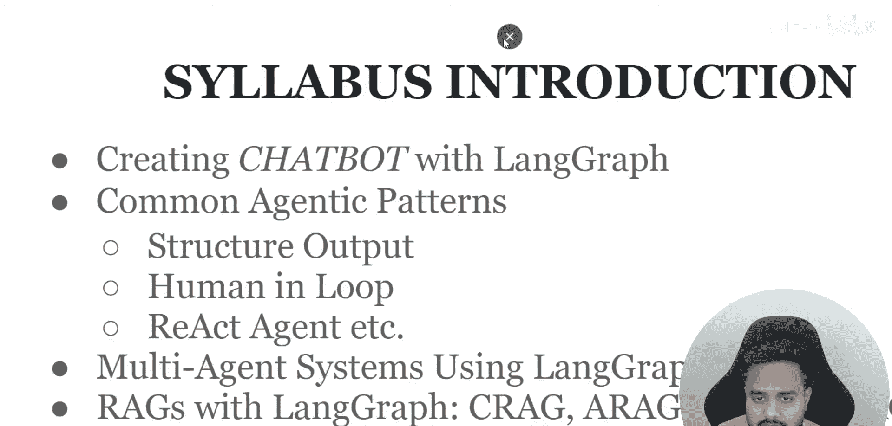

So let's begin with our let's begin with our today's agenda so if let me let me show you the different different agent rag pattern so what things we have discussed so far and what we are going to discuss so we are going to discuss this particular architecture let me show you how this architecture is gonna work okay and so far guys I discuss this two pattern first was the corrective rag and the second was the pure agent rag so let me give you the walkthrough of this particular pattern how this pattern or how this architecture are working and then I will come to this part okay then then I will come to this architecture and don't worry I will show you how you can code it from a scratch so see guys what is my topic name so my topic name is a very straight forward that is different agent pattern inside the rag now if you will ask to me Sun what is agent pattern so agent pattern are very much simpler so agent pattern。

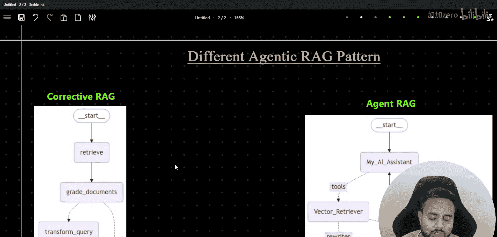

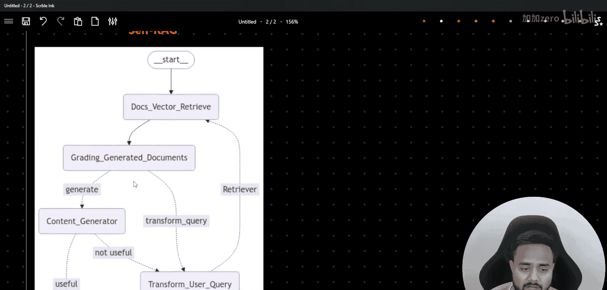

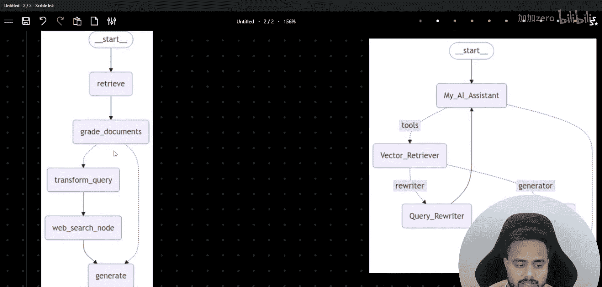

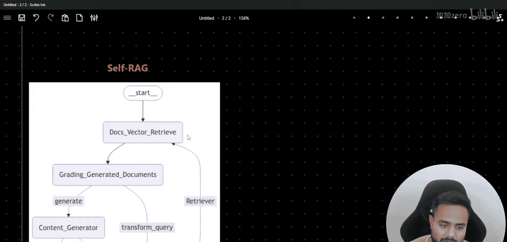

あルた？Pattern actually where we are keeping our LLM in the loop。

 Okay so let's say if I want to build any agent pattern。

 so what will be the flow of it So here I can write something let's say we have agents Okay and one more thing guys I would like to tell you Age are nothing Age are the advanced AI assistant So whatever AI assistant we have created so far it's an advanced AI assistant Okay it's an advanced version of the AI assistant Now whenever talk about the agent guys so this agent always work on this three pillars So the first is called thought So we always think about the given input then based on that it take action So action basically it's going to take action it's going to call the tools right it's going to call the thirdpart functionalities and then it's going to make observation observation means what observation means interpretation of the output right So this all the things actually is working in the loop So in every agent pattern you will find out all these three thing and。

We are going to use the capability of the LLM right so different different basically we have different different like other words as well。

 but all the words are around to these three words so you can say this three word actually it's a pillar of the agents right and here what we are doing we are going to use the capability of the LLM means we are going to use the thinking capability or to content generation capability of the LLM based on that we are going to perform some sort of a reasoning and then we are going to take action okay and that to actually is working in a loop until unless we are not getting a final output means we are not getting a reliable output So if someone is going to ask you what is a agent so in a single line you can explain isn't our advanced AI is a which is having a capability to think take action and make an observation and to generate a more reliable output that is case Now if you will check with a rag So what is a rag I think rag I already discuss now let me do one thing let me give you the。

Idea about the rag as well that how does rag work？

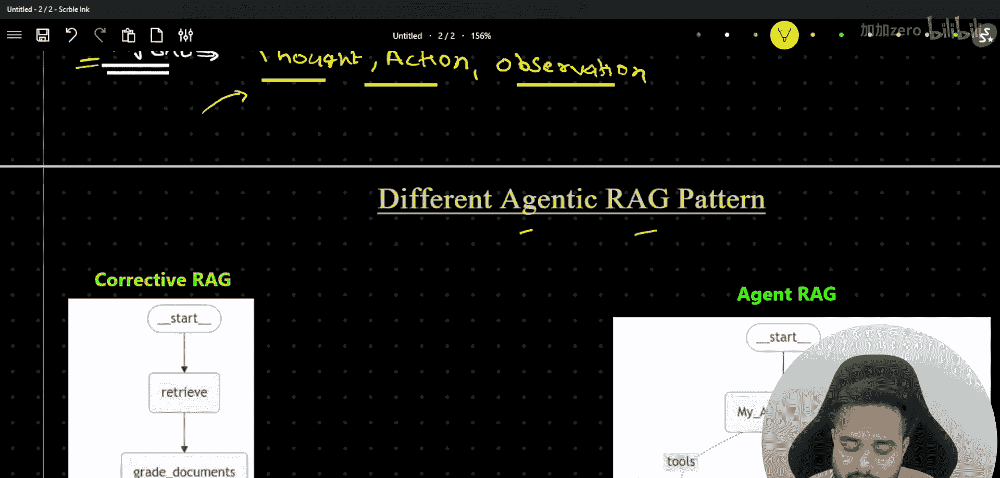

So guys， this is a rag architecture so let me give you a walkthrough and I explain you each and every part of the rag in a very detailed way。

 if you will go and check with my previous video So in rag actually we always collect a data then we divide into the chunks if our data is very huge then we create a embedding out of that data and then we store inside some data so this particular process is called the data in then what we do we have a user。

 let's say this user actually is asking a question then we convert that particular question into the embedding and we perform the similarity search or semantic search over here and then we fetch the relevant data relevantle output from our rag and then based on this relevantle data what we do see we have a two stages in in the relevancy also if we want to check the relevancy of the output So the first stage is called the rank result and then if we want to do one more level of filtration then what we can do we can perform reranking I already explain you what is a reranking。

ranking right this thing I discuss in very detail May in my advanced playlist So if you want to understand this reranking and all you can refer my advanced rank playlist right so this is very much important if you want to build some advanced architecture then each and every information the accumulate information we are passing to the LLm and then based on this particular information means LLm is taking a reference and based on this particular information my output is being generated right so this is a whole sort of a pipeline the rank pipeline now we need to understand how we can introduce the different different agent pattern Okay so guys here the first pattern basically it was a corrective rack so let me give you a walk through and then I will come to this self so this is kind of a difference basically which I trying to explain you and then I will come to the coding part coding part of this self okay why I'm doing it I can skip this part as well but I'm doing it so that you can get a good understanding right so Im。

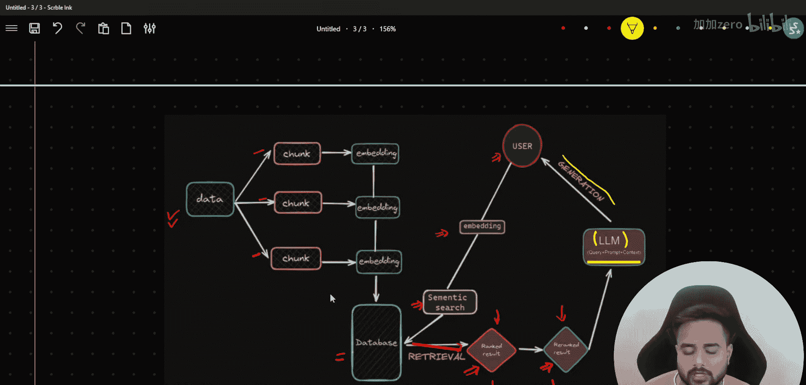

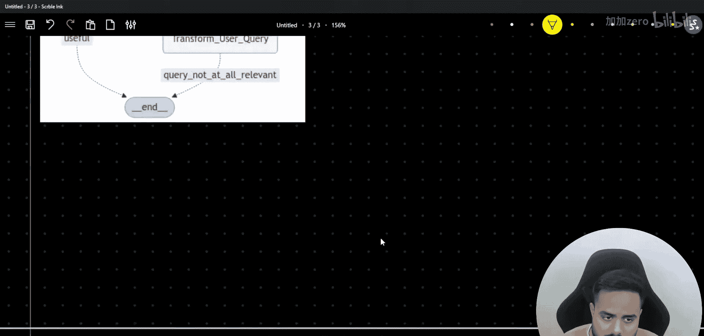

Like。Treating this all the video as a single course al right which I am giving you a completely free and if you are following this course so you will be sync of with each and every video right so now here what we gonna talk about。

 we gonna talk about the corrective rag since as the corrective rag let's say we are getting output and here this output actually we are giving to the retriever retriever means what retrievever is my vector database itself now after giving to the vector database it's going to face some relevant document So here I'll be getting the relevant document R means what relevant document So we are giving this relevant document to the grader here again we are going to use the capability of the LLm。

 we are checking right this relevant document whatever document we got it is a really reliable or it's really useful or not let's say if this document is not a useful right sorry let's say this document actually is a useful document yes。

Then what we'll do well give it to the generator and generator finally we generate a final output straightforward very straightforward process so the same thing we are doing over here as well see what we are doing so here we have a database and we are going to retrieve output and then whatever relevant document we are getting we are directly passing it to the LLM and you can treat this particular process this relevant document process retrieval or relevant document process as a retrieval and this LLM process as a generation okay let's say we have a second aspect of this architecture so let's say this document is not going to be correct here I'm saying no。

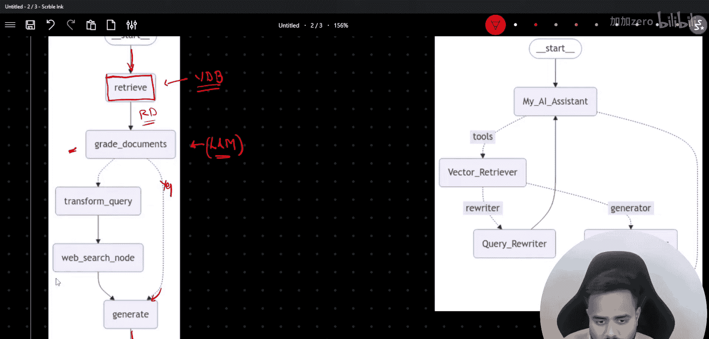

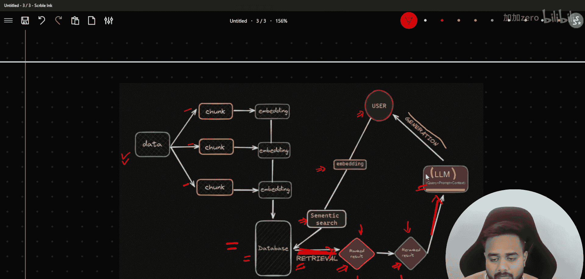

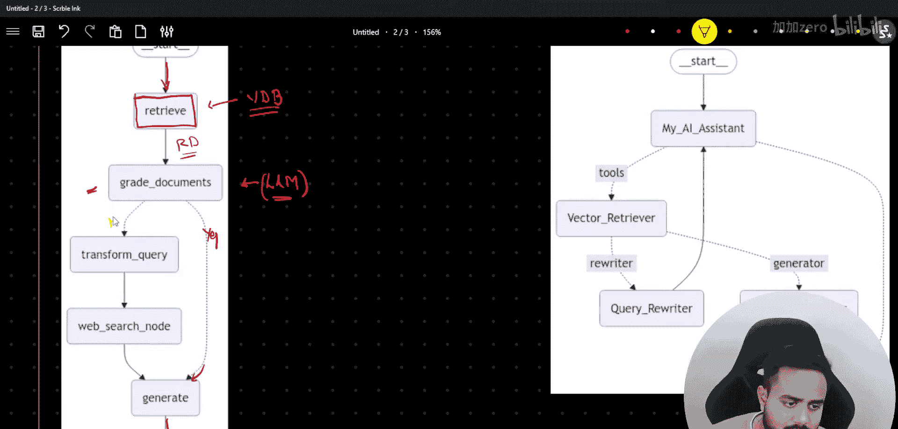