# Sunny Savita【中英⚡生成式AI：从初学者到专家｜Generative AI In-Depth Roadmap from Beginner to E】 p74 P74 Roadmap of Agentic AI & Generative AI with 150 + Interview Questions and Ans [BV1Uht8zDENA_p74]

Hey hi everyone。 welcomelcome back to my YouTube channel。

 My name is Sunny Savita and I'm back with another exciting and super important video。

 Now why I'm saying it's a super important video because in this video。

 Im going to discuss when quick roadmap for the geneative AI as well as I will give you the extensive resources for the geneative AI interview So guys this is my YouTube channel where Im uploading a video related to the gene AI and soon I will upload the video related to the deep learning machine learning Python and everything。

 So guys， this could be one stop solution for all of you if you are eager to learn this AI or geneative AI So guys instead of video section guys。

 you will find out all the video， whatever video I have upload so far now from this one guys if you will go in my live section So I release one video put live actually there I discuss stop0 gene AI interview So this is all the interview guys with。

😊。

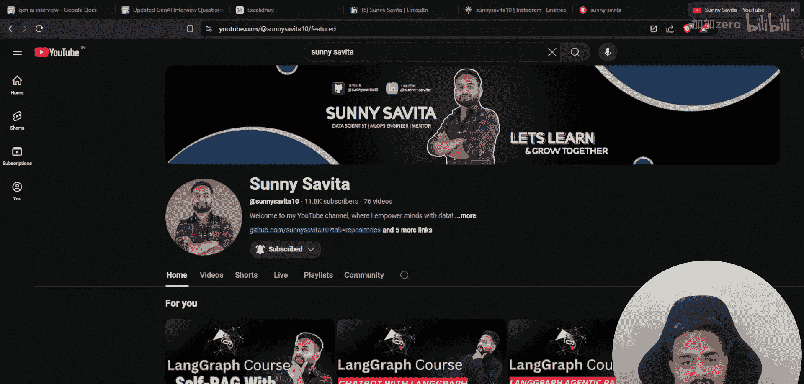

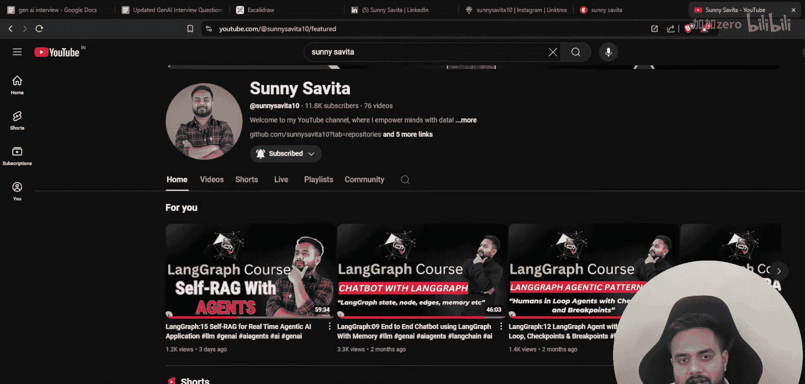

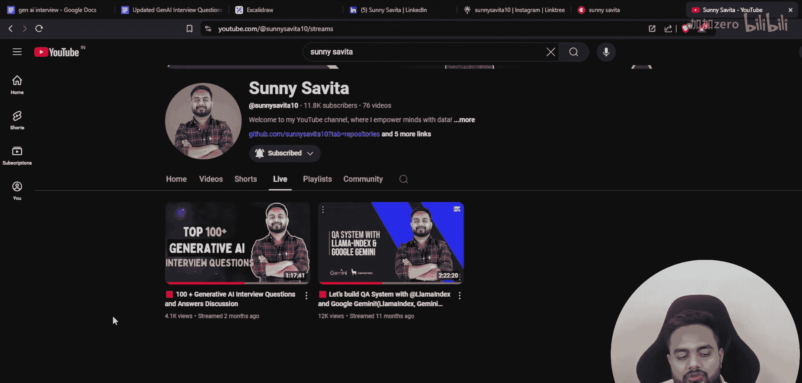

Back to each and every category of the Gene V like artificial neural network means the fundamental of the fundamental of the deep learning and the Gene V then the natural language process processing it also comes inside a fundamental then the question related to the transformer architecture the question related to the LLM language modeling the question was related to the fine tuning rack vector databases LLM op systems rang each and everything so there I discuss around 150 interviewt even though I discuss but I didn't give you the answers of this entire now in this video guys I will provide you all the answers of this particular question because inside this video guys I publish one challenge whoever going to complete this particular questionss so like the person will get amazing price from my end that prize I will reveal soon in my one of the video because I invited that particular guy who has prepared this interview questionss。

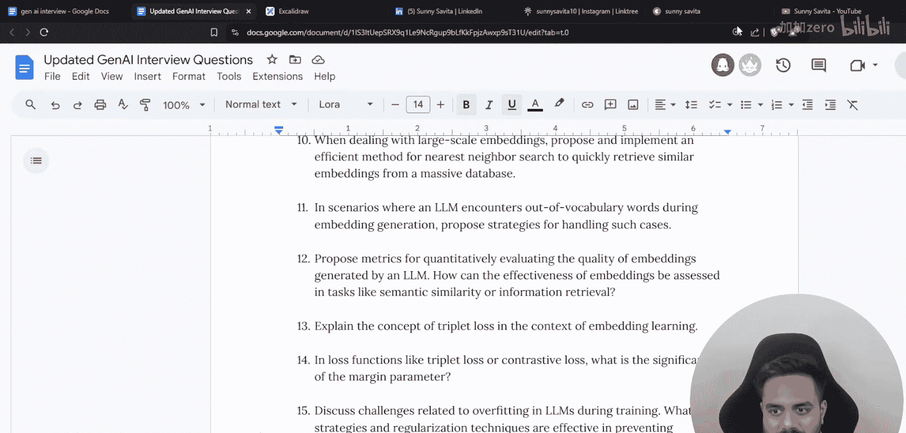

Definitely I will show you all the answers with respect to this 150 interview question but before that。

 let me discuss the quick roadm for the Geneative AI So guys here on top of this screen you can see this is a quick roadmap for the Gene A I divide it into the multiple categories even though I publish one video on my YouTube channel with respect to the geneative AI roadmap so here you can see this roadmap is having more than 40000 views somewhere around 41000 views right so this is a very amazing video if you want to understand about the Geneative A roadmap but here is a quick recap of the geneative AI or the agent AI how basically you can learn the Geneative A topics you to cover and how you can reach out to the agent AI which is a very hot topic nowadays So guys here if you will look so the first thing is the first thing is a deep learning fundamental So inside the deep learning fundamental you always need to focus where。

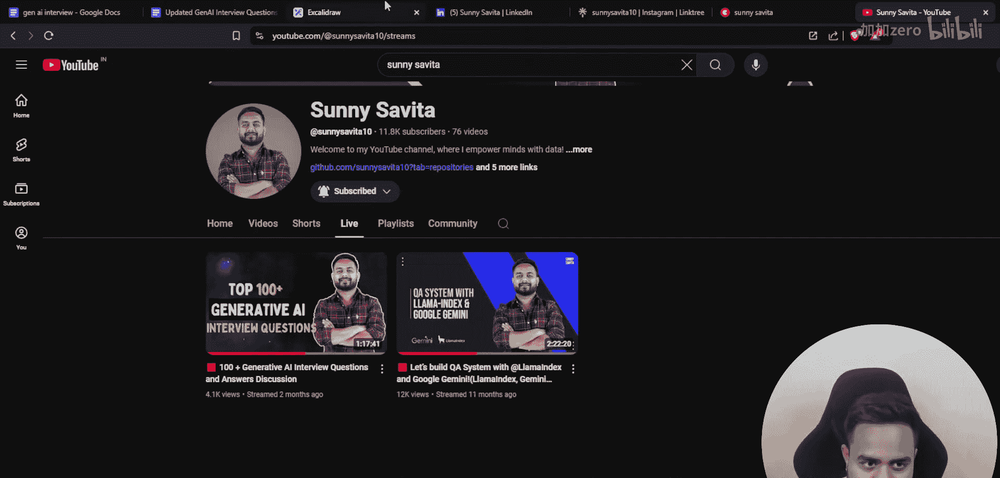

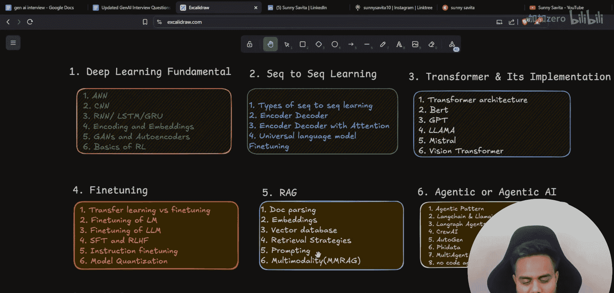

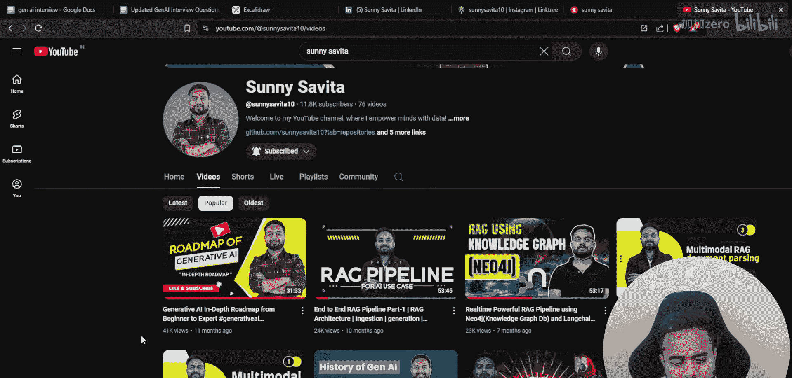

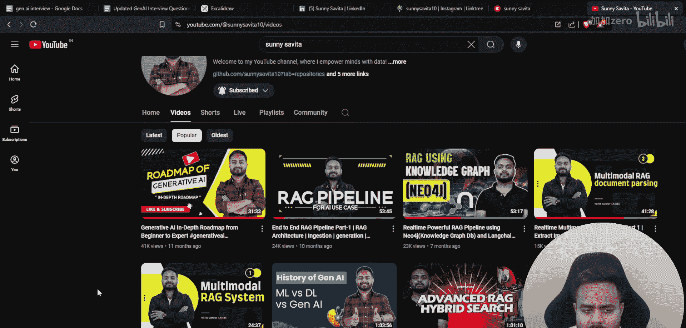

You always need to focus inside the AN and CNNN then RNN LSTM GRU it's a variant of the it's a variant of this RN model itself then ening and emitting it's a very important super important topic then again auto encodeder and then basics of the reinforcement learning So this entire thing actually comes under deep learning fundamental got it then guys after learning this deep learning fundamental you can switch to the sequence to sequence learning right again which is a part of the deep learning itself and which usually which we usually learn inside this NLP okay inside this RN so guys here inside the sequence to sequence learning you need to learn about the sequence type of the sequence to sequence learning then this encode decoder andgo decoder with attention and then universal language model find today So this is an ULM fit model which is a super important model and definitely you should go through once with this particular model this particular topic if you want to understand about the sequence to sequence learning。

Okay then guys are the main and the very important topic and the super important topic comes into the picture that is transformer transformer and its implementation or its architecture。

 So first thing transform architecture， you need to takecode the entire architecture then heres a board GT right you need to understand about the mass language model genetic preing model right how the language model is working in a real time how they have created that then Lama architecture。

 my architecture why I have included this two architecture so that you can understand the state of art modeling and then vision transformer that how we can include the vision vision to the transformer model that is super important guys okay because nowadays most of the model actually will find out those are the multimod and this architecture will give you the comprehensive idea that how this multimodative working then guys there is a fine tuning So instead the fine tuning you need to understand about the transfer learning then fine tuning then fine tuning of the language modeling like board。

T5 then fine tuning of the last language model like G Mial and ama model and then here we have supervised fine tuning RHf and DPO right the preference optimization technique like DO PPO Kt use and all So these are super important topic inside the fine tuning then instruction fine tuning for the GP kind of model where directly we cannot access a model but still we can fine tune using some technique those technique actually is called the instruction fine tuning where we just need to define an instruction inside the gson file and we can directly provide to the model and some kind of a mechanism coded by the developer itself So model will be directly fine tune then here is a model quantization this is also very imagine technique which we should which you should learn along with the fine tuning then guys the very important and the super important topic rack which is like the most important Now here inside inside the rag actually you need to understand about the document。

Passing how you can pass the document， how you can pass the different different website。

 how you can fetch a data from the different different database。

 So if I'm seeing document passing So simply I'm like talking about like how you can gather the data how you can create your in pipelines that's mean over here then here the emitting techniques again I'mting is a super important thing for the for the retrieval generation then you need to understand about the vector databases then retrieval strategy。

 differentval strategy or the mathematics and all behind those retval strategy then prompting is also very much important thing guys you need to be understand about the prompting even though it's under topic but guys you should not miss this prompting the short prompting few short prompting chain of are the super important thing if you want to build a robust application using using rag then multimodal multimodality how you can use the different different L model。

Moel， how you can store the different different type of data。 Okay， multi model data like images。

 audio， stacks， right， how you can get embedding out of it。 So guys。

 this is a super important thing because。Most of the application you will find out this multimod rag only then guys。

 here comes R。Champ， right， that is agent AI guys this agent AI actually it's a super hot topic nowadays why it is a super hot topic because here we are using the uttermost capability of the LLM means using the LLM actually we are going to create a kind of pattern we are keeping our LLM in some kind of loop。

 We are LLM can take a decision by themselves means LLM can think LM can observe LLM can generate a right kind of answer。

 LLM can interpret right So every kind of thing we can do inside the agents inside the agent pattern right if my LLM is not able to answer in that case also we can fetch the answer from anywhere from variety of the sources right and we will make sure that those answer should be a reliable answer。

 not only the agents we can implement this agents along with a ra architecture。

 That's a beauty of the agent AI and that's why this is a very hot topic nowadays So here。😊。

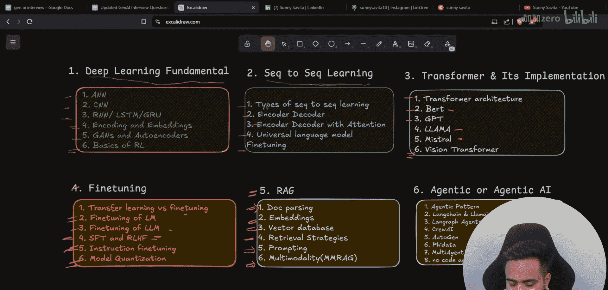

です。You need to learn about the agentic pattern。Langction and index agents， La graph agents。

 two Ei agents， autogen agents， okay few data multi agents and then no code no code agent built in slight lengthflow where much coding is not required。

 So first of all guys understand the different different agent pattern like react selfr self ask and then tool calling agent at all and then try to implement it using these particular framework where you'll find out some some like a different different custom classes also inside these particular framework So try to evaluate each and every framework and then try to create a multi agenttic system So if someone I got a lots of query nowadays should I learn the agent A Yes definitely you should learn the agent A but guys this is the complete way to reach out to the agent K I see this one the fundamental then here the sequence to sequence learning which you cannot miss out then transformer right and then a。

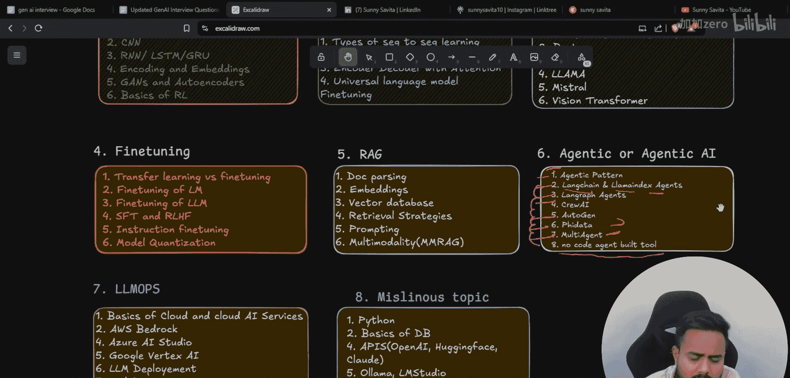

From here。This like fine tuning comes then guys this rack comes okay which is a super duper important thing and then here is a agent AI。

 So now guys you understood where this agent AI lies okay where you can keep this agent AI understood then guys once you will be good with your agent AI and all then where you can move so you can move to the LLM op where you should have basic understanding of the cloud where you should like having a understanding of the different different cloud AI services in those services AWs badro as your AI studio。

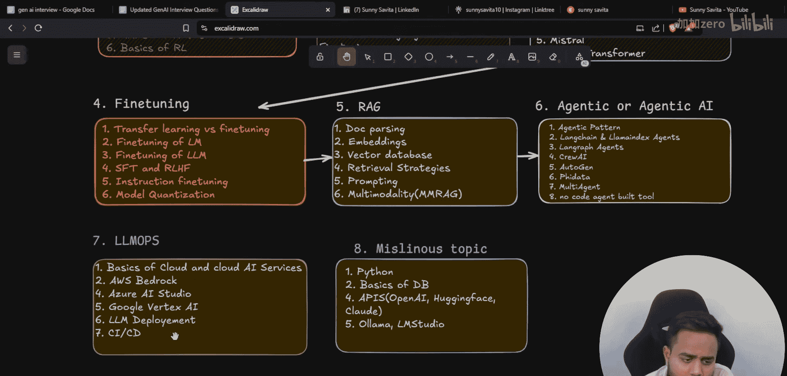