# Sunny Savita【中英⚡生成式AI：从初学者到专家｜Generative AI In-Depth Roadmap from Beginner to E】 p75 P75 LangGraph：16 Advance SQL Database Agent Powered by LangGraph #llm #genai #ai [BV1Uht8zDENA_p75]

Hey hi everyone， welcomee back to my group channel。

 My name is Sunny Savita and I'm back with another exciting and important video。 guys， as you know。

 I started with this end to end La graph course and I already uploaded around 15 video inside this course if you will go and check with my YouTube So you'll find out I started from very scratch and I cover up to the rag the different different type of rag the agenttic ragagon all。

 Now inside this video we're gonna implement one project and the project name is going to be a SQL agent using the La graph and right after this particular project I'll be starting with the multiagetic system。

 So if you haven't checked with the syllus guys， you can go and check with this particular slide inside this I cap the entire syabus this is the first slide where I cap all the basic stuff and all which is required to develop the gen application okay using the agent flow。

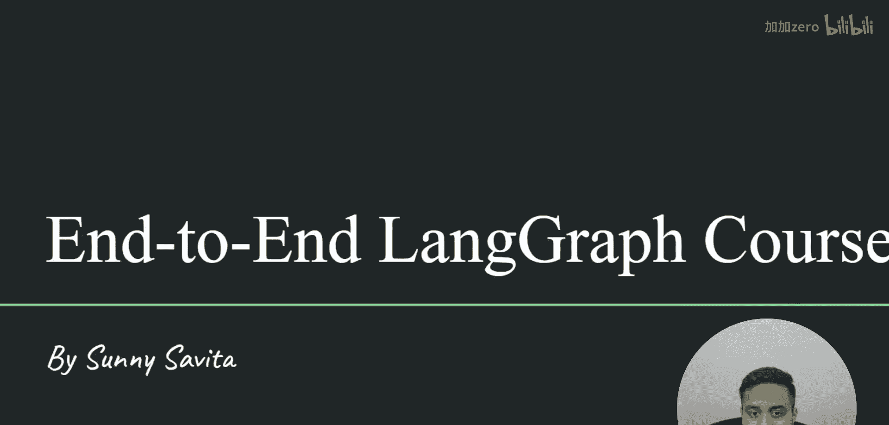

It's a it's a basic la classes and all then I explain you this graph concept if you will go and check with my video number82 sorry6 to12 right so there I explain you this basic graph concept of the la graph and all and even I implemented over there as well then here you can see this the advanced slide where we are going to discuss a different different agent pattern I already uploaded this video as well and apart from this one I already uploaded this rag as well so rag with the la graph and now we are into this multienttic system and using this multiagetic system will try to solve couple of project as well So this is going to be all sort of agenda for the upcoming session so I will upload around five mode video inside this playlist so that each and everything will be covered with respect to this la graph and the entire playlist now if you don't know about the entire material and the entire slide guys you can go and check out with my two channel there I upload it。

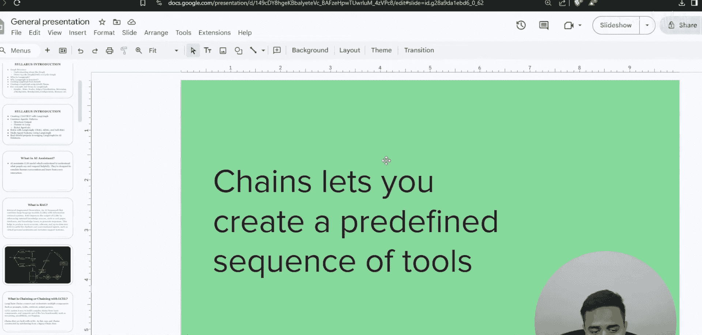

All this entire slide， the material and all everything now where you will get it。

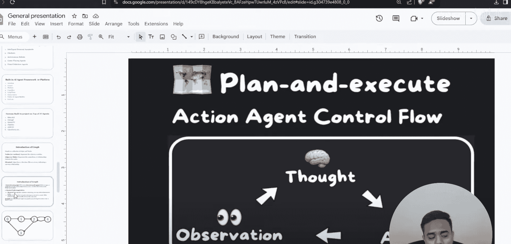

So if you will go and check with my group channel， I even created a dedicated playlist over here。

 the playlist name is Lagra agents you can watch this playlist and inside from the description itself you can download all the material now apart from this one I uploaded a couple of other videos with respect the L rag and here you can see the multimodal rag okay and inside this particular placelist you will find out all the important video which is required to under genative on So if you are new to this channel then please look into the video look into the playlist if you find the content is worth then definitely you can subscribe the channel and you can leave your thoughts inside the comment section if you want anything from my end now without further delay let's start with the concept So first of all guys what I will do see here inside this particular。

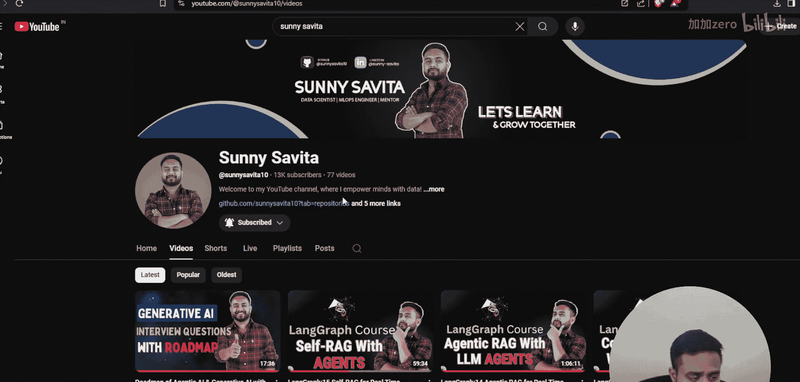

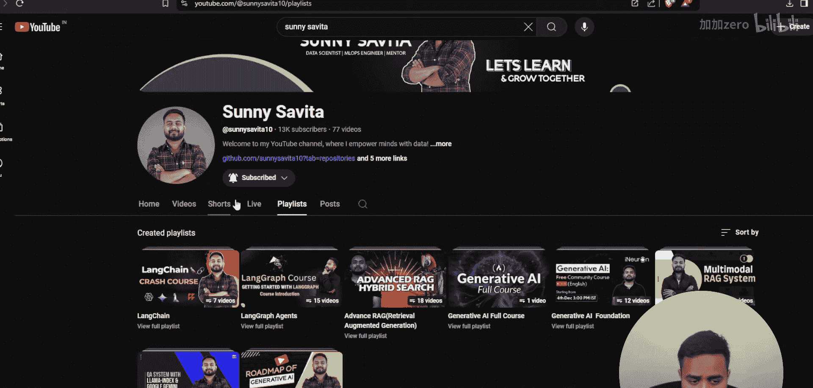

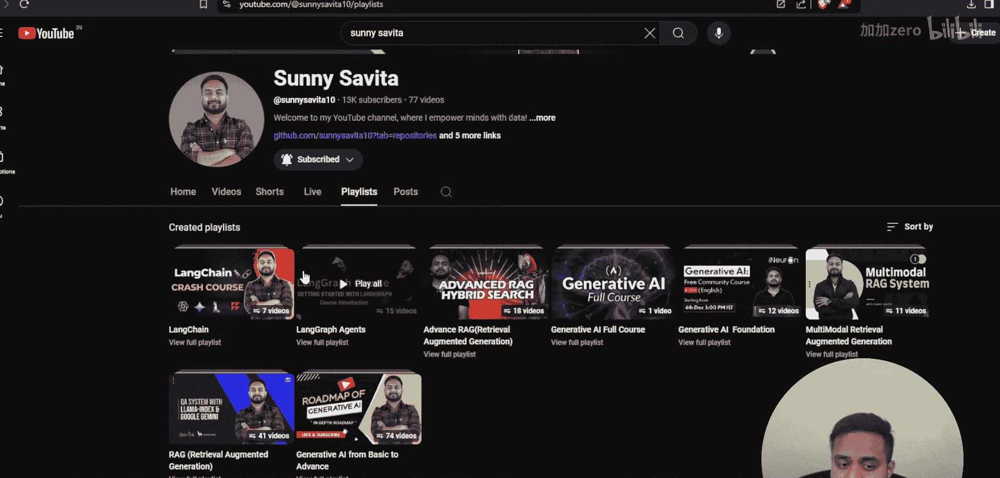

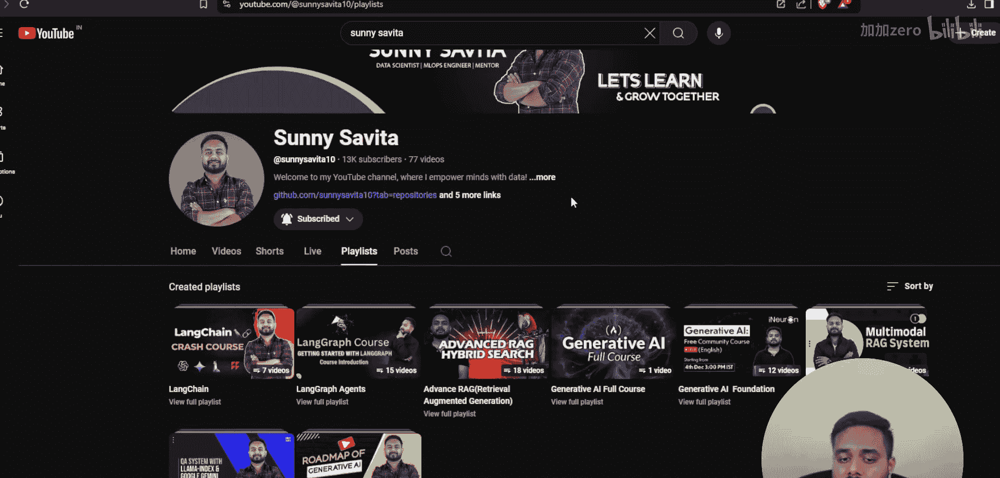

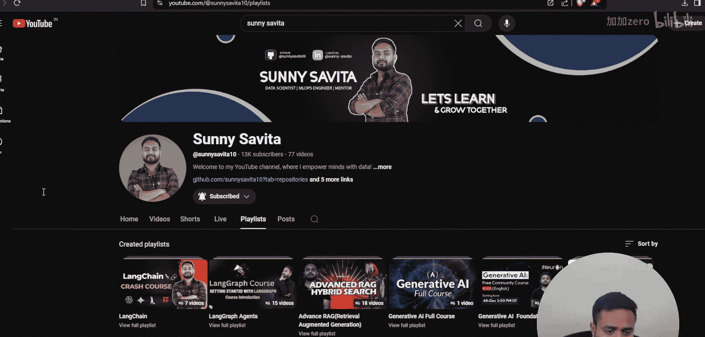

First of all， let me show you the code base and all so inside this particular folder I kept my all the files and all and。

This entire code base is available over the Github okay。

 I will show you in some time where you can find out all these files。

Right so today we are going to talk about the SQL agent。 I already have the code with me。

 some code is with me and some I'll be writing now before starting with the code and all let me explain the architecture that how the architecture is going to be and lets try to understand the problem statement as。

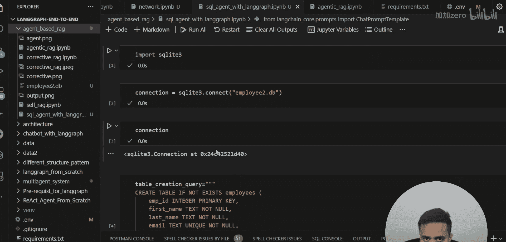

So guys this is going to be my pronoun statement， it is very easy， very simple。

 so we have a SQL database and we are interacting with our SQL database。

So what we are passing we are passing a text query to the SQL database， let me highlight this thing。

We are passing。Just a second Here it is this one So we are passing what we are passing a text query to the SQL database Now this query actually it will be converted into the SQL query the back itself okay LLM will take care of it then we hit the SQL database and then we get back the result now again after fetching the result at all whatever result right we will be fetching in terms of the rows and the columns now again we are going to convert into the text using the LLM itself and will get a response So we are passing a query we are getting a response and we are going to interact with a SQL database it's not going to be a simple rank it's not going to be a simple check okay it's going to be a complete agent flow now let me show you further thing So if you will check with this tools and technology what tools and technology were gonna use inside this project inside this poOC right it's not a fullfl project but you can set a poOC right for that you can use it anyhow I don't have any issue right。

Can convert into the into end project as well and you can send it to me and soon I will be coming up with the into project as well along with a multigenictic system and all Okay inside the same list I will be uploading each and everything now。

So we are going to use the SQL database SQL I database， were gonna use the la over here。

 Okay for the chat from tempating and all we are going to use the G API。

 we are gonna use the ama3 model from the G API itself see here I mentioned the model name and then we are going to use a la graph for creating the agents right So this is going to be a complete tools and technology for this particular project I hope so you are familiar with each of them if you don't know then I will familiar I will like explain you all the stuff inside the video itself and you will get a pretty good idea now come into the next part so this is going to be my architecture which I'm going to implement inside this particular video So let me highlight a couple of points over here what we are going to do So start means we are passing input to our workflow and end means we are getting a output now in between this is start and end you can see multiple blocks So this all the blocks are nothing it is just the functions so we have first tool then。

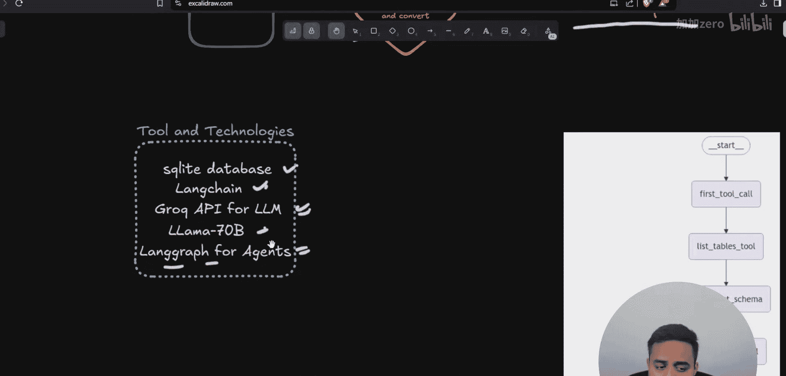

Of tables okay this first tool basically is helping us to get a list of the table then we are getting a schema okay of the database then here is a schema tool okay using this a schema tool we are getting a schema right then we are going to perform this query and if everything is perfect then we are going to end the process otherwise we are going to correct the query and then we are going to execute the query and again we are generating a query and all means we are generating answer if everything is fine then we are going to generate answer right so this is going to be a whole whole sort of a for this particular。

Application， this this particular agent application and really guys you will enjoy it a lot once I will show you the code base。

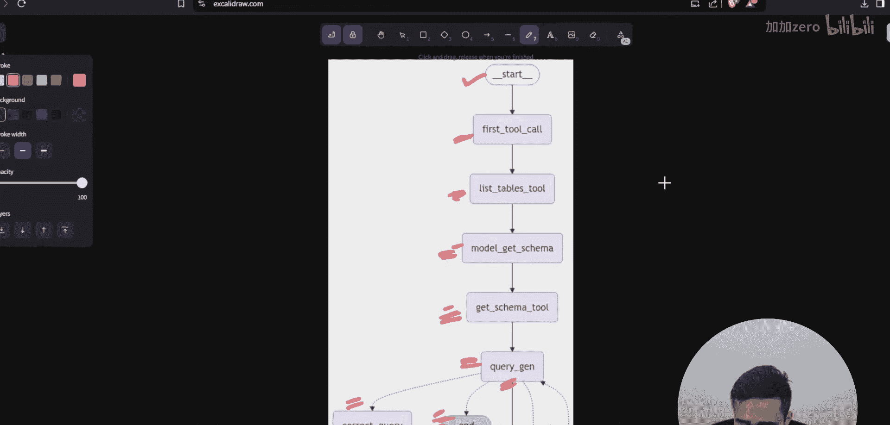

So I hope so guys the architecture was clear to all of you If not then it will be more clear in some time。

 So first of all let me run couple of commands over here， which is a very generic one。

 So here we are going to set up our database it's a SQL database this SQL database could be anything in your case it could be postscript it could be my SQL database oracle database and any SQL database you can select I'm just for the demonstration I'm using this SQLite3 in memory database so first let me execute this import statement here you can see so my all the files and folder is as a workspace right so you will find out some changes left inside I will be creating this employed database and inside this employ database I will keep couple of database what kind of data I going to keep it inside a database you will get to know in some time so first we are going to make a connection to the SQL database SQLite database this is what this is my database employed D。

Here is what here is my connection。 Okay then this is my table creation query I'm fast forwarding all this step because it is a very generic step with respect to SQL N I will more I will invest my more time on the la graph and the la is stuff the agent flow and on so this is what this is my table and we are going to create an employee table and inside this one we have employee ID first name last name email high date and the salary right so let me execute it then here you can see the second query so this is my customer query okay then here we have customer ID first name last name email phone so I'm going to create a multiple table see this is my third table inside the third table I'm keeping my order I or customer ID order date amount for this is my foreign key all right so here we have a four column inside this order table okay。

Now so coming to the next part so we have created a connection over here as you can see so we call this connect method and my connection is ready now we are going to create a cursor on top of it So using this cursor actually we can execute any sort of a query So first we are going to execute this table creation query so table is created second table is created here the third table is also created now what I have to do inside this particular table I have to fill some data so that later on I can perform some query on top of it So this is the insert query command here me I have my all the here you can see I have my have all my columns and all okay this is my value。

 this is the placeholder okay later on we are going to fill this particular placeholder how I will show you the command so I'm going to insert the data and see this is my data employee data here is my customer data and this is what is my order data in every data in every table I'm keeping four rows only according to the table you can see the values over here name last name。

Email I data board okay it is a date of birth or joining date you can check out in the column itself So sorry it's a higher date with respect to the employer Okay so this is the higher date and then this is the salary Okay。

 let me execute this employee data customer data and this order data and here we are going to insert in our database So cursor dot execute many and insert this is my insert query where is my insert query this is my insert。

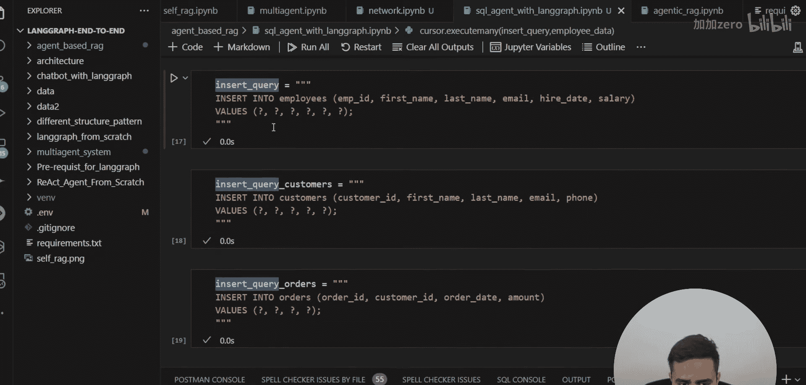