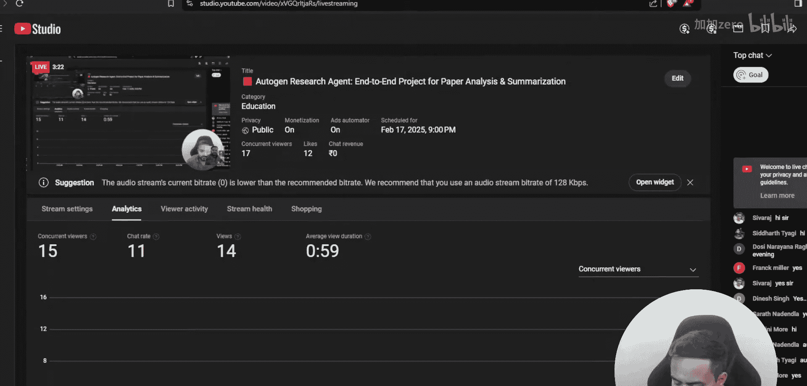
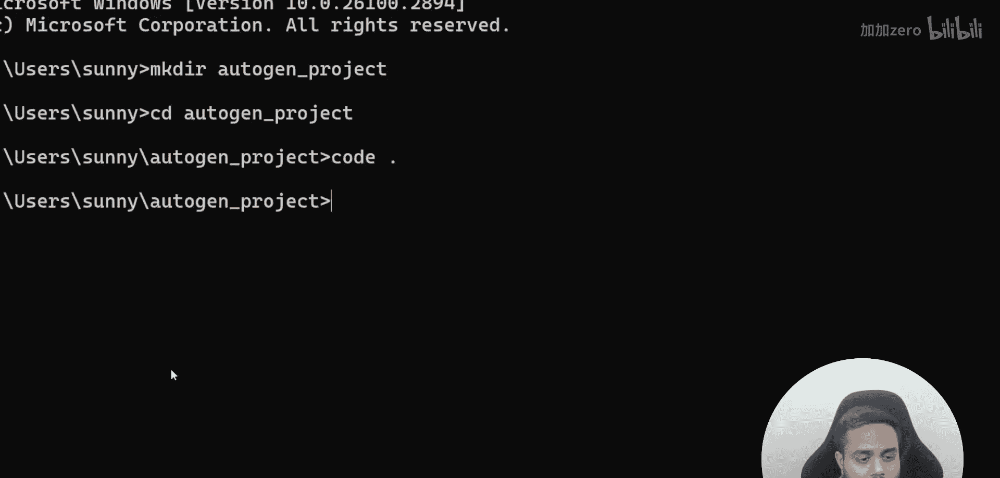
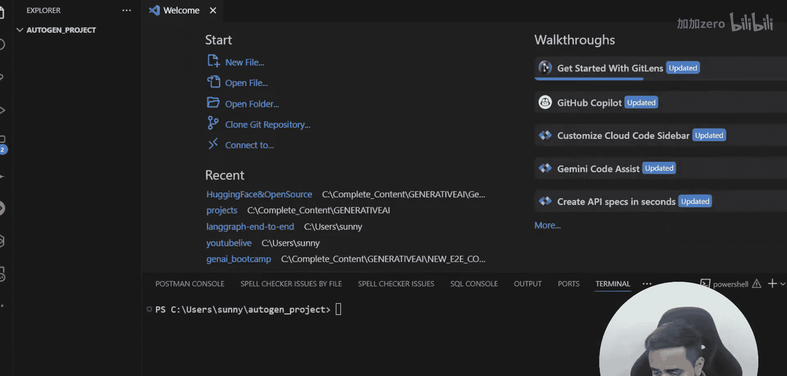

# Sunny Savita【中英⚡生成式AI：从初学者到专家｜Generative AI In-Depth Roadmap from Beginner to E】 p76 P76 🟥 Autogen Research Agent： End-to-End Project for Paper Analysis & Summariza [BV1Uht8zDENA_p76]

Hey hi everyone。 I think we are live， so can you hear me if you can hear me then please do let me know inside the chat。

If I'm audible to everyone。Can you please let me know inside the chat。Yeah， hi， everyone。

 Good evening to all of you。Let me start my camera， also。啊，隔来听歌。I am visible to everyone。Okay， great。

 perfect。So I am confirming again， if I am audible to all of you。

 please do let me know in the chat and my voice。And my camera， both are perfect。

You can confirm inside the chat， guys。Great， so many people are saying yes， years risk career， so。对。

So let's begin。 Let's start。 I think you all have seen the title of this live show you that。不是。Okay。

 perfect。 So I think I was stuck。Maybe because of the Internet issue， but again， I'm packed。Great。

 so let me show you the agenda。 first of all， that what thing we are going to discuss in this。

Particular live session and we'll discuss about the project。Okay。

 we'll discuss about the project using the autogen and we are not going to deploy that particular project。

 but yeah， definitely I'll show you how you we can build that and in the upcoming session in the next session will try to see how we can deploy this type of project。

 the agent based project Now this particular session is not going to be a same of the land graph like the La graph itself Okay that is a different series which I initiated on my YouTube channel this is a separate session okay and here will discuss regarding the autogen and likewise I'll be taking many more session in the upcoming days usually I don't take a much live session but now Im thinking to take the live session in the night itself with respect to the different different project and the different different important thing and whatever thing I'm uploading on my YouTube channel。

 those thing would be as it is right now let me do one thing， first of all guys okay。

Everyone thinks are you are audible， you are visible。Thank you Hason。 Thank you very much。

 And so it the right time to jump into the Gene way having a strong knowledge of MD and just this is the right time if you have basic knowledge of the Ml Ndl you can make a project of the journeyi Okay。

 you can start with the Genei journey okay， this is quo I already answer is this video part of the La graph series No。

 this video is not part of the La graph series， This is a different video okay。

So first of all what we have to do see let me set up the entire thing for this particular project and then I'll show you the problem statement also so for setting up guys first of all open your CMD I hope so you can see my screen and this is visible to all of you。

First， please do let me know if my screen is visible。 Can you see my screen。Yes。

 so here what I'm doing I'm going to create one directory， so direct directory name is going to be。

Autto then。多ject。OK。So I created one directly， the right name is auto Jane project。

And now let me go inside this particular。Dirory， okay。

So here I am going to write Cri autogene and see I am into this particular directory。Guys。

 tell me my screen is visible。Can you see my skin clearly or rub。Any issue， it is not visible。

Just a second。 Let me check it out why it is not visible。🎼嗯。still， it is not coming。嗯。

Just a second guys。 Let me check it out why it is not coming。Yeah， I got it。

 Black screen is displayed。嗯嗯嗯嗯嗯嗯。屋企。White is blank。

Great guys。 Now， is it visible。Please do confirm in the chat if you can see my screen。

So please create an playlist for the MLlop well Yes， I'll create that playlist。

 Okay in future definitely I'll be creating that now I think my screen is visible So what I did guys I just created one folder Okay so folder name is what autogen project Now what is this autogen and all and why we use it each and everything we gonna discuss right it's a code creating a agent okay based agent Lm based agent Okay so I created one folder now I'm going to change my directory here and then inside this directory I'm going to open my B code。

Okay， so see guys what I did， I opened my Vs code Okay。

 now after opening the Vs code here I am opening my terminal and I hope so guys you all have this gi badge Okay and Iconda and all inside your system。

