# Sunny Savita【中英⚡生成式AI：从初学者到专家｜Generative AI In-Depth Roadmap from Beginner to E】 p77 P77 LangGraph：17 Introduction to Multi-Agent System #llm #genai #aiagents #ai #g [BV1Uht8zDENA_p77]

Hey hi， everyone。 Welcome back to my Ro channel。 My name is Sunni Savita。

 and I'm back with another exciting and important video。 guys。

 I started with this I doing Lgra playlist， and I recorded around 16 video inside this course inside this playlist。

 If you don't know about it。 you can go and check with my Ro channel。 And one more thing。

 I would like to say， so guys， from past one or two months。

 I' am not very much consistent on my Ro channel。 before that。

 I used to upload a video on a regular basis。 but within this two month。

 I couldn't upload so many video because of some personal reason and my like a work pressure and all。

 But don't worry， guys， I will try to maintain a consistency from now onwards。

 I'll try to upload2 to three video per week so that you will be aligned with the learning。

 I've seen many people were messaging to me on LinkedIn on basically over the mail itself。 please。😊。

to upload a video on a regular basis we are liking a content are we are learning a lot from that Okay so yeah definitely guys Ill try to maintain that consistency and I will try to upload a video on a regular basis so guys first of all let me give you a quick recap of the previous thing that whatever we have done so far and what I'm going to discuss in this particular video so I started with this end graph course and I cover up like this entire thing whatever I mentioned over the slide is the first slide。

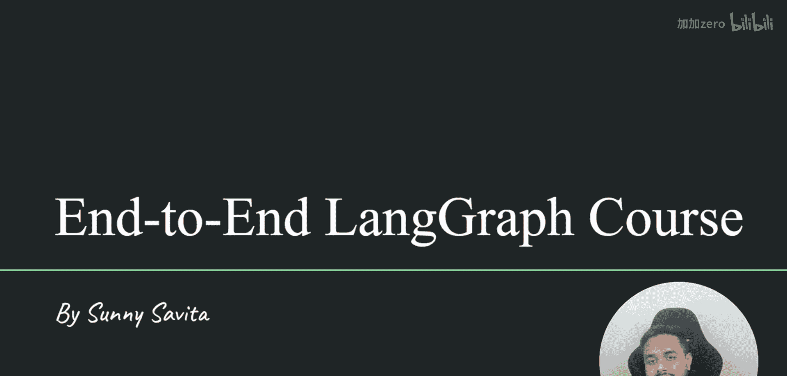

So I discuss about the tool agents length agent classes simply I assistant rag andal then I came to this la graph and instead the la graph I discuss all the fundamental of the la graph you can read all this points then I came to the I came to this agenttic patterns structure output human in loopbe how you can create a react agentent and all and then I came to this agenttic rag like corrective rag the core agent rag cell ragagonal then guys the last topic is the multiagetic system which was the last one of this entire syllabus I'll upload around four to five video with respect to this multiageenttic system and then I'll start with a fine tu okay and during that will try to see a couple of project also how basically we can create a multiagenttic system and deployment part I will show you later on once will try to complete a couple of more thing okay then I will come to the deploy。

Part because I need to explain you about the APIs vector databases and all okay and then the fundamental of the clouds then we can discuss about the deployment。

 So guys this is the slide of this is the entires I mention inside the slide and the slide actually you will find out the description of my first video of the language graph so there I kept the complete theoretical points and also that you can revise it and you could be more confident in the interview now if you will go through with my YouTube channel So inside the playlist section。

 you will find out a different different playlist like L La graph advance couple of more playlist from the different YouTube channel where I took my end to end courses and all so definitely you can visit it and you can take a leverage of this content I would personally suggest you this playlist and this agent playlist so that。

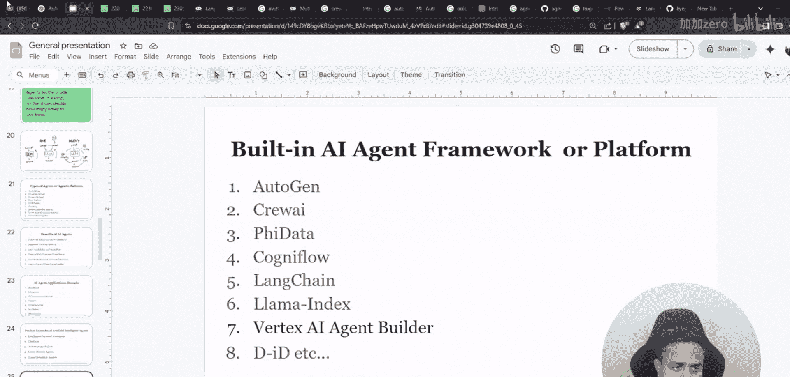

Like you can understand and you can learn some advanced concept with respect to this two important topic Okay the last video I uploaded with respect to this La graph agent sorry this SQLl database agent using the La graph why I' am teaching you this La graph guys because starting itself I explain you that the La graph actually give you the more authority okay on your agent workflow and all so that's why I started my agent journey from this La graph itself but you can learn other framework as well through EI auto fee data I'll upload video with respect to those framework as well but my personal suggestion would be if we can start your agent journey with the La graph that would be great so this was my last video there I discuss SQL database agent you can go and check I think it is around one month I haven't uploaded any sort of a video now let's try to discuss something new so what is going to be an agent of this particular video so guys in this video。

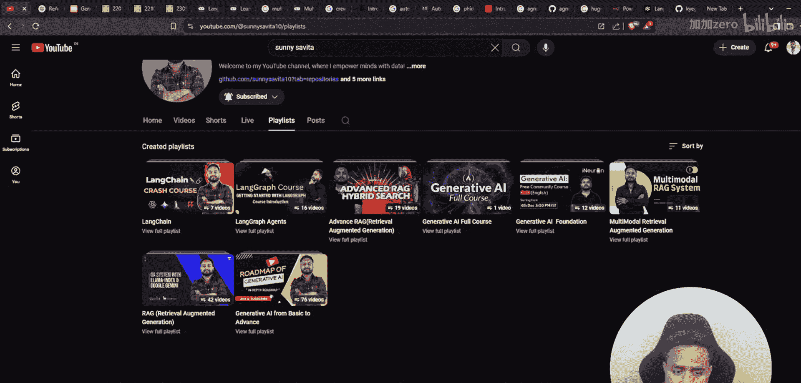

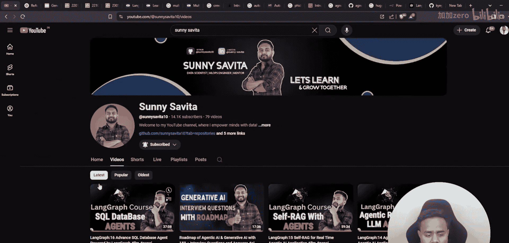

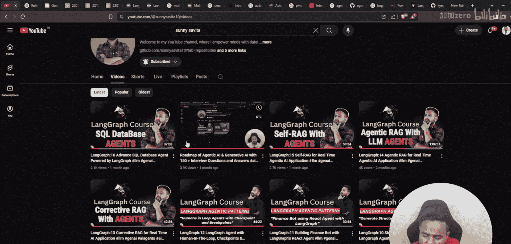

T to discuss about the multi agenttic system Okay so first I'll give you the complete introduction。

 This session actually is going to be a theoretical session。

 I will not discuss any practical thing in this particular session in from next video onwards I will show you the practical of this multiagetic system but in this video Ill stick with the theory itself and I will try to discuss so many points with respect to this multi agenttic system。

 Okay well let me tell you what all points actually I am going to discuss So guys this entire pdf I created for you Okay so this is the content basically I generated。

And what is a heading of it multiagent complete guide okay why I created this PDF so that you can get a structural learning with respect to the multiagents and all because multiagents is very important nowadays everyone wants to create agents for automating their workflow and all so this guide this PDF actually it will guide you right in a better way that what is a agent what is a multiagents okay what framework we have which one you should pick right and where you will find out all the research paper and all with respect to the multiageent and all right so I'll upload this particular PDF inside the description so that so from the description itself you can download it and you can learn the theoretical stuff just to just to be more confident inside the interview because an interview they might ask you some theoretical question as well so that you will be aligned with the theory as well along with a practical practical voice don't worry I'll show you the practical from next class onwards。

And don't worry if you are watching my videos， you will be very much pro in the practical session as well Okay now so here guys I'm not going to take see I'm going to take a reference of this particular P。

 but I'll be explaining you each and everything over the blackboard itself with respect to multiagent and all multiagent and all okay and in total youll find out six pages inside this p okay and I try to cover like almost all the points over here right so if you will go through with it you will get a very good understanding of the multiag got it now coming to my blackboard okay now over here all the blackboard guys I kept couple of architecture and all and here basically we are going to understand about the multiagent along with the example and all I'll be starting from very basic so that you can understand you can you can connect each and every dots okay from EI assistant to rack to the agents to the multiag because that is very much important if you are able to connect。

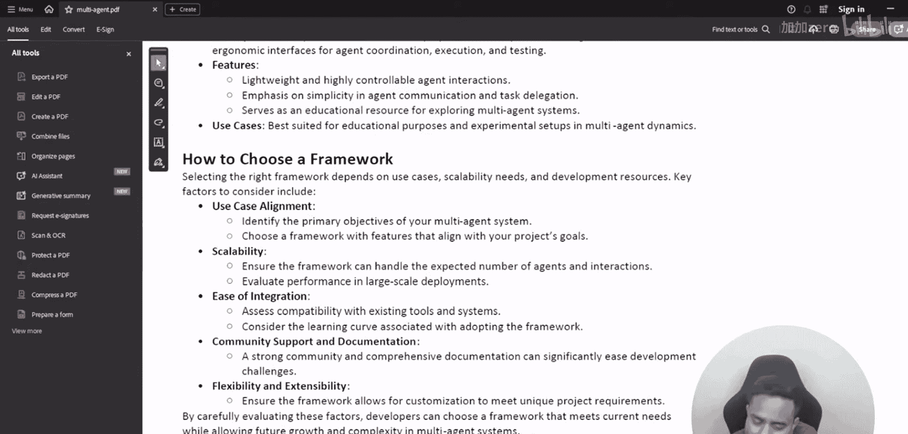

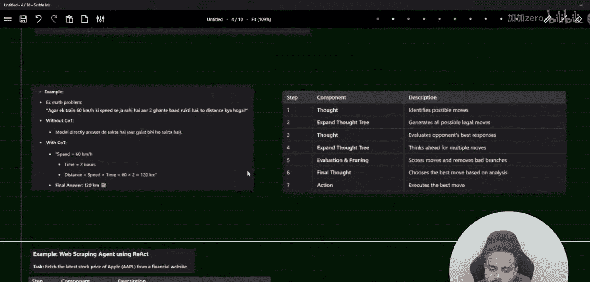

Each and dot right in then only your learning will be structure and you will not lag anywhere Now one more thing I would like to say so guys I've seen many people are having a doubt during their learning so if you you want any conancy here if you want any sort of assistance from my end so you can go through with this particular option one to one call here I'm giving a various services okay during my available time you can see Geneative AI preparations Q chat okay career guidance resume review mock interview so if your problem lies inside any of this topic right so definitely you can book so what is this LLM。

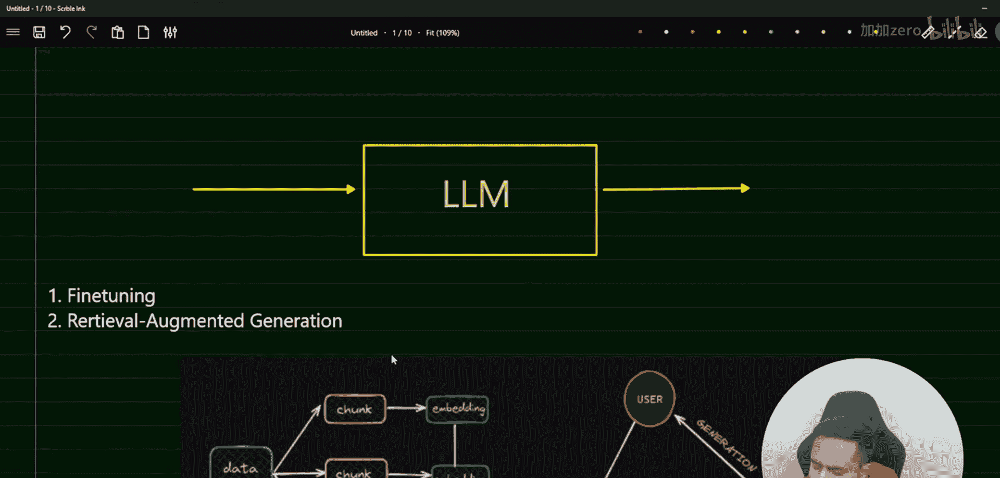

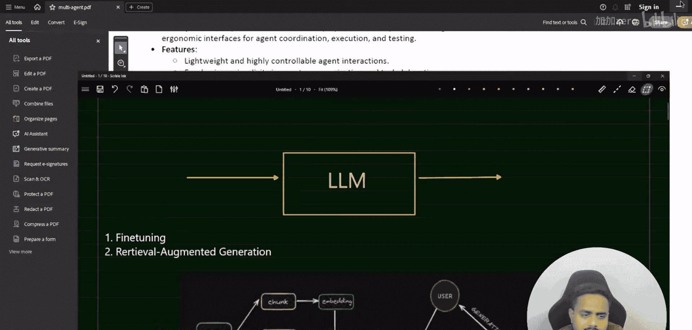

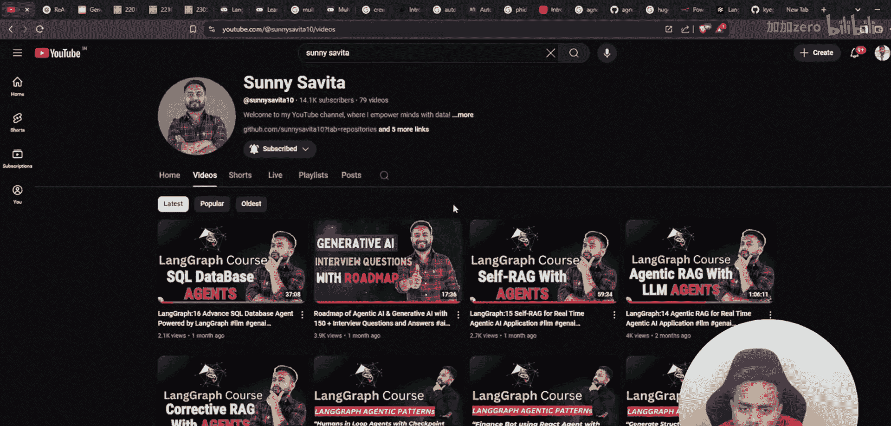

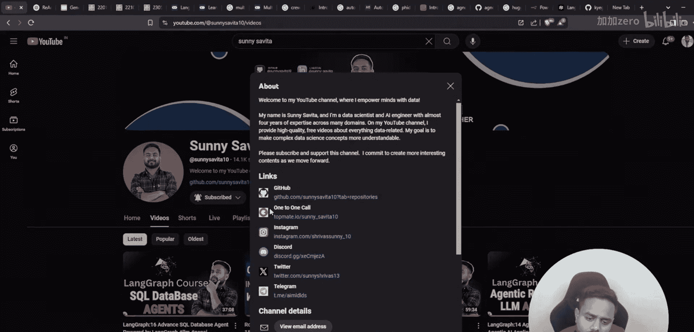

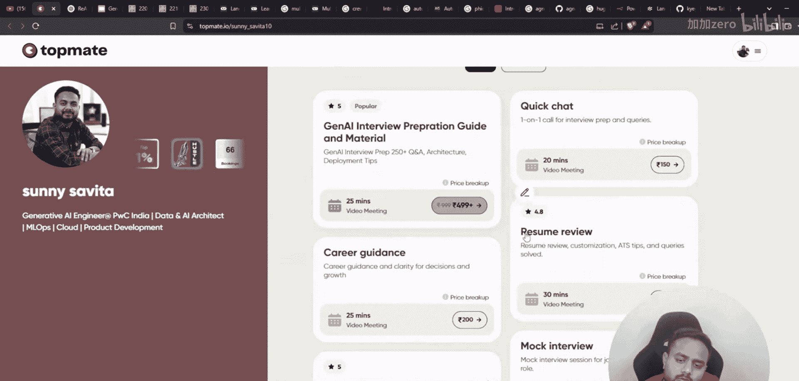

So everyone knows about the LLM LLM or nothing LLM are the model which is which was trained on the huge amount of data okay to this LLM what we provide guys tell me so to this LLM actually we provide input as we know right this inputs。

Actually， it is called pros。ok。We provide prompts to this particular LLM and what we generate we generate our So this LLM actually it could be a multimod LLM means it is not just taking a text it might take the images audios right and the other type of modity the other type of data itself so guys this LLM actually it always are train on a huge amount of data as we know if I'm saying huge data So there is no certain definition of the H data it could be in G ts it could be in a petabytes also it depends on the system。

 the infrastructure， the configuration which we are using generally knows about the G model this G model actually it's a quite popular model now other model also coming nowadays into the market and they are booming right they are suppressing this G but again I would say G model is like quite good good and even the cloud also I use the cloud。

ally cloud is sonnet 3。53。7 right well especially Sonet model and I would say GP4 series is like a very amazing right so any of them which was trained on a huge amount of data GP4 model actually they have two conions right so I'll discuss the APIs open air APIs cloud API okay。

They are actually will tied to discuss about the GP and the cloud and model and all。

 so you will get some in depthth understanding of each and every model and you will get to know which model we should use for what kind of tasks right even the open source model also like this。

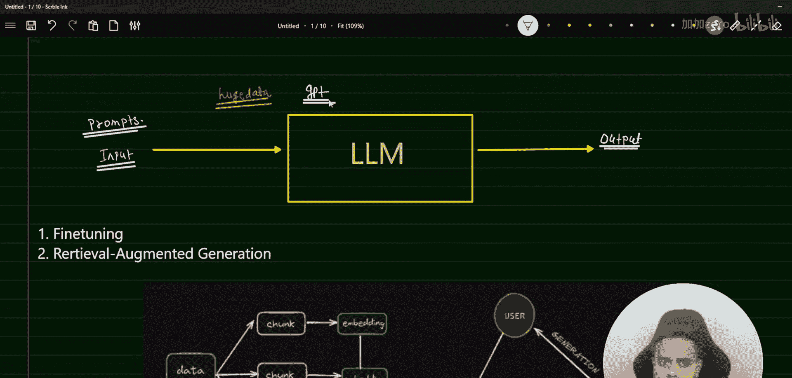