# Sunny Savita【中英⚡生成式AI：从初学者到专家｜Generative AI In-Depth Roadmap from Beginner to E】 p78 P78 LangGraph：18 Network or Collaborative Multi-Agent System Implementation #aia [BV1Uht8zDENA_p78]

Hey hi everyone welcomee back to my YouTube channel My name is Sari Savita and I'm back with another exciting and important video guys from this video onwards we are going to start with an implementation of the multi agenttic system In my previous video I shown you the complete theoretical is regarding the multiagetic system Whatever is required to understand the multiagetic flow or multiagetic application I explain you each and everything if you haven't watched that particular video please go and check。

So guys as you aware about it as you are aware about this particular course and a La graph course I already recorded 17 video inside this playlist and here is the complete syllabus of it the syllabus I designed from very basic you can see I started from simply assistant rag to legend okay the different different classes of the la then here I came to the la graph okay I explained the La graph from very very basic then here you can see the advanced part of the La graph so we completed almost all the thing so we completed till this rag with La graph C G H A okay selfragonal now we are about to complete this playlist so this is the last topic of this playlist that is multi agent system okay so this is the first video of the implementation where we are going to where we are going to implement the。

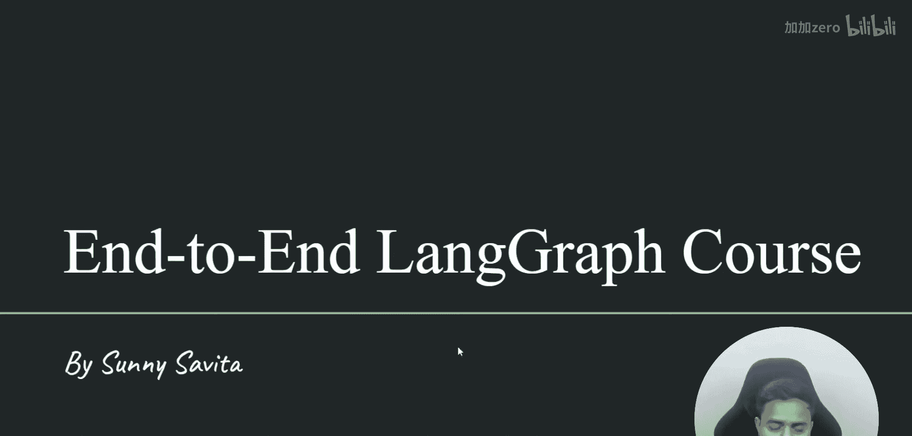

AColl agent okay or network agent how to do that I'll show you So guys if you haven't gone through with my do channel you can go and check right so once you will search Sunny Savita。

 you will get my do channel and this was a last video where I explain you each and everything regarding the multiagent and all once you will go inside of playlist guys here instead of playlist you will find out each and everything whatever is required to become AI engineer and once you will go through with this each and every playlist right so personally guys I can recommend you this rag multimodal Landgra agent okay guys this three to four playlist is more than sufficient to understand the application of the AI based application and the agent based application and guys believe me I given you lots of content over here and where you will find out all the code and all so for that you can check out with my Github repository so this is the playlist with respect to this land graph playlist this particular repository and from the previous video。

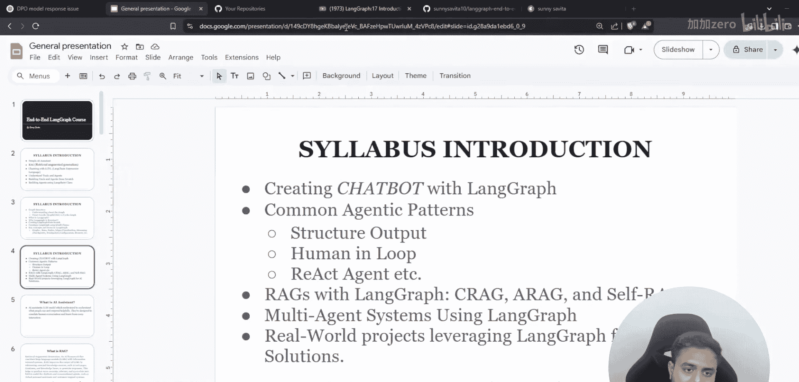

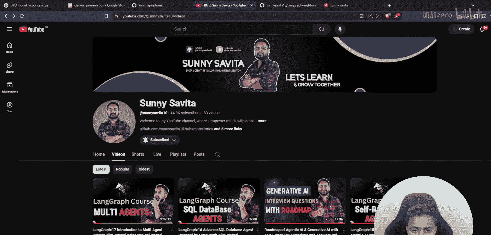

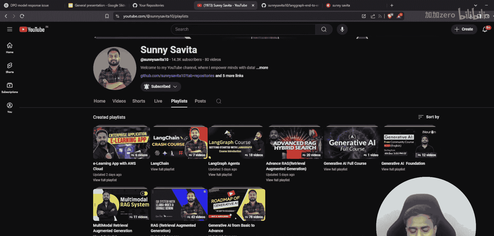

I even I shared one PDF also so see this is a PDF regarding the multiage and all you can check out with this particular PDF I kept the complete vertical list with respect to the multi agent system okay now what you can do guys you can follow to me on my Github。

So you will get all the updated content and all all the updated repository right I am updating my repository on a very frequent basis okay regarding the content and all so please please follow to me okay and even whatever content I taught you over my E2 each and everything you will get on my repository itself okay。

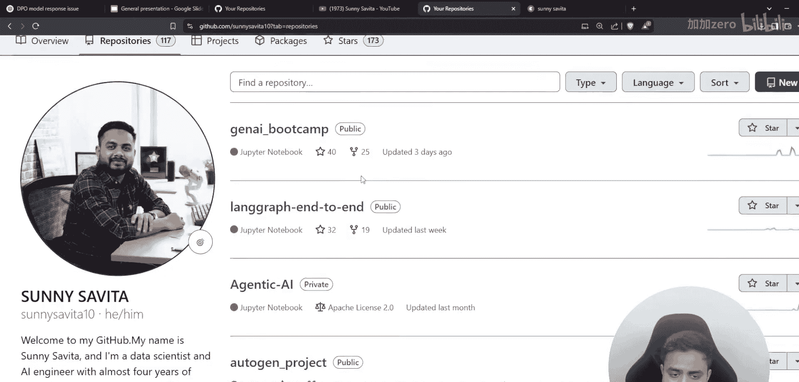

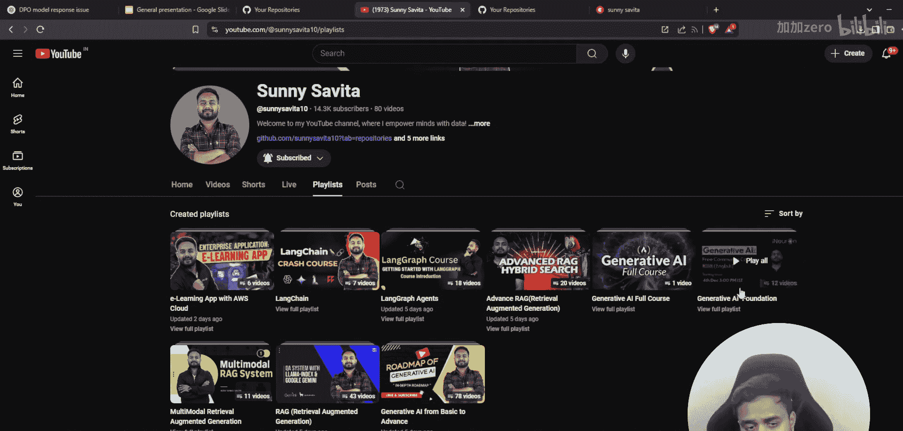

Now coming to the next part so guys if you want to connect with me1 to one here is an option you can go and check with this particular option1 to1 call so here Im giving various services like geneative interview petition quick chat resumeum discussion so if any of the problem right if any of your problem lies inside this particular section in all that definitely you can book a call and I would be available for you。

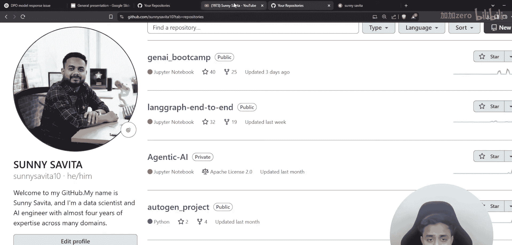

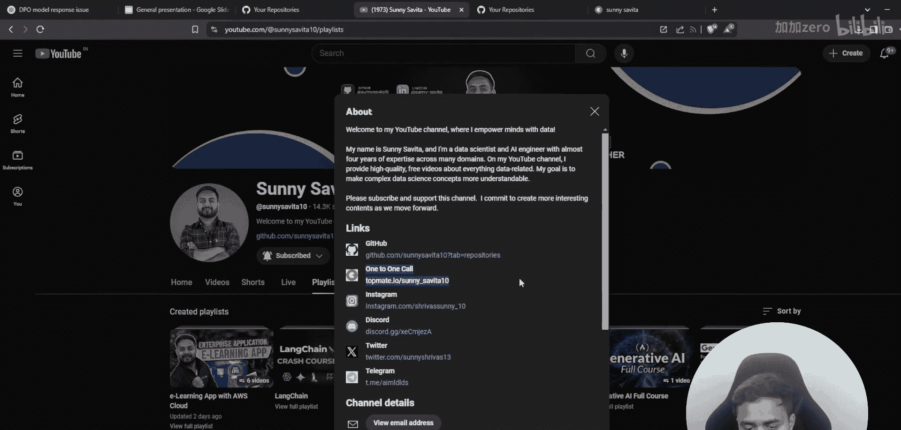

So now without wasting a time let's begin with the session guys today we are going to implement a network agent okay our collaborative agent how to do that let me show you so this is my folder where I was writing my each and every line of code so let me create one more file okay inside this particular folder multiage system I think this was the previous where I was doing my practice also so I'll be deleting this one but here for you guys I am creating a new file。

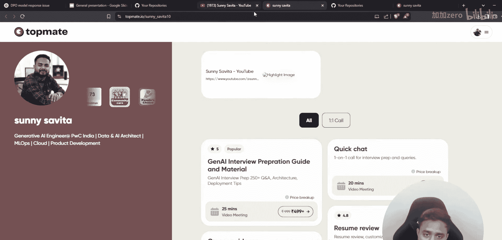

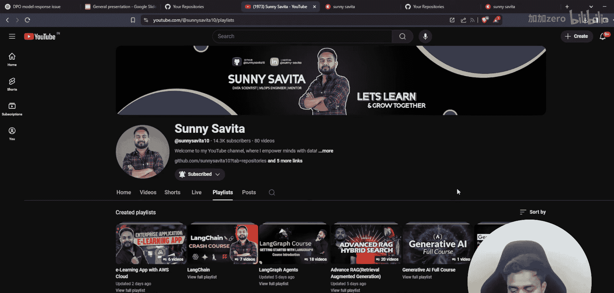

So the file name is what network。M啲。Agent。A G E and E。System。Thought I P， Y N B， Okay。

 now let me select a kernel So this is my kernel and I can check it out whether it is working fine or not。

So let me import something。 I'm going to import， let's say OS。 and yes， it is working fine。

 And let me print something over here。So， yes， this is okay， fine。So my notebook is ready。

 so now let's start with the。Implementation in my theoretical session。

 I told you guys we have a different different type of， we have different different type of。

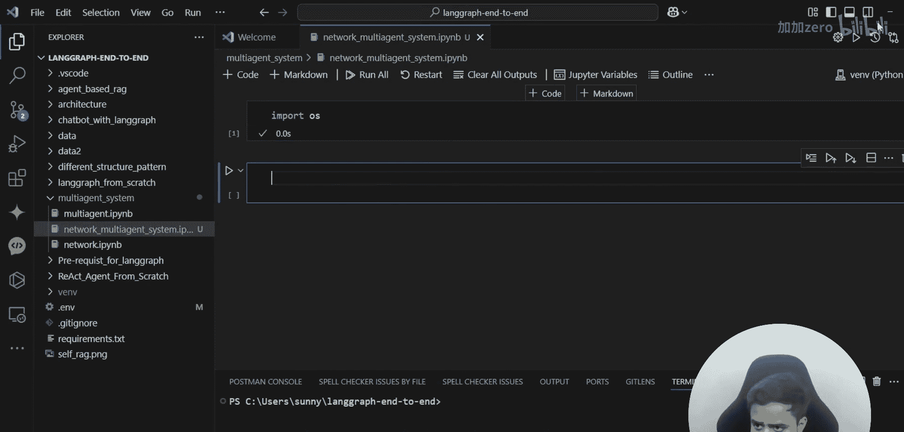

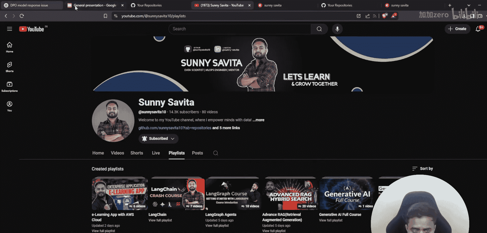

Basically multi agent， okay， so where you can check it out。Just a second。

That me open this repository。So just go and check over this multiagetic system。

Okay with this particular PDFf this one， so there I told you we have different different type of multigenictic system like network a multient system。

 hierarchical multient system or supervisor multi multigenictic system even you can create your custom multigenictic system also okay so even I given you the application also what could be the application of those a particular system and all。

Right even I given you even I explain the different different framework okay what is the difference between the different different framework like L graph through AI autogen all so you can get all the theoretical list from here see network agent supervisor region and this hierarchical agent and here then basically we have a custom multigenictic system so all four multigenictic system we are going to implement okay one by one step by step will try to implement it but in today's video I'll show you only network agent okay so here is my file now let's start with a coding。

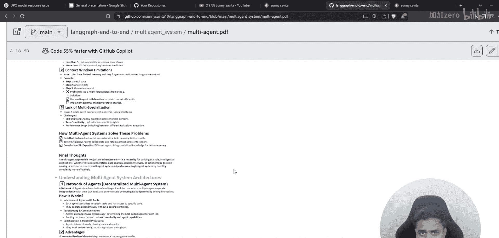

You guys here I kept all the import statement， whatever import whatever packages is required for implementing this particular problem okay I'll talk about the problem statement as well so what we are going to implement okay here I kept it on my blackboard itself so yeah definitely I'll be talking about it so first guys first a literal this is just for checking the types and all type of the data type and all okay tools it is from the la just to convert any function into the tool then here we have chat G any to read out any sort of a model from the G API then message state state graph this is all from the language graph okay command is a new thing which I will explain you in today's video then what we have we have this load dotnv for loading the environment variable image display to visual to visualize the L graph workflow chat open AI to read the model from the open API base message human。

Message。Just to define the message okay inside the pro pro template and all then create create react agent so just to make a react agent okay it is an inbuilt class inside the language graph itself even we can create from a scratch but they have given you the inbu class right so that is also fine we can use this particular class Inot it just to like make a description and all with respect to any sort of a variable or anything then Python RP this is just to execute the Python code right if we are giving a python code Python code as a string to this particular tool it will be generating the actual code okay the result of that particular code I'll show you how does it work。

Now let me import it guys and here after importing so yeah everything is working fine I believe now let me import the environment variable Okay so here here I I am writing this load underscore dot env so see guys I am able to import all the environment variable I kept it inside this dot env file I cannot show you guys those particular keys because those are the confidential one but whatever keys would be required Ill be highlighting those key okay along with my implementation or not so I in I basically loaded all the environment key now。

Here what Im doing so after that guys let me let me load the model so I'm going to load my openaiI models here I'm going to keep both I have see I have key for both openaiI as well as G Goc is free openai is not free okay so here I am configuring both so if you have open AI key you can you can use the openaiI model if you don't have it you can use the Goc model okay so first of all what I will do guys I'll be taking this chat openaiI class class where it is here it is and which model I am going to which model I' am going to read I'm going to read the GP for model okay so let me write the model name over here。

This would be GPp4 model Now here I can write this is my open AI model。O。

Then what I can do is I can configure the G model as well。I can configure model from the G itself。

 So here is my chat G clock。 Now inside this chat G actually I'll be passing the model from the G API。

 So for the G API there are different different model， which you will find out。

 So this model deep seek R1 distill Lama 70 B Okay， they have disized the。

I like all the knowledge and all from deepse to Lama this model is quite good you will find out very good responses from this particular model and yes definitely you can utilize it so here I can write G and score model okay so this is going to be my second model now here is my first model open eye model and the second is the G so any one of them I can use I have key for the open eye that's why I have configured this as well so if this is not giving a good good result to me I can utilize this paid model okay from the open any now。

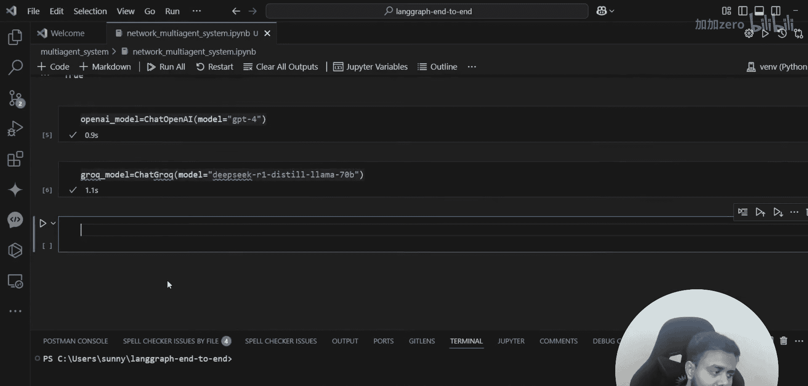