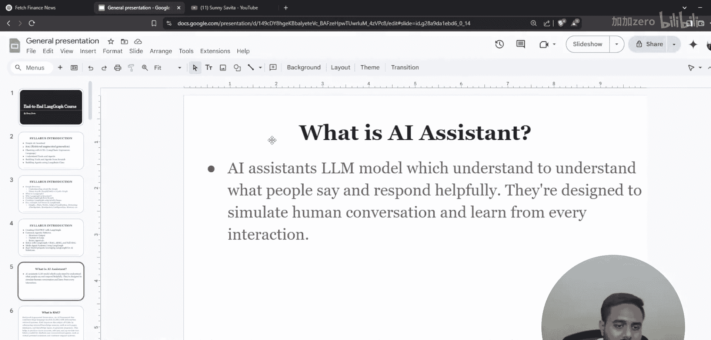
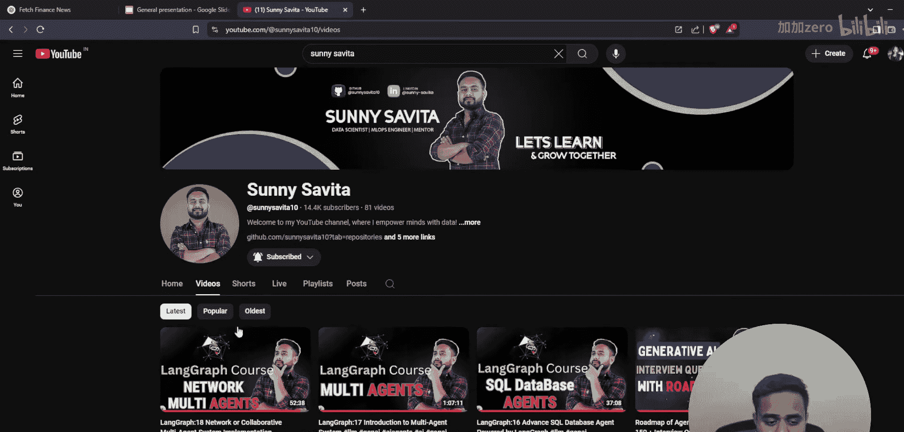
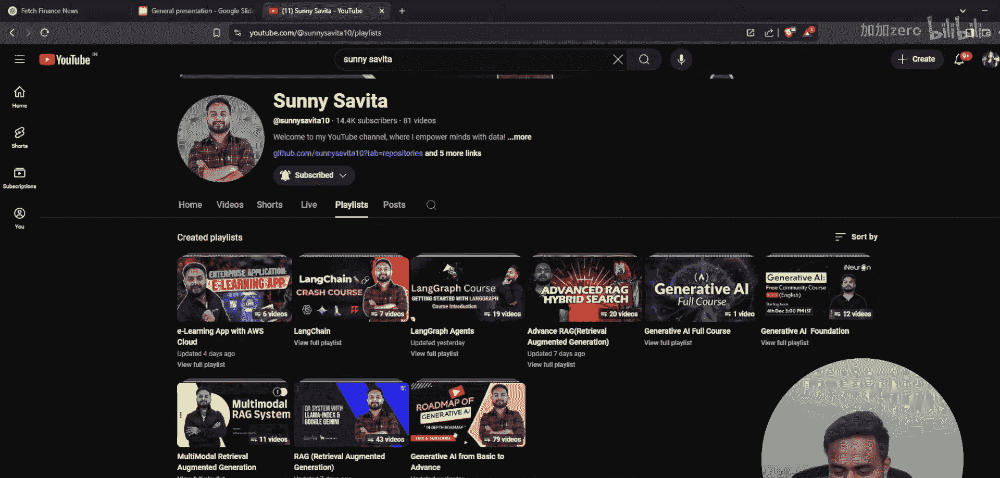
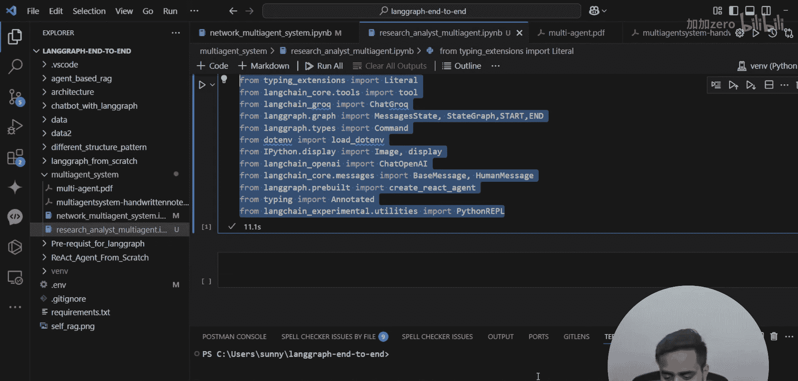
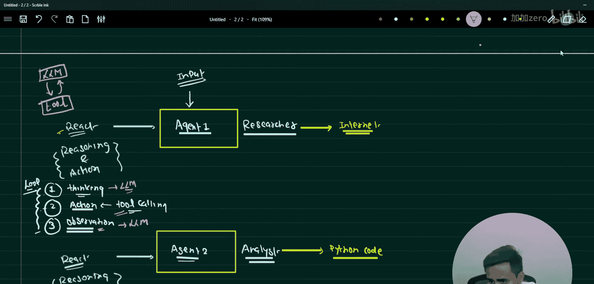

# Sunny Savita【中英⚡生成式AI：从初学者到专家｜Generative AI In-Depth Roadmap from Beginner to E】 p79 P79 LangGraph：19 Research and Analysis with Collaborative Multi-Agent System #ai [BV1Uht8zDENA_p79]

He hi everyone。 welcomele back to my YouTube channel。

 My name is Sunny Savita and I'm back with another exciting and important video So guys in my previous video I started with the implementation of the multiagetic system where I have explained you how you can implement the collaborative multiag or network multiag So in my previous video I explain you the complete ground of the multiagetic system I explain you how you can start from very very basic I took very simple example and I shown you how to transfer the cursor from one agent to the next agent So this video actually it's an extension of the previous video itself and in this particular video were gonna see one more problem statement that is called research analysis multiagent system So one agent will do the research for you and second agent will perform the analysis okay so how we can do it how it is possible definitely I'll show you in this particular video and I will show you the complete code of。

So that whenever any problem statement is coming to you right so you can take a reference of this particular solution and you can implement using a multi agenttic flow so guys you know I started with the end and Land graph course and this is a complete syllabus of it if you don't know about this particular course so you can check it out with my channel here is my YouTube channel guys and see this was a previous video there I explain the multiagetic system。

Before that I explain you the complete theory of the multiagetic system that what is a multient system what is the type of it and the different different other thing with respect to the multi agentric system guys so if you want to learn AI the AI then this channel can help you inside this channel inside the playlist section I have upload in a different different playlist regarding the rag language graph blank AWs okay and there are like end to codes as well which was published on the different different other platform so everything you will get at a single channel itself to start your journey into the AI so if you haven't gone through with this particular material if you haven't subscribed this channel please do it definitely you will get a very refined and very useful content so now without wasting a time let's get started with a problem statement so first I will explain the problem statement and then will implement it step by step。

Gys this is the previous code okay which I given to you if you will go and check the description of the previous video you will get this attached solution over there okay so there I explain you how this multi agenttic system works I took very simple example over there I just took one additional expert and the multiplication expert and I shown you how how the basically cursor flow right how the authority flow between two agents this additional agent and the multiplication agent okay then I extended this particular example and I shown you one more example where I where I took one agent as a。

Triivl advisor and the other agent is a hotel advisor and I show you how this complete architecture is working So this architecture。

 which you are seeing this is called the collaborative agent or network agent okay where we can have multiple agent and number of agent and those agent basically simultaneously talking to each other okay so you are giving input to one agent then it is passing input input as output sorry it is passing output as an input to another agent okay likewise all the agent are working in one network you can connect n number of agent over here now guys we are going to implement one more statement where one agent would be a researcher agent which is going to be research from the internet itself and the second agent is going to be a analyst okay so based on the research it will perform some sort of analysis and it will show you the result got it So before starting with a coding okay let me do one thing let me create one more new file inside this particular folder inside a multi agent system and this end time。

Material is available over my Github。 So if you don't know about this entire material。

 you can visit my Github， you will get the entire code and all everything。

 So let me create one file inside this folder itself。 My file name is going to be。A research。

ananalyst。Mty。agt。Okay， dot IP Y and B。Now here what I will do first。

 I will import all the modules from my previous file itself。

So this is all the module and let me import it guys let me check whether everything is working fine or not。

 so here I。Tosen my environment， the virtual your environment and see my。

Imported statement is getting imported now after that what I will do after importing this imported statement Ill first I will be taking a different different tools and then I will build my workflow but before coming to this code right let me explain you the complete architecture over the blackboard itself that you will get some clear cut understanding of this arche okay so what I'm doing guys here I am going to explain you this particular architecture over the blackboard I hope it is visible to you。

So pass。See， here is my one agent， the first agent， okay。This one。

This is called researcher agent okay and then well be having second agent as well so let me do the second agent over here so here is my first agent and here is my second agent so this agent one。

Okay， so let me write over here。Eent。1。And this is going to my agent。不。

Now this agent one actually is called a researcher agent。Re。The regime okay。

 iss performing a research based on the given input based on the given topic and this。

Second agent actually its called analysis okay， so it is going to perform the analysis based on the given input case to the first agent we are going to pass the input so here。

I would be having input okay input is nothing just a quot instruction whatever you can think then it will process this particular input So inside the C if I'm saying researcher agent so from where it' is going to pick the data how it's going to perform the research it is going to search over the internet okay so based on the given topic its going to face the information from the internet itself so from the internet。

It's going to make a research Okay now if Im saying analyst right。

 so how it' is going to perform the analysis so it is using Python code。Good包 phone。

Analysts understood。Now guys， if we're talking about the agent 1 right。

 so this agent1 itself is a react agent。React agent。 Now。

 you know what is a meaning of react Re is called。Reasoning。An action。Okay。

 now instead this raising an action there are several list which is involved and this also right this agent2 is also a react agent。

React agent Re means what。Reasoning。And action。So what what all step is involved inside the react agent inside the react agent a couple of his step is involved。

 the first step is called thinking。So based on the given input。My all thing。

 the second step is called action。Action is nothing in。Tool calling yes。

 tool when we involved over here， the tool basically is going to fetch the information from the internet itself and the third is called observation so again。

LLM is going to perform this particular step okay observation and all and this entire thing is going to work in a loop So first it will think then it will take action then it will make observation then again it will be thinking right so this entire thing is going to work into the loop I hope so this entire thing is killer right if I'm saying react guys so instead the react tell me all thing is involved I already exclude the react in my previous video So instead the react two thing will be involved the first thing is called LLM okayLM itself which is a brain of the entire agent agent floor of the entire agent and the second thing is called tool okay so if I'm designing a react agent so there two thing will be involved。

The first thing is called LLM。O。And the second thing is called tool。多。

so this LLM and this tool actually it will be in a sync with each other right over here as well over here as well。

 this agent 2 is nothing， it is my react agent， so LLM，LLM， along with a tool。

So here let me write tool so this LLM and this tool， it will be in sync with each other。

Right this this will be working in a loop and what all step thats going to perform so it's going to perform the thinking which is happening using the LLM based on the given instruction that tool calling and then observation again it is happening based on the LLM this is the whole sort of architecture guys which are we going implement now one more thing like me tell you so whenever we are passing input to the first agent right which is my researcher agent and which is nothing which is a react agent itself right so after like processing the entire input and all it will generate some outputpost。

