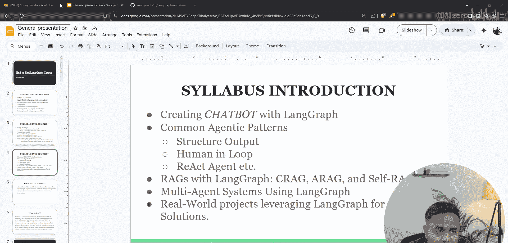
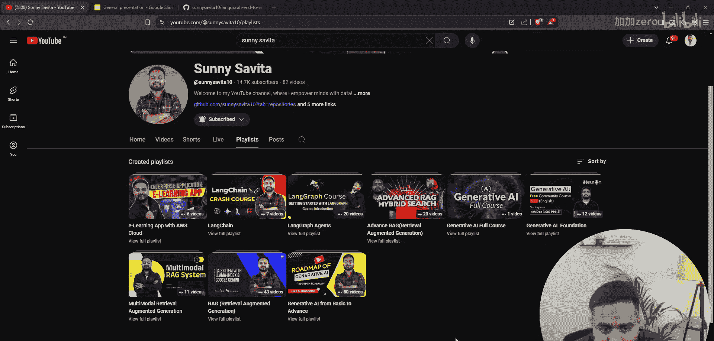
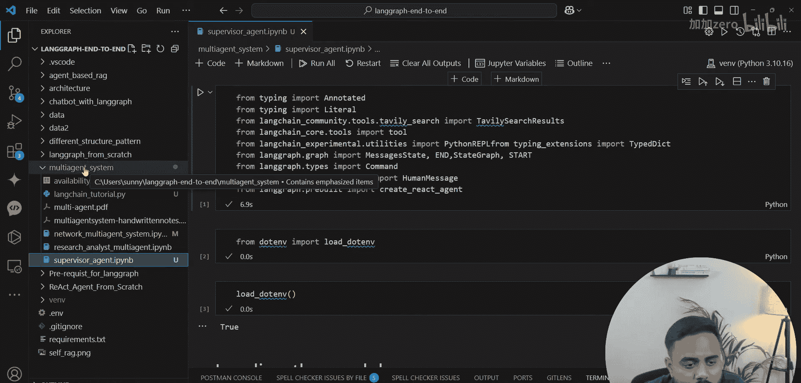
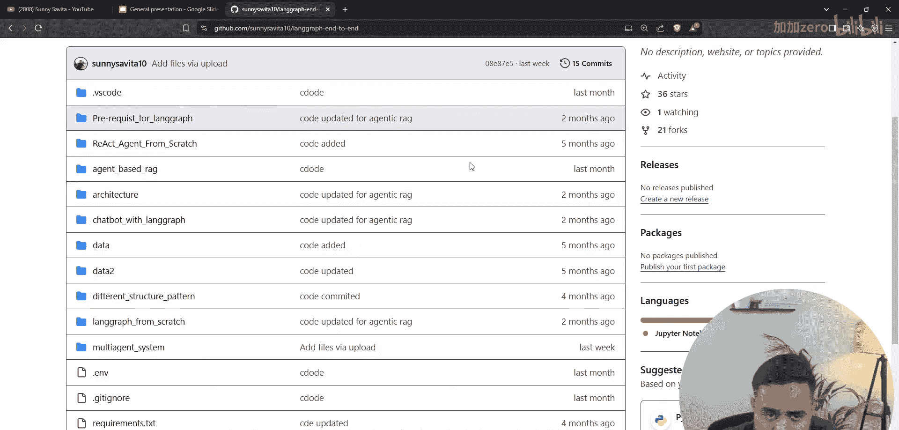
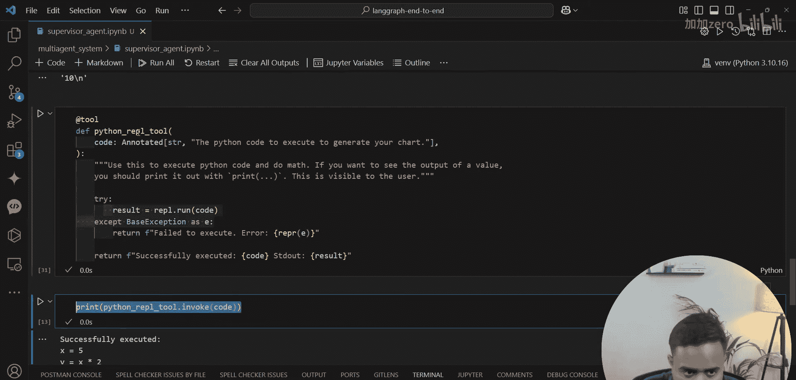

# Sunny Savita【中英⚡生成式AI：从初学者到专家｜Generative AI In-Depth Roadmap from Beginner to E】 p80 P80 LangGraph：20 Supervisor Multi-Agentic System ｜ Agentic AI #aiagents #ai #gen [BV1Uht8zDENA_p80]

Hey hi， everyone。 Welcome back to my do channel。 My name is Sunny Savita。

 and I'm back with another exciting and important video。 So guys， in this particular video。

 we gonna to discuss about supervised multi agenttic system we'll see the complete implementation of the supervised multi agenttic system in Lagra and step by step one by one will try to takecode each and everything。

 So guys， as you know， I started with this Android Lagra course where I uploaded around 20 video with respect to the Lagraft agents and all。

 I started from very basic here you can see the complete syllabus。 So inside the first slide。

 there is a complete basics。😊。

Where I use the La graph and the L to explain you about the tools agents and all everything。

 Then I explain about the La graph what it is。 I coded the La graph from his cache and I explain each and every concept of the La graph like nodes state visualization is streaming checkpointing。

pointing everything。 Now guys after that we discuss about the different different agent pattern we have seen how we can generate a structure output。

 We have seen how we can create a chatbo using the La graph。 Okay。

 and I shown you the react agent and the different different rag based agent like corrective rag agent rag cell ragor Now we are into the multiaging system where I already uploaded one video with respect to the collaborative agent Now this is second video where I will teach you the supervised agent and we see the implementation of it。

 Now， if you don't know about my YouTube channel guys so you can search the YouTube Sunny Savita。

 you will get my YouTube channel。 go inside the playlist section。

 you will find out a different different playlist。

According to your requirement， you can start with any of them I would suggest suggest this two playlist plus is this agent La graph agent and the second is the rag okay there I explain you the rag from very very scratch and say here I uploaded around 43 videos and in agents I uploaded around 20 videos so this two playlist will help you a lot to develop any sort of agent take application Now guys let's come to the code let's start with the coding and all without a further delay so here guys I am going to write my code in the vs code itself so let me open my vs code。

So I'm maintaining my entire code base over here and the same code base is available over my Github as well。

 If you will go and check with my Github here guys see this is the complete code。

 which I will provide you the description of the video even you can download this particular material from the previous video description as well I given you this entire material now let's try to start with the supervised agent and let's see what what it is and let's try to understand the complete meaning of it so here guys you can see I already written a couple of code So this is my file my file name is supervised underscore agent which is available inside this multigenictic system here you can see so inside this file I imported couple of couple of module so I imported this unnoted lit just unnoted it just to explain the description of the given variable and all lital basically it is for the type hint we can give the with respect to very sort of a variable it belong to which function or which。

Data type and all then we have this tool table search okay and this Python R we are going to use this two tool guyss let me okay so to tool we are going to use okay python R and which one this tablet search I will let you know why we are going to do that why we are using it everything will be cleared to all of you so yeah after apart from that we have some some classes and all from the La graph itself so from Lagrat graph I'm going to import this message state and state graph start okay this is important to create La graph orchestration La graphflow now there is one more module that is command okay this is very much important because using this particular functionality only we are passing command from one agent to the another agent then we have human message just to pass the input as a human as a user to the LLM and then we have an input react agent so every node basically is going to be an agent okay so。

I will be initializing that particular agent using this create react agent it's in build class in saddle and graph or else we can create it from scratch as well create this react agent I already shown you in my previous videos you can go and check over there right let me execute it and see this is working fine so before like coming to the main code let me set my each and everything like tools model and all then I will come to the main logic so here guys I'm going to be load my environment variable so this environment variable I set inside this dottn file if you don't know about this dottnb file and all you can go and check with my previous videos there I already discuss each and everything regarding this dott andb file and all okay。

So easily， you can understand this particular concept。

 Now I'm just going to be load my environment variable using this load underscore code dotv So whatever variable I kept inside my dottv file。

 I will be able to load all those all those value as environment variable and then I can utilize those particular value throughout my implementation now here what I'm doing I here I'm going to load the model So which model I'm going to use here So I'm going to use the model from the deep from the rock and the model name is going to be deep C Okay so heres my model guys see I have the O key over here because just now I generated before this tutorial before start recording and all but already I kept it over here but don't worry after the session I will delete it so I have this rock model now whenever I'm invoking any whenever I'm invoking this rock models it is generating output So let me show you how the output looks like so here I'm going to call this invoke let me pass my message So this is my message guys and。

Let's see。What its going to be generated。 So see this is my message and here you will find out the message Okay。

 so inside the message actually there， it is appending this think tag also so first it is thinking about the given first it is thinking about the given input and then only it is generating a final output if you don't want this thing okay in that what you can do you can you can pass it so here I'm using a regular expression for passing this think and and I just want to get this particular output this hello how I can assess dus my final output So this is my function which I'm using to pass the output。

 Okay so let me keep it over here this clean text it's a simple regular expression so whenever any whenever I will be getting any sort of output from my rock model So instead of showing directly first I will pass to this clean text let me show you how So here Im giving a message to my model then whatever response is being generated let's say here is a。

response do content。 Let me show you over here this response do content and see what you get。

 So see it is giving me this。Message right along with this think tag and on So let's try to remove that let's try to clean the text。

 So here I'm going to call this clean text and see I'm just getting this message So whatever message。

 whatever response you will pass it will clean the text means it is going to remove this think tag Okay this a particular tag from the response。

 I hope this is skill Now here I input it to tool So first tool is a tabt search right this tab basically it is going to be fetch the data from the internet right so whatever question I will asked to my tabt search So it is going to be generated answer So let let me execute it and see。

Here it is going to be generate answer right So it is going to be fetch the entire data from where from the internet itself。

 Now I have one more tool guys。 the tool name is Python R。

 Okay so whatever code we pass to this Python it can execute that particular code and can generate a responsible So let's say this is my code which I cap in a double triple code。

 So whenever we pass any input to the RP So we always pass in the form of string right so let me execute it。

 And here this is the object of the Python and here you can see I'm going to be I'm going to be done it。

 So see here is output output of what output of this particular code got it now guys see this Python is not available as a tool right So this is available as a simple function it's simple class itself So where it is available it is available inside this lecture experimental utility Okay inside this particular module but I want to use this Python as a tool。

 So what I will do I will create one custom function。 this Python tool。

Okay and I will use this tool decorator over here and here what I will be passing I will be passing my code Okay here this unnoted it is nothing it just a description of the given code is how my code will look like okay so it will be a and this is a description of the code right now this is my do string and here you can see I'm going to run this Python RP okay this one so。

As you can see guys， what we have we have this IP Okay。

 Im going to be execute this R dot run So whatever code I'm getting over here inside this particular function。

 okay， which I'm using as a tool so that like this code basically will come to the IP and it is going to be generate result right and that result I am going to be written over here that said now I hope this thing is clear to all of you whenever we are going to be written from here guys。

 so please make sure to return everything in a markdown format。

 Okay why let me show you that So let's say we have a tool over here and we are invoking this particular tool C before it was a normal class this was the normal class and we were calling this run method on top of it。

 now it will tool means I created a custom function and this particular functionality I kept insert this particular tool right now I can call the invoke on top of it invoke on what。

