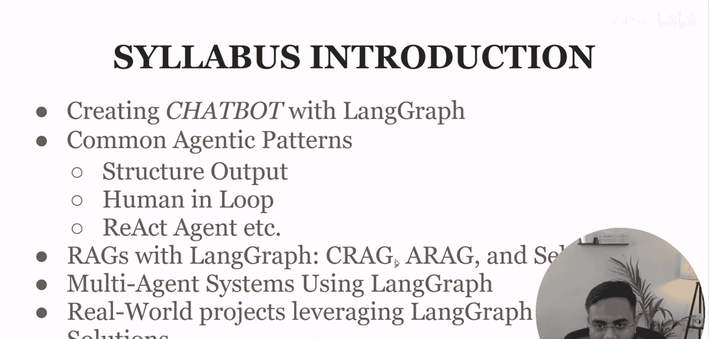
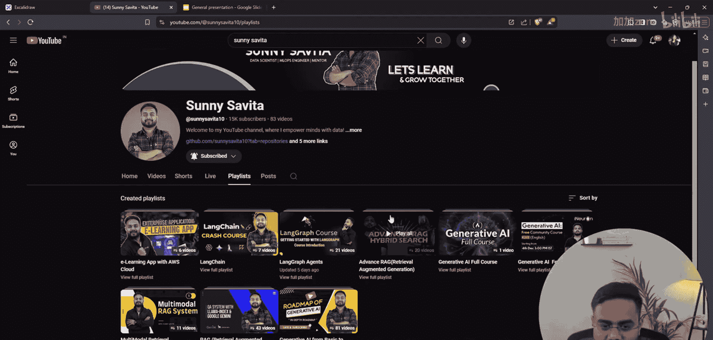
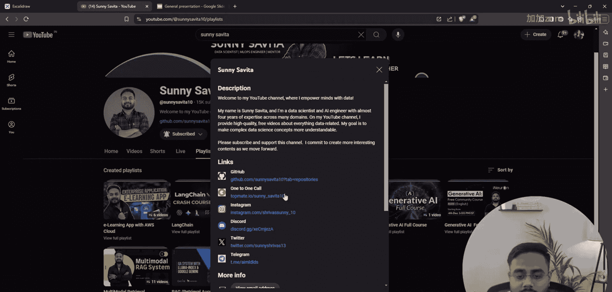
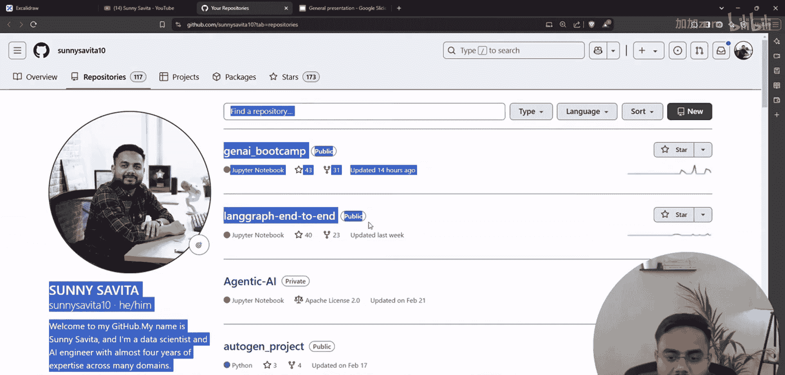
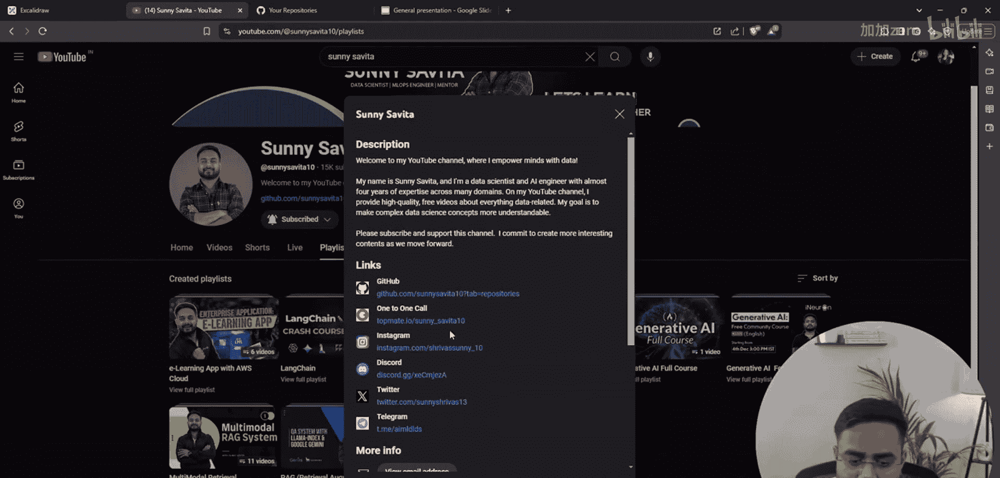
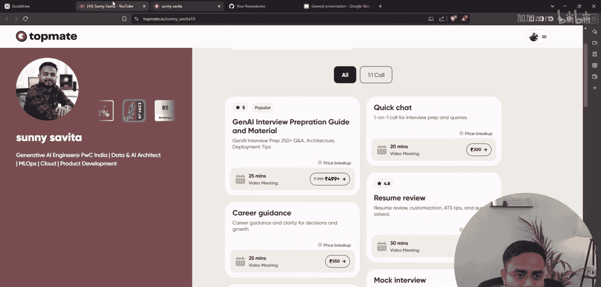
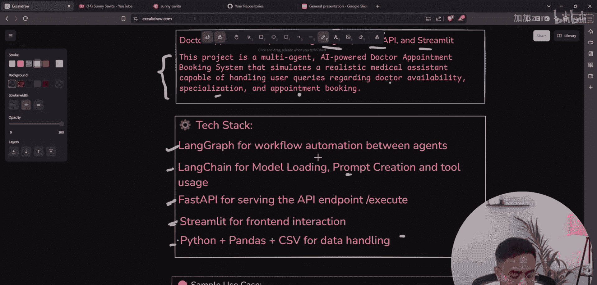
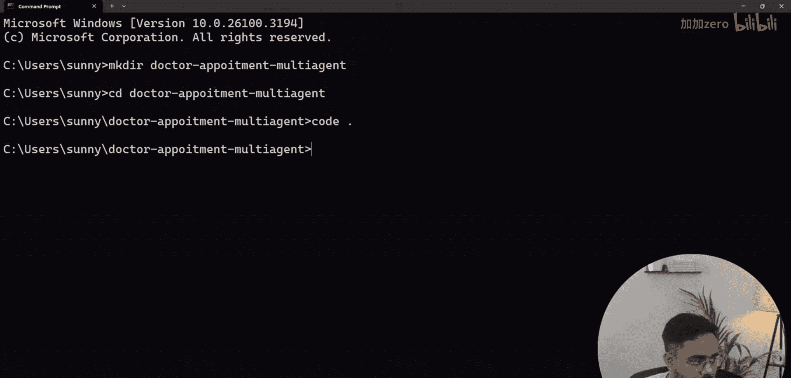
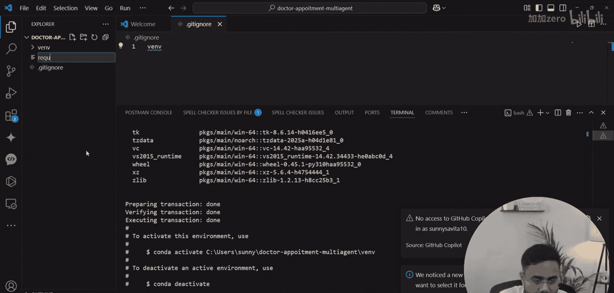

# Sunny Savita【中英⚡生成式AI：从初学者到专家｜Generative AI In-Depth Roadmap from Beginner to E】 p81 P81 LangGraph：21 End-to-End Supervisor Multi-Agentic AI Project for Booking Doct [BV1Uht8zDENA_p81]

He hi everyone。 Welcome back to my Do channel。 My name is Sunny Savita。

 and I'm back with another exciting and important video。

 So in this particular video were gonna implement one end to end project using multi agenttic system。

 Yes， guys。 So in my previous video， I explain you about the multiageenttic system。

 I discuss different different kind of multiagenttic system along with a complete theory Now it's time to implement some project。

 So guys in this video I will show you how you can implement a project using supervisor multi agenttic system and this project is going to be complete and to end means I'm not going to write a code inside the IP file instead of that Ill be writing complete modular coding and you will get an idea if we are getting any sort of a project related to the agent AI or multiag system how we can code that end to end。

 So let's。😊，Begin， let's start without a further delay。 So here guys。

 you can see the complete syllabus of this la graph course this entire syllabus I covered inside my course you can check out the playlist it is there or the YouTube now guys we are about to complete this course we are here at this particular point where we are going to understand different different multi genetic system along with a real world projects right so two to three more video I'll be uploading with respect to this course and then I'll be starting with a new playlist soon I will announce that particular playlist So if you haven't seen my YouTube channel so far if you haven't subscribed guys。

 please go and check please subscribe the channel hit the like button if you are liking the content liking the video and leave your thoughts inside the comment section apart from that guys。

 you can connect with me or my Liedin and。

You can follow to me over the Github there Also I' am uploading my code voice and all everything。

 Okay and this entire code base of this particular course， right， this land graph course。

 you will find out over my Github itself here you can see this land graph end to end Now apart from this one if you have any any query right for me So you can click on this one to one call and you can connect with me one to one for sorting out any sort of a query whether it is regarding to the resume make guidance interview mock interview geneative interview or if you want to do quick chat with me I'm available like for the given slot right so please check out this page and。

Based on the like query。 Okay， you can connect with me now so guys， first of all。

 let me clarify the complete problem statement。 So here I return the complete statement or my blackboard。

 Okay step by step will try to understand each and everything right and from in front of you only I am going to code the entire project right a couple of pieces I keptped in my system that I'll be copyed pasting at the specific place inside the project directory right but most of the thing I am going to write in front of you only now here guys so first of all。

 let's try to understand the problem statement I return in very clear cut way easily you can understand it we are going to build a doctor appointment system using L graph fast API and streamlink So here guys we are going to use the L graph for creating our agent flow were going to use this fast API for creating our endpoint and this stream late for the Ui now you can read out the problem statement。

What is my pro statement So this project is a multiagetic system in multiagetic system where which architecture it is following so is following a supervisor architecture right supervisor multiagetic architecture I will show you in some time I cap the architecture as well here you can read the further description So this is a project this is a multiageent project AI power doctor appointment booking system so that's similar to realistic medical assistant capable of handling user query regarding doctor availability specialization appointment booking and all so guys this is a doctor appointment booking system which I developed using the multi agent supervised multiagetic system how does it work okay what functionality have in over here each and everything we are are trying to discuss right now here I'm talking about the techt right what is our tech stack for this particular project so we're gonna use the language graph for the workflow automation for creating agent and then we're gonna use the link for modeling。

Model loading prompt engineering for the tool creation and all then we're gonna use the fast API here right for serving a API and point and all。

 then we're gonna use a streamlate for front end creation and then we're gonna use the python panda cv for that data headline So here incorporate the data as well I kept the data inside a cv that that particular data can leverage for building this particular project I'll show you how the data looks like and what all components we have inside the data right now apart from this one guys here you can see so this is a sample use case So how this application is going to work So let's say if users are going to ask can you check if a deologist is available on 5 August at 10 So according to that it is replying to me so thiss checking inside the database and all based on that tool calling based on that agent flow and it will provide me an answer now I hope this problem statement this tag is and this sample use case。

It is clear now coming to the architecture of this project。

 So guys this is a multi this is a multiagent architecture。

 it's a supervisor multiageent architecture。 So over here what I'm doing。

 please try focus now you will get the clear card idea first we are passing the input this input is going to the supervisor agent now based on the query it is going to be delegate let's say if if I just want the information so I can pass my query to the information node let's say along with the information I want I want the booking I want the booking also So after collecting a information okay it is passing again cursor to the supervisor and then it is booking a slot for me let's say query does not belong to any information information node or to any booking node in that case directly its going to be finished the query okay that mechanism is also there So in short I can say it is a complete multi agent AI system supervisor multiage AI system where whatever query we are getting based on the query it is going to be。

Elegate the task plus it is trying to retrieve the information from the given database and that what it is doing according to my convenient time or according to my date it's going to book the slot for me for the doctor I hope this entire thing is clear now so you can take a pause can you can take a screenshot and all of this entire thing right because if you are going to mention this type of project is resumesum so this entire information would be required so you can take it up or else I can give you the as a PDF in the discussion you can download from there itself let's try to start with the implementation let's see how we can implement this entire project how we can implement this entire use case。

So here， guys， I will show you from very scratch and what I'm doing。

First I'm going to create a folder and inside that folder I will open my V code and then I will create my environment all and the complete folder structure Okay producing enter character to delete to here what I' am doing first I'm going to create one directory inside this location see you can see my location over here see user Sunny okay it could be any location in your system so I'm writing mkTR means make directory and my project name is what doctor。

aquament。apoint men。Partty pig。ok。So I created this folder。 Now I am going inside this folder。

 doctor。apppointment。Mti agent， okay。with what Im doing here。

 I'm going to write this code dot so that I can open my Vs code inside this location right so here I open this here I open the Vs code inside the particular location what I can do。

 I can close the C is not anymore required。 So first of all。

 what I will do over here inside this Vs code Ill be creating my environment Okay。

 so for creating an environment guys， I will I am going to open my terminal and over the terminal。

So Im not going to use the power cell here， I' am going to use the gib so here is my gib and let me open the gi bash。

For the gridb actually you can execute the Linuxux command so my command is going to I'm going to use the conduct for creatinging a virtual environment you can use anything okay Python or Uv sorry not Uv you can use directly Python and okay or whatever this environment manager you are using can use that so here conduct create。

放到佢 iphone。BNB。And。Python， which Python version I'm going time me to use Python 32 and then i。

Okay you can see my environment is getting created and along with the environment what I will do I am going to be in slice the Gi as well so I can give you this entire code through the Github only so that you can vector this so first I'm going to create this Gi note and inside I mentioned this VN here Im going to create one more file the file and name is going to be required。

