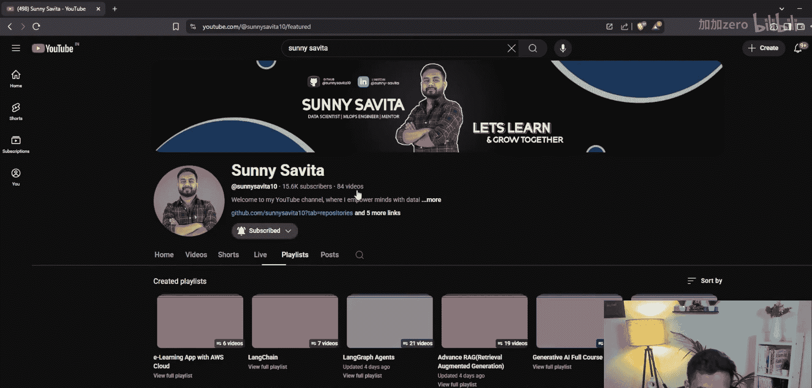
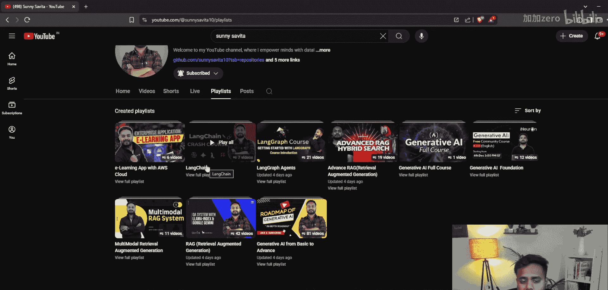
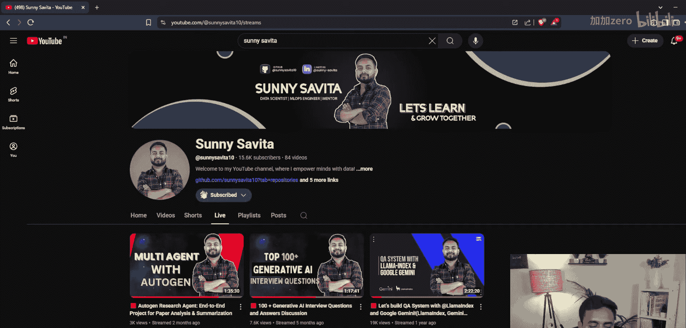
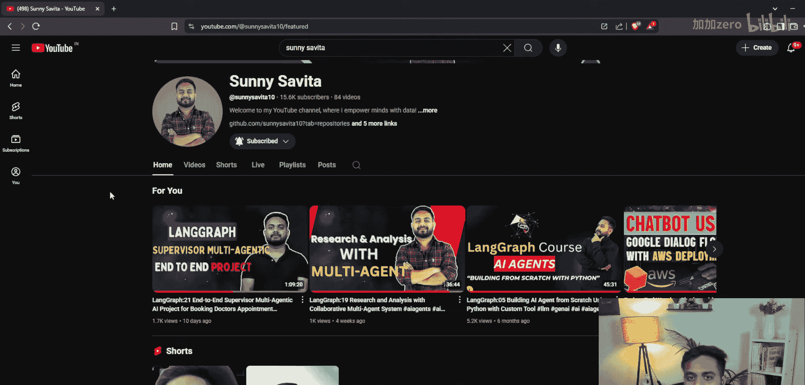
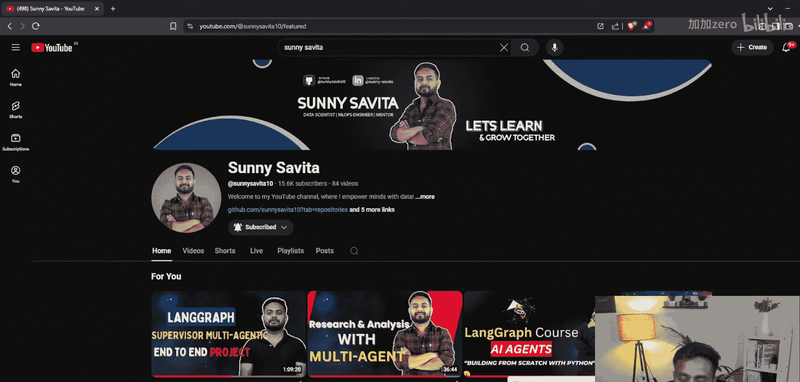
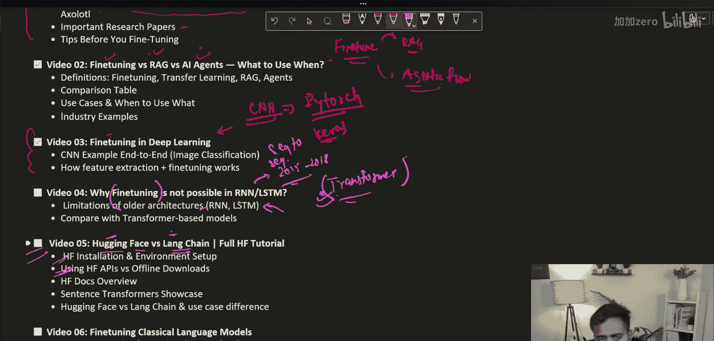

# Sunny Savita【中英⚡生成式AI：从初学者到专家｜Generative AI In-Depth Roadmap from Beginner to E】 p82 P82 LLM Fine-Tuning： 01 LLM Fine-Tuning From Scratch—Full Playlist Coming Your W [BV1Uht8zDENA_p82]

Hey hi， everyone。 Welcome back to my YouTube channel。 My name is Sunny Savita。

 and I'm packed with another exciting and important announcement。 Yes， guys。

 So in this particular video， I am going to announce one brand new fresh playlist about the fine tuning。

 Yes， So if I uploaded a content of my YouTube channel regarding rag agents。 and you loved it a lot。

 and this fine tuning was a very， very demanding topic on my YouTube channel。 So in many videos。

 you have commented， Sir， why you are not teaching this fine tuning。

 why you are not teaching about the Lm from scratch。 Now I am here， guys。

 with that particular playlist with that particular content。 So in this in this video。

 I will discuss about the syllabus or the fine tuning and what we are going to discuss an upcoming to to three months along with that。

 Ill start one more playlist。 We are try to understand this LM from very， very scratch。😊。

So that each channel we you can get at a single place you can get on my YouTube channel itself regarding the GeneW if you are trying to prepare for the GeneW agent LLM ops and all so this channel could be one stop a solution for all of you so I'm keeping that thing in my mind and according to that I'm preparing my sllus and I'm designing my playlist and all so guys if you haven't seen my YouTube channel so far please go and check inside the playlist section you'll find out the different different playlist here I can suggest you a couple of playlist you can follow this rack you can follow this multimodal rack you can follow this La graph which will give you the in depthepth understanding about the agent la La graph and all and along with that we can look into this la also so that your understanding will be pretty much kill how to build an application user la and all now you can check out with my live section where I took a live session regarding the projects I discuss about the interview quot and all。

Yes， so many things you will find out on on my YouTube channel regarding the geneative AI and all guys so please try to check please try to look in the content if it is useful for you then please subscribe the channel hit the like button and leave your thoughts inside the comment section now without further delay let's start with the discussion so I create very extensive syllabus for this fine tuning and in the upcoming days right so I think I'm planning it for next two to three months where well try to discuss each and everything with respect of fine tuning don't worry along with that Ill so many in the live session I'll discuss about the projects I'll discuss more about the agents because there are so many things which I need to discuss with respect to the agents now there is one more thing which is MCCP protocol which could be a future in the AI so we have to discuss about that also and there are so。

which is pending but I'm picking up this fine tuning Now let me tell you one thing about this fine tuning eyes So this fine tuning seems very underrated means most of the people don't discuss about it。

 they thought， okay so we are discussing about the we are discussing about the agents we are discussing about basically some hot topics and all but no one talks about the fundamental right guys believe me this Lm fine tuning it's a fundamental topic of the Gene A this gives you the understanding how you can train your Lm model which could be very。

 very beneficial for youth and you won't believe guys companies are doing that companies are spending their money。

 their resources of fine tuning their models they are reading the model from various APIpi like cloud open and all well along with that they are fine tuning according to their department okay people are fine tuning open source model then on top of it they are creatings they are creating agents。

Try to understand each and everything in this particular prelist， how we can also do the same thing。

 how we can build an industry great solution because fine tu is just not a fine tu just not a training a model。

 it is more than that means we can take a model we can train that。

We can build a rag on top of it we can use in our agent flow if it is not working fine。

 then again we can retrain it。Right and believe me guys see this is up like this could be expensive。

 I'm not saying it it would be a fee right it would be free。

 of course if we are going to be retrain your LM model or any sort of AI model。

 but how we can train it in a minimal cost what frame what new researcher researchers are there right so we we can explore those things and with a minimal cost with a no cost we can find tune our model So I will focus on those industry is tender inside this playlist and believe me guys after watching this play is after watching this a particular videos you will become a champion。

In LLMs in fine union right in drag and agents and everything okay you could be an AI developer and along with that I discuss so many things in the upcoming videos like how you can build object or how you can build a classes object right how you can create your project using this classes object with object or programming concepts how you can deploy your project with like Cicds and all okay so so many things I need to discuss on this channel and definitely guys I coming I will be coming up with this type of full proof roadm okay I'm not going to discuss like one or two video I never do that because I believe to give you the entire content with that particular sequence with a complete sequence okay and that's why I take a time like between the video right so nowadays you'll find out Im taking seven to eight days that is just because of my work and all nothing else。

in between Im preparing a content for all of you guys。 So let's begin。

 let's try to discuss this particular syllabus。 So I hope you are able to see I just preparing my onenote and definitely I share with you So here in the first video guys we are going to discuss about the introduction of the fine tuning in AI right there I so many points and we are going to discuss that this will be one single video we will try to discuss the importance of the fine tuning so well start from various basic what is a model training task for learning pretrain fine tuning why this matters all the theoretical stuff right so we try to discuss about the fine tuning framework what on fine tuning framework out there likel unlaught Lama factory a then we'll try to discuss some important research paper。

 what an important research paper we have with respect to this fine tuning now after completing all this theoretical stuff and all will come to the next video there will try to see the differences between fine tuning。

Rg and AI agents， okay， when you need to choose which like approach。

 whether you should go with a fine tuning or you have to build a rag or agent or after the fine tuning。

 let's say you fine tu model now on top of this fine tune model。

 how you can build a RA right how you can create an agent flow so。

This each and everything we are going to discuss in our upcoming videos。 So guys。

 I hope this second point is clear。 Now in the third video right。

 we'll try to discuss the fine tuning in the deep learning fine tuning the deep learning means how this fine tuning fine tuning have is starting a deep learning how they came up with the idea I'll show you a CNN training also using the pi toch and the cares so that you will get a clear cut understanding how they have trained how like basically we can train this CNN model。

 okay using the p toch using the cares and your understanding with respect to the neural network with spec layers parameters and all everything is going to be clarify over here right So till here this would be my fundamentals now just look in the fourth video Okay so in a fourth video I mentioned about a fine tuning right why fine tuning is not possible or why fine tuning was not possible inside。

Inside the RNn LSTM because we know before before the transformer architecture right so we were using the Rnn and Rnn LSTM right in 2015 to 2018 So this Rn LSM was booming a lot in AI industry in Nlp industryT mainly with respect the sequence to sequence data but when this like when this transformer came with the picture after that it got failed So what was the reason why scientists didn't focus on this Rnn LSTM why they chosen this transformer architecture means why Google has not invested much on this Rn LSTM kind of architecture and put a decoder and all why they came up with different research like transformer and all and my main name would be why fine tu was not possible So we'll see with respect to the coding and all and I hope so your each and every doubt will be clarified。

Over here now guys our main thing is going to be start So from here I'll start with the hugging phase Okay。

 I'll explain what was the hugging phase what was the linkin what is the differences between this hugging face and link when you need to use which one either hugging phase or the link and guys will see all sort of a thing the installation how we can read the model use Hf API hugging face API Okay we'll try to use the link also in between。

