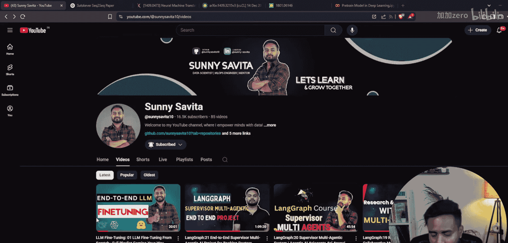
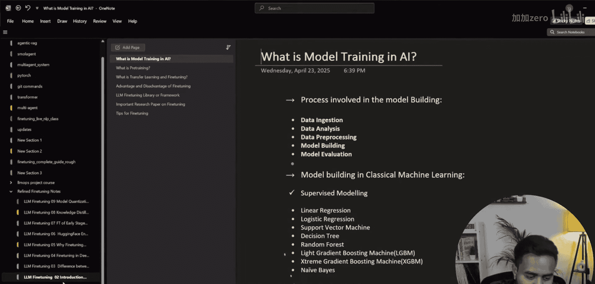
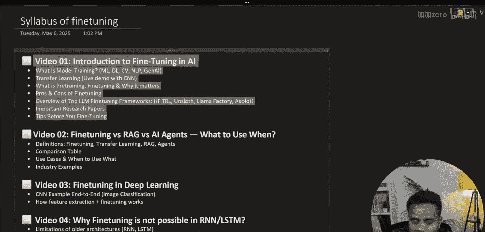
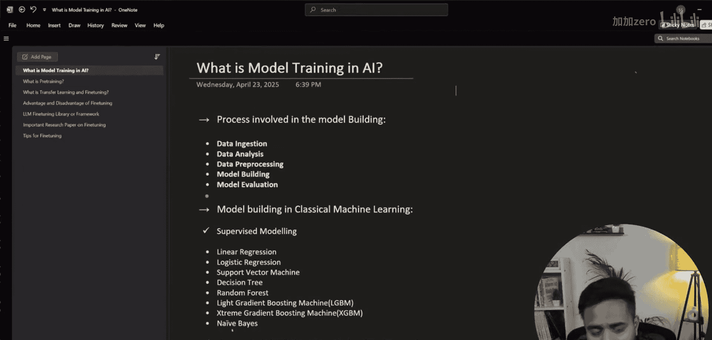
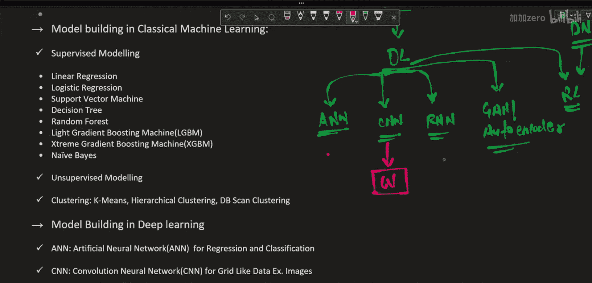

# Sunny Savita【中英⚡生成式AI：从初学者到专家｜Generative AI In-Depth Roadmap from Beginner to E】 p83 P83 LLM Fine-Tuning： 02 Understanding Model Pretraining and Training in AI  #aia [BV1Uht8zDENA_p83]

He hi everyone， welcomelcome back to my new channel， My name is Sunny Samita。

 and I'm packed with another exciting and important video with this particular video guys。

 because I continue our fine tuning series， which I started in my previous video there I just experienced the syllabus of the fine tuning and I told you that in in the upcoming 10 to 15 video we are just going to discuss the fine tuning concept。

 the LLM fine tuning concept。😊，But unfortunately， I couldn't upload a video in my last couple of days。

 So the last video which I uploaded it was two week ago。 And I know guys。

 many of you new message to me。 you written in a comment and even I got the personal message why you stop this fine during series and now。

 So again， I'm saying I didn't it。 I will upload all the video as it is whatever I said because of the work person you know I just took a break and even I was involved to create some refined content for this fine during series。

 So that's why guys， I couldn't record a video。 but don't worry now I try to upload a video。

 as much as video I will try to upload inside this playlist and I will make sure that you will get enough content from my you channel Okay So yeah I think I discuss all the stuff all the whatever was in your mind。

Now first of all， let me show you the syllabus which I discuss in the previous session and then I'll come to the agenda of today's video。

 So here guys are the thing I kept inside by OneNotes so this the syllabus and first of all。

 let me discuss this and syllabus So the syllabus itself I told you that we are going to discuss the complete and detailed introduction of the fine tuning Yes in today's video will discuss the detailed introduction of the fine tuning then we'll discuss the differences between the fine tuning rack AI agents and all everything then we' come with the fine tuning in the deep learning why this fine tuning is why this fine tuning is possible in the deep learning how it came into the picture each and everything we try to discuss inside this particular lecture then why fine tuning is not possible inside the R and LSTM and here you will learn some significant significance differences between the LSTM R and。

ransform argument direction then the hugging phase and the line because line does not provide any support to the find tu。

 it only support to the rank based application and an agent application and the application which we production right So guys for the find tu for sure will have to learn this hugging phase because hugging phase provide all the open source model and even the support for the find unit。

 there is a library like a transformer there is a library like the data Drl right all those library is support to the find unit is So for sure will have to learn the hugging phase。

 which is very much important and the important concept of this n syllabus。

 Then the fine tuning in a classical language model like what and all knowledge distill is also very important people can ask you to interview element quantization again it is a very important just to basically reduce the size of the model and to load it in any sort of a con Then here is a fine tu of the last language model the main concept will start from here。

So the concept basically which you are waiting right so the concept will start from this particular stage and then guys API based model and then framework for the large language model okay the fine tuning for the vision language because you know right so vision language vision modeling is also going to be a very popular now and know the chargeD has integrated many multimodel is right inside their application so definitely will have to learn about this vision fine tuning of the vision language model and then reinforcement learning with a human feedback very important concept guys and we see some advanced concept like a review and all。

And the embedding fine tuning so this was a syllabus which I discussed in my previous video now it's time to discuss about the introduction of the fine tuning and without wasting a time let's start guys the introduction of the fine tuning and I let you know that each and every point and again I'm saying I see my video is going to be quite long from now onwards because。

I will not this the thing on surface。I will discuss each and everything in there。

So if you are interested to learn everything in them， then stick with my video。

 otherwise this video is not for you where I'm going to complete any sort of a topic within5 to 10 minutes。

 I can do that。For sure I can do that， but I'm not political good Okay， so yeah。

 let's start with the introduction of the point2 and then I'll show you the practical sub option。

Gys， as you can see， I divided this introduction of the fine tuning into the multiple section。

 So in the first section， we are going to discuss what is a model training。

 I want to start from this。 So first Ill show you what is a model training then what is a pretrain。

 So this pretrain， it plays a very important role in the fine tuning and we need to understand the pretrain with respect to the LLm model。

 not only the LM model， I'll try to explain you this pretrain with respect to the other deep learning model like CNN based model。

 then there is a concept of the transfer transfer learning。

 So we'll discuss what type of transfer learning we have how we can modify the layer of the architecture and how we can achieve this transfer learning and where this fine tuning exist inside this transfer learning。

 Then guys we have some theoretical concept like advantage。

At disadvantage of the fine during then Lm fine tu libraries。 So whatever libraries we have。

 I will try to explain you about those library and will discuss which library you can use。

 then we have this important research papers so there are a couple of research paper which is very much important and you should follow those research paper if you are trying to learn the fine during term then guys we have a next topic which is still of our fine tu So yes。

 you can follow a couple of tips which will which will enhance your model model training and the fine tu results。

 So that will discuss at the end of the video or maybe I can divide this particular video into two section where in the first section means in this particular video I'll try to discuss about this model training pretraining and the transfer learning Again guys again I'm saying for the transfer learning I I have recorded one with specific session So most probably after this particular session one most session will come with respect to the rank versus fine。

During that engine， and then I will upload this class for learning session。

 So I will explain you most of the theoretical list in this particular section。

 but yeah in the next session next session I will try to discuss the practical also now。

 let's begin with the model training。 So what is the model training in the end。

 let me switch up my cameras with that you can access the entire board and you can address that in a better way okay。

So here you can see guys I return this entire note。

 this entire notes written by me and I will provide you this particular notes and so that you can follow it and you can prepare the fine tuning stuff and all And whenever anyone is asking you any sort of a question related the fine tuning and also easily you get answer again I'm saying guys this notes is created by me mindfully I created all the notes okay and that's why I took this much of time to upload on my video So first of all guys will try to understand where this fine tuning lies it set a model training。

SoWhen we discuss about the AI guys。 So this AI on a very high level。

 we can divide into the multiple section。 So here I can write AI。 So under this AI。

You will see machine learning。Under the machine learning， there is one specific kind of air。

Wwhich we develop using the neural network that is called deep learning Now again。

 we can divide this deep learning into the multiple neural network so the vanilla neural network is called artificial neural network then there is a CNN which is called convolution neural network and this convolution neural network we use for handling the image kind of data then we have recurrent neural network which we use for handling the sequence kind of data then we have a gaze gaze and autoenr earlier it was using for generating a data and this gaze is nothing this gaze basically involved on top of the CNN itself then we have one more kind of learning that is called reinforcement learning So instead the reinforcement learning we always perform the reward based learning and we use the policies over there and here also we can use the。

A deep neural network。 Okay， so this is called deep error deep reinforcement learning。 Now， guys。

 whenever we talk about the charity， the agent where it lies So here instead the CNN guys。

 you can see。 So CNN using the CNN architecture we can we can achieve basically some state of state of art model。

 right， so there the you will find out the evolution of the C computer present。

