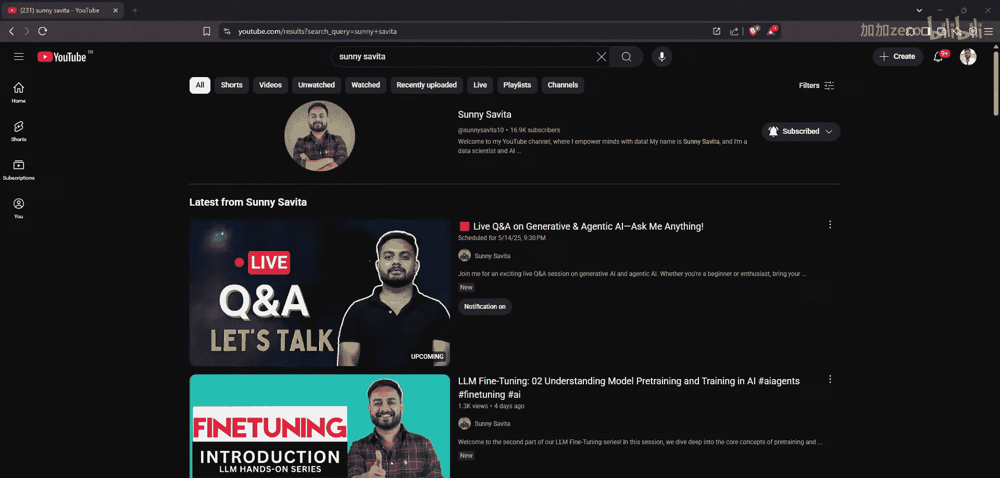
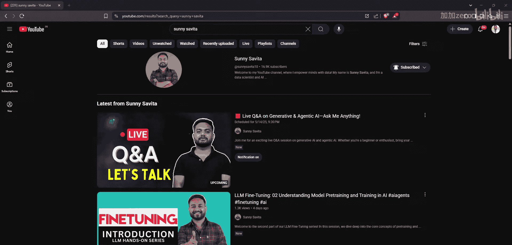
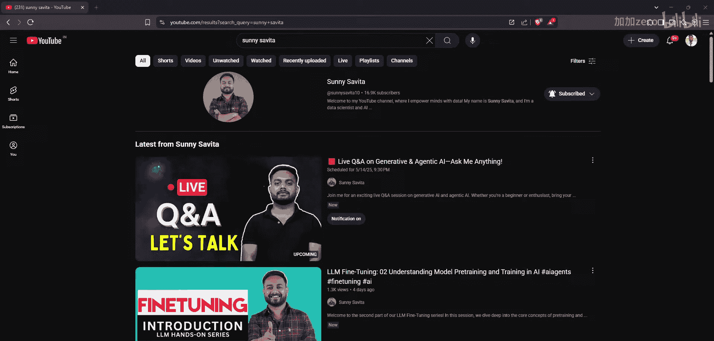
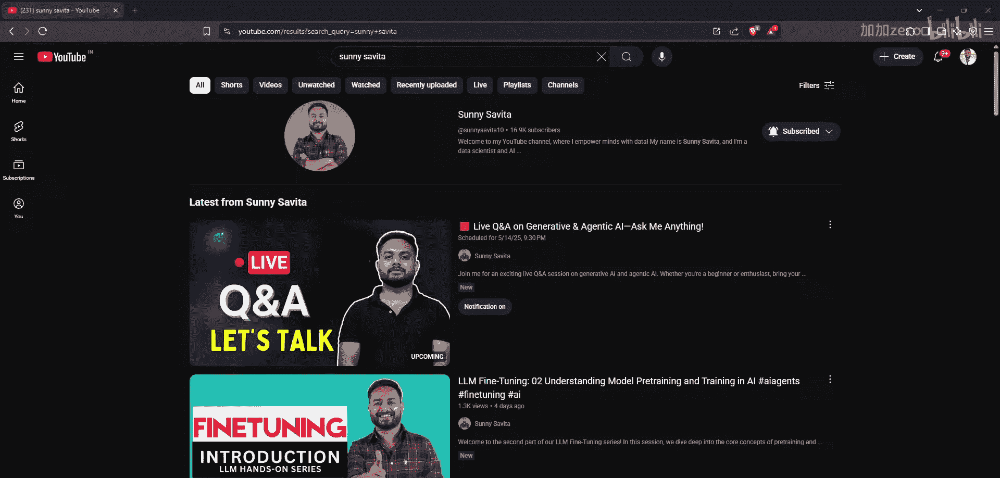

# Sunny Savita【中英⚡生成式AI：从初学者到专家｜Generative AI In-Depth Roadmap from Beginner to E】 p84 P84 🟥 Live Q&A on Generative & Agentic AI—Ask Me Anything! [BV1Uht8zDENA_p84]

Yeah， hi， everyone。 I'm Audible。Can you hear me。Yeah， hi everyone。 Good evening。

 I hope I am visible to everyone， right。依呀不。So if I'm visible。

 can you give me quick thumbs up or quick ears in the chat？

And let me clarify the agenda so I joined the session just to clarify your doubts related to the geneative AI related to the Age AI so whatever doubts and question you have guys regarding my YouTube videos and upcoming plans and whatever thing I'm going to cover up on the YouTube channel right so each and everything you can ask me and for sure I will be there for next 30 minute to answer your all the queries and even I'm planning many more session like this where I will directly interact with you I will take your queries as well as I'll try to Ill try to like complete some project some end2 end project also in the live class itself so if you will go and check with my previous sessions so there I already took a couple of live session with respect to the interview preparation regarding the resume preparation and even I explain you couple of project the end to end project as well so yeah Ill be。

Ting like like this only in the upcoming days just to solve your doubts and even will do many more thing whatever is required to you to become a geneative AI and agent K engineer so if i'm aible guys can you okay people are saying yeah I'm aible yeah it is perfect。

Great， so whatever questions you have in your mind。

 you can ask me for sure I will try to answer for all of your query。

You you can mention inside the chat guys， I am looking into the chat and for sure I will try to answer of your each and every questions。

 whatever you have in your mind。The crew AI and Autogen playlist soon I will start creating a video on crew AI and Autogen it is already in my tu list I started with a fine tuning since I want to give you some base level understanding of this LLM and the transformer architecture after completing this fine tuning or maybe in parallel I will try to create a video on top of this crew AI and autogen as well。

So after complete Geneative AI can we jump with the agent AR or we can get it into the geneative AEC if you are saying agent AI right so agent AI itself comes under this geneative AI So if you are getting recruit on this role for this geneative AI role So for sure you will get a work either to create a rack retrieval argument generation or the pure agent system So guys this agent AI and geneative AI right its not a different thing you can say it is a two side of a single coin So if you are getting recruit as a gene AI engineer or even as a basically on this。

Deep learning engineer and all and where you are going to work with respect to this transformer based model okay and some like this rag and agent framework like Langon and allden for sure like you are going to work as an agent tech engineer only。

Understood。can you tell me about a plan for the LLM fine tuning clearlist so LLM fine tuning what is my plan to teach you from very scratch that's why I started from this introduction in all so first I started from the introduction the fine tuning and then we'll deep dive into the different different basically other concept okay which is directly really to the deep learning itself I will not directly jump to this LLM fine tuning so once we complete those fundamental thing within this four to5 video then I will move to some advanced video advanced means so we'll look into the LLM fine tuning then we'll see the different different frameworks for doing this LLM fine tuning and how we can perform the fine tuning of the multimodel as well so we have different different multimod rights so which can handle the text related data and the other model kind of data right so we'll try to look into those model as well okay。

Apart from that I will teach you the how you can align the preference optimization and all well see the DPO technique okay which is one of the supervised learning which we can do after performing a supervised fine tuning so in this particular sequence in whatever sequence I discuss in the syllabus in that specific sequence we are going to cover up in the upcoming videos okay and。

Yeah， Imor， right， guys。Can you hear me， Can you hear me， guys。Audible right， Okay。

 I am visible also。Yeah， maybe there was some network problem and because of that I disconnected。

 I think now it is perfect。Okay， great。Yeah， so I think I given you the enough amount of information regarding a fine tunic pillarlist。

SoAfter completing okay this I already answered can you please provide some information on evaluation rag system Yeah so for sure I will create a playlist on this evaluation part because this evaluation actually it is a crucial part right of any of the basically architecture right or any of the like thing which we are going to implement like the agent text thing and all so for sure I will try to create one separate playlist for this evaluation part if you want to evaluate your rag right so for evaluation of the rag we have some in build framework you can visit this ragas you can look into the true lens right we have errors so you can look into this framework where you will find out a detail that on which matrix on which parameter actually we can evaluate this rag based system。

Understood， and even we can create our own custom metrics also for evaluating this rack system。

 So yeah， for sure， I will try to create one separate plist for this。Rg evaluation， okay？

So when you going upload the find during all videos so I understand the frequency basically I am not able to maintain okay regarding this find during videos and previously right earlier actually I was able to upload a video on maybe per week I was uploading three to four video but nowadays actually I have per week I am uploading one video so as of number frequency very less that I accept but don't worry guys Ill try to increase it and within a week itself you will find out at minimum three to four video from my end okay。

Regarding the fine tuning itself， I am safe。Do you have a on how to create a large agent。

 yes how we can create a large agent I have a project and as I told。

