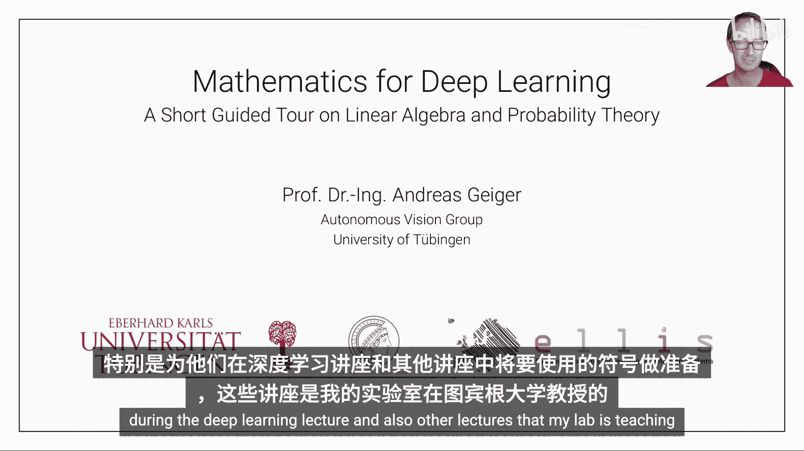
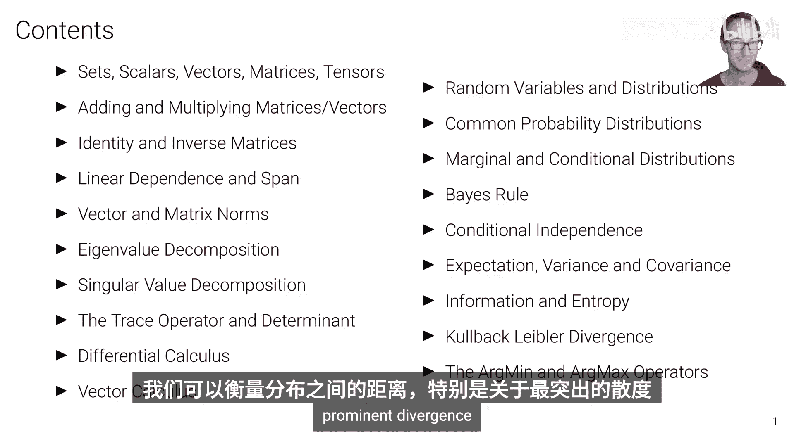
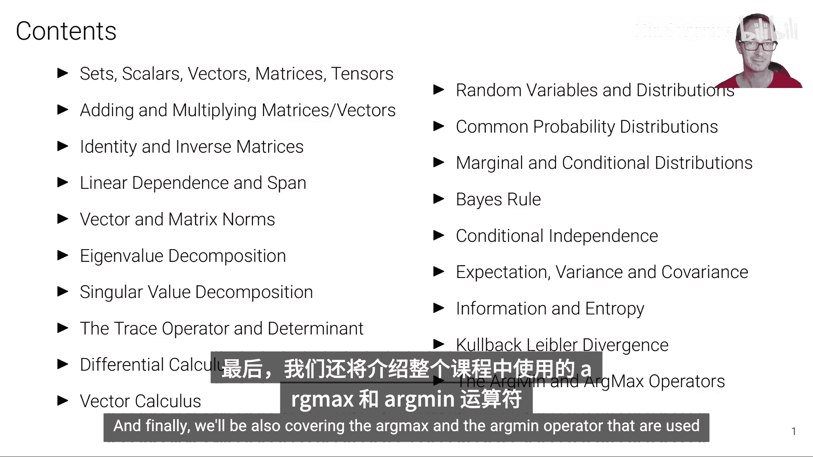
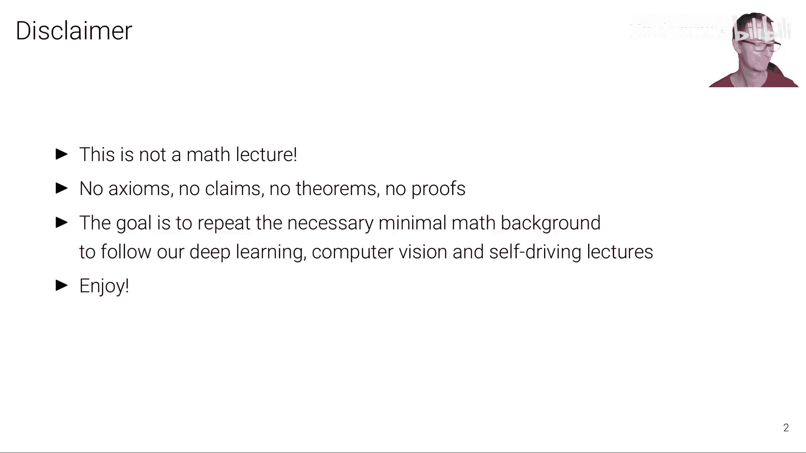

# 001：课程介绍 🎯

在本节课中，我们将对“深度学习的数学”这门微课程系列进行概述。我们将了解这门课程的目标、内容结构以及它旨在为后续深度学习课程所做的准备。

大家好，欢迎来到“深度学习的数学”课程。这是一次关于线性代数与概率论的简短导览。这个微课程系列包含许多简短的视频教程，是我为回应图宾根大学深度学习课程学生们背景知识的多样性而创建的。

这门课程并非一门全面的数学课，而更像是对学生们在本科数学课程中已学知识的一次简短回顾。其目的尤其在于，为学生们准备我们将要在深度学习课程以及我实验室教授的其他课程中使用的数学符号和表示法。

## 课程内容概览 📋

以下是本微课程系列将要涵盖的内容概览。

*   **线性代数基础**：我们将从集合、标量、向量和矩阵的表示法开始。我们将学习如何对矩阵和向量进行加法和乘法运算，了解逆矩阵的含义，以及矩阵中的线性相关性意味着什么。
*   **范数与矩阵分解**：我们将介绍课程中最常用的向量和矩阵范数，以及矩阵分解技术，如特征值分解和奇异值分解。
*   **微积分**：我们将讨论微分学和向量微积分，即如何计算导数、梯度和海森矩阵。
*   **概率论基础**：我们将探讨随机变量和概率分布是什么，并了解深度学习课程中使用的一些最常见的概率分布。
*   **概率关系与度量**：我们将涵盖边缘概率分布和条件概率分布的主题，以及著名的贝叶斯规则。我们将了解随机变量何时是独立、相关或条件独立的。我们还将引入期望、方差和协方差的概念。
*   **信息论**：最后，我们将讨论信息论，特别是信息是什么、如何度量信息，以及熵的含义。然后，我们将探讨散度，即如何度量分布之间的距离，重点介绍最突出的散度——KL散度。
*   **常用运算符**：此外，我们还将介绍在整个课程中都会用到的Argmax和Argmin运算符。

## 课程性质与目标 🎯

需要特别说明的是，这再次强调不是一门严格的数学讲座。这里不会有公理、命题、定理或证明。所有内容都非常注重应用。相反，本课程的目标是回顾必要的、最低限度的数学背景知识，以便大家能够跟上我们的深度学习、计算机视觉或自动驾驶课程。

希望你能享受这门课程！