# 004：单位矩阵与逆矩阵 🔢

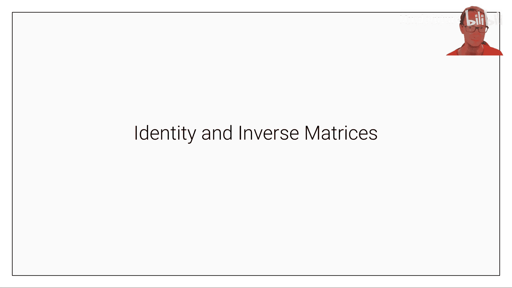

在本节课中，我们将要学习线性代数中两个核心概念：**单位矩阵**和**矩阵的逆**。理解它们是掌握后续矩阵运算和求解线性方程组的基础。

## 单位矩阵

上一节我们介绍了矩阵与向量的乘法。本节中我们来看看一种特殊的矩阵，它不会改变与之相乘的向量，这种矩阵被称为**单位矩阵**。

我们使用粗体 **I** 加下标 **n** 来表示能保持 **n** 维向量的单位矩阵，其中 **n** 指明了它所保持的向量的维度。这个矩阵属于 **n × n** 维的实数方阵空间。

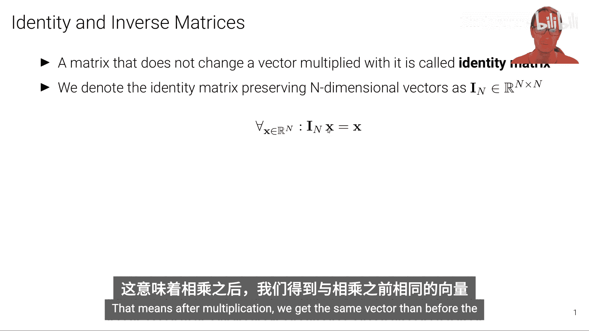

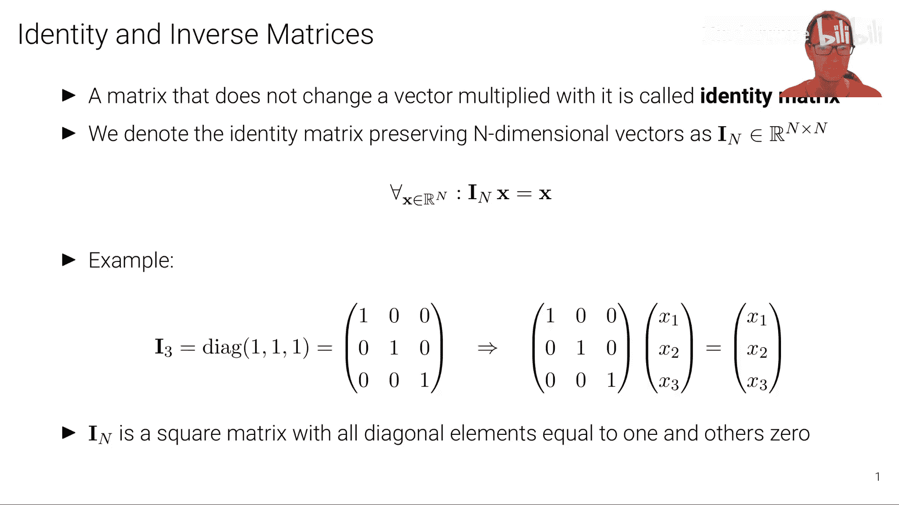

这意味着，对于向量空间 **R^n** 中的**任何**向量，将其与该矩阵相乘后，得到的向量与原向量完全相同。

**公式表示如下：**
对于任意向量 **v ∈ R^n**，有：
**I_n v = v**

那么，这个矩阵应该是什么样子？显然，它必须是一个对角线元素为1，其余元素为0的矩阵，这样才能保留向量的所有分量。

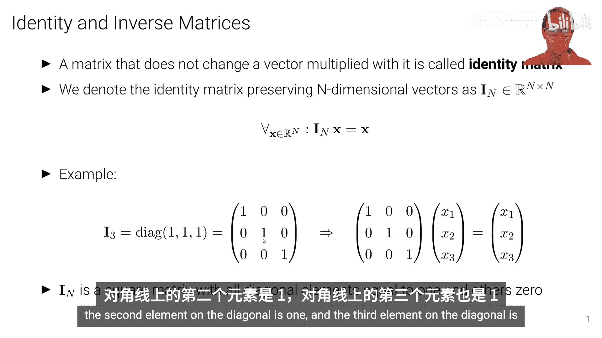

以下是单位矩阵的具体形式：
*   对于一个三维向量空间，对应的单位矩阵是：
    ```
    I_3 = [ [1, 0, 0],
            [0, 1, 0],
            [0, 0, 1] ]
    ```
*   由于这是一个对角矩阵，我们也可以将其写作：
    **I_3 = diag(1, 1, 1)**
*   对于四维向量空间，单位矩阵 **I_4** 具有相似的结构，只是维度增加。

总之，**I_n** 是一个对角线元素全为1，其他元素全为0的 **n × n** 方阵。

## 矩阵的逆

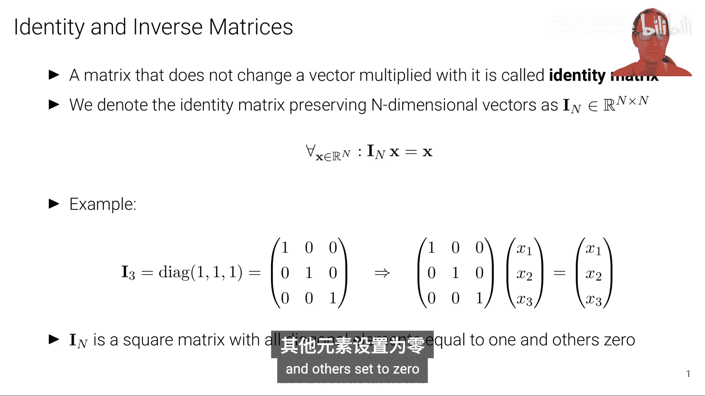

了解了单位矩阵作为“乘法单位元”的角色后，我们现在可以定义**矩阵的逆**。

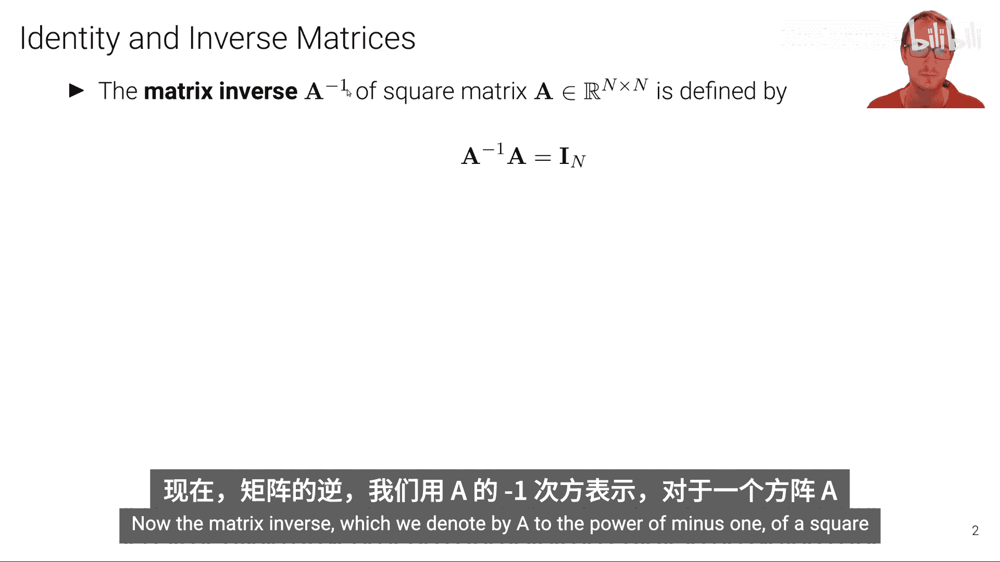

对于一个方阵 **A**，其逆矩阵记作 **A^{-1}**。逆矩阵的定义与单位矩阵紧密相关：**A** 的逆矩阵 **A^{-1}** 满足，当它与 **A** 相乘时，结果是单位矩阵。

**公式定义如下：**
**A^{-1} A = I_n**

换句话说，乘以逆矩阵 **A^{-1}** 可以“抵消”矩阵 **A** 的作用，最终得到单位矩阵（即乘法单位元）。

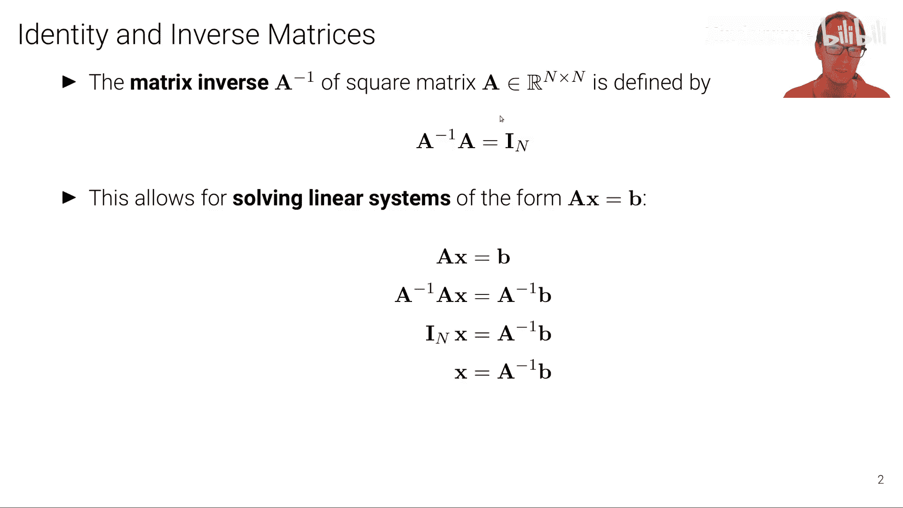

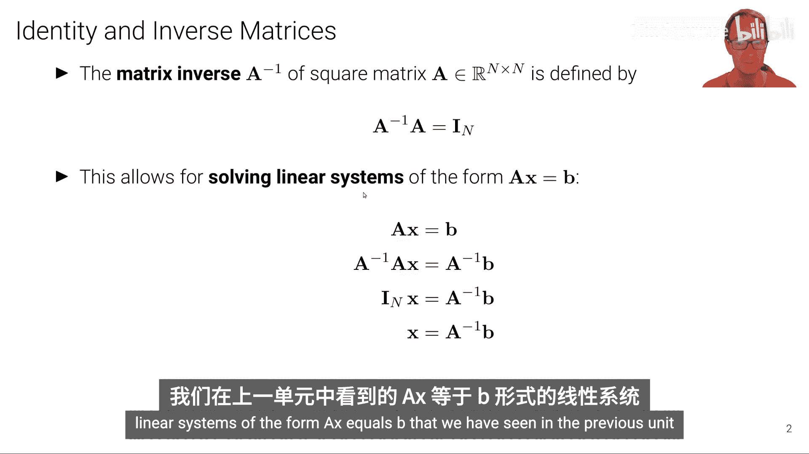

## 利用逆矩阵求解线性方程组

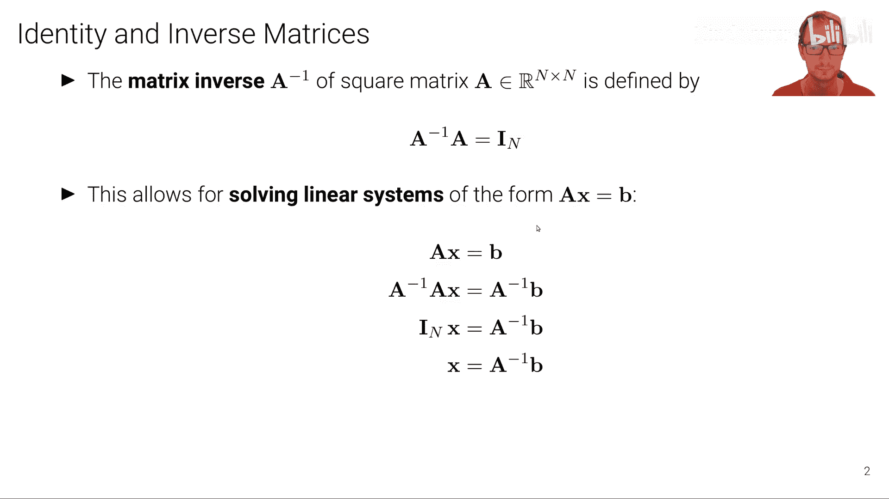

掌握了逆矩阵的定义，我们就可以用它来解决上一单元见过的线性方程组。

考虑一个线性方程组，其形式为：
**A x = b**

如何求解向量 **x** 呢？我们可以利用矩阵的逆。

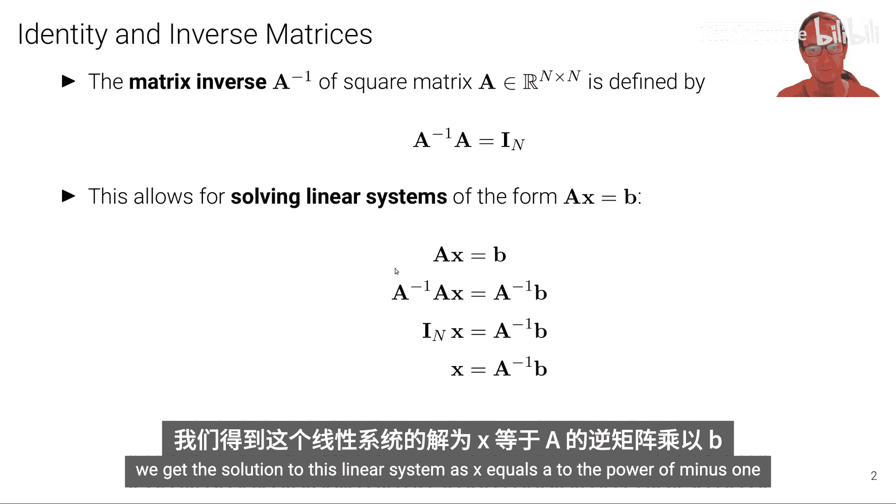


以下是求解步骤：
1.  从方程 **A x = b** 开始。
2.  在等式两边同时左乘 **A** 的逆矩阵 **A^{-1}**。这不会改变等式的成立。
    **A^{-1} (A x) = A^{-1} b**
3.  根据矩阵乘法的结合律，以及逆矩阵的定义 **A^{-1} A = I**，左边变为：
    **(A^{-1} A) x = I x = x**
4.  由于单位矩阵 **I** 乘以任何向量都等于该向量本身，我们可以直接得到解：
    **x = A^{-1} b**

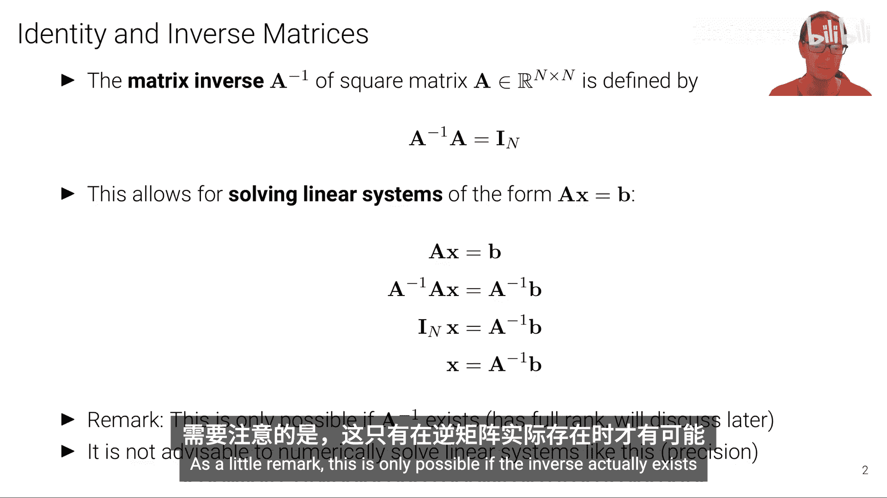

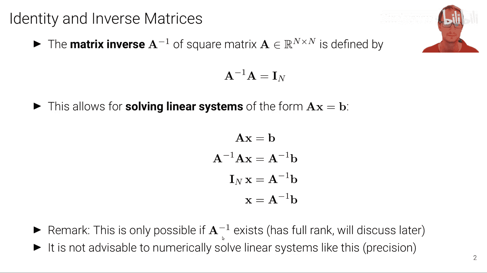

因此，理论上，只要计算出系数矩阵 **A** 的逆，再乘以向量 **b**，就能得到方程组的解 **x**。

## 重要说明与示例

在应用上述方法前，有两点关键说明：

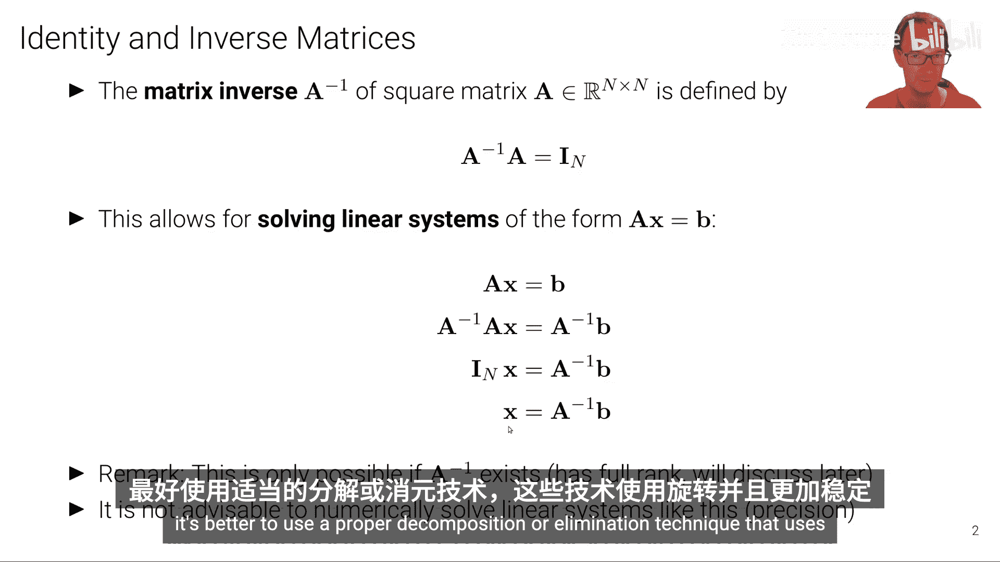

1.  **逆矩阵的存在性**：上述求解方法仅在矩阵 **A** 的逆矩阵 **A^{-1}** 存在时才可行。这要求矩阵 **A** 是**满秩**的（或称非奇异的），这个性质我们将在后续课程中详细讨论。
2.  **数值计算的建议**：虽然从数学推导上看 **x = A^{-1} b** 是正确的，但在实际数值计算（如编程）中，**通常不建议**先显式计算逆矩阵再相乘来求解。因为直接求逆可能在数值上不稳定。更稳健的方法是使用高斯消元法、LU分解等专门的线性系统求解算法。

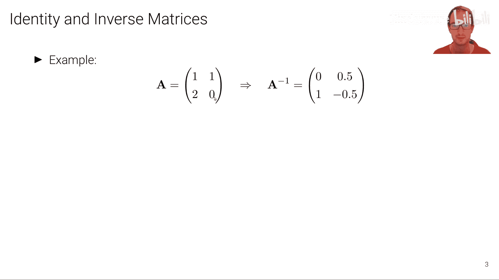

最后，让我们通过一个具体例子来巩固理解。

考虑矩阵 **A**：
```
A = [ [1, 1],
      [2, 0] ]
```

通过计算（例如使用高斯消元法），我们得到它的逆矩阵 **A^{-1}** 为：
```
A^{-1} = [ [0,   0.5],
           [1,  -0.5] ]
```

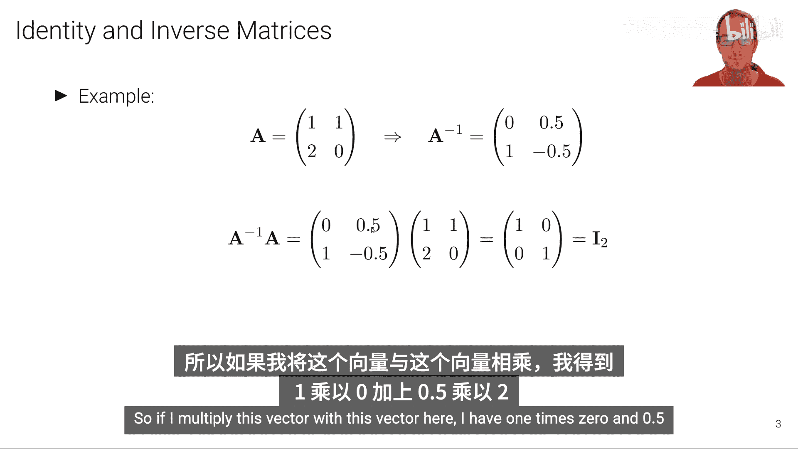

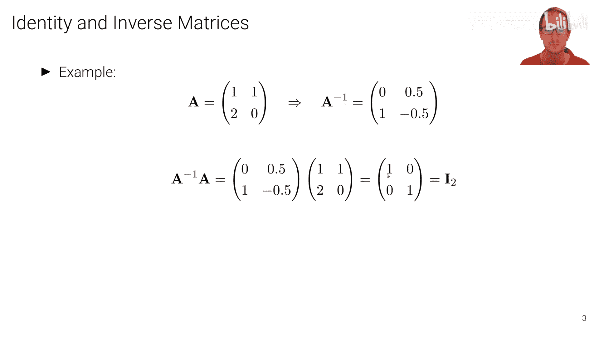

我们可以验证 **A^{-1} A** 的结果确实是单位矩阵 **I_2**：
```
A^{-1} A = [ [0*1+0.5*2, 0*1+0.5*0],
             [1*1+(-0.5)*2, 1*1+(-0.5)*0] ]
         = [ [1, 0],
             [0, 1] ]
         = I_2
```

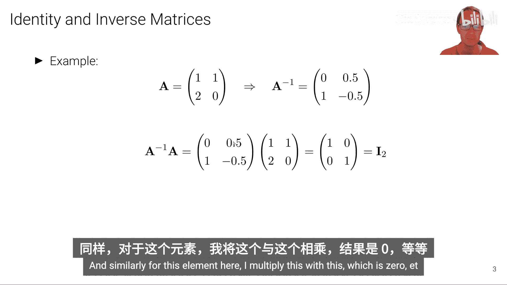

现在，假设我们想求解线性方程组 **A x = b**，其中 **b = [2, 1]^T**。
根据公式，解 **x** 为：
```
x = A^{-1} b = [ [0,   0.5],  *  [2,
                 [1,  -0.5] ]     1]
             = [0*2 + 0.5*1,
                1*2 + (-0.5)*1]
             = [0.5,
                1.5]
```

## 总结

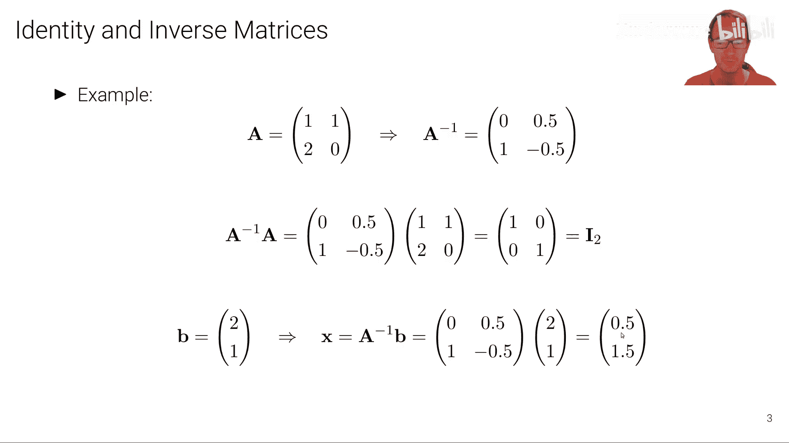

本节课中我们一起学习了：
*   **单位矩阵 (I_n)**：一种对角线为1、其余为0的特殊方阵，任何向量与之相乘都保持不变，是矩阵乘法中的“单位元”。
*   **逆矩阵 (A^{-1})**：对于一个方阵 **A**，其逆矩阵满足 **A^{-1} A = I**。它的作用是“抵消” **A** 的变换。
*   **应用**：逆矩阵为求解形如 **A x = b** 的线性方程组提供了一种理论方法，即 **x = A^{-1} b**。但需要注意逆矩阵存在的条件，并在实际计算中选用更稳定的数值算法。