# 006：向量与矩阵范数 📏

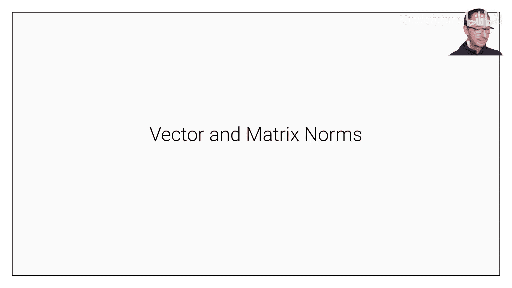

在本节课中，我们将要学习如何衡量向量和矩阵的“大小”。我们将介绍一个称为“范数”的函数，并探讨几种常见的范数类型及其性质。

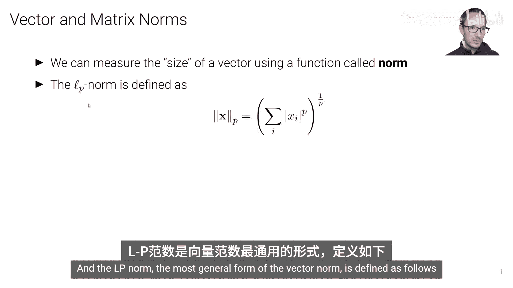

---

## 范数的定义与性质

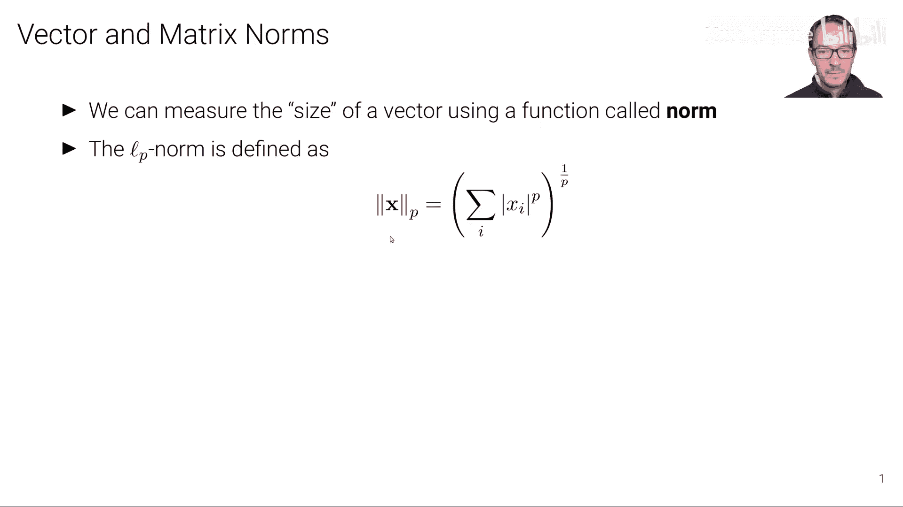

我们可以使用一个称为范数的函数来衡量向量的大小。最通用的向量范数形式是 **Lp 范数**，其定义如下：

**公式**：`||x||_p = (∑|x_i|^p)^(1/p)`

首先，范数的符号是向量符号左右两侧的两条竖线。这里的下标 `p` 定义了范数的 `p` 值。例如，在欧几里得范数（L2范数）的情况下，`p` 等于 2，因此我们会用 `2` 代替这里的 `p`。

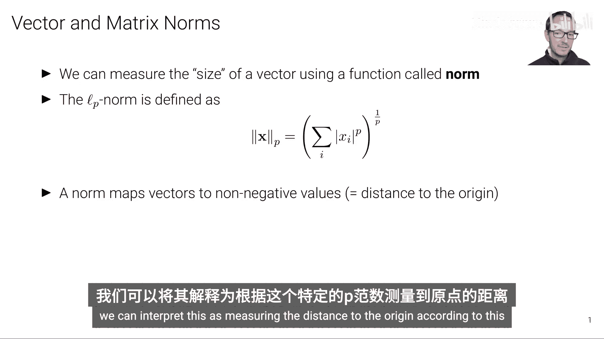

Lp 范数的定义是：我们取原始向量 `x` 的所有元素，取其绝对值，然后计算这些绝对值的 `p` 次方，将它们求和，最后对结果取 `1/p` 次方。通过这个方程，我们可以看到范数将向量映射到非负值。我们可以将其解释为根据这个特定的 Lp 范数来测量到原点的距离。

从数学上讲，一个范数函数 `f` 必须满足以下几个条件：

1.  **零向量条件**：如果向量的范数等于 0，那么该向量本身也必须等于 0。如果到原点的距离为 0，那么该向量的所有元素都必须为 0。
    **公式**：`||x|| = 0 ⇒ x = 0`

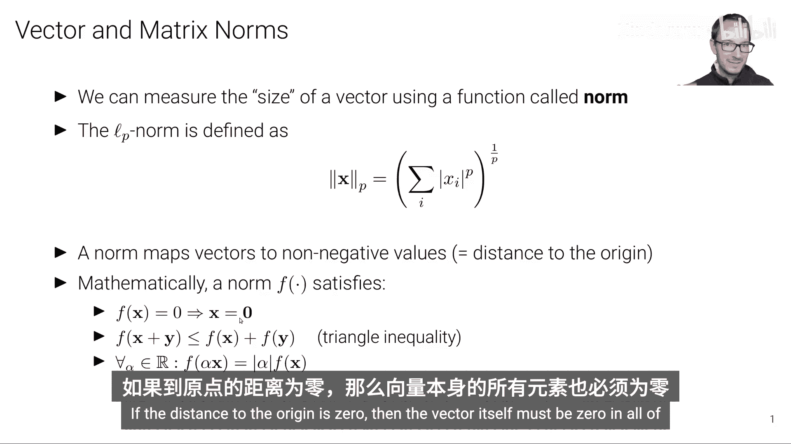

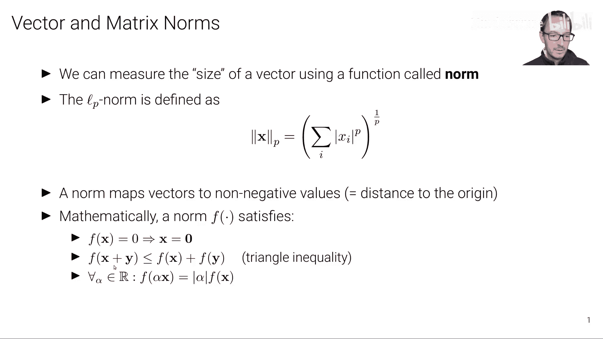

2.  **三角不等式**：向量 `x` 和 `y` 之和的范数小于或等于各自范数之和。
    **公式**：`||x + y|| ≤ ||x|| + ||y||`

3.  **齐次性**：对于任意标量 `α`，向量乘以 `α` 后的范数等于 `α` 的绝对值乘以该向量本身的范数。
    **公式**：`||αx|| = |α| * ||x||`

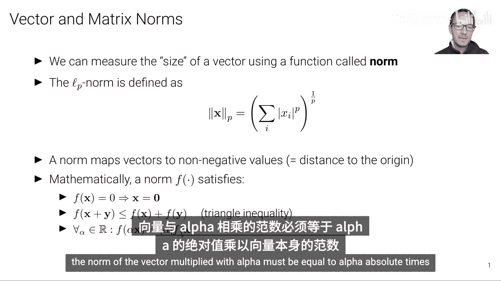

---

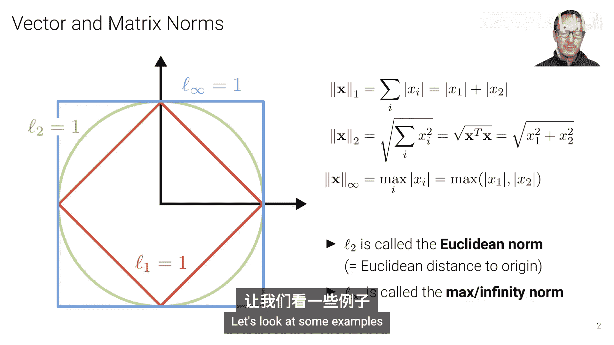

## 常见的向量范数示例

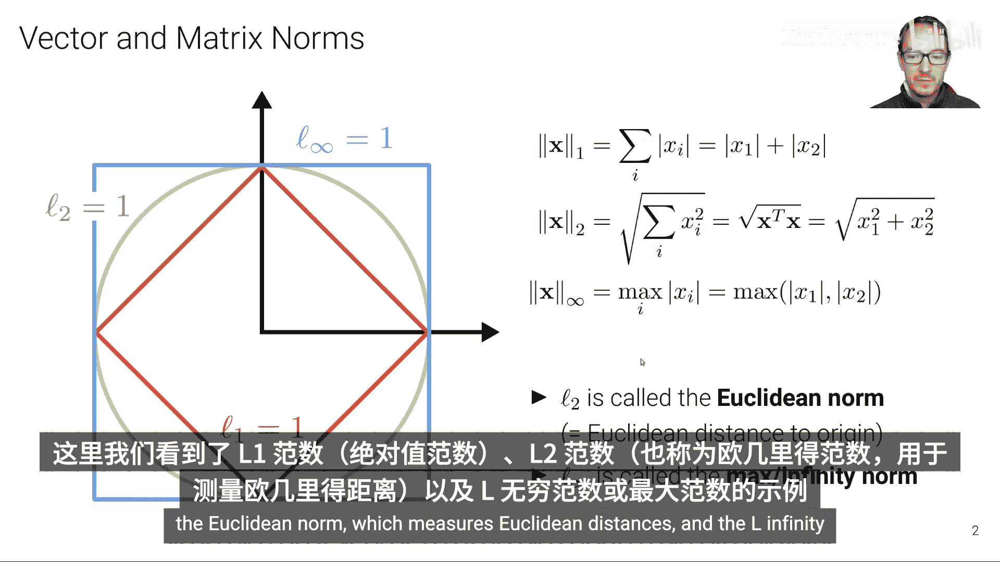

上一节我们介绍了范数的通用定义和性质，本节中我们来看看几种具体的、常用的向量范数。

以下是三种最常见的向量范数：

*   **L1 范数（绝对范数）**：`p = 1`。它是向量所有元素绝对值之和。
    **公式**：`||x||_1 = ∑|x_i|`

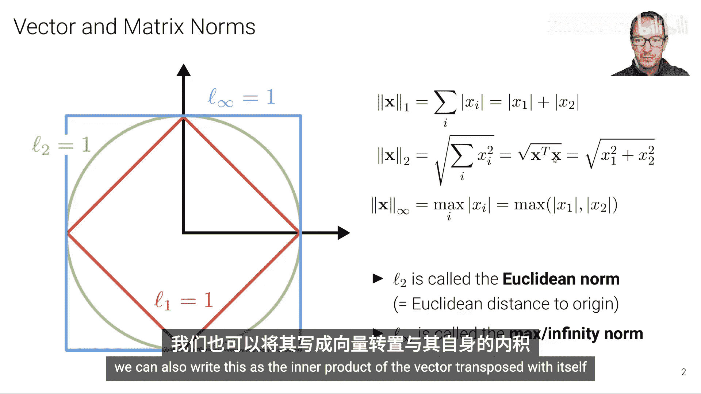

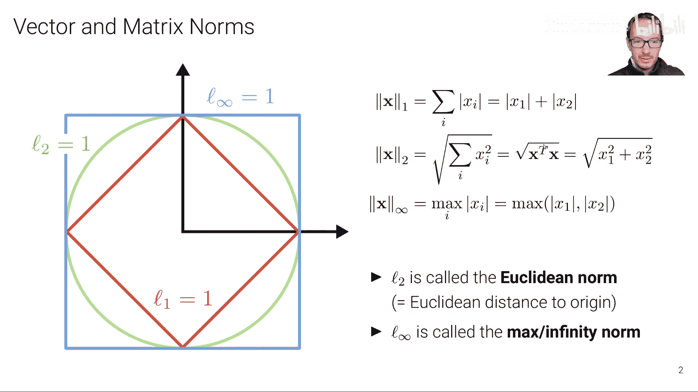

*   **L2 范数（欧几里得范数）**：`p = 2`。它测量的是欧几里得距离（直线距离）。我们也可以将其写为向量与其自身内积的平方根。
    **公式**：`||x||_2 = √(∑x_i^2) = √(x^T x)`

*   **L∞ 范数（最大值范数）**：`p` 趋近于无穷大。它是向量中绝对值最大的元素。
    **公式**：`||x||_∞ = max(|x_i|)`

---

## 范数的几何可视化

我们可以通过绘制“单位范数”的等高线来可视化这些范数，即所有范数值等于 1 的点构成的集合。以下是 L1、L2 和 L∞ 范数在二维空间中的形状：

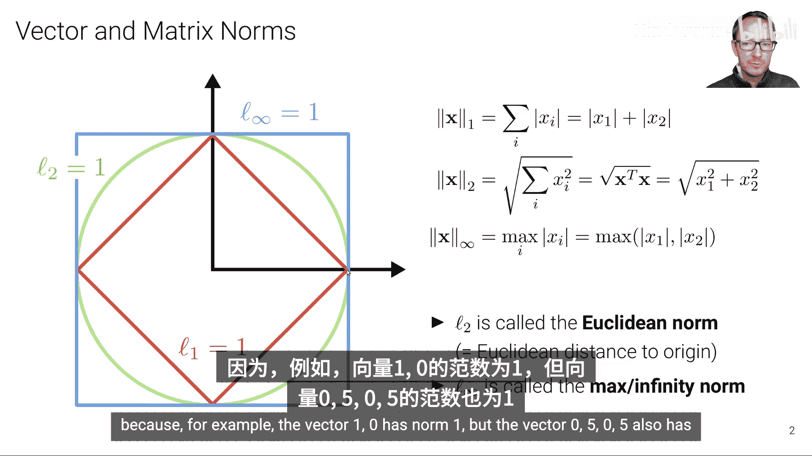

*   **L1 范数**：形成一个红色的菱形。例如，向量 `(1, 0)` 的范数为 1，向量 `(0.5, 0.5)` 的范数也为 1，向量 `(0, 1)` 的范数同样为 1。由于我们取每个元素的绝对值，负方向也是如此。

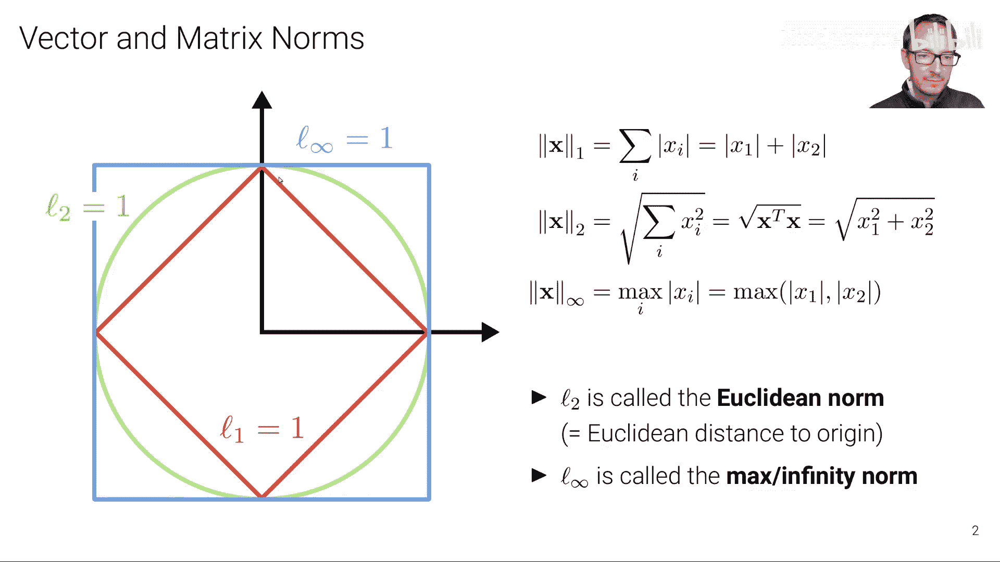

*   **L2 范数**：形成一个绿色的圆形。这是因为如果我们令 `√(x1^2 + x2^2) = 1`，得到的就是圆的方程。

*   **L∞ 范数**：形成一个蓝色的正方形。例如，在这条水平线上，所有点的 `x2` 坐标无关紧要，因为 `x1` 坐标已经是 1，所以这条线上所有点的 L∞ 范数都等于 1。

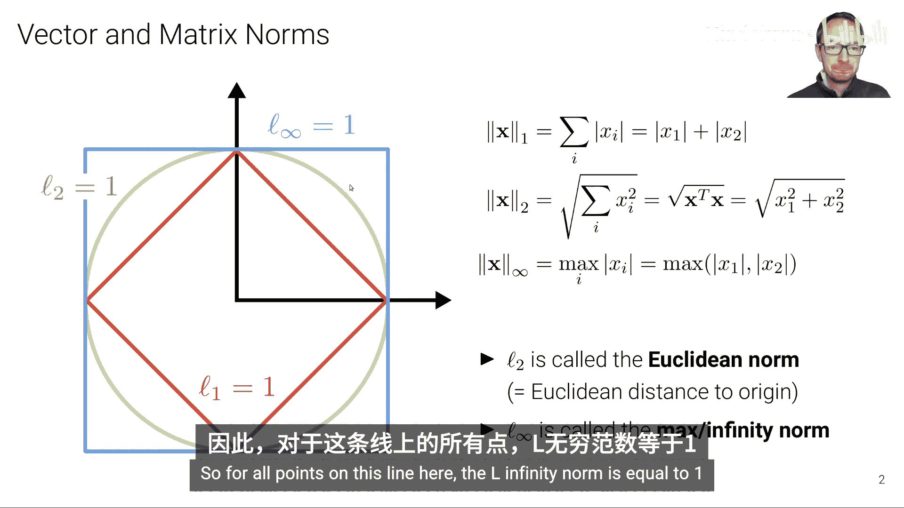

---

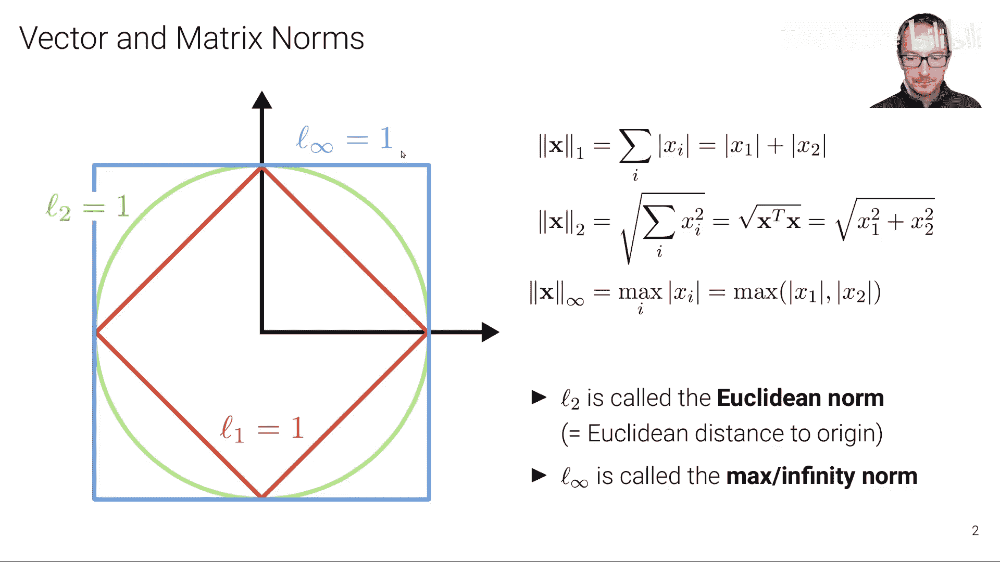

## 扩展与应用

最后，我们做一些扩展说明。

两个向量 `x` 和 `y` 的点积也可以用范数来表示：
**公式**：`x^T y = ||x||_2 * ||y||_2 * cos(θ)`
其中 `θ` 是向量 `x` 和 `y` 之间的夹角。

矩阵的大小也可以衡量。一个常见的矩阵大小度量是 **Frobenius 范数**，可以将其视为 L2 向量范数对矩阵的直接扩展。我们用下标 `F` 表示它，其定义是矩阵 `A` 所有元素平方和的平方根。
**公式**：`||A||_F = √(∑∑ A_ij^2)`

---

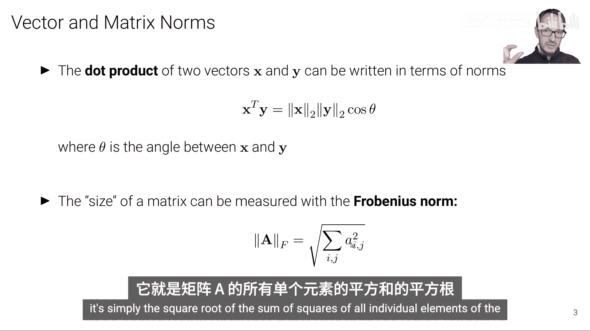

本节课中，我们一起学习了向量和矩阵范数的概念。我们定义了通用的 Lp 范数及其必须满足的数学性质，并具体介绍了 L1、L2 和 L∞ 这三种常见范数及其几何意义。最后，我们了解了点积与范数的关系，以及如何将范数的概念扩展到矩阵上。理解这些“大小”的度量方式，是深入学习线性代数和后续机器学习算法的基础。