# 008：特征值与奇异值分解 📊

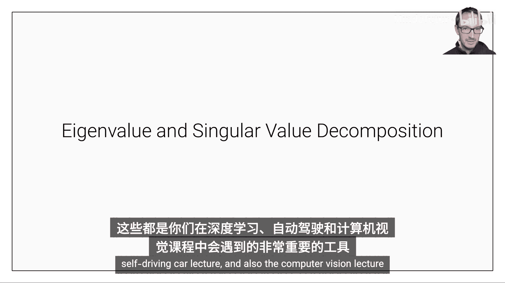

在本节课中，我们将学习两种非常重要的矩阵分解工具：特征值分解与奇异值分解。它们是深度学习、自动驾驶和计算机视觉等课程中的核心数学概念。通过将矩阵分解为更基础的组成部分，我们可以更好地理解矩阵的性质和其代表的线性变换。

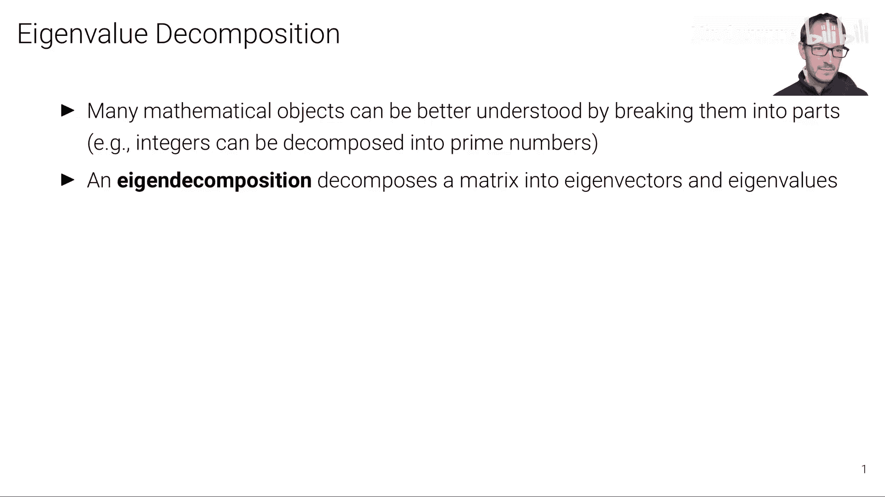

## 矩阵分解的意义

许多数学对象可以通过分解为组成部分来更好地理解。例如，整数可以分解为质因数，这能直接揭示该整数能被哪些数整除。类似地，我们关注如何分解矩阵。

## 特征值分解

特征值分解将一个矩阵分解为所谓的特征向量和特征值。

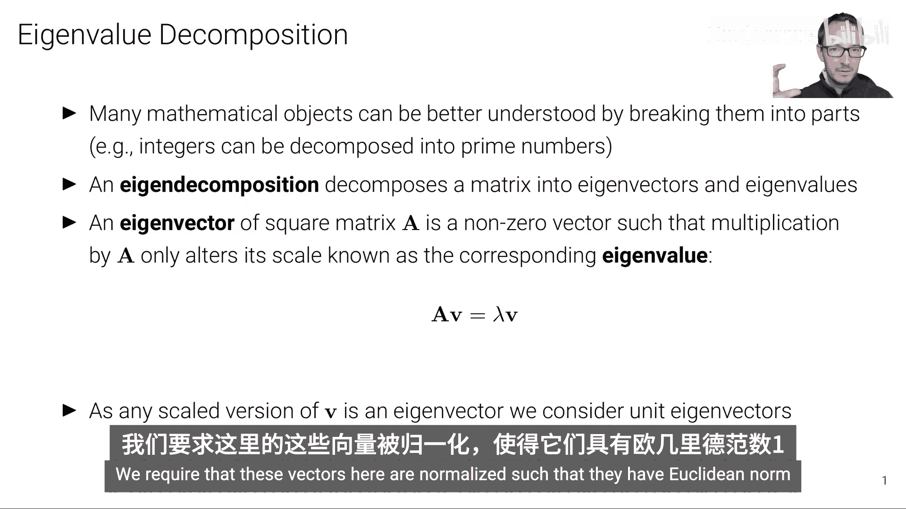

### 核心概念

一个方阵 **A** 的特征向量是一个非零向量 **v**，使得与 **A** 相乘仅改变其尺度（即长度），而不改变其方向。这个缩放因子被称为对应的特征值 **λ**。

用公式表示即：
**A v = λ v**

任何缩放后的 **v** 仍然是特征向量。为了使特征分解唯一，我们通常只考虑单位特征向量，即要求这些向量的欧几里得范数为 1。

### 构建分解矩阵

我们将所有特征向量拼接起来，形成一个矩阵 **V**，其中每一列都是一个特征向量。同样地，我们将所有特征值放入一个对角矩阵 **Λ** 中，使得特征值 **λ₁, λ₂, ...** 按顺序排列在对角线上，其余位置为0。

作为补充说明，为了消除歧义，我们通常按降序排列特征值。这意味着如果 **λ₁** 不是最大的特征值，我们就将其与更大的特征值交换，直到实现降序排列。当然，我们也需要以同样的方式交换 **V** 的列，使它们保持对应关系。

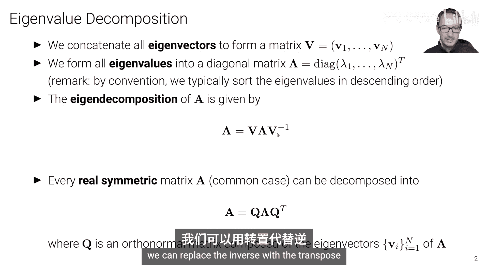

矩阵 **A** 的特征值分解由以下表达式给出：
**A = V Λ V⁻¹**

可以证明，每个实方阵都有这样的特征分解。

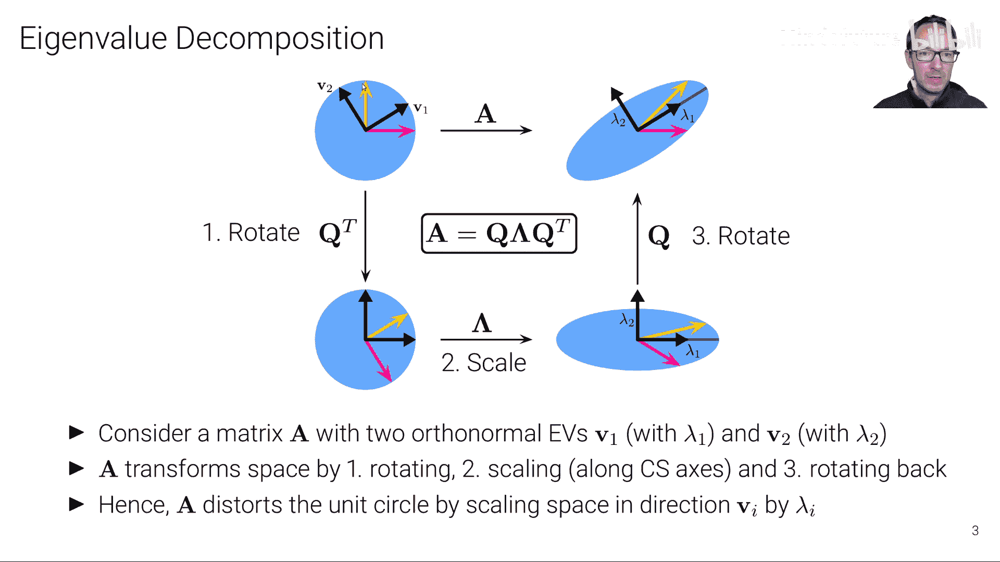

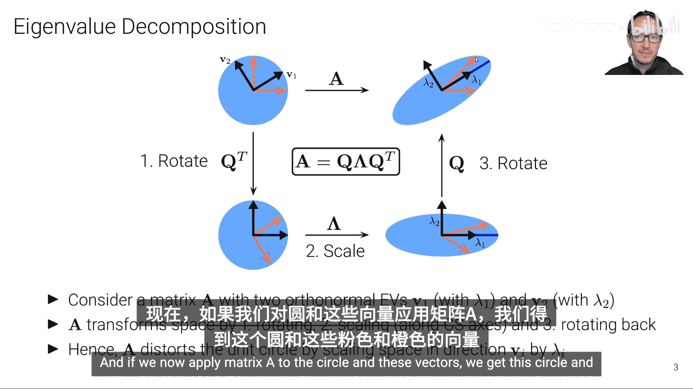

### 对称矩阵的特殊情况

更进一步，对于非常常见的实对称矩阵 **A**，它可以被分解为一个更简单的表达式：
**A = Q Λ Qᵀ**

这里没有逆矩阵 **Q⁻¹**，只有转置 **Qᵀ**。这是因为在这种情况下，**Q** 是一个由 **A** 的特征向量组成的正交矩阵，其所有列都相互正交。这意味着我们可以用转置来替代求逆。

### 几何解释

上一节我们介绍了特征值分解的数学定义，本节中我们来看看它的几何意义，即这个变换如何影响空间中的元素集合。

在下图中，黑色箭头表示第一和第二特征向量 **v₁** 和 **v₂**。图中还绘制了一个圆（代表一组点）以及两个没有特殊含义的示例向量，以便观察它们如何被变换。

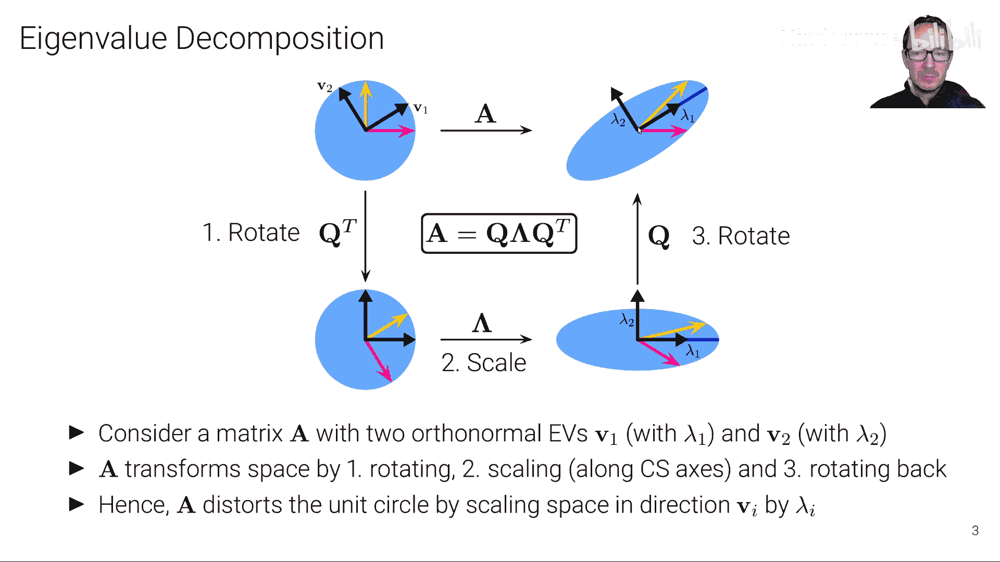

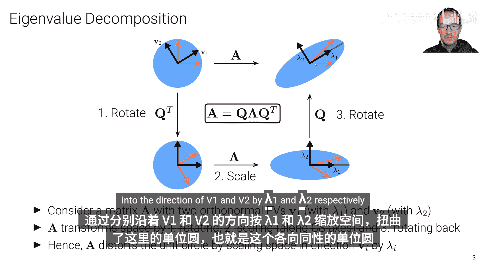

当我们对圆和这些向量应用矩阵 **A** 时，它们会发生变化。我们可以通过将变换分解为三个子变换来理解这个过程：
1.  首先乘以 **Qᵀ**。由于 **Q** 是正交矩阵，**Qᵀ** 相当于一个旋转矩阵。它将整个坐标系旋转，使其与坐标轴对齐。
2.  然后应用对角矩阵 **Λ**，这意味着我们沿着各个坐标轴按特征值进行缩放。例如，如果 **λ₁ > 1** 且 **λ₂ < 1**，则水平方向被拉伸，垂直方向被压缩。
3.  最后应用 **Q**，即旋转回原始坐标系。

通过这三个子变换，我们有效地将各向同性的单位圆，沿着 **v₁** 和 **v₂** 的方向，分别按 **λ₁** 和 **λ₂** 进行了缩放和扭曲。

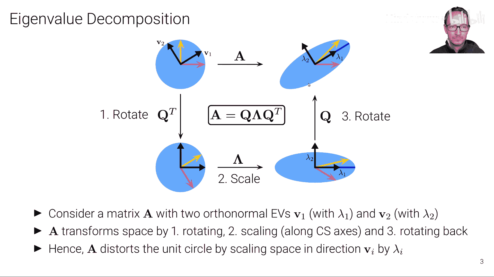

### 相关性质

以下是关于特征值的一些重要性质：
*   如果一个矩阵的任何特征值为0，则该矩阵被称为**奇异矩阵**。这意味着其列之间存在依赖关系，因此矩阵不可逆。
*   矩阵的秩等于其非零特征值的数量。这是一个很方便的性质，通过特征值分解，我们可以知道有多少特征值为0或接近0，从而判断矩阵是否可逆以及对应线性系统有多少解。
*   只有满秩矩阵（即所有特征值均不为0）才是可逆的。
*   所有特征值均为正的矩阵称为**正定矩阵**。
*   所有特征值均为正或零的矩阵称为**半正定矩阵**。对于半正定矩阵，对于所有向量 **x**，有 **xᵀ A x ≥ 0**。正定矩阵额外保证，如果 **xᵀ A x = 0**，则向量 **x** 必须为零向量。

### 计算方法

当然，我们可以用纸笔推导和计算特征值分解。但在实践中，我们通常不需要这样做，因为有优秀的数值线性代数包可供使用。例如，在 Python 的 NumPy 库中，我们可以使用 `numpy.linalg.eig` 函数，通过一次调用即可将矩阵 **A** 分解为其特征向量和特征值。

## 奇异值分解

现在，让我们来讨论另一种分解：奇异值分解。为什么我们需要另一种分解呢？特征值分解的问题在于它只能应用于方阵。然而，对于非方阵，我们可以使用奇异值分解。

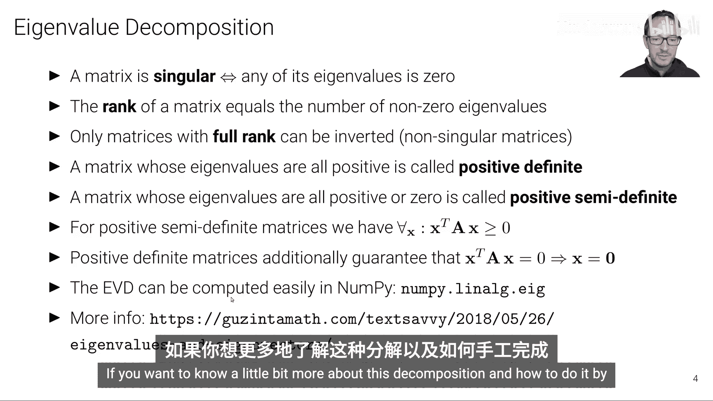

### 核心概念

奇异值分解在形式上与特征值分解相似，但它可以分解一个非方阵 **A**（例如一个 m×n 的实数矩阵）。

其分解形式为：
**A = U D Vᵀ**

其中：
*   **U** 是一个 m×m 的正交矩阵。
*   **D** 是一个 m×n 的对角矩阵（在非方阵情况下，它是一个矩形对角矩阵）。
*   **V** 是一个 n×n 的正交矩阵。

**D** 对角线上的元素被称为**奇异值**。**U** 和 **V** 的列分别被称为**左奇异向量**和**右奇异向量**。

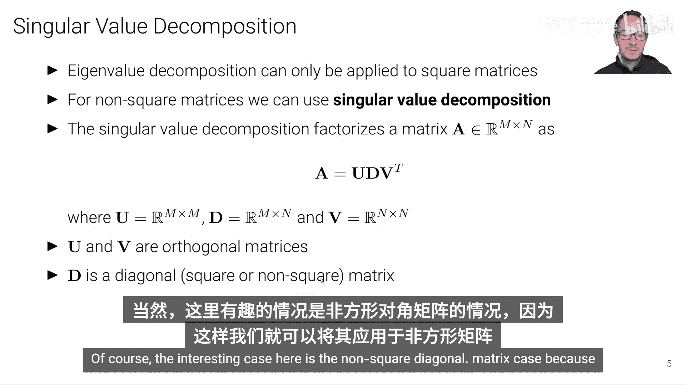

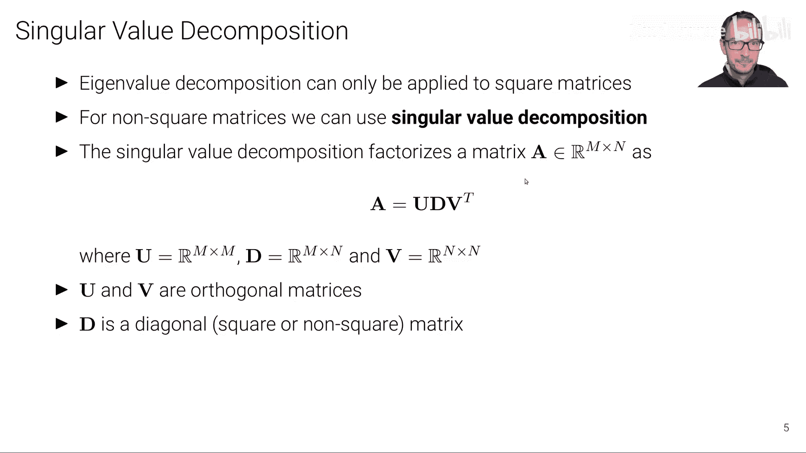

### 与特征值分解的关系

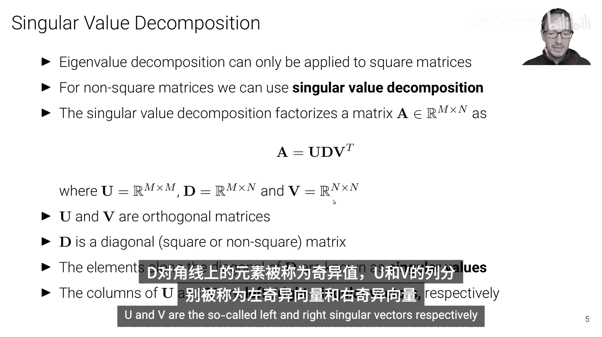

实际上，特征值分解和奇异值分解密切相关。考虑任意实矩阵 **A** 的奇异值分解 **A = U D Vᵀ**。

如果我们计算 **AᵀA**，利用转置的规则和 **U** 的正交性（**UᵀU = I**），可以得到：
**AᵀA = (V Dᵀ Uᵀ)(U D Vᵀ) = V Dᵀ D Vᵀ = V D² Vᵀ**

由此可见，**A** 的右奇异向量 **V** 正是矩阵 **AᵀA** 的特征向量。类似地，左奇异向量 **U** 是矩阵 **AAᵀ** 的特征向量。而 **AᵀA** 和 **AAᵀ** 的特征值等于 **A** 的奇异值的平方。

## 应用实例：主成分分析

最后，让我们看一个应用实例，这个应用我们将在深度学习课程的第11讲中更详细地探讨，它被称为**主成分分析**。

PCA 是一种用于分析大型高维数据集的技术。我们可以将任何高维数据集投影到一个更小的维度空间中以便观察。我们这样做的目的是在投影时保留最多的信息，即我们希望沿着方差最大的方向进行投影。

这里的一个美妙特性是：如果我们计算散点矩阵或协方差矩阵的特征向量，这些特征向量被称为**主成分**，它们指向方差最大的方向。这一点可以被证明。

在下图的示例中，我们有一个蓝色的二维数据集。我们计算了其特征向量，可以看到最大的方差分布在这个方向上，因为数据点是这样展开的。下一个与这个向量正交的最大方差方向是第二个特征向量所指的方向。

因此，如果我们要将这个二维数据集投影到一维空间中，我们能做的最佳选择就是沿着这条线（第一主成分方向）投影，因为这是方差最大化分布的方向。在此图示中，两个特征向量 **w₁** 和 **w₂** 按其对应特征值的平方根进行了缩放，这指示了在每个方向上的标准差分布范围。

## 总结

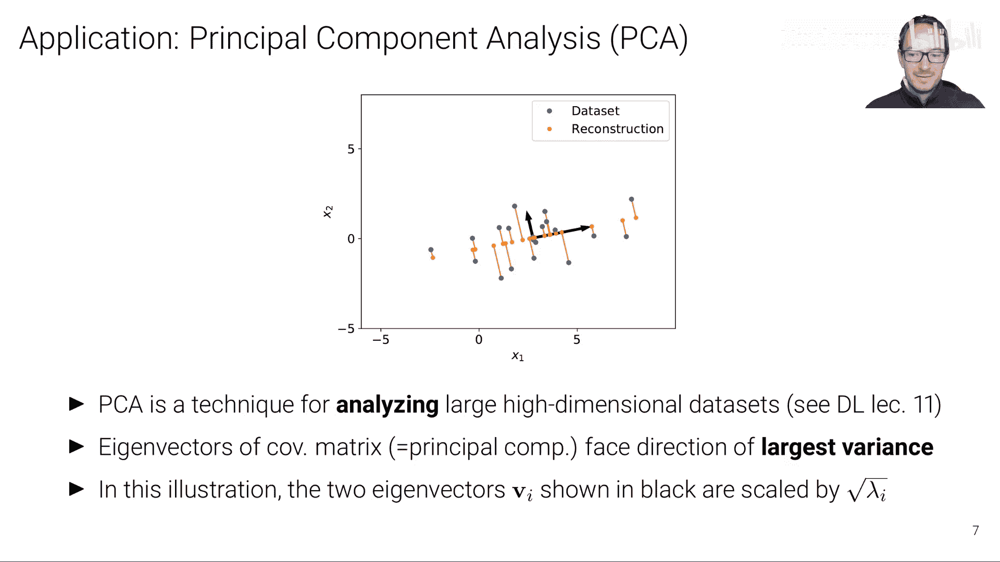

本节课中，我们一起学习了两种强大的矩阵分解方法：特征值分解与奇异值分解。特征值分解适用于方阵，揭示了矩阵在其特征向量方向上的缩放特性。奇异值分解则更具普适性，可应用于任意矩阵，并与之密切相关。最后，我们看到了这些概念在数据降维技术（如主成分分析）中的实际应用，它们帮助我们在保留关键信息的同时简化数据。掌握这些工具对于理解后续更复杂的机器学习与深度学习模型至关重要。