# 009：迹算子与行列式 🧮

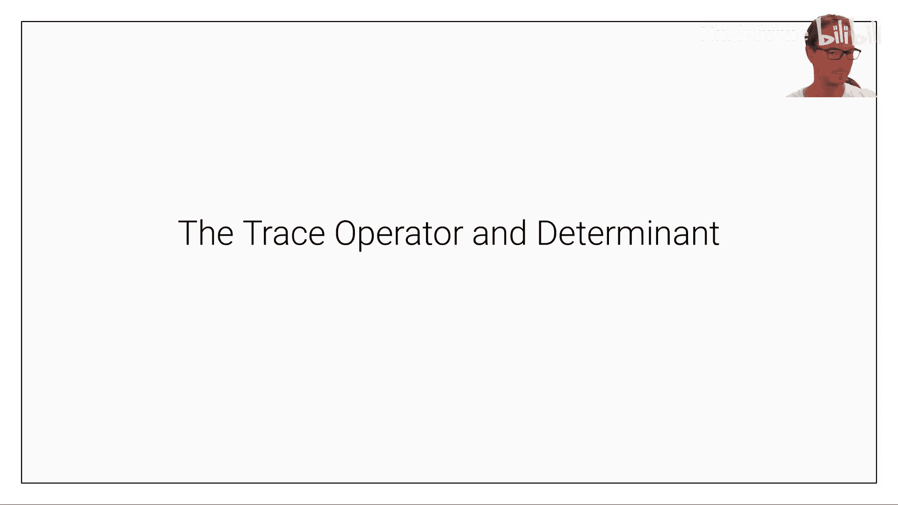

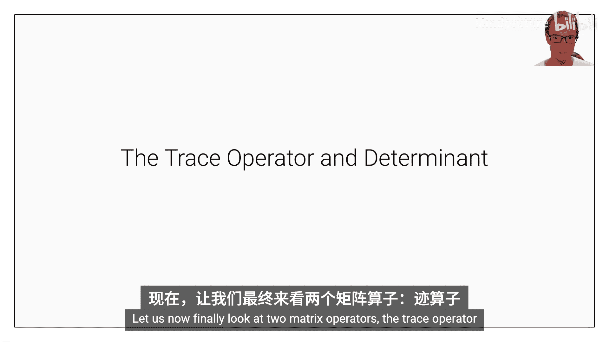

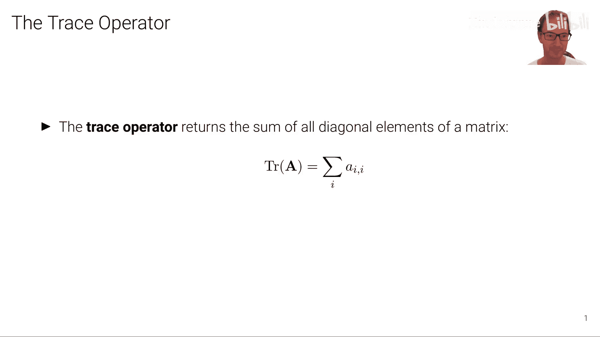

在本节课中，我们将学习两个重要的矩阵算子：迹算子和矩阵的行列式。它们是线性代数中的核心概念，对于理解矩阵的性质和后续的深度学习理论至关重要。

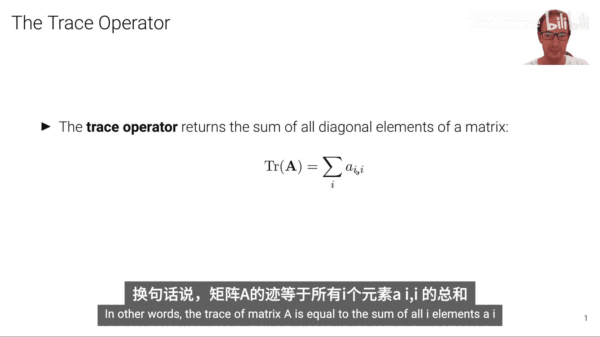

上一节我们介绍了特征值分解，本节中我们来看看两个与矩阵特征值密切相关的算子。

## 迹算子

迹算子返回一个矩阵所有对角线元素的和。换句话说，对于一个矩阵 **A**，其迹表示为 **tr(A)**，计算公式如下：

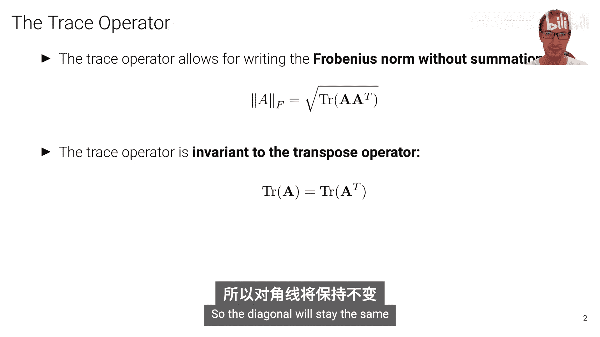

**tr(A) = Σᵢ Aᵢᵢ**

其中 **Aᵢᵢ** 表示矩阵 **A** 第 **i** 行第 **i** 列的元素。

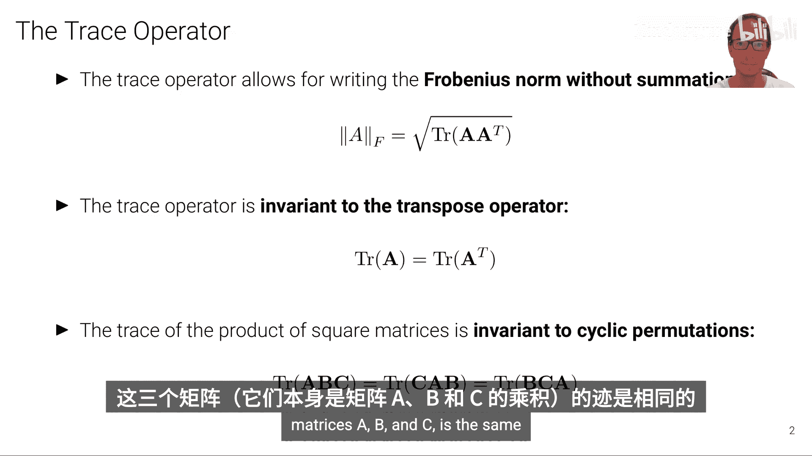

迹算子有几个重要的性质。以下是关于迹算子的一些关键点：

*   **弗罗贝尼乌斯范数**：迹算子可以简化弗罗贝尼乌斯范数的写法。矩阵 **A** 的弗罗贝尼乌斯范数可以表示为 **||A||_F = √(tr(AAᵀ))**。
*   **转置不变性**：矩阵的迹在转置操作下保持不变，即 **tr(A) = tr(Aᵀ)**。这是因为转置操作不会改变矩阵的对角线元素。
*   **循环置换不变性**：对于多个方阵的乘积，迹在循环置换下保持不变。例如，对于三个方阵 **A**、**B**、**C**，有 **tr(ABC) = tr(CAB) = tr(BCA)**。

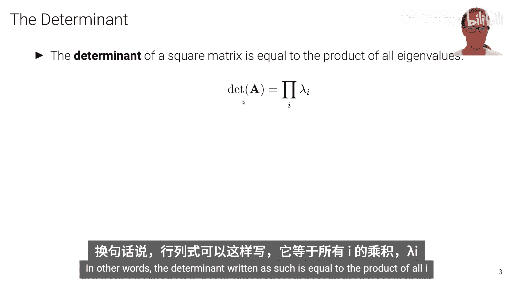

## 行列式

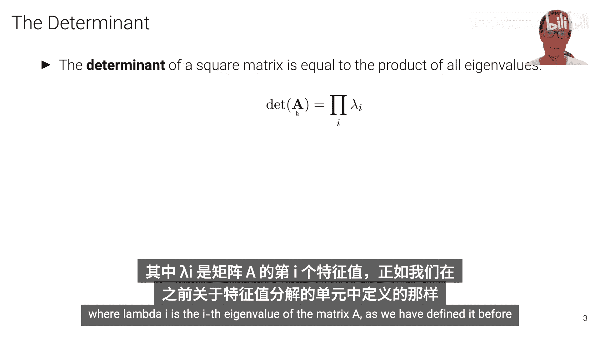

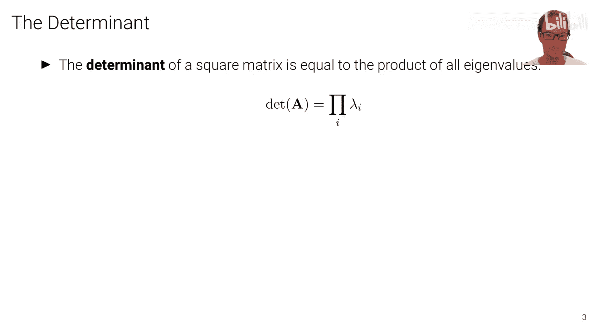

与迹算子不同，方阵的行列式等于其所有特征值的乘积。对于一个矩阵 **A**，其行列式表示为 **det(A)**，计算公式如下：

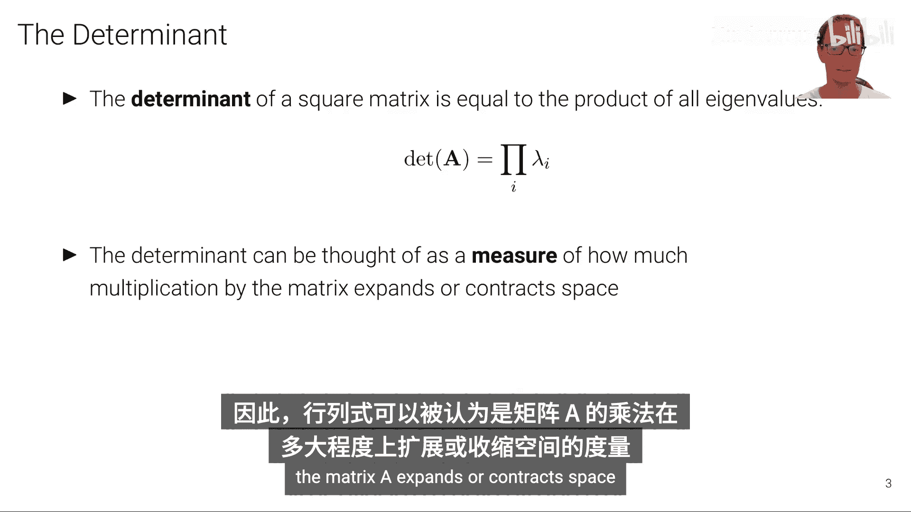

**det(A) = Πᵢ λᵢ**

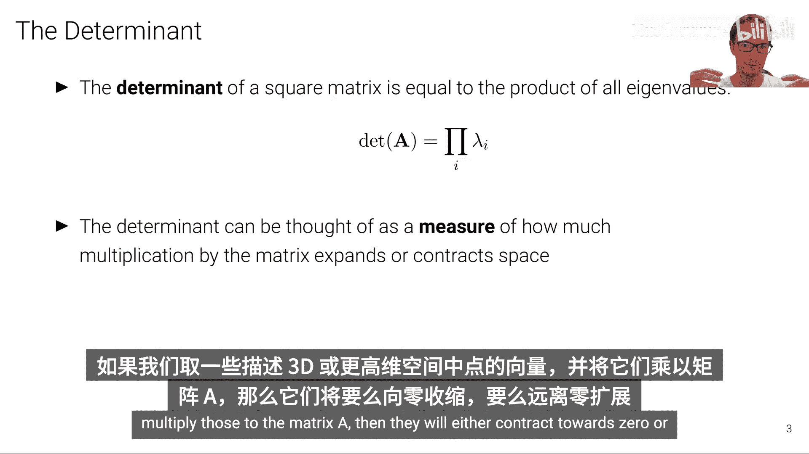

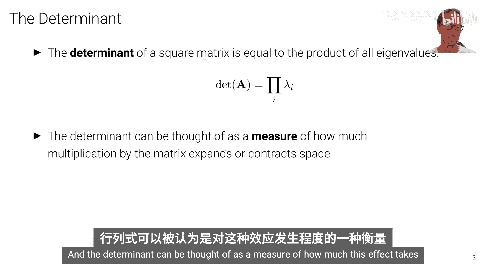

其中 **λᵢ** 是矩阵 **A** 的第 **i** 个特征值。

行列式可以被视为衡量矩阵 **A** 对空间进行伸缩变换程度的一个指标。

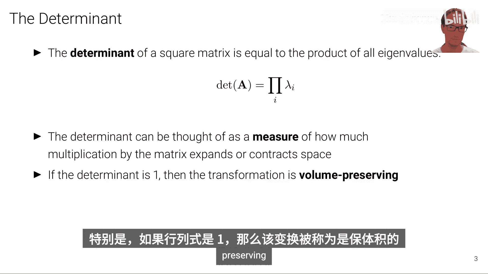

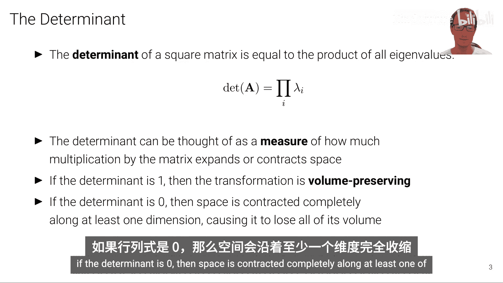

以下是行列式值的几何解释：

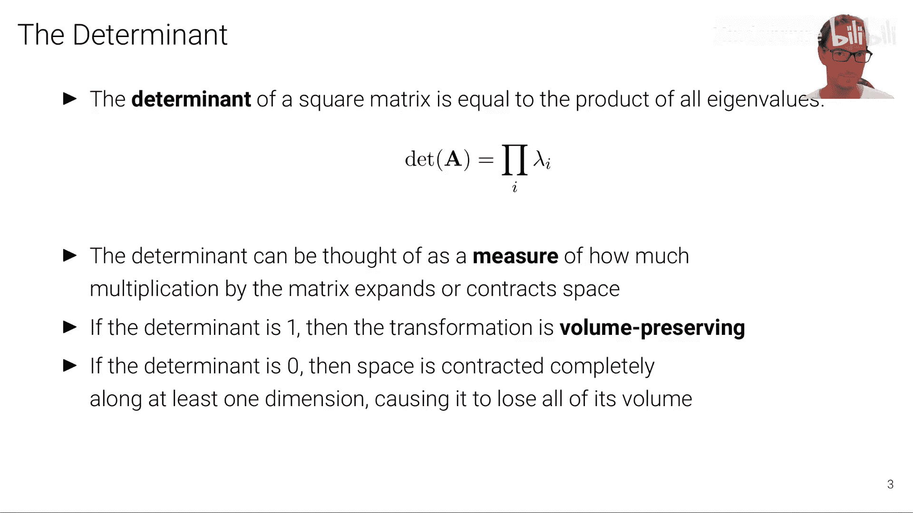

*   **行列式 = 1**：变换是**保体积**的。输入向量所描述的空间体积在乘以矩阵 **A** 后保持不变。
*   **行列式 = 0**：空间沿着至少一个维度被完全压缩。这意味着矩阵是**奇异**的或**秩亏**的，它将整个空间的体积压缩为零。
*   **行列式 > 1 或 0 < 行列式 < 1**：变换分别导致空间**膨胀**或**收缩**。行列式的绝对值大小反映了膨胀或收缩的程度。

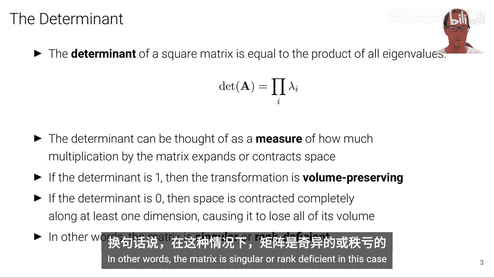

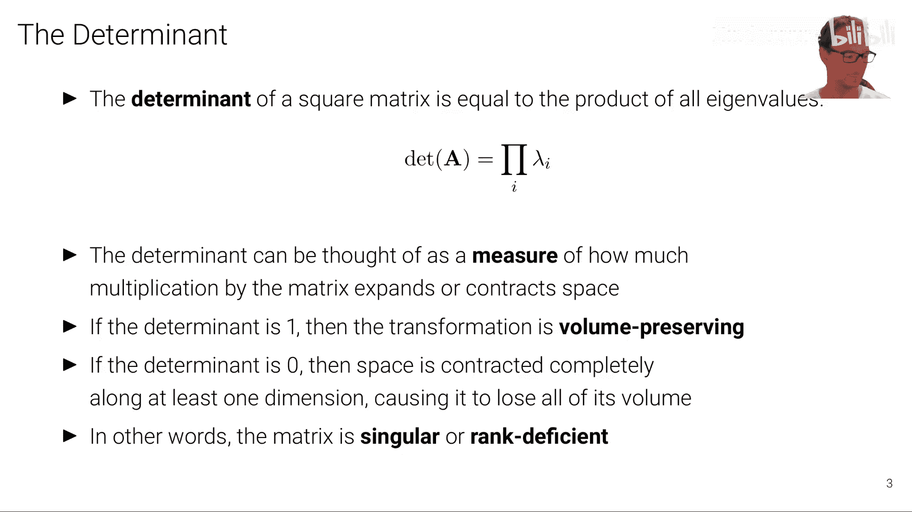

本节课中我们一起学习了迹算子和行列式这两个矩阵算子。我们了解了迹是矩阵对角线元素之和，而行列式是所有特征值的乘积。更重要的是，我们探讨了行列式的几何意义——它衡量了矩阵变换对空间体积的缩放效应。理解这些概念是掌握后续更复杂线性代数运算和深度学习模型的基础。