# 011：向量微积分 🧮

在本节课中，我们将从微分学转向向量微积分，即向量场的微分（以及积分）。本单元我们只讨论微分。这部分内容与计算机视觉和深度学习高度相关，因为在这些领域中我们大量处理矩阵，因此需要了解如何对它们进行微积分运算。

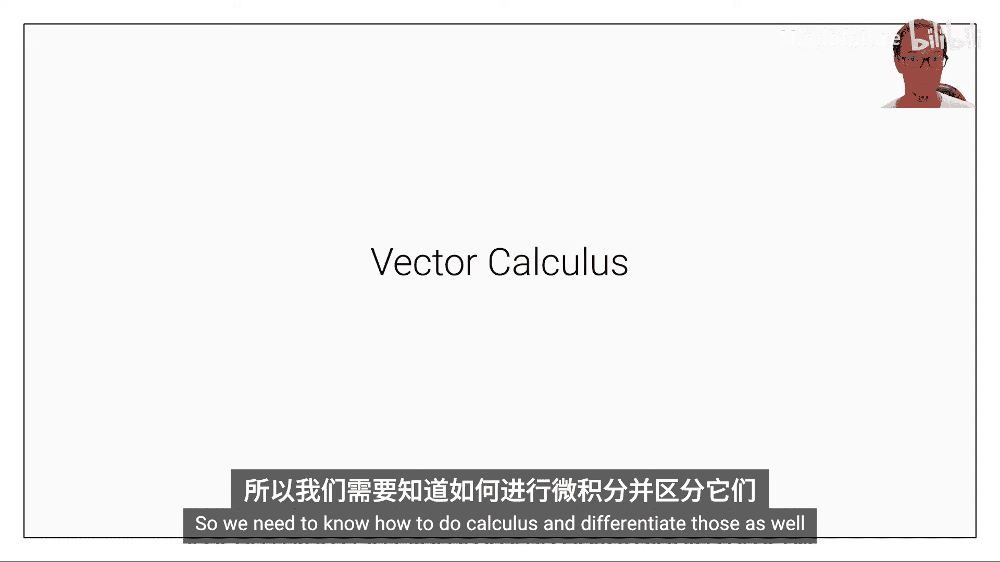

## 概述

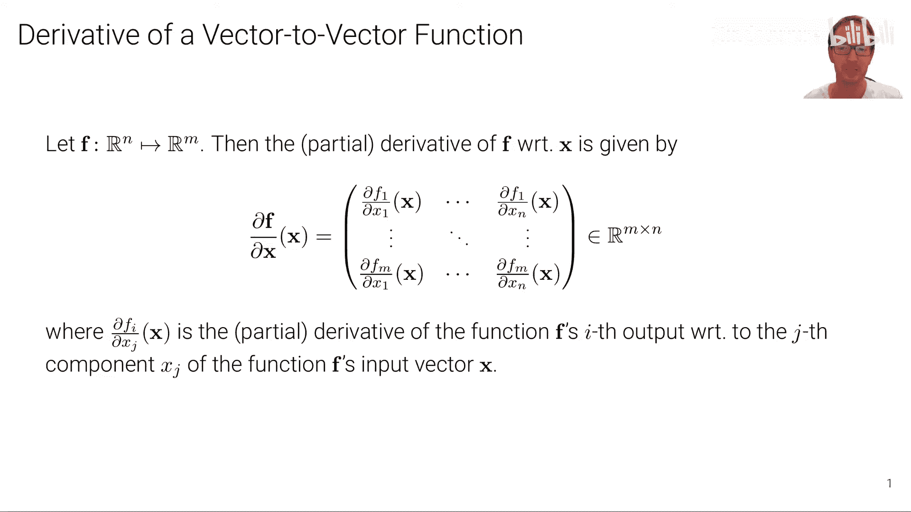

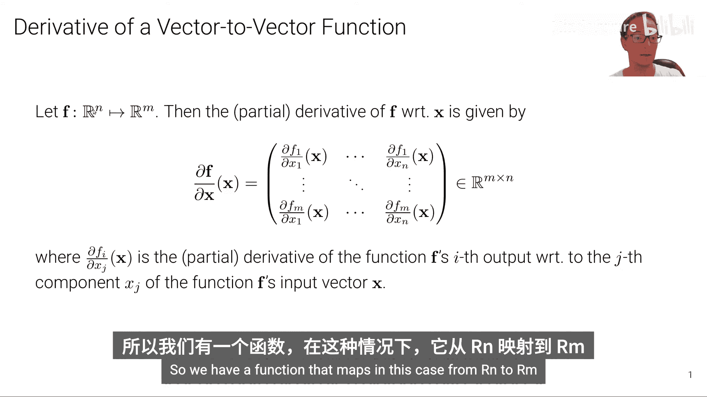

向量微积分处理的是输入和输出均为多维向量的函数。我们将学习如何计算这类函数的导数，特别是雅可比矩阵和梯度，并理解链式法则在向量函数中的形式。这些是理解深度学习模型（如神经网络）中参数优化（如梯度下降）的基础。

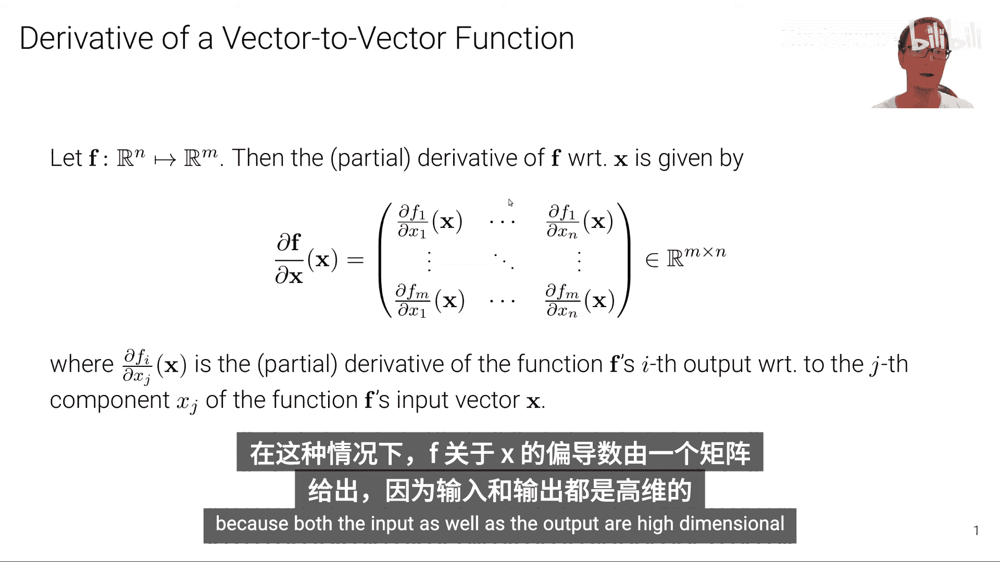

---

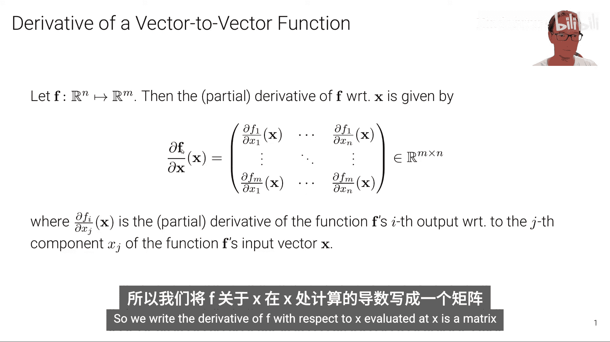

## 向量到向量函数的导数

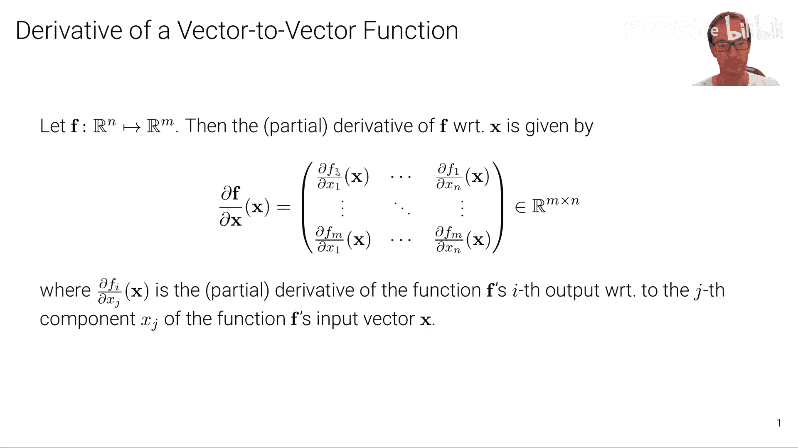

上一节我们讨论了多元标量函数的导数。本节中，我们来看看当函数的输入和输出都是向量时，导数会是什么形式。

考虑一个函数 **f**，它从 **R^n** 映射到 **R^m**。我们使用粗体符号表示向量：

**f**: **R^n** → **R^m**

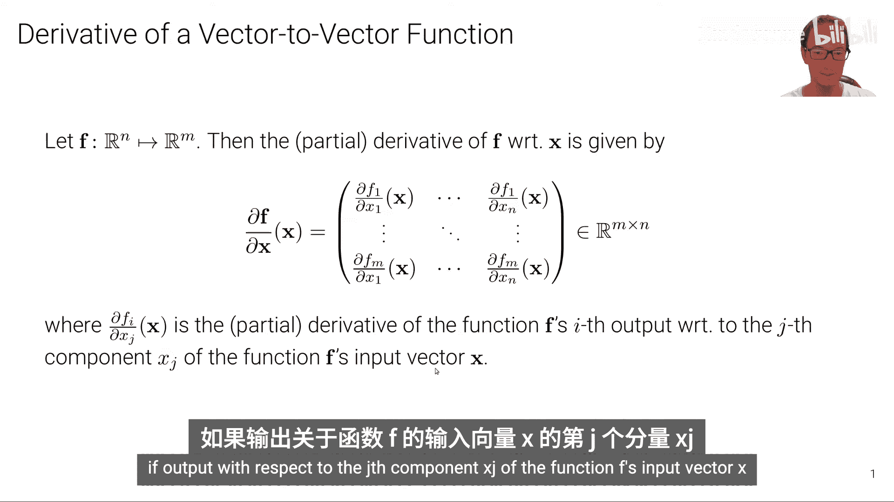

对于这样的函数，其导数（称为**雅可比矩阵**）是一个矩阵。这是因为我们需要描述输入向量 **x** 的每一个微小变化如何影响输出向量 **f(x)** 的每一个分量。

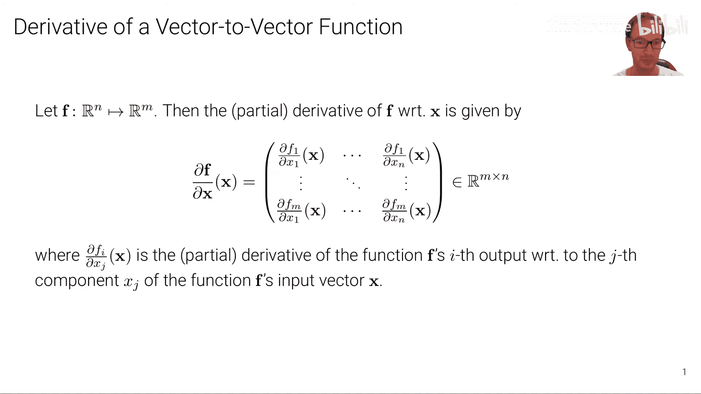

函数 **f** 在点 **x** 处关于 **x** 的偏导数定义如下：

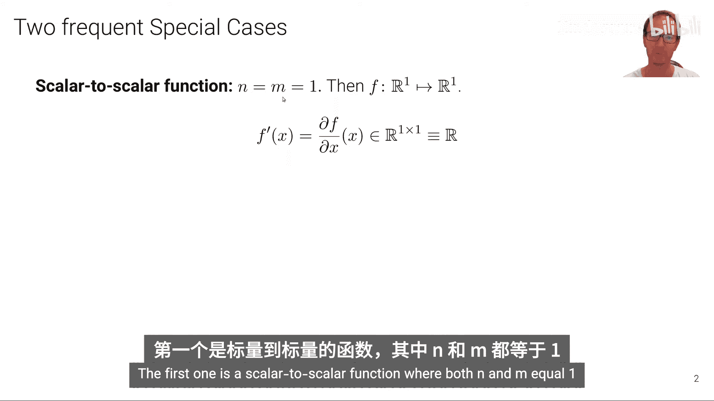

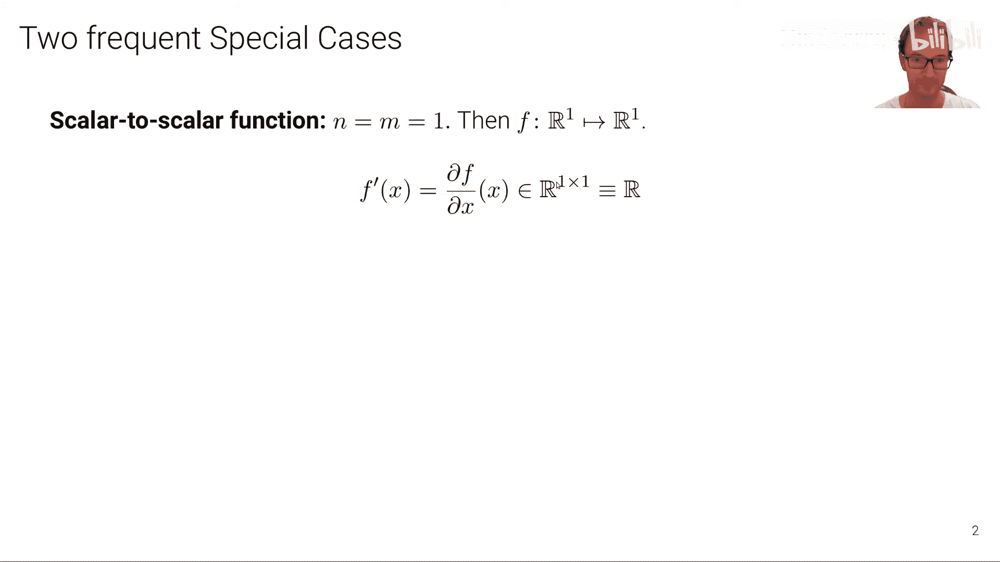

$$
\frac{\partial \mathbf{f}}{\partial \mathbf{x}}(\mathbf{x}) =
\begin{bmatrix}
\frac{\partial f_1}{\partial x_1}(\mathbf{x}) & \frac{\partial f_1}{\partial x_2}(\mathbf{x}) & \cdots & \frac{\partial f_1}{\partial x_n}(\mathbf{x}) \\
\frac{\partial f_2}{\partial x_1}(\mathbf{x}) & \frac{\partial f_2}{\partial x_2}(\mathbf{x}) & \cdots & \frac{\partial f_2}{\partial x_n}(\mathbf{x}) \\
\vdots & \vdots & \ddots & \vdots \\
\frac{\partial f_m}{\partial x_1}(\mathbf{x}) & \frac{\partial f_m}{\partial x_2}(\mathbf{x}) & \cdots & \frac{\partial f_m}{\partial x_n}(\mathbf{x})
\end{bmatrix}
$$

这个矩阵是一个 **m × n** 矩阵。矩阵中的第 i 行、第 j 列元素是第 i 个输出分量 \( f_i \) 关于第 j 个输入分量 \( x_j \) 的偏导数。

---

## 两种重要的特殊情况

理解了通用形式后，我们来看两个在深度学习中极其常见的特例。

### 1. 标量到标量函数 (n=1, m=1)

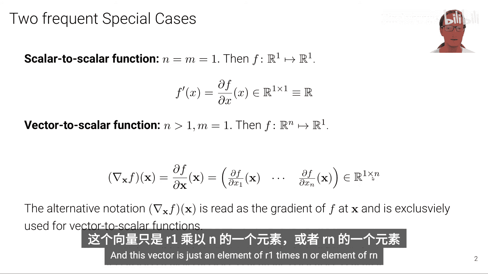

这是最基础的微积分情况。函数形式为：
\( f: \mathbb{R} \to \mathbb{R} \)
其导数就是我们所熟知的单变量导数，是一个 1×1 矩阵（即一个实数）：
$$
\frac{df}{dx}(x) \in \mathbb{R}
$$

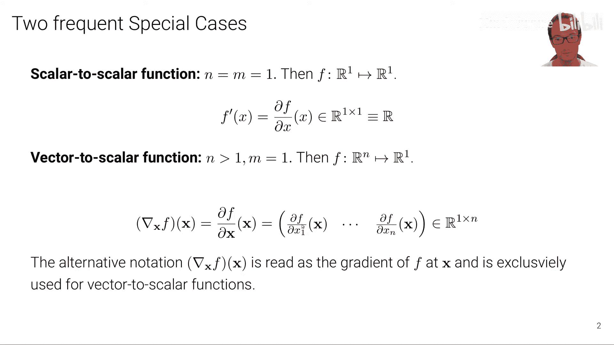

### 2. 向量到标量函数 (n>1, m=1)

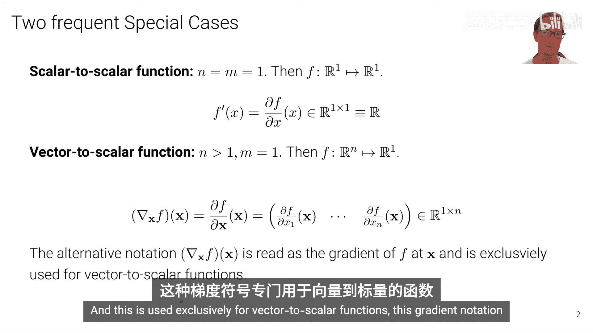

这是深度学习中**损失函数**的典型情况：输入是许多参数（一个向量），输出是一个标量损失值。
函数形式为：
\( f: \mathbb{R}^n \to \mathbb{R} \)
其导数是一个特殊的向量，称为**梯度**，记作 \( \nabla_{\mathbf{x}} f \) 或 \( \frac{\partial f}{\partial \mathbf{x}} \)。
梯度是一个 **n** 维行向量（或列向量，取决于约定）：

$$
\nabla_{\mathbf{x}} f(\mathbf{x}) = \frac{\partial f}{\partial \mathbf{x}}(\mathbf{x}) = \begin{bmatrix} \frac{\partial f}{\partial x_1}(\mathbf{x}), & \frac{\partial f}{\partial x_2}(\mathbf{x}), & \cdots, & \frac{\partial f}{\partial x_n}(\mathbf{x}) \end{bmatrix}
$$

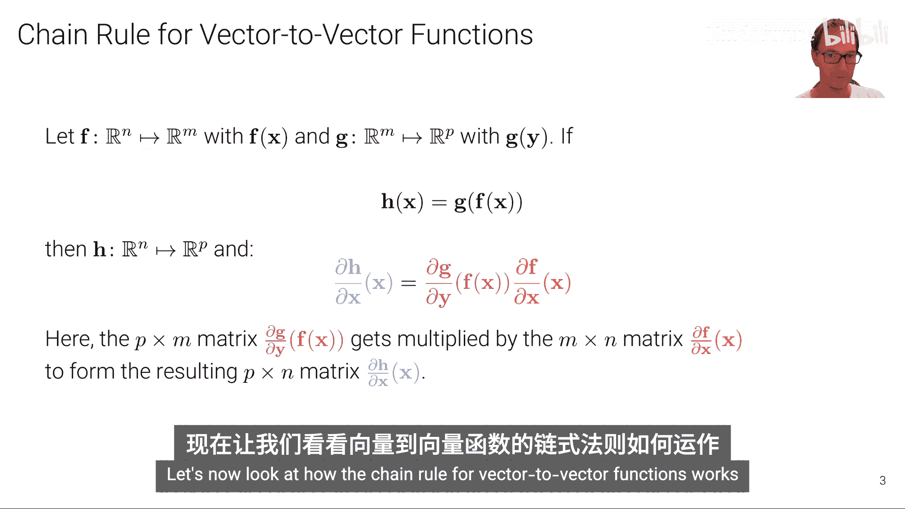

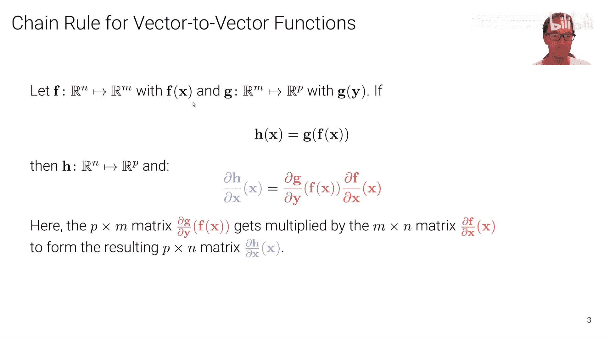

梯度指向函数值增长最快的方向，在优化算法（如梯度下降）中用于更新参数。

---

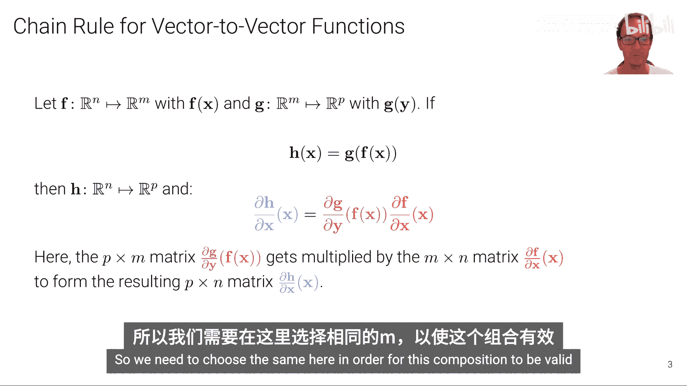

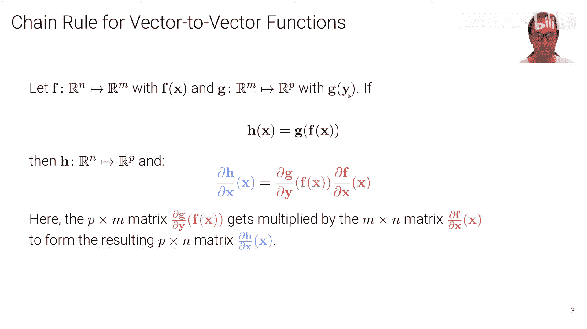

## 向量值函数的链式法则

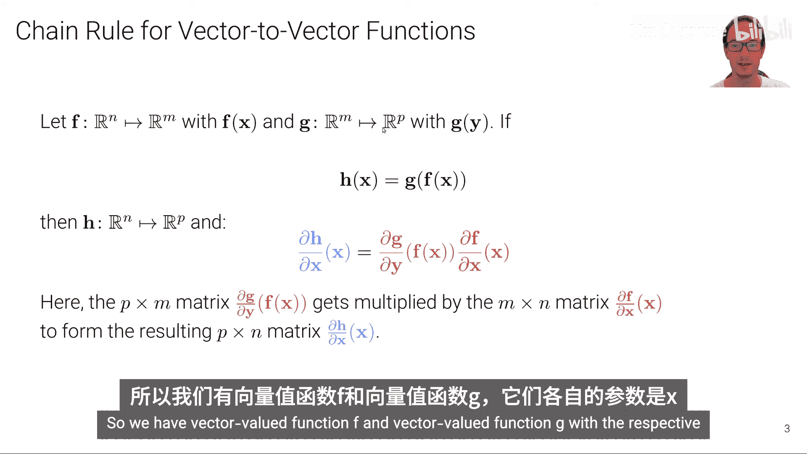

现在，让我们将链式法则推广到向量函数。这是进行复杂函数求导（如神经网络反向传播）的核心工具。

假设我们有两个函数：
- **f**: **R^n** → **R^m**， 自变量为 **x**
- **g**: **R^m** → **R^p**， 自变量为 **y**

我们构造复合函数 **h**(**x**) = **g**(**f**(**x**))。那么 **h**: **R^n** → **R^p**。

向量值函数的链式法则如下：

$$
\frac{\partial \mathbf{h}}{\partial \mathbf{x}}(\mathbf{x}) = \frac{\partial \mathbf{g}}{\partial \mathbf{y}}(\mathbf{f}(\mathbf{x})) \cdot \frac{\partial \mathbf{f}}{\partial \mathbf{x}}(\mathbf{x})
$$

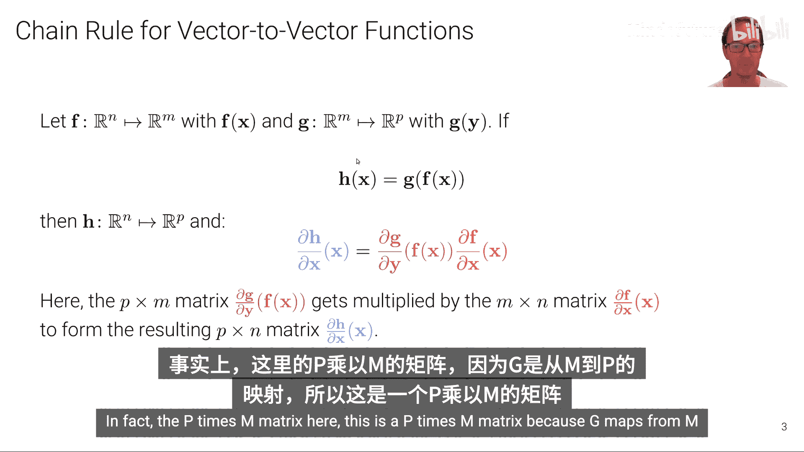

**关键点**：
- \( \frac{\partial \mathbf{g}}{\partial \mathbf{y}} \) 是一个 **p × m** 矩阵。
- \( \frac{\partial \mathbf{f}}{\partial \mathbf{x}} \) 是一个 **m × n** 矩阵。
- 它们的矩阵乘法结果 \( \frac{\partial \mathbf{h}}{\partial \mathbf{x}} \) 是一个 **p × n** 矩阵。
- 这里的“·”表示**矩阵乘法**。

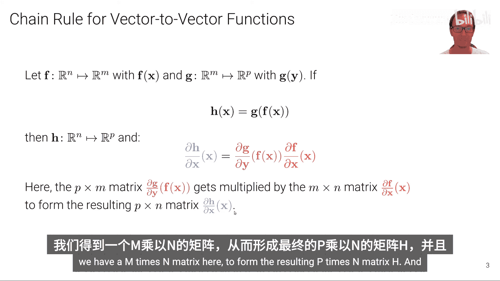

---

## 链式法则的一个重要特例：全微分

链式法则有一个非常重要的特例，它将我们带回了熟悉的“全微分”概念。

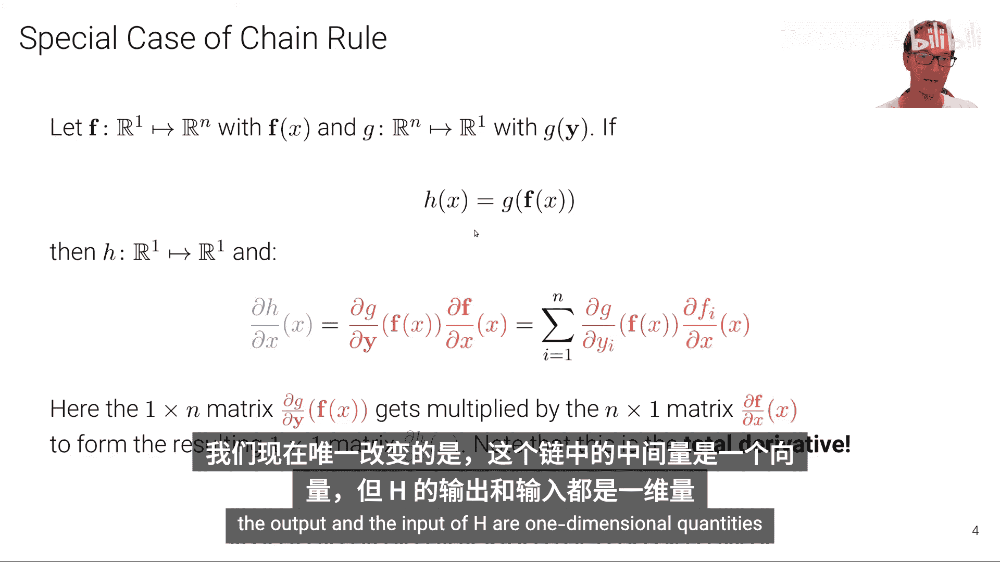

考虑以下情况：
- **f**: **R** → **R^n** （标量输入，向量输出）
- **g**: **R^n** → **R** （向量输入，标量输出）

复合函数 **h**(x) = **g**(**f**(x)) 是一个标量到标量的函数：**h**: **R** → **R**。

应用链式法则：
$$
\frac{dh}{dx}(x) = \frac{\partial g}{\partial \mathbf{y}}(\mathbf{f}(x)) \cdot \frac{\partial \mathbf{f}}{\partial x}(x)
$$

现在：
- \( \frac{\partial g}{\partial \mathbf{y}} \) 是一个 **1 × n** 的行向量（梯度）。
- \( \frac{\partial \mathbf{f}}{\partial x} \) 是一个 **n × 1** 的列向量。

它们的点积是一个标量。我们可以将其写为求和形式：

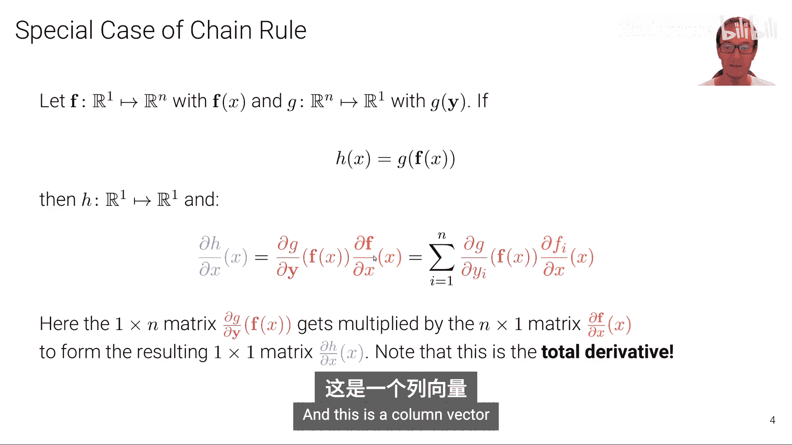

$$
\frac{dh}{dx}(x) = \sum_{i=1}^{n} \frac{\partial g}{\partial y_i}(\mathbf{f}(x)) \cdot \frac{\partial f_i}{\partial x}(x)
$$

**这正是我们之前学过的全导数公式！**
它描述的是：一个最终标量输出 **h**，依赖于中间变量 **y** = **f**(x)，而 **y** 的每个分量 \( y_i \) 又都依赖于输入 x。x 的微小变化会通过所有中间路径影响最终结果，总效应是这些路径贡献的**总和**。

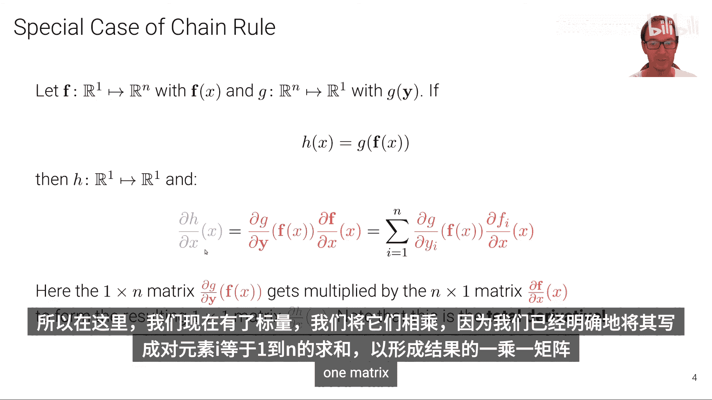

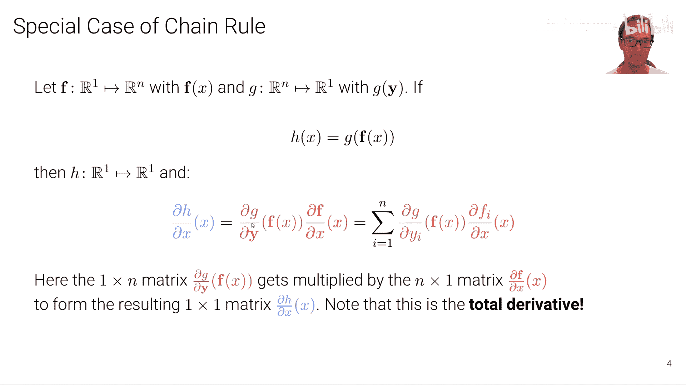

---

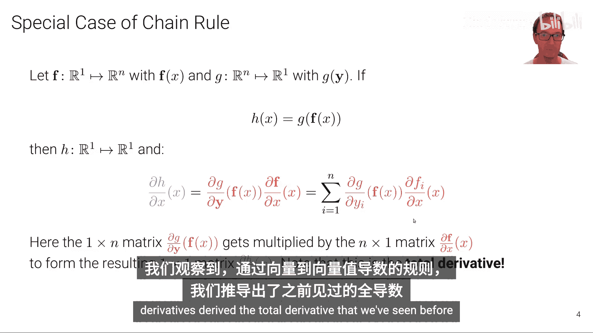

## 总结

本节课中我们一起学习了向量微积分的基础：

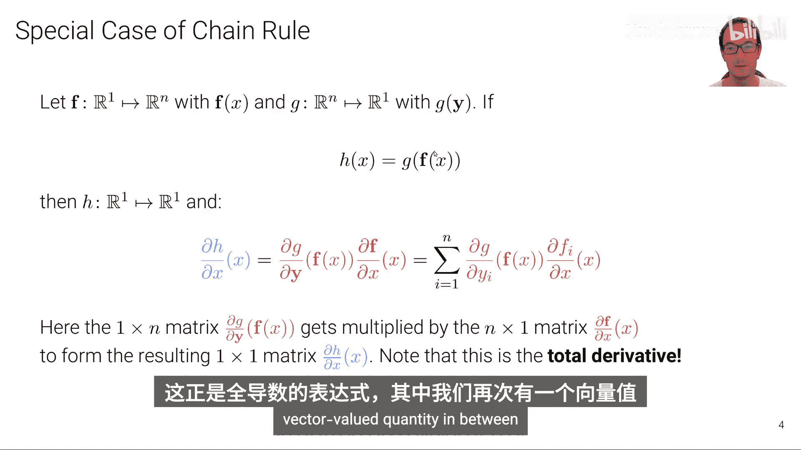

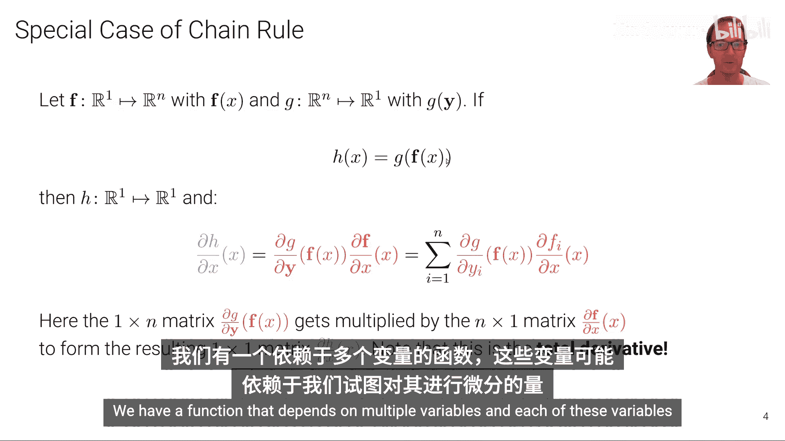

1.  **雅可比矩阵**：向量到向量函数的导数，是一个矩阵，包含了所有输出分量关于所有输入分量的偏导数。
2.  **梯度**：向量到标量函数导数的特例，是一个向量，指向函数值上升最快的方向，是优化算法的基石。
3.  **向量链式法则**：复合向量函数求导的规则，表现为**雅可比矩阵的乘法**。这是理解神经网络反向传播算法的数学基础。
4.  **与全导数的联系**：链式法则的一个特例直接导出了全导数公式，揭示了多路径依赖下变化率的求和本质。

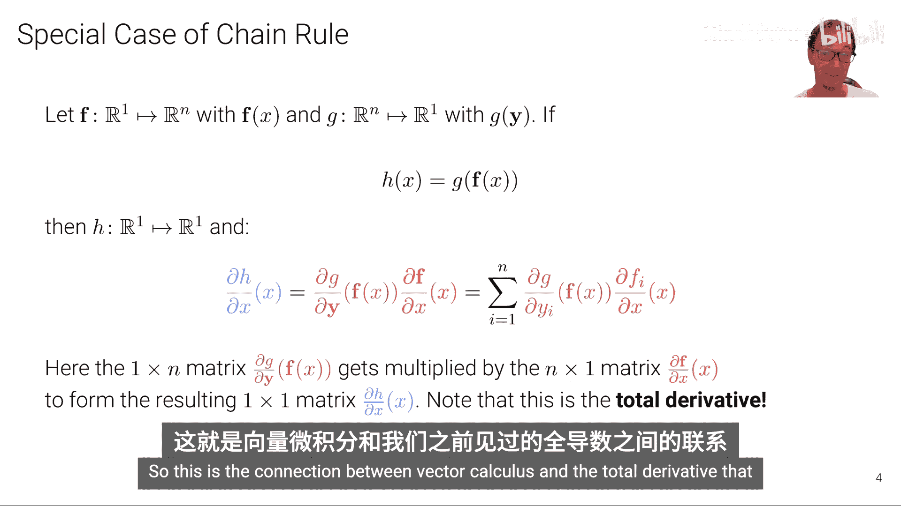

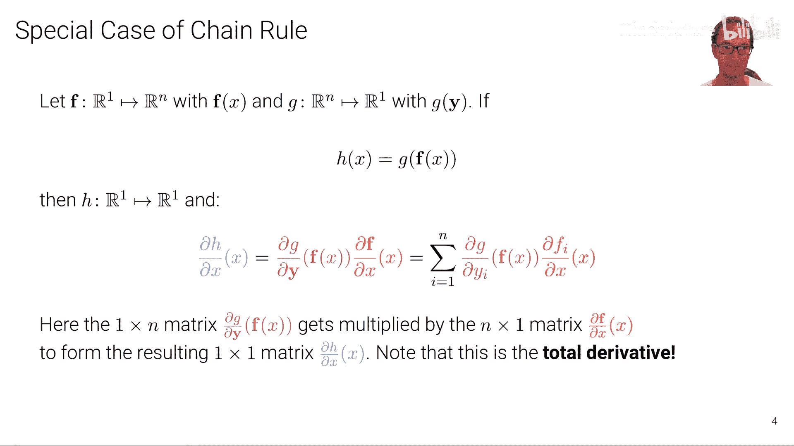

掌握这些概念，你就拥有了理解深度学习模型如何通过梯度下降等算法从数据中“学习”的关键数学工具。下一部分，我们可以在此基础上探讨这些知识在具体优化算法中的应用。