# 012：随机变量与概率分布 📊

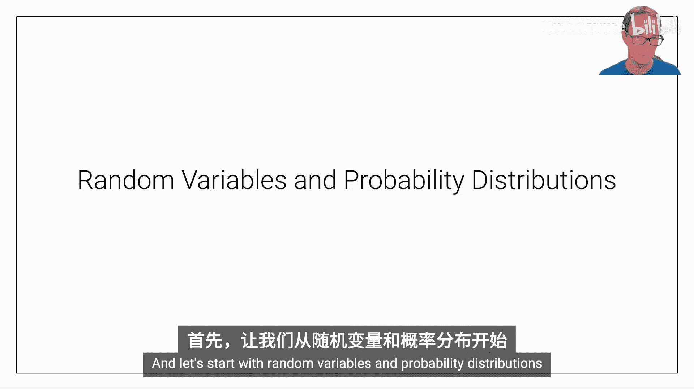

在本节课中，我们将要学习概率论与信息论的基础知识，从随机变量和概率分布开始。理解这些概念对于处理深度学习中的不确定性至关重要。

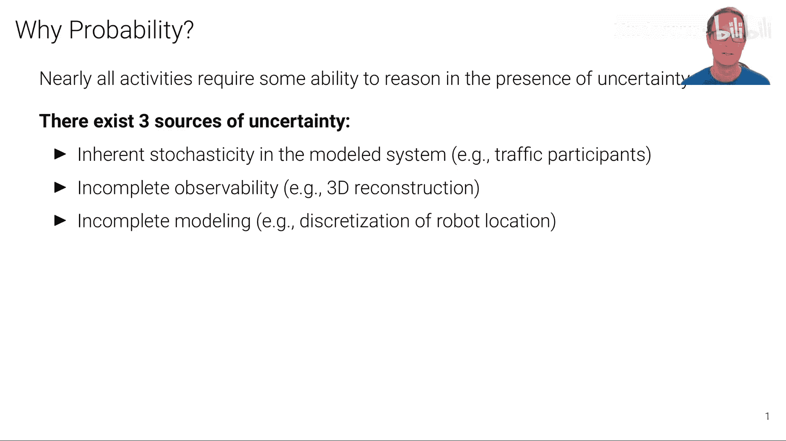

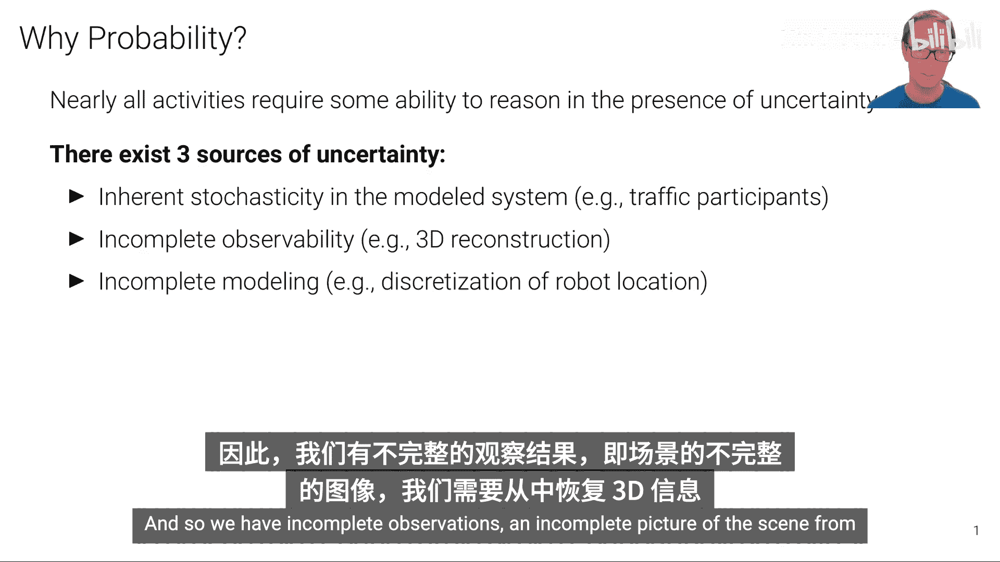

## 为什么需要概率论？🤔

几乎所有活动都需要在不确定性存在的情况下进行推理。我们主要考虑三种不同的不确定性来源。

第一种是模型系统固有的随机性。例如，为自动驾驶汽车构建感知系统时，观察交通场景中的其他参与者，你无法精确知道他们的下一步计划，其行为存在无法建模的固有随机性。

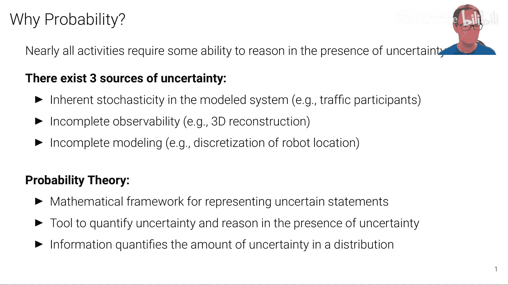

第二种是不完全可观测性。这在计算机视觉等领域非常常见，例如从2D图像重建3D模型时，2D图像只是3D世界的投影，我们拥有的是不完整的场景信息，需要利用归纳偏置和先验知识来恢复缺失的信息。

第三种是不完全建模。例如，由于计算限制，机器人定位时可能将3D环境离散化为体素网格，这种表示的离散化会导致无法精确定位。我们的模型总是对无限复杂真实世界的一种近似，因此总是不完全的。

概率论正是处理这些不确定性的数学框架。它允许我们表示不确定的陈述，处理不同来源的不确定性，并在模型中传播不确定性。它也是量化不确定性的工具。信息论与概率论密切相关，它量化了分布中不确定性的总量，我们将在后续单元讨论。

## 随机变量与概率分布 📈

让我们从定义一些术语开始。随机变量是一个可以随机取不同值的变量。与取特定值的常规变量不同，随机变量与某种随机性相关联，通常通过分布来指定。

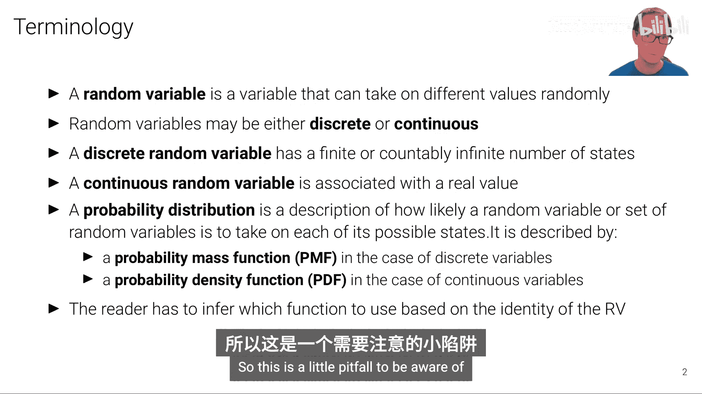

随机变量可以是离散的或连续的。离散随机变量具有有限或可数无限个可能状态，我们通常处理有限状态的情况。连续随机变量则与一个实数值相关联。

概率分布描述了随机变量（或一组随机变量）取每个可能状态的可能性。根据处理的是离散还是连续变量，概率分布由不同的函数描述。

*   对于离散变量，使用**概率质量函数**。
*   对于连续变量，使用**概率密度函数**。

需要注意，在数学文本中，读者通常需要根据随机变量的身份来推断使用哪个函数。我们通常用 `P(x)` 表示变量 `x` 的概率质量函数或密度函数，尽管名称相同，但根据参数 `x` 的不同，它们代表不同的分布。

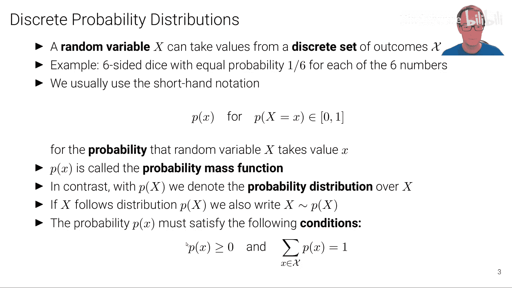

## 离散概率分布 🎲

上一节我们介绍了随机变量的基本概念，本节中我们来看看离散概率分布的具体形式。

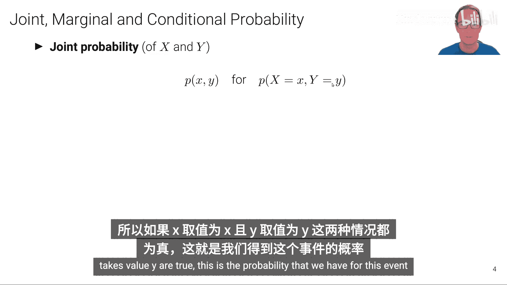

一个随机变量（通常用大写字母表示，如 `X`）可以从一个离散的结果集合 `𝒳` 中取值。例如，一个均匀的六面骰子，每个数字（1到6）出现的概率都是 `1/6`。

我们通常使用左边的简写符号来表示随机变量 `X` 取值为 `x` 的概率。完整的写法如右边所示：`P(X = x)`。这个概率必须在0到1之间。因为 `P(X = x)` 的写法较长，我们常简写为 `P(x)`。

在离散概率分布中，`P(x)` 被称为**概率质量函数**。与之相对，`P(X)`（大写 `X`）表示 `X` 上的概率分布。如果随机变量 `X` 服从分布 `P(x)`，我们常写作 `X ~ P(x)`。

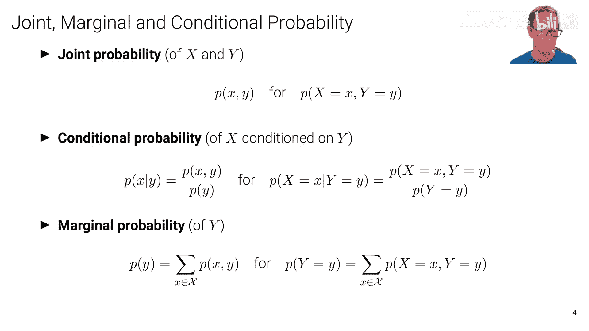

一个有效的概率质量函数 `P(x)` 必须满足以下条件：
1.  对于任何可能的参数 `x`，概率必须大于等于0：`P(x) ≥ 0`。
2.  对所有可能结果的概率求和必须等于1：`∑_{x∈𝒳} P(x) = 1`。

## 联合、边缘与条件概率 🤝

现在让我们考虑涉及多个随机变量的情况：联合概率、边缘概率和条件概率。

两个随机变量 `X` 和 `Y` 的**联合概率**简写为 `P(x, y)`，完整含义是 `P(X=x, Y=y)`，即 `X` 取值为 `x` 且 `Y` 取值为 `y` 同时发生的概率。

随机变量 `X` 在给定另一个随机变量 `Y` 的条件下的**条件概率**简写为 `P(x|y)`，其定义为联合概率除以 `Y` 的边缘概率：`P(x|y) = P(x, y) / P(y)`。这表示在已知 `Y` 取值为 `y` 的条件下，`X` 取值为 `x` 的概率。

最后，随机变量 `Y` 的**边缘概率** `P(y)` 定义为对所有其他随机变量（这里是 `X`）的可能状态求和：`P(y) = ∑_{x} P(x, y)`。我们通常使用左边的简写符号，这在处理长表达式时更易于阅读。

## 一个离散概率的例子 📊

为了让概念更具体，让我们看一个离散概率的例子。考虑两个随机变量 `X` 和 `Y`，每个都有三个可能状态（`x1, x2, x3` 和 `y1, y2, y3`）。我们可以用一个计数表来表示观测到的联合出现次数。

以下是观测到的计数表：

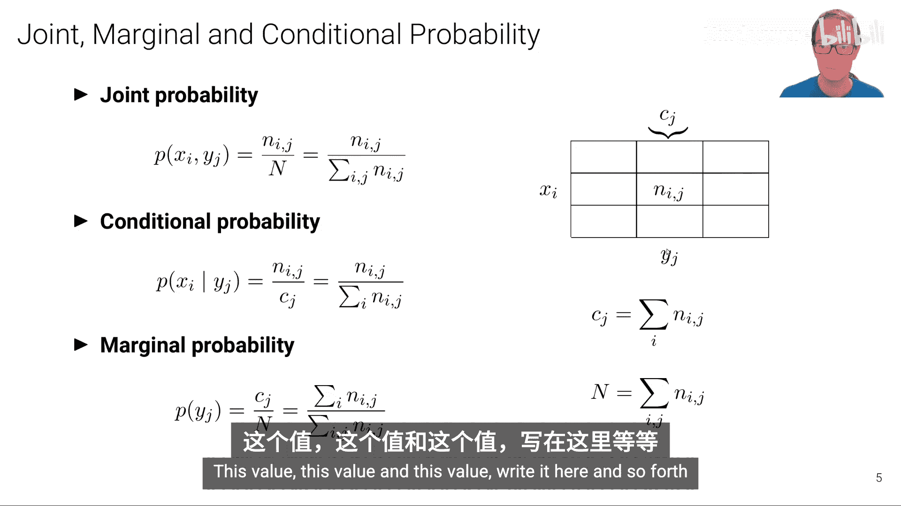

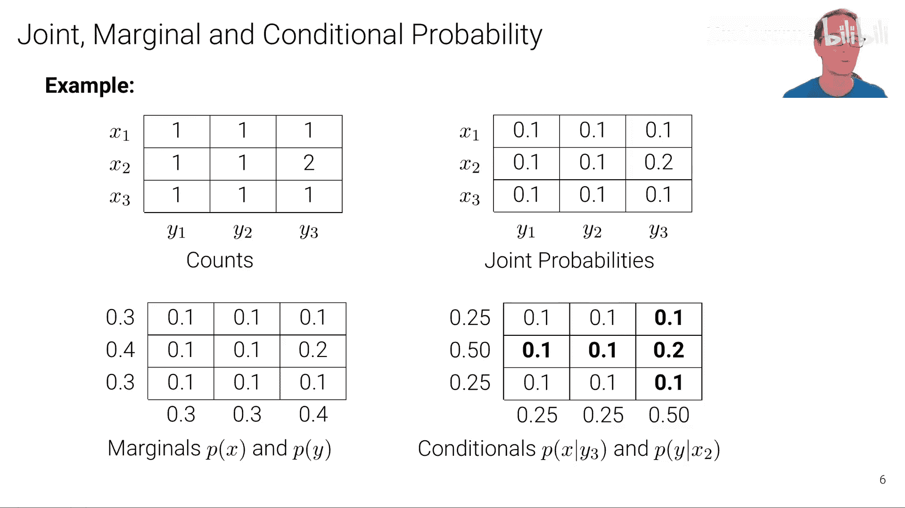

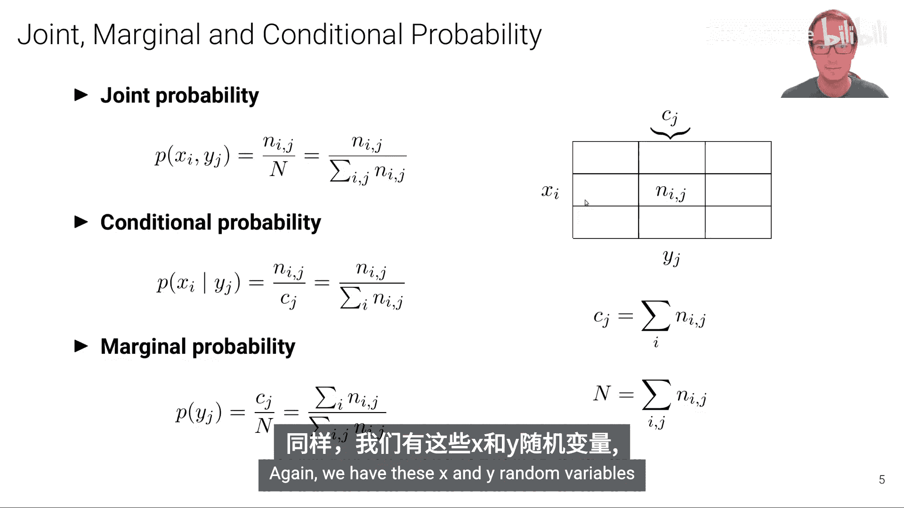

|       | y1 | y2 | y3 |
| :---- | :- | :- | :- |
| **x1**| 1  | 1  | 1  |
| **x2**| 1  | 1  | 2  |
| **x3**| 1  | 1  | 1  |

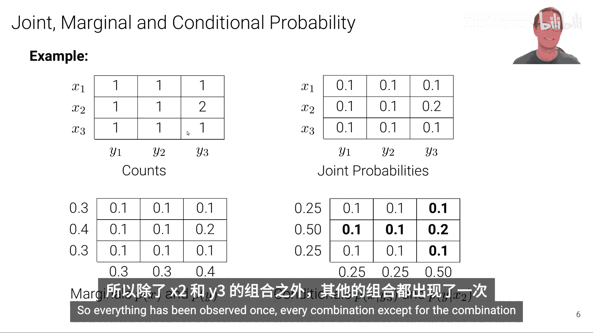

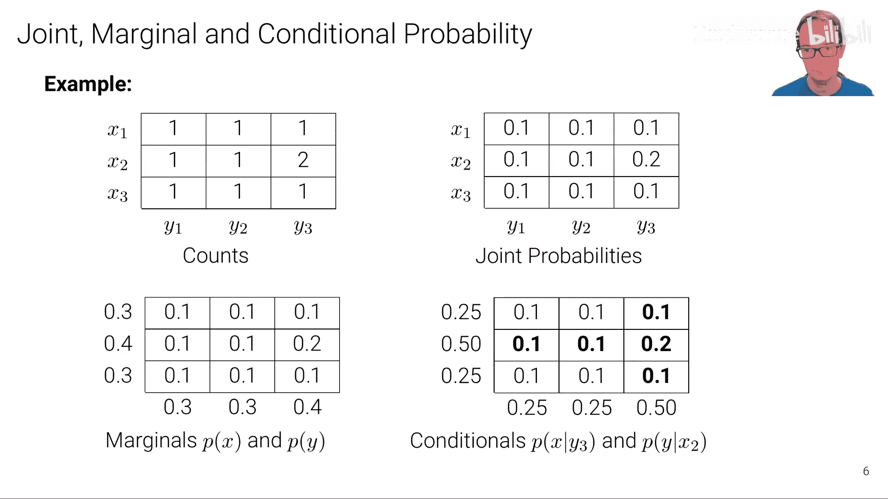

总计数为 10。根据这个表，我们可以计算各种概率。

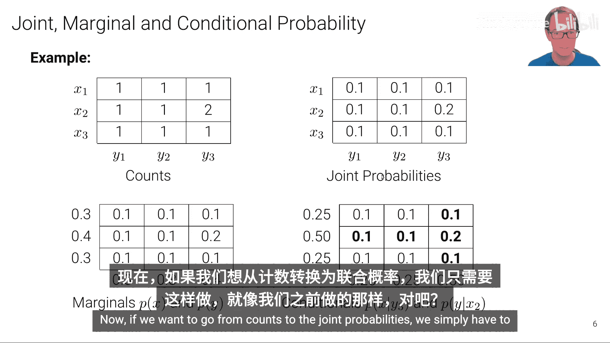

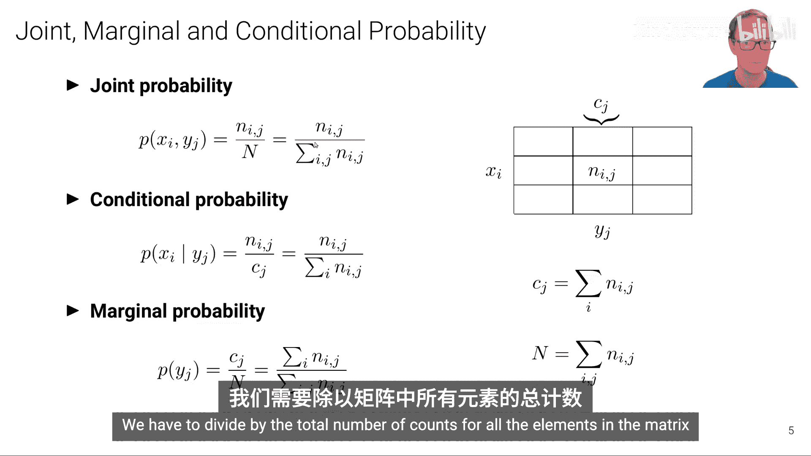

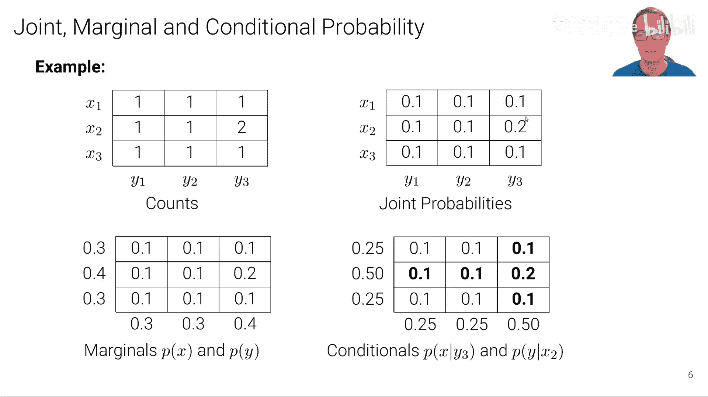

**联合概率 `P(x, y)`**：将每个单元格的计数除以总计数（10）。
*   `P(x1, y1) = 1/10 = 0.1`
*   `P(x2, y3) = 2/10 = 0.2` （其他大部分为0.1）

**边缘概率 `P(x)`**：对 `y` 的所有可能值求和。
*   `P(x1) = 0.1 + 0.1 + 0.1 = 0.3`
*   `P(x2) = 0.1 + 0.1 + 0.2 = 0.4`
*   `P(x3) = 0.1 + 0.1 + 0.1 = 0.3`
（验证：0.3 + 0.4 + 0.3 = 1）

**边缘概率 `P(y)`**：对 `x` 的所有可能值求和。
*   `P(y1) = 0.1 + 0.1 + 0.1 = 0.3`
*   `P(y2) = 0.1 + 0.1 + 0.1 = 0.3`
*   `P(y3) = 0.1 + 0.2 + 0.1 = 0.4`

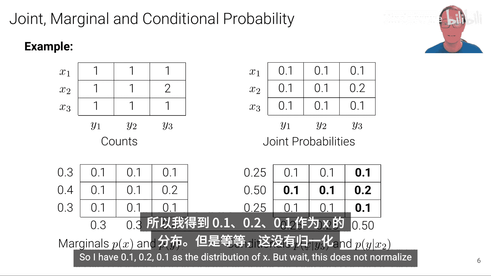

**条件概率 `P(x | y3)`**：在 `y3` 发生的条件下，看 `x` 的分布。我们取 `y3` 对应的列（0.1, 0.2, 0.1），其和为0.4。将其归一化（每个值除以0.4）得到条件概率：
*   `P(x1|y3) = 0.1 / 0.4 = 0.25`
*   `P(x2|y3) = 0.2 / 0.4 = 0.5`
*   `P(x3|y3) = 0.1 / 0.4 = 0.25`

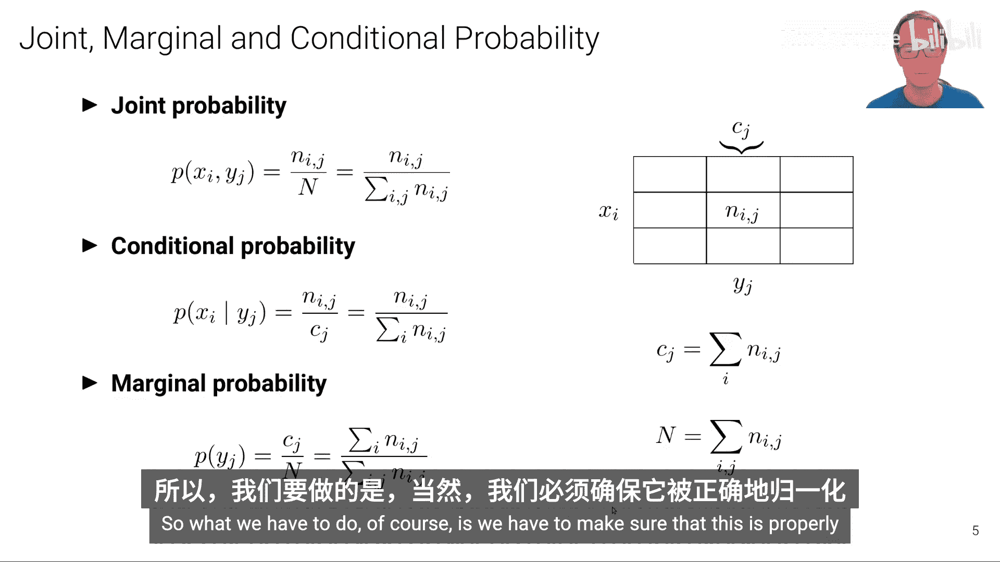

**条件概率 `P(y | x2)`**：在 `x2` 发生的条件下，看 `y` 的分布。我们取 `x2` 对应的行（0.1, 0.1, 0.2），其和为0.4。将其归一化得到：
*   `P(y1|x2) = 0.1 / 0.4 = 0.25`
*   `P(y2|x2) = 0.1 / 0.4 = 0.25`
*   `P(y3|x2) = 0.2 / 0.4 = 0.5`

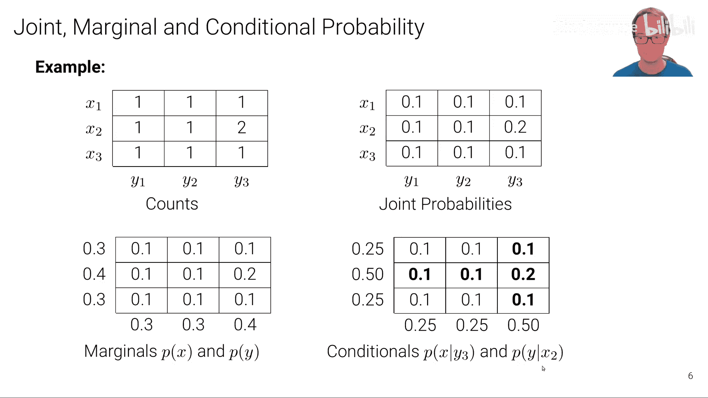

## 概率的基本规则 ⚖️

从上面的例子中，我们已经接触到了概率论的两个基本规则。

第一个是**求和规则**，即边缘化规则。对于离散变量：
*   `P(x) = ∑_{y} P(x, y)`
*   `P(y) = ∑_{x} P(x, y)`

第二个是**乘积规则**，它关联了联合概率、条件概率和边缘概率：
*   `P(x, y) = P(x|y) P(y)`
*   或等价地 `P(x, y) = P(y|x) P(x)`

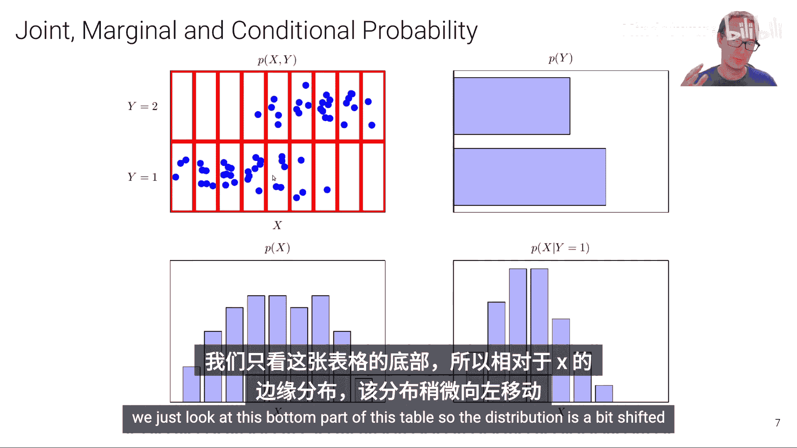

由乘积规则可以推导出著名的**贝叶斯定理**：
`P(y|x) = [P(x|y) P(y)] / P(x)`
我们将在后面讨论决策论时看到贝叶斯定理的应用。

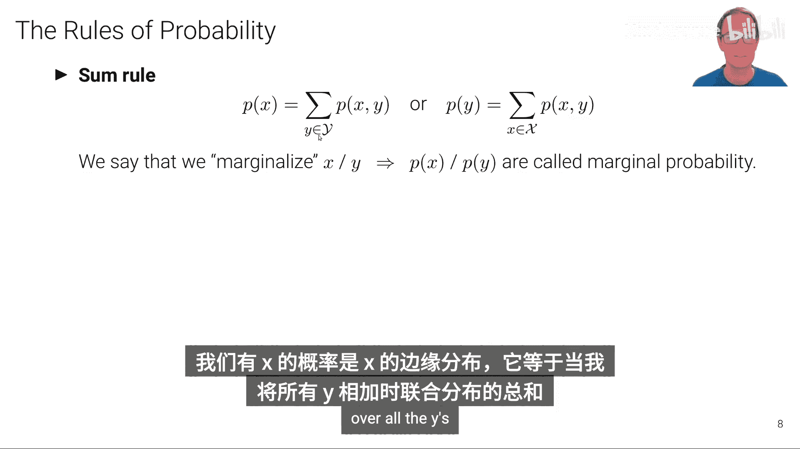

## 连续概率分布 📉

现在让我们转向连续概率分布。在这种情况下，`x` 是一个连续随机变量，在实数集 `ℝ` 中取值。

`x` 在某个区间 `[a, b]` 内取值的概率，通过积分**概率密度函数**来计算：
`P(a ≤ x ≤ b) = ∫_{a}^{b} p(x) dx`
我们称 `p(x)` 为概率密度函数。

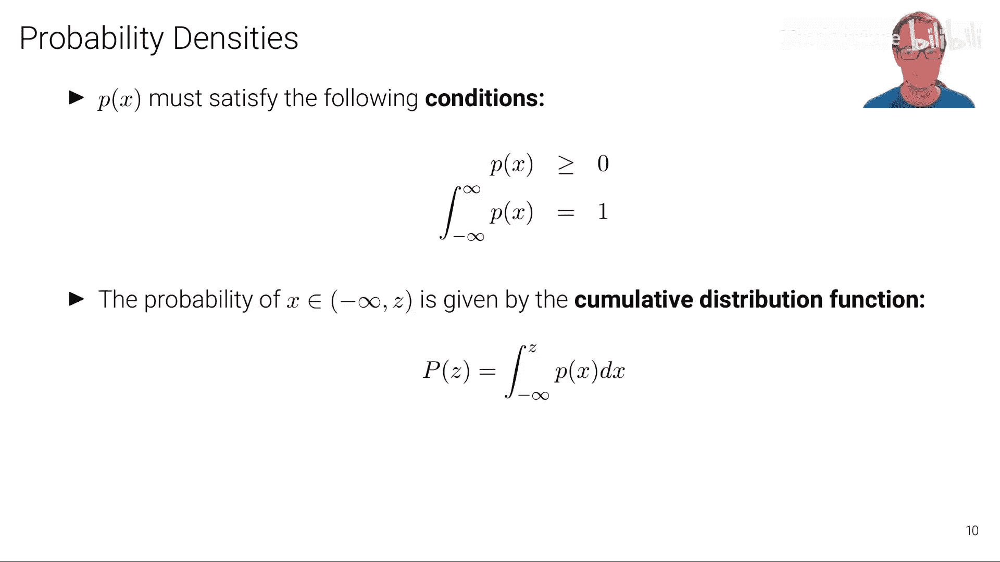

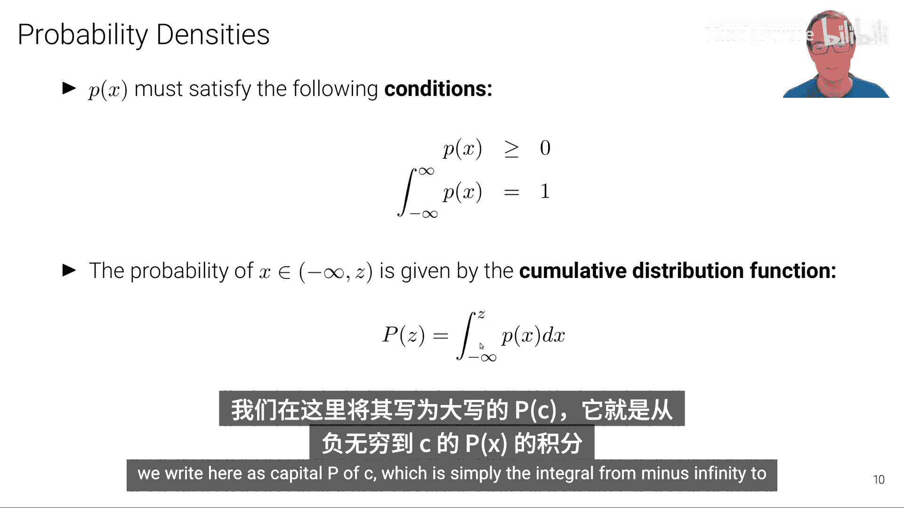

一个有效的概率密度函数必须满足以下条件：
1.  处处非负：`p(x) ≥ 0`。
2.  在整个定义域上的积分等于1：`∫_{-∞}^{∞} p(x) dx = 1`。

此外，随机变量 `x` 取值小于等于 `c` 的概率由**累积分布函数**给出：
`P(x ≤ c) = ∫_{-∞}^{c} p(x) dx`
当 `c` 趋于无穷大时，该值趋于1。

> **重要提示**：对于连续随机变量，取**某个精确值**的概率通常为0（例如 `P(x=0.5) = 0`），但该点处的概率密度 `p(0.5)` 可以大于0。这是概率密度与概率本身的关键区别。

## 连续情况下的联合、边缘与条件概率 🏔️

与离散情况类似，我们可以定义连续随机变量的联合、边缘和条件概率。

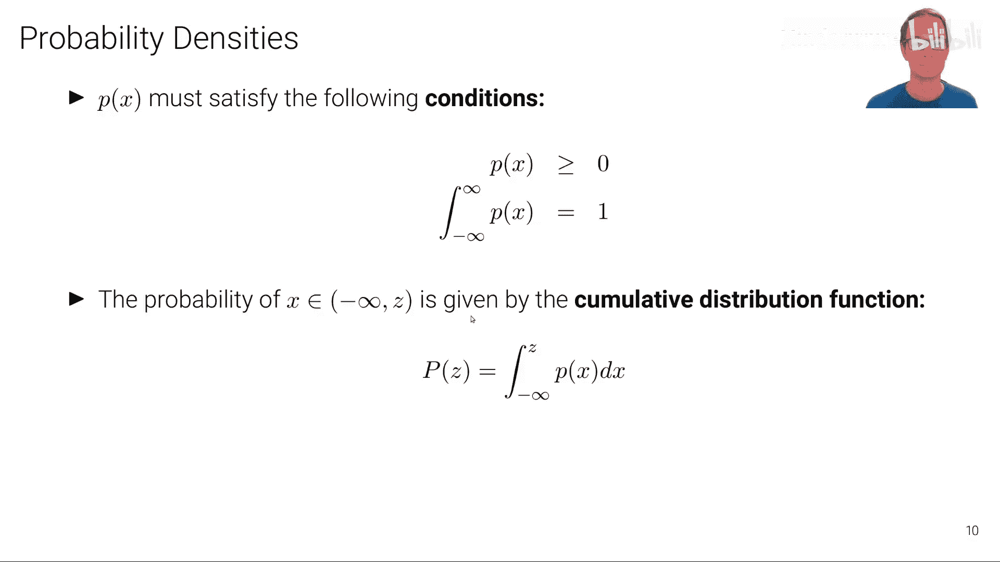

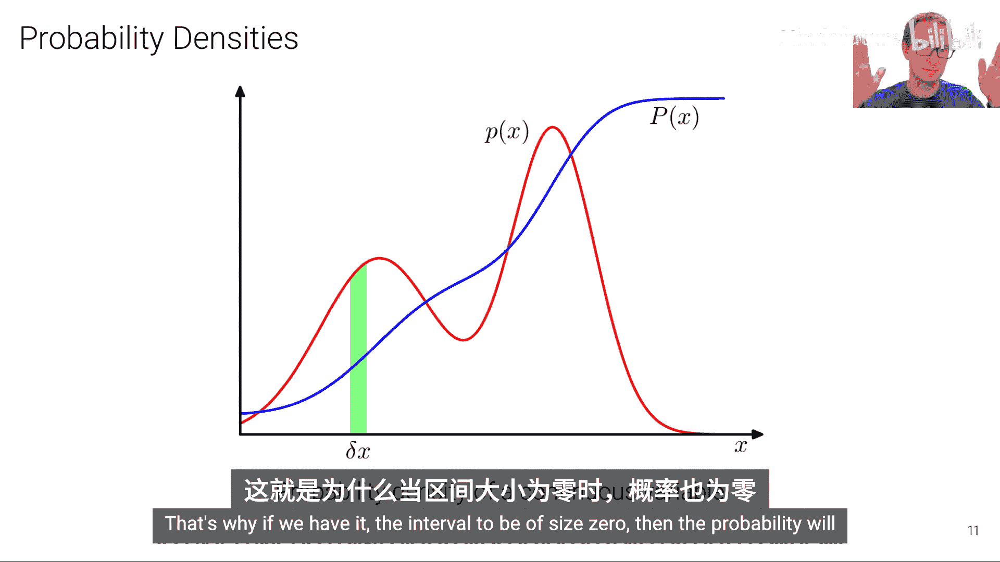

*   **联合密度**：`p(x, y)`
*   **条件密度**：`p(x|y)`
*   **边缘密度**：`p(y) = ∫ p(x, y) dx` （通过对另一个变量积分得到）

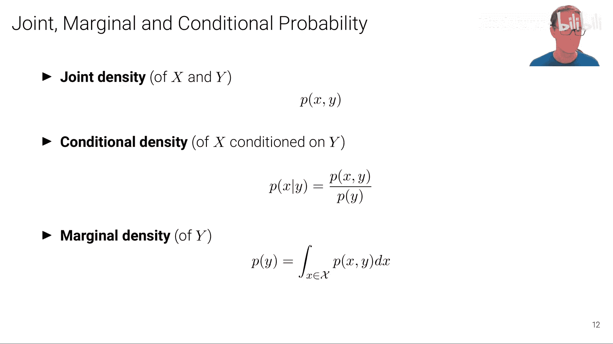

我们可以用高斯分布的例子来可视化。考虑一个二维高斯分布，其等高线图展示了联合概率密度 `p(x_A, x_B)`。`x_A` 的**边缘分布** `p(x_A)` 是通过对 `x_B` 维度积分得到的，在图上表现为一个一维高斯曲线。**条件分布** `p(x_A | x_B=0.7)` 则是在 `x_B=0.7` 这条线上“切片”得到的分布，它是另一个一维高斯，但其均值和方差与边缘分布不同。

连续概率的**求和规则**和**乘积规则**与离散情况完全类似，只是求和换成了积分：
*   求和（边缘化）规则：`p(y) = ∫ p(x, y) dx`
*   乘积规则：`p(x, y) = p(x|y) p(y)`
贝叶斯定理在连续情况下形式相同。

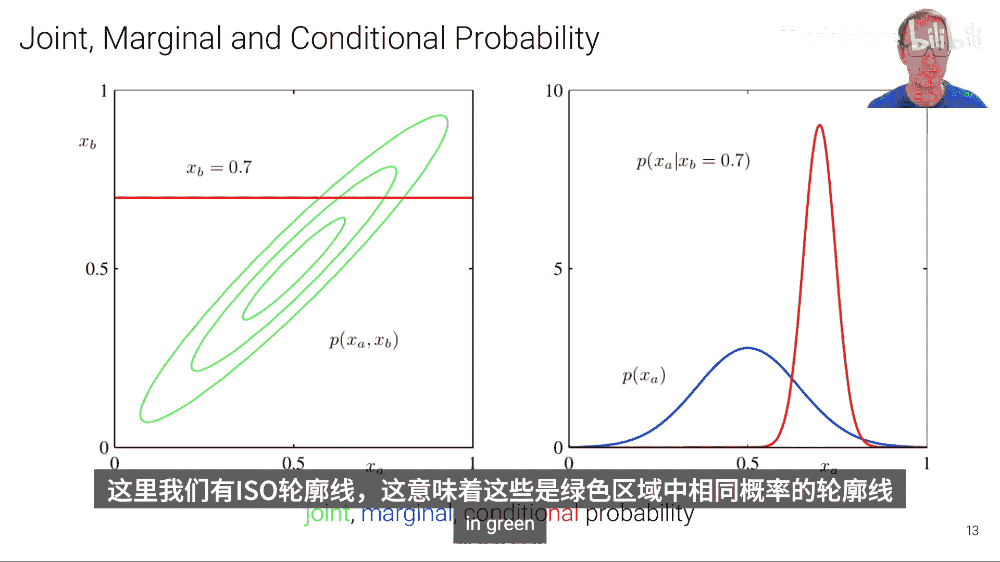

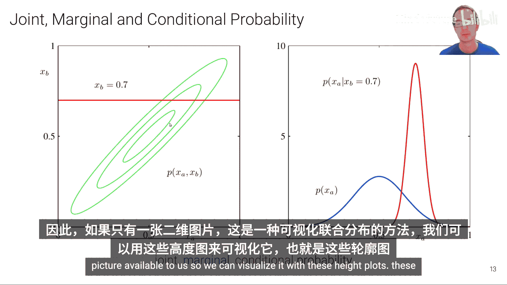

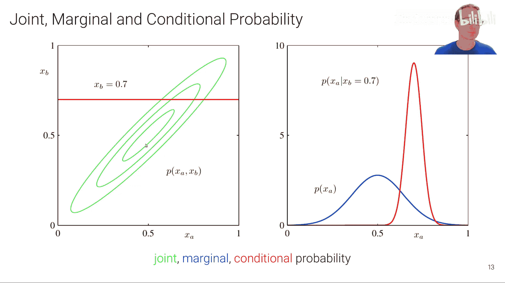

## 独立性与条件独立性 🧩

最后，我们来学习独立性的概念。

如果两个随机变量 `x` 和 `y` 的联合概率分布可以分解为各自边缘概率的乘积，则称它们是**独立的**：
`p(x, y) = p(x) p(y)`

如果两个随机变量 `x` 和 `y` 在给定第三个随机变量 `z` 的条件下，其联合条件概率可以分解，则称它们是**条件独立的**：
`p(x, y | z) = p(x | z) p(y | z)`

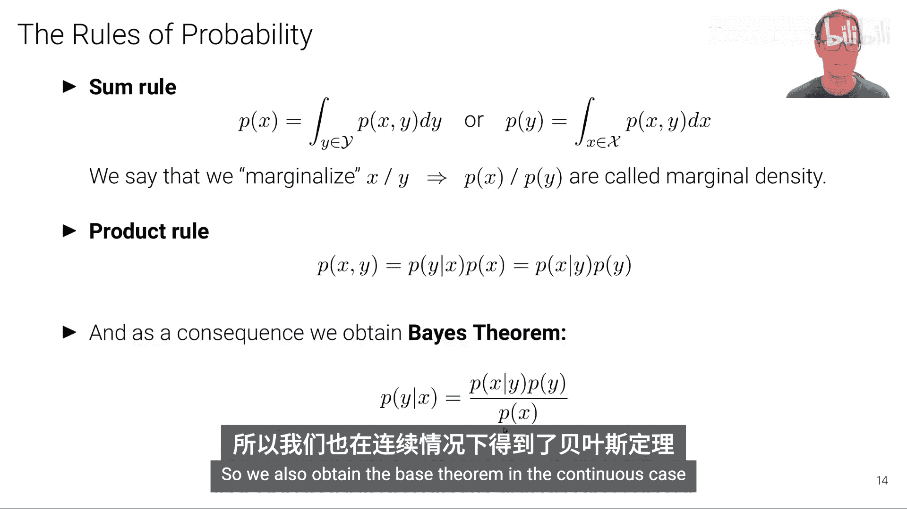

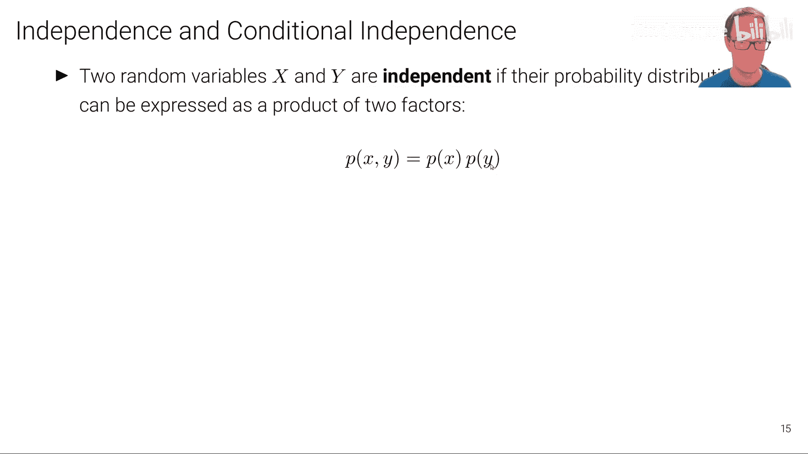

这些性质有简明的记号表示：
*   独立性：`x ⫫ y`
*   条件独立性：`x ⫫ y | z`

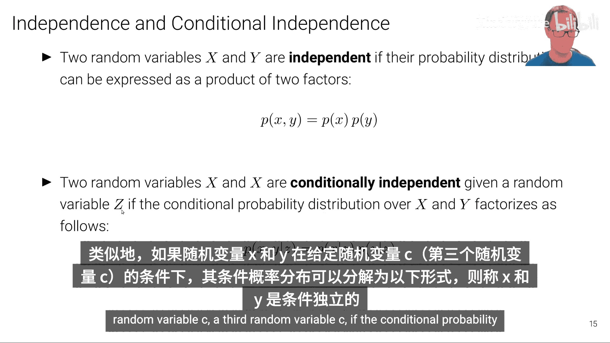

---

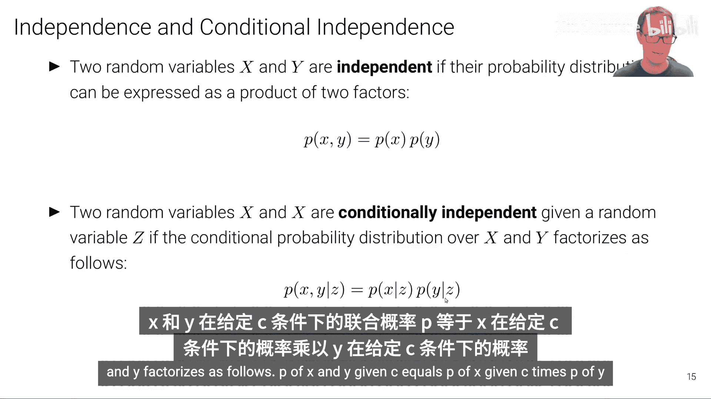

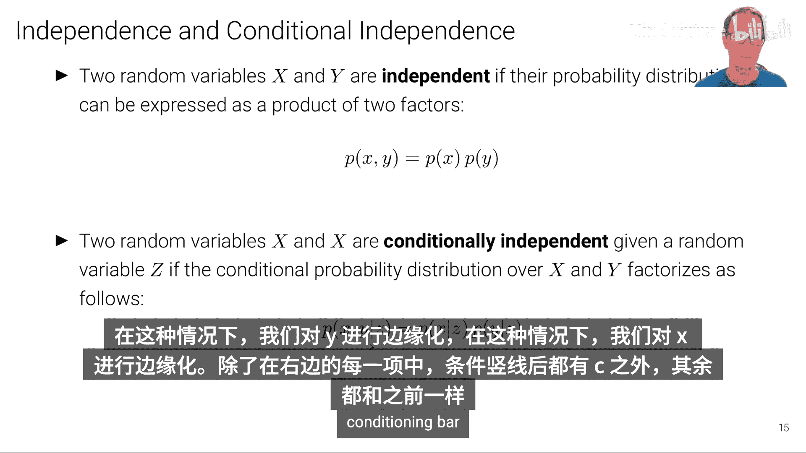

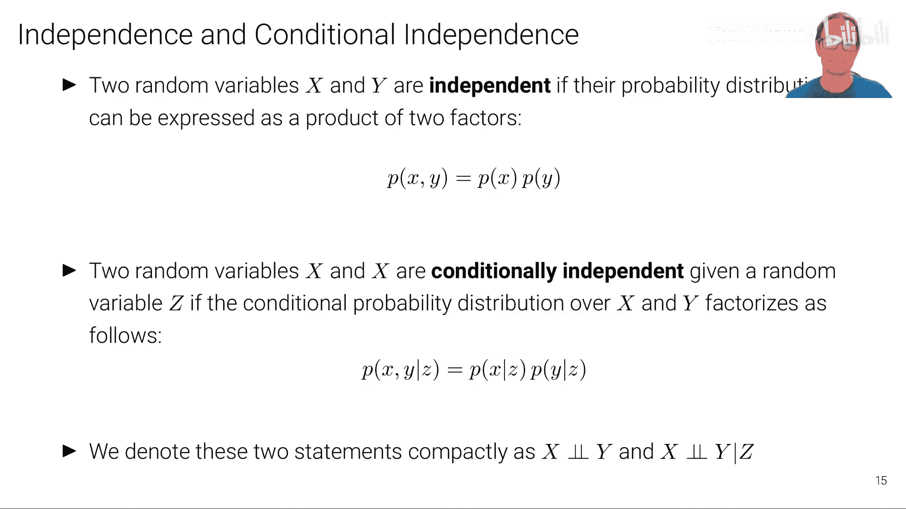

本节课中我们一起学习了概率论的基础：随机变量、离散与连续概率分布、联合/边缘/条件概率、概率的基本规则（求和、乘积、贝叶斯定理）以及独立性的概念。这些是理解深度学习中不确定性建模和贝叶斯方法的基石。