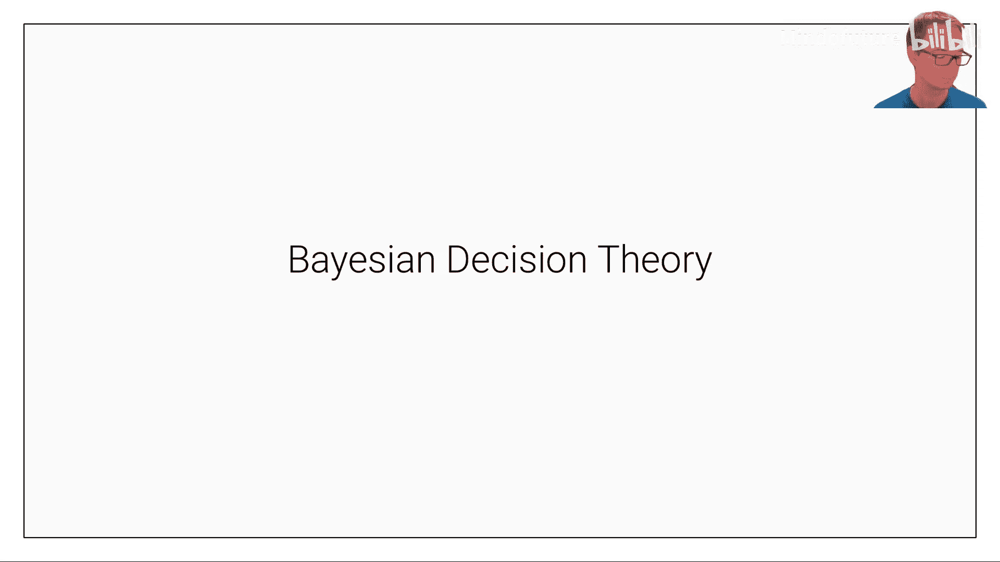
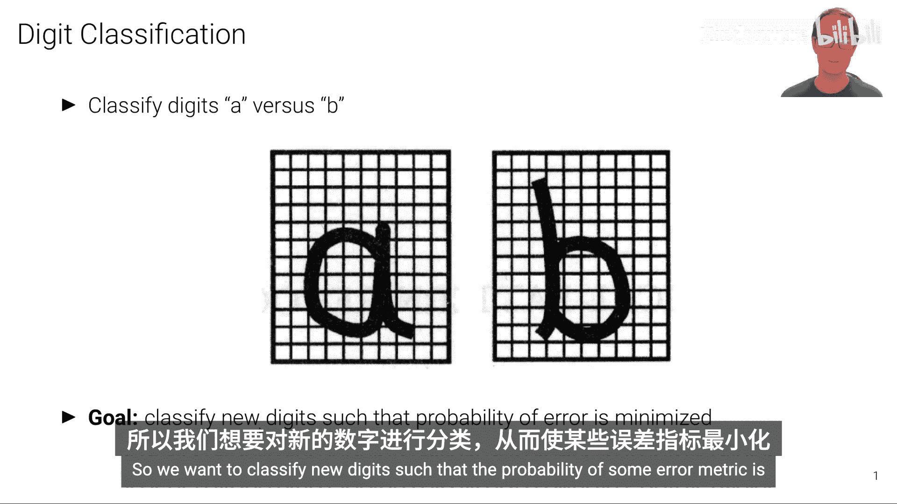
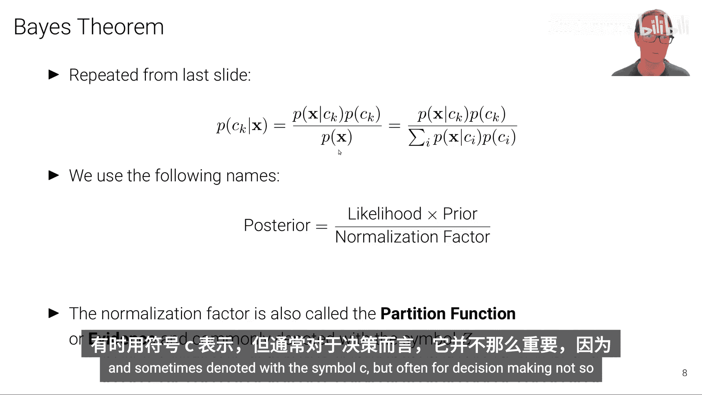
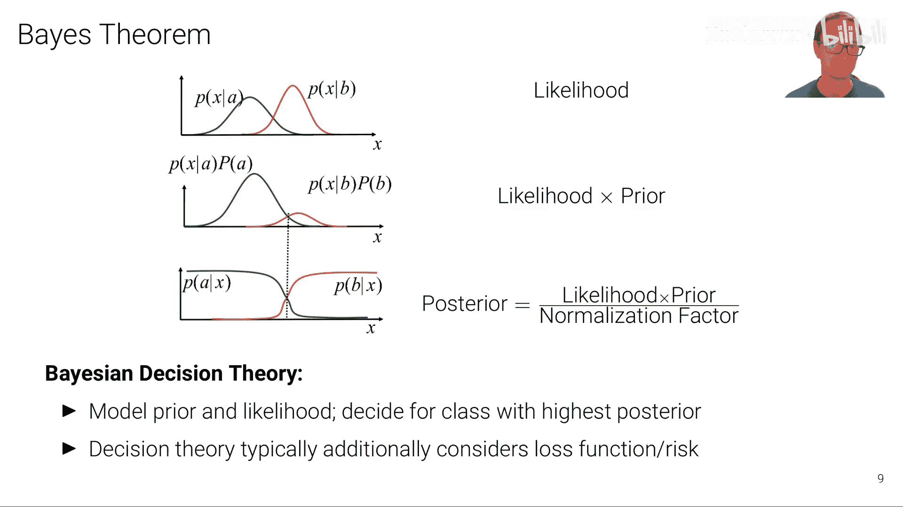

# 014：贝叶斯决策理论 🧠

在本节课中，我们将学习贝叶斯决策理论。我们将通过一个简单的数字分类例子，来理解贝叶斯定理中涉及的各个量，并直观地展示如何结合先验知识和观测数据做出最优决策。

上一节我们介绍了贝叶斯定理的基本公式。本节中，我们来看看如何将其应用于一个实际的决策问题。

## 问题设定：数字分类任务

考虑一个数字分类任务，目标是区分字母“A”和“B”。我们有一个像素矩阵图像，需要判断它属于“A”类还是“B”类。我们的目标是做出分类决策，以最小化某种错误度量的概率。

## 先验概率

我们可以从思考这些数字出现的先验分布入手。在自然文本中，字母“A”比“B”更常见。假设“A”出现的频率是“B”的三倍。

以下是先验概率的设定：
*   设类别1（对应字母“A”）的概率为 **P(C1) = 0.75**。
*   设类别2（对应字母“B”）的概率为 **P(C2) = 0.25**。

先验概率必须是一个分布，其在整个定义域上的和为1，这里确实满足。这些数字可以通过统计（例如维基百科文本）并归一化得到。

## 特征与似然

我们用特征向量 **x** 来描述每个数字。特征可以是简单的（如图像中黑色像素的数量、宽高比），也可以是复杂的（如神经网络的表示）。为了便于可视化，我们假设特征空间是一维的。

似然 **P(x|Ck)** 定义了在给定类别（A或B）下，观测到特定特征 **x** 的可能性。我们需要两个不同的条件分布来区分类别。

以下是两个类别的似然分布特点：
*   对应字母“A”的特征分布（绿色）更偏向左侧。
*   对应字母“B”的特征分布（红色）更窄，且更偏向右侧。

这两个分布有重叠区域，说明分类并非易事。对于某些特征值，两个类别的似然可能都很高。

## 决策困境与贝叶斯定理

对于一个给定的特征值 **x**，我们应该将其归为哪一类？
*   如果 **x** 位于绿色分布的高概率区，显然应归为A类。
*   如果 **x** 位于红色分布的高概率区，显然应归为B类。
*   但如果 **x** 位于两个分布重叠的中间区域呢？此时，B类的似然可能略高于A类。然而，由于A类有更高的先验概率，我们可能仍应将其判为A类。

如何形式化这种直觉？这就需要用到贝叶斯定理。

我们将贝叶斯定理应用于当前语境，其中 **y** 对应类别，**x** 对应特征。公式如下：

**P(Ck|x) = [ P(x|Ck) * P(Ck) ] / P(x)**

以下是公式中各部分的名称：
*   **P(Ck|x)**：后验概率。这是我们最终关心的，即在观测到特征 **x** 后，该样本属于类别 **Ck** 的概率。
*   **P(x|Ck)**：似然。我们前面已经讨论过。
*   **P(Ck)**：先验概率。
*   **P(x)**：证据或归一化因子。它是特征 **x** 的边际概率，对于寻找最可能的类别而言是一个常数。

在决策理论中，我们通常选择具有最高后验概率的类别。

## 可视化决策过程

我们可以将这个过程可视化。
1.  首先，我们有两个类别的似然函数曲线。
2.  然后，将每条似然曲线乘以其对应的先验概率。这会显著改变曲线的形状和相对高度。
3.  最后，除以归一化因子（证据），得到后验概率曲线。

此时，两条后验概率曲线的交点就是决策边界。如果特征值 **x** 落在交点左侧，我们应将其判为A类；否则判为B类。

简而言之，贝叶斯决策理论对先验和似然进行建模，然后选择具有最高后验概率的类别。

## 更完整的图景：损失函数

当然，这还不是决策理论的全部。完整的决策理论通常还会考虑损失函数或风险，以进行经验风险最小化。

并非所有分类错误的后果都是相等的。例如，在癌症检测中：
*   假阴性（有癌症但未检出）的危害远大于假阳性（无癌症但误报）。
*   假阳性可能引发不必要的治疗，但能很快被发现。
*   假阴性则可能导致患者错过治疗时机。

因此，通常会引入一个额外的损失或风险函数来评估整体风险，但它整合了我们所讨论的基于似然和先验的贝叶斯方法。

本节课中，我们一起学习了贝叶斯决策理论。我们通过一个二分类例子，理解了先验概率、似然函数和后验概率的概念，并看到了如何利用贝叶斯定理结合先验知识与观测数据做出最优分类决策。我们还了解到，在实际应用中，决策过程可能需要引入损失函数来权衡不同错误类型的代价。