# 015：期望、方差与协方差 📊

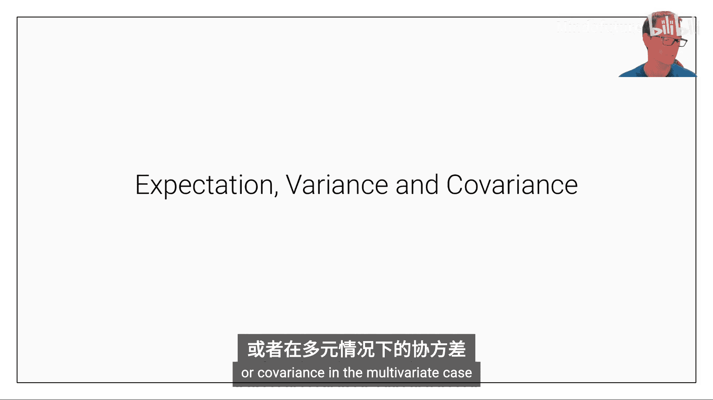

在本节课中，我们将学习随机变量及其函数的一些基本性质，特别是被称为期望、方差以及在多元情况下的协方差。这些概念是理解概率分布和后续机器学习模型的基础。

## 期望值

上一节我们介绍了随机变量的概念，本节中我们来看看如何衡量一个随机变量或其函数的“平均”表现，这就是期望值。

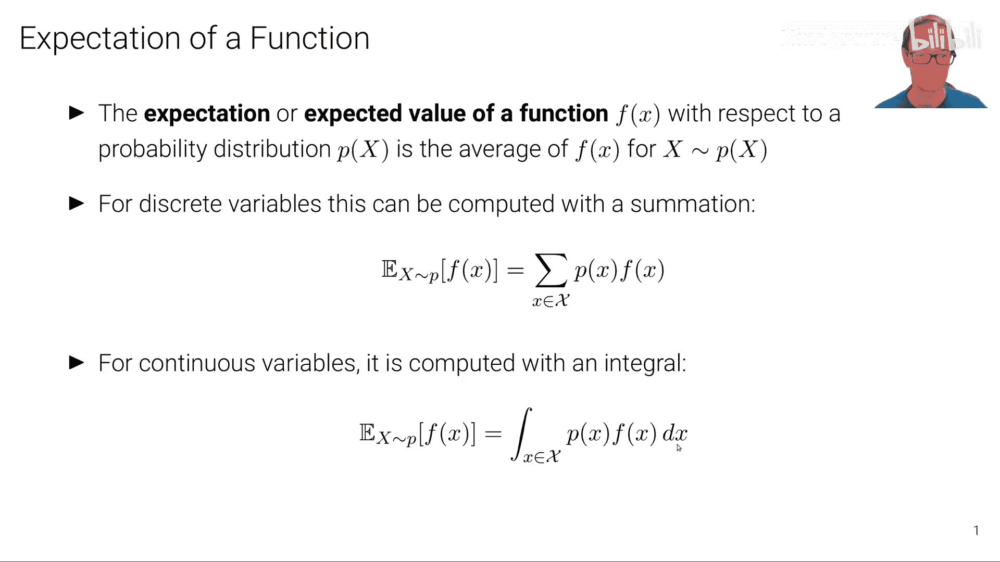

一个函数 `f(x)` 相对于概率分布 `P(x)` 的**期望值**或**期望**，是从该分布中抽取样本时 `f(x)` 的平均值。

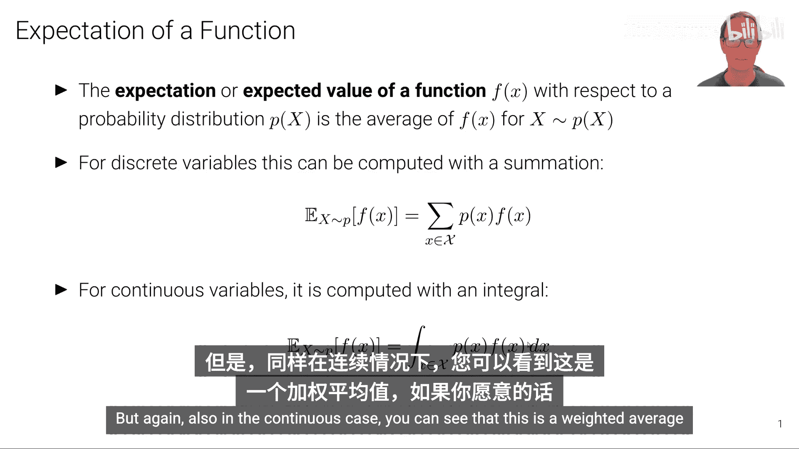

对于离散变量，可以通过求和计算：
`E_{x \sim P}[f(x)] = \sum_{x} P(x) f(x)`
这是一个以概率 `P(x)` 为权重的加权和。

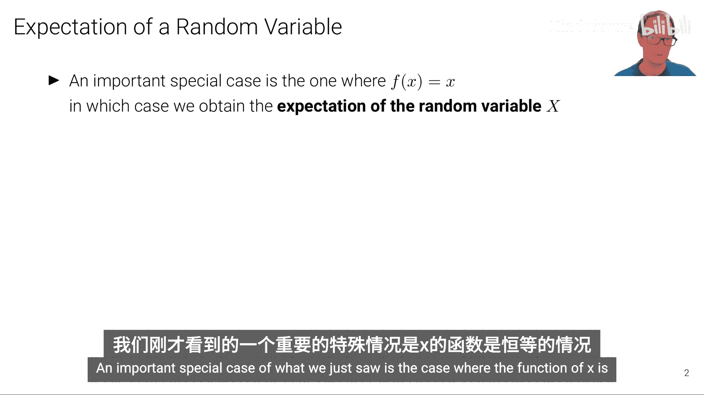

对于连续变量，则通过积分计算：
`E_{x \sim P}[f(x)] = \int P(x) f(x) dx`
这同样是一个加权平均。

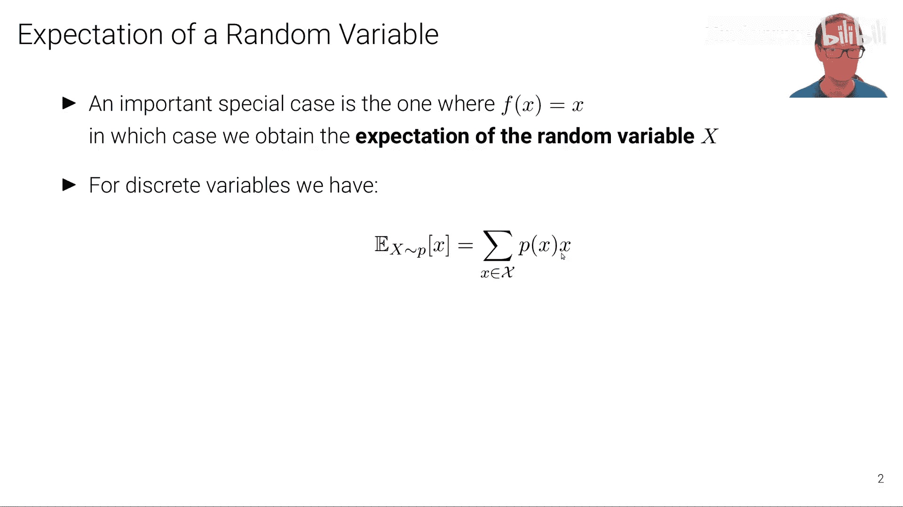

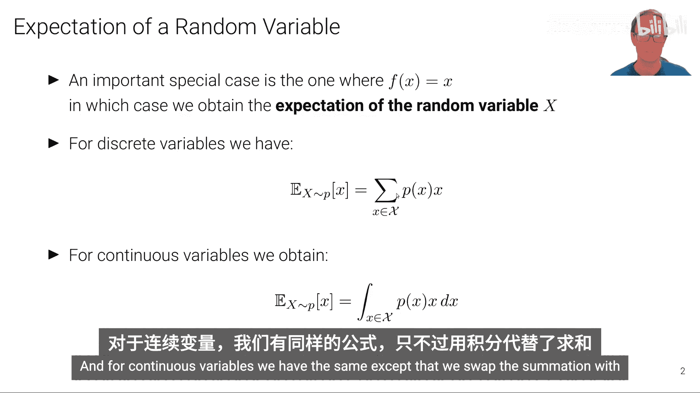

一个重要的特例是当函数 `f(x)` 是恒等函数（即 `f(x) = x`）时，我们得到随机变量 `X` 本身的期望值。

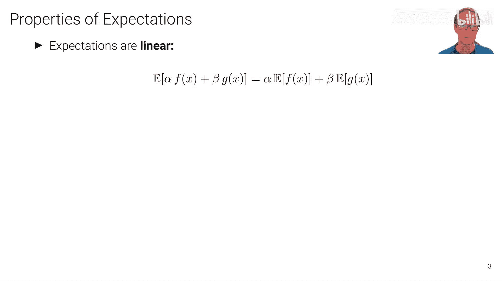

对于离散变量：
`E[x] = \sum_{x} P(x) x`

对于连续变量：
`E[x] = \int P(x) x dx`

期望的一个重要性质是它是一个**线性算子**。这意味着：
`E[\alpha f(x) + \beta g(x)] = \alpha E[f(x)] + \beta E[g(x)]`
我们可以将期望算子线性地分解到函数内部。

对于高斯随机变量，其期望值就是该分布的均值 `\mu`，因为分布是对称的。

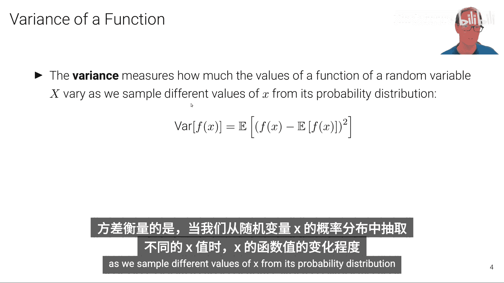

## 方差

了解了数据的“中心”位置（期望）后，我们接下来关心数据围绕这个中心的分散程度，这就是方差。

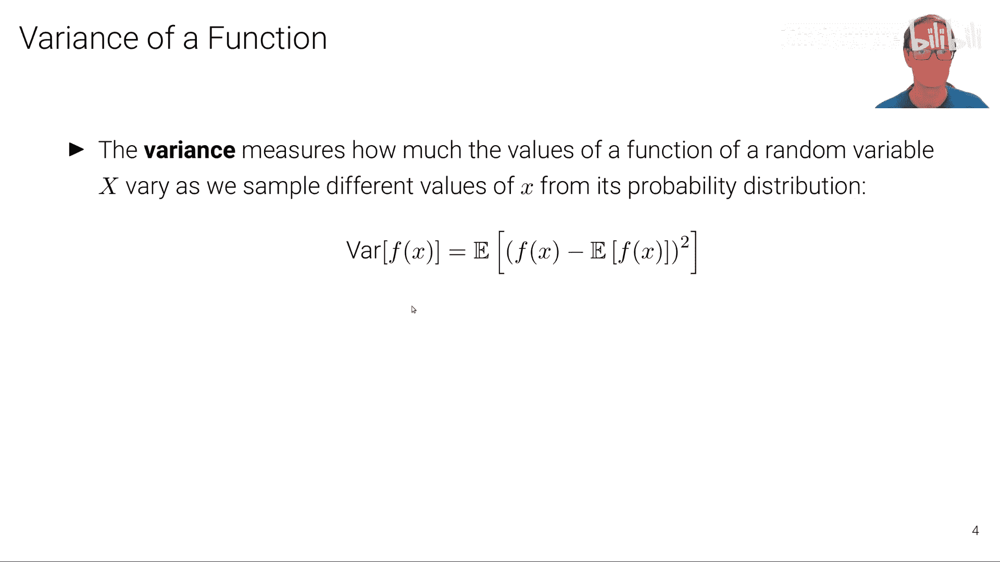

**方差**衡量了当我们从概率分布中抽取不同的 `x` 值时，函数 `f(x)` 的值变化有多大。

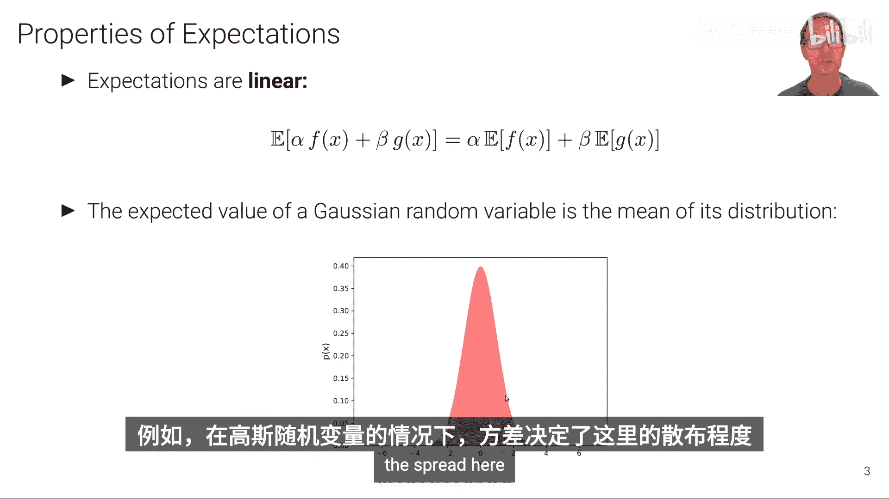

`f(x)` 的方差定义为：
`Var(f(x)) = E[(f(x) - E[f(x)])^2]`
即，函数值与其期望值之差的平方的期望。

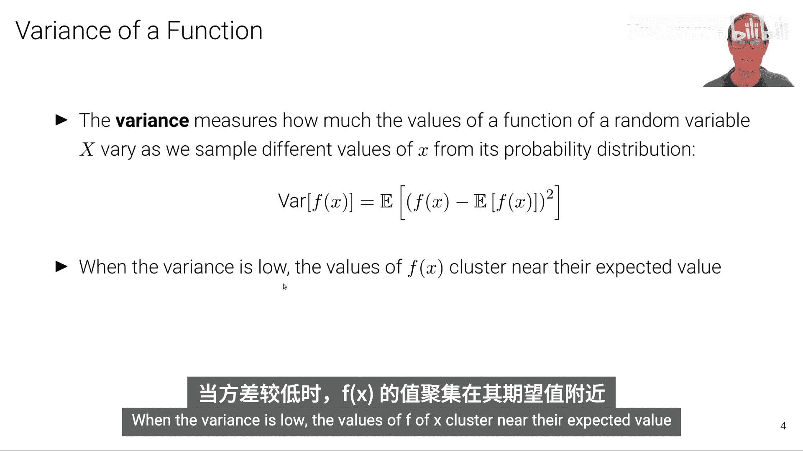

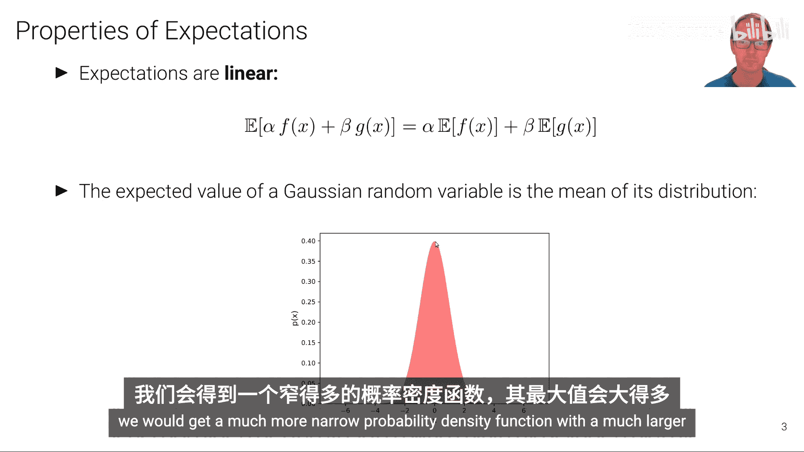

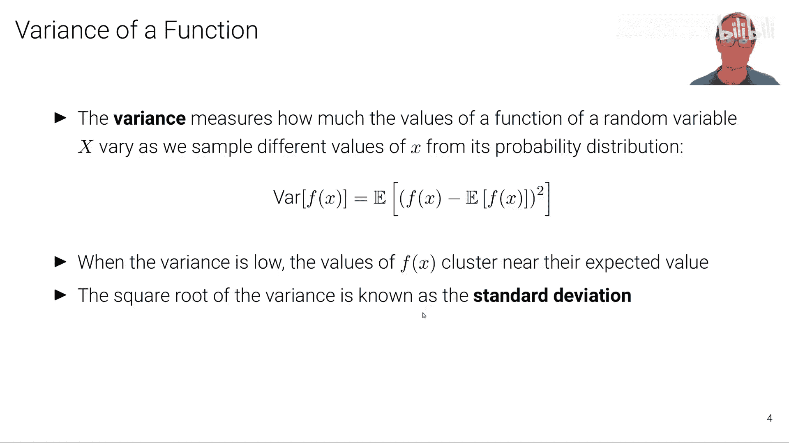

例如，对于高斯随机变量，方差决定了分布的“宽度”或“扩散”程度。

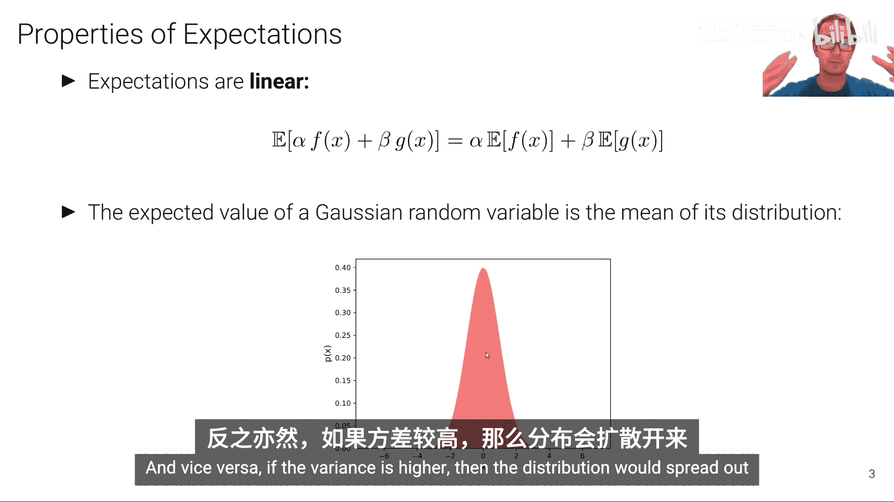

*   当方差较低时，`f(x)` 的值会紧密地聚集在其期望值附近，概率密度函数更窄、峰值更高。
*   当方差较高时，分布会更加分散。

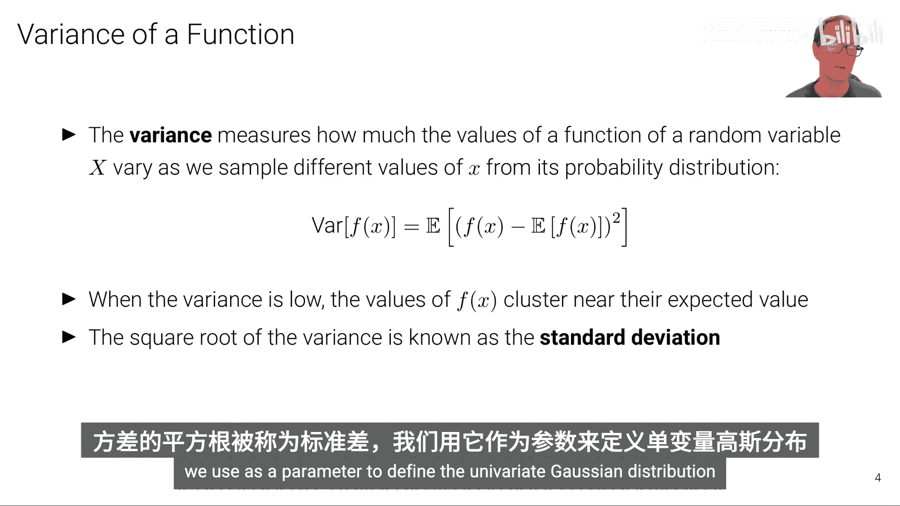

方差的平方根被称为**标准差**，它是定义单变量高斯分布的一个参数（通常记为 `\sigma`）。

## 协方差

在多元情况下，我们不仅关心单个变量的分散程度，还关心不同变量之间的关系。协方差就是衡量这种线性关系的工具。

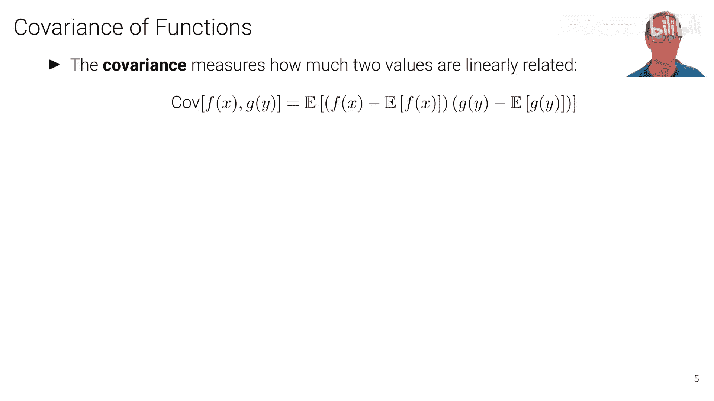

**协方差**衡量两个值线性相关的程度。

对于函数 `f(x)` 和 `g(y)`，其协方差定义为：
`Cov(f(x), g(y)) = E[(f(x) - E[f(x)]) (g(y) - E[g(y)])]`
即，各自减去期望值后的乘积的期望。

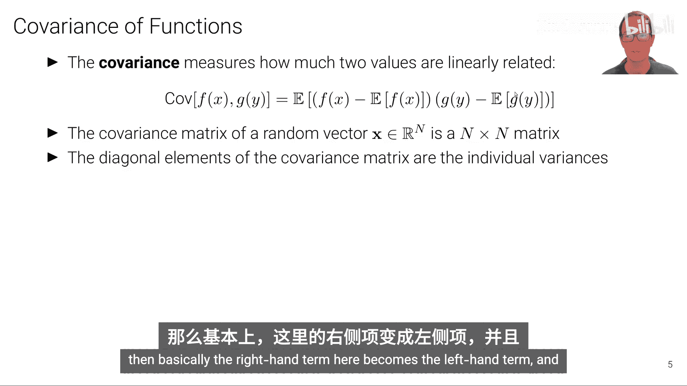

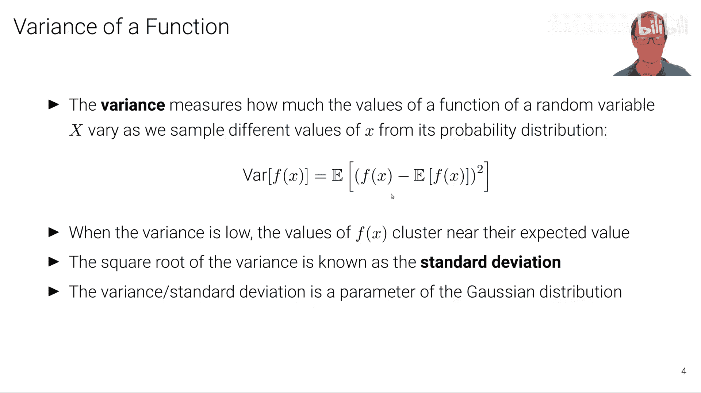

对于一个 `n` 维随机向量，其**协方差矩阵**是一个 `n \times n` 的矩阵，其中每个元素 `(i, j)` 是第 `i` 维与第 `j` 维之间的协方差。

以下是协方差矩阵的一些关键点：
*   协方差矩阵的对角线元素是各个维度自身的方差。
*   非对角线元素描述了不同维度之间的协方差。
*   协方差的符号决定了变量是正相关还是负相关。

我们可以通过二维高斯分布的协方差矩阵来直观理解：
`\Sigma = \begin{bmatrix} Var(x) & Cov(x, y) \\ Cov(y, x) & Var(y) \end{bmatrix}`
*   如果 `Cov(x, y) > 0`，则 `x` 和 `y` 呈正相关：`x` 值较大时，`y` 值也倾向于较大。
*   如果 `Cov(x, y) < 0`，则 `x` 和 `y` 呈负相关：`x` 值较大时，`y` 值倾向于较小。
*   如果 `Cov(x, y) \approx 0`，则 `x` 和 `y` 几乎不相关。

## 总结

本节课中我们一起学习了概率论中的三个核心概念：
1.  **期望**：衡量随机变量或其函数的加权平均值，是线性算子。
2.  **方差**：衡量随机变量取值相对于其期望的离散程度，是标准差的平方。
3.  **协方差**：衡量两个随机变量之间的线性相关程度，协方差矩阵则描述了多元随机向量中各维度之间的关系。

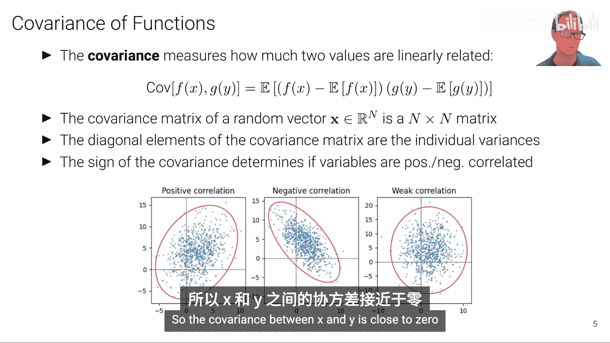

理解这些概念对于掌握后续的机器学习算法，尤其是涉及概率模型和优化目标的部分至关重要。