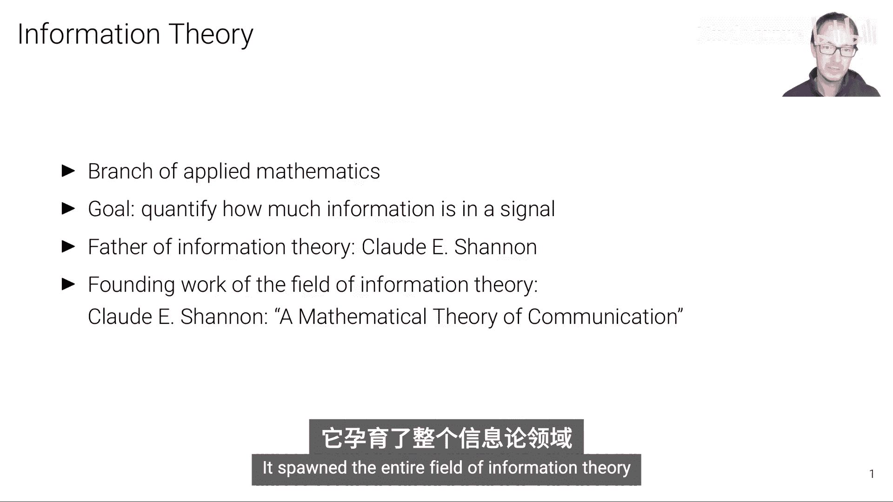
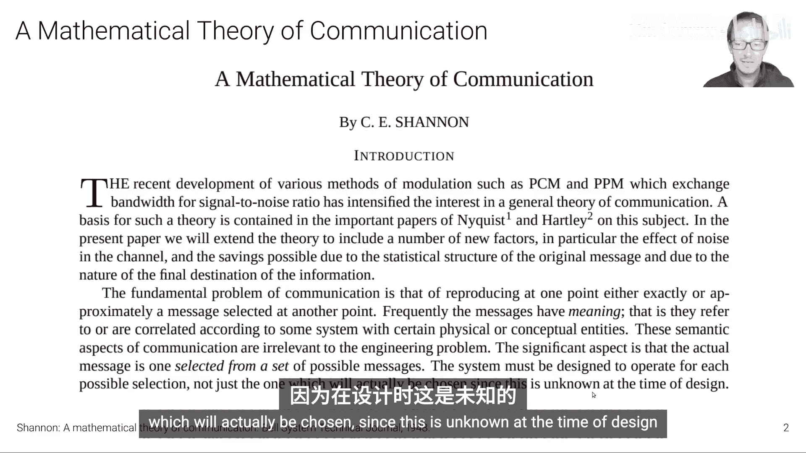
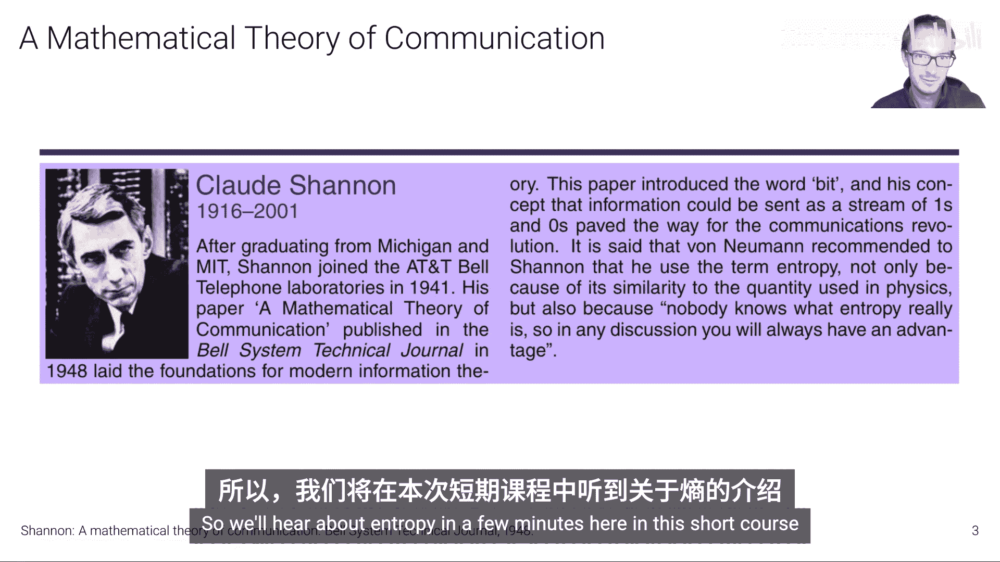
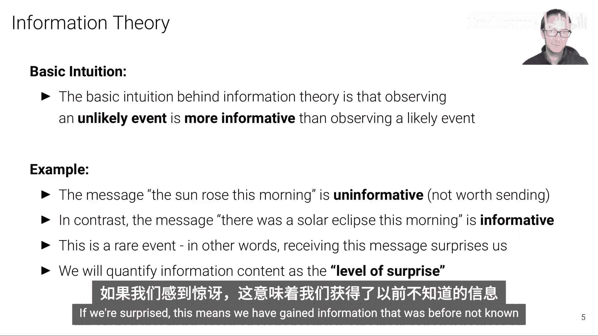
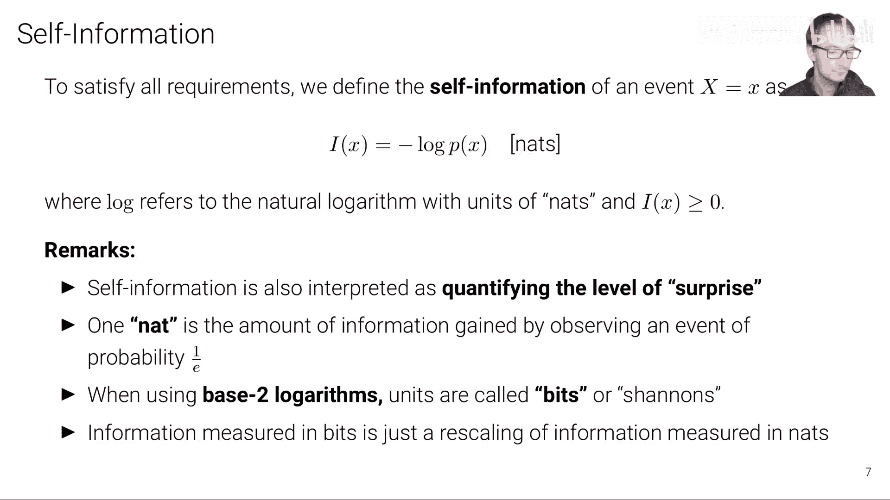
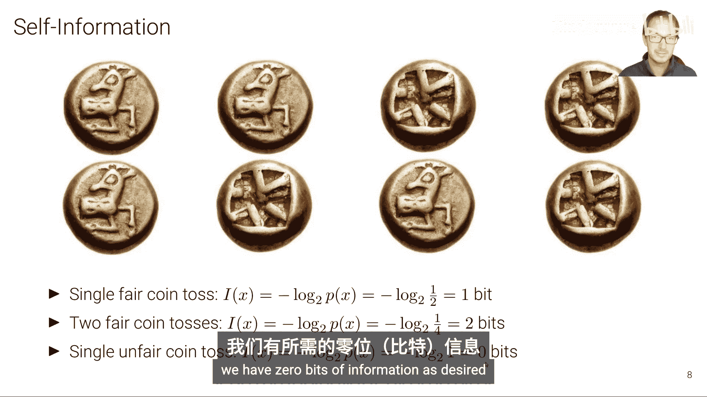
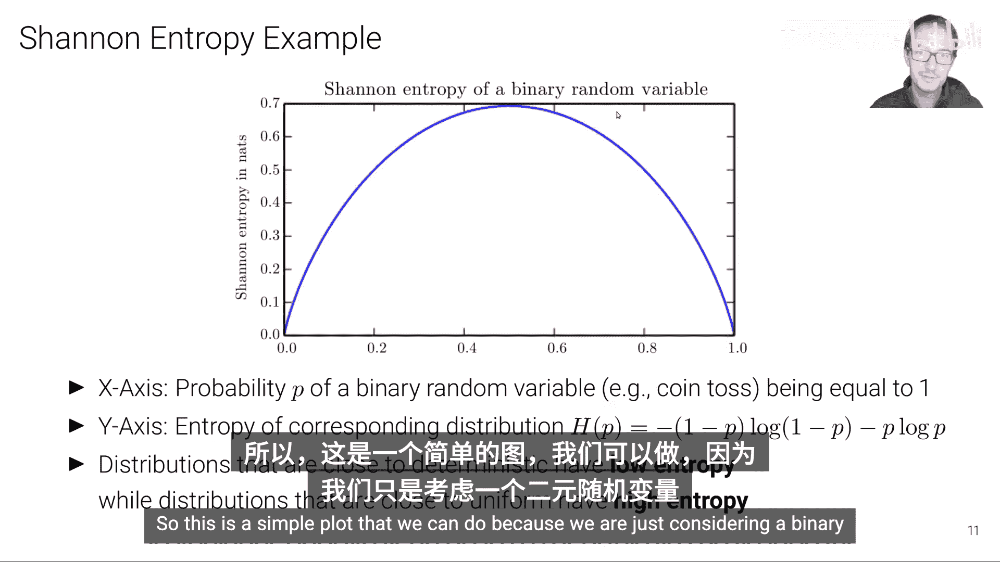
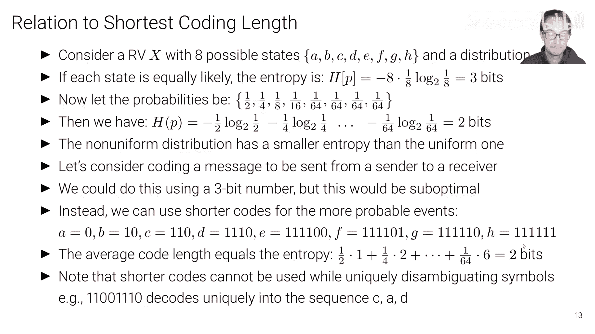

# 016：信息与熵 📊

在本节课中，我们将学习信息论的基础知识。信息论是应用数学的一个分支，旨在量化给定信号中包含的信息量。我们将介绍**自信息**、**香农熵**等核心概念，并探讨它们与概率分布的关系。

## 信息论的起源 📜

上一节我们介绍了本课程的目标。本节中，我们来看看信息论的起源。

信息论之父是克劳德·香农。他在1948年发表了开创性论文《通信的数学理论》。一年后，这篇论文以书名《通信的数学理论》出版，这表明其重要性在当时已得到广泛认可，并奠定了整个信息论领域的基础。

以下是香农1948年原始论文的截图。

让我们看看这篇论文的开头几行。他写道：“最近各种调制方法（如PCM和PM）的发展，它们用带宽换取信噪比，加深了人们对通用通信理论的兴趣。奈奎斯特和哈特利关于该主题的重要论文包含了这一理论的基础。在本文中，我们将扩展该理论，纳入一些新因素，特别是信道中噪声的影响，以及由于原始消息的统计结构和信息的最终目的地性质而可能实现的节省。”

香农考虑的系统结构如下：信息源产生消息，通过数字信号传输，在接收端接收，然后解码回其原始形式。这个信道可能受到噪声的影响。

关于克劳德·香农有一个小轶事。香农于1960年至2001年生活。他从密歇根大学和麻省理工学院毕业后，于1941年加入AT&T贝尔电话实验室。1948年，他在《贝尔系统技术杂志》上发表了著名的论文《通信的数学理论》。这篇论文奠定了现代信息论的基础。该论文引入了“比特”一词。他关于信息可以作为一串0和1发送的概念为通信革命铺平了道路。据说冯·诺依曼建议香农使用“熵”这个术语，不仅因为它在物理学中的相似性，还因为没有人真正知道熵是什么。因此，在任何讨论中，你总是会占据优势。

## 信息论与机器学习 🤖

信息论最初是为了研究在噪声信道上发送来自离散字母表的消息而发明的。例如，通过无线电波进行消息通信。信息论告诉我们如何为这些消息设计最优编码，以及如何计算使用各种编码方案采样的消息的预期长度。我们将看到一个非常简单的例子。

在本短期课程中，我们主要使用信息论中的几个关键思想。这个领域非常庞大，我们甚至无法涵盖原始论文的一小部分。因此，我们只使用信息论中的几个关键思想，目的是描述概率分布或量化概率分布之间的相似性。这就是信息论在我们课程背景下进入机器学习的地方。

## 什么是信息？ 💡

信息论的基本直觉如下：观察一个不太可能发生的事件比观察一个很可能发生的事件提供的信息更多。直观上，这是有道理的。例如，消息“今天早上太阳升起了”是完全无信息的。太阳每天早晨都会升起。发送这条消息不值得，它不包含任何有价值的信息。相比之下，消息“今天早上有日食”则信息量很大。日食实际上相当罕见。因此，如果你告诉我发生了日食，这对我来说信息量很大。

这是基本的直觉。像日食这样不太可能的事件比非常可能的事件（如太阳每天升起）包含更多的信息。换句话说，接收这条消息让我们感到惊讶。“惊讶”是“信息”的另一个说法。我们可以非正式地将信息内容量化为惊讶的程度。如果我们感到惊讶，这意味着我们获得了之前未知的信息。

## 量化信息：自信息 📏

我们希望以一种形式化这种直觉的方式来量化信息。可能的事件应该具有低信息内容。确定的事件应该没有信息内容。然而，不太可能的事件应该具有更高的信息内容。我们强加的另一个规则是：如果观察独立事件，那么信息应该相加。例如，发现抛出的硬币两次正面朝上应该传达两倍于发现一次正面朝上的信息。

给定这些假设，只有一个公式可以满足所有这些要求。我们定义**自信息**。我们将这个信息量称为事件 `X = x` 的自信息，其中 `X` 是一个随机变量，取值为 `x`。自信息 `I(x)` 定义为：

**`I(x) = -log(p(x))`**

这里，对数通常指自然对数，单位是**奈特**。如果使用以2为底的对数，单位称为**比特**或**香农**。自信息总是大于或等于0。

使用不同底数的对数只是缩放比例不同。可以证明，这是唯一满足上述所有要求的公式。这也很容易理解，因为对数的性质：乘积的对数等于对数的和，这满足了可加性要求。同时，`-log(p(x))` 总是非负的，并且概率越高，信息量越低，因为这是一个单调递减函数。

自信息也被解释为量化惊讶的程度。一奈特是通过观察概率为 `1/e` 的事件所获得的信息量。当使用以2为底的对数时，单位称为比特或香农。以比特为单位测量的信息只是以奈特为单位测量的信息的重新缩放。

让我们看一个关于可加性的简单例子。考虑一次公平的抛硬币。如果硬币是公平的，出现正面的概率是 `1/2`。如果我们使用以2为底的对数，自信息是 `-log₂(1/2) = 1` 比特。

现在考虑两次公平的抛硬币。观察到两次正面的概率是 `1/4`。那么，观察到此事件的信息是 `-log₂(1/4) = 2` 比特。可以看到，通过观察这两个独立事件，我们有了可加效应：1比特 + 1比特 = 2比特。

相反，如果我们有一个总出现正面的不公平硬币（假设物理上可能），那么这个事件的概率是1。因此，该事件的信息是 `-log₂(1) = 0` 比特。因为它总是以确定性出现，所以我们有零比特信息。

## 从自信息到香农熵 📈

自信息只处理单个结果。但我们也可以量化整个概率分布中的不确定性量。我们使用所谓的**香农熵**来实现这一点。我们将香农熵写为 `H(P)`，其中 `P` 是概率分布。它定义为当 `x` 从该分布中采样时，自信息的期望值。

因此，它可以重写为：

**`H(P) = E[I(x)] = -E[log(p(x))]`**

换句话说，熵 `H(P)` 等于从 `P(x)` 中抽取时的预期信息量。由于自信息是正的，熵也是正的。

当使用以2为底的对数时，熵指定了平均编码从概率分布 `P(x)` 中抽取的符号所需比特数的下限。当 `x` 是连续变量时，香农熵被称为**微分熵**。

以下是其形式。在离散情况下，香农熵定义为：

**`H(P) = -Σ p(x) log(p(x))`**

在连续情况下，求和被积分取代：

**`H(P) = -∫ p(x) log(p(x)) dx`**

按照惯例，我们将可能出现的 `0 log 0` 视为 `x log x` 当 `x` 趋近于0时的极限，即等于0。

## 熵的示例 🎲

最简单的例子是查看二元随机变量（如公平或不公平的硬币）的香农熵。在下图中，x轴是二元随机变量（如硬币）等于1的概率 `p`。对于公平硬币，`p = 0.5`；对于不公平硬币，`p` 可能为1或0。y轴是对应伯努利分布的熵，其公式为：

**`H(p) = -[(1-p) log(1-p) + p log(p)]`**

我们看到，如果分布接近均匀（`p = 0.5`），不确定性最大，熵最高（略低于0.7）。另一方面，如果分布接近确定性（硬币总是正面或反面），那么香农熵将接近0。因此，如果我们有一个完全随机的均匀分布，则熵高。如果事件以高确定性发生，则熵低。

我们也可以查看其他分布。这里我们有30个状态的离散概率分布的直方图。顶部显示了以奈特为单位的熵。我们可以看到，正如预期的那样，较宽分布（更不确定）的熵高于较窄分布（从该分布采样时更清楚哪些状态会被取到）的熵。同样，在这种情况下，均匀分布会产生可能的最大熵。如果我们有一个完全均匀的分布，那么熵将是 `-log(1/30) ≈ 3.4` 奈特，这是该特定分布可能具有的最高熵。

## 熵与最短编码长度 🔗

最后，我想简要展示熵与香农在从发送方向接收方传输消息时非常重要的最短编码长度之间的关系。这不仅对我们作为概率分布或不确定性的度量有用，而且它实际上源于编码。

考虑一个具有8种可能状态 `{A, B, C, D, E, F, G, H}` 的随机变量 `X`，以及该变量上的分布 `P`。如果每个状态的可能性相同（均匀分布），则熵 `H(P) = -8 * (1/8) * log₂(1/8) = 3` 比特。

现在假设一个非均匀分布。具体来说，让概率如图所示。第一个状态极有可能，占一半的概率质量。然后，另一半概率分布在所有其他状态上，其中第二个状态仍然相当可能，第三个状态也是，但其余状态则相当不可能。在这种情况下，我们也可以计算熵，结果是2比特。

我们已经看到，在均匀分布下，熵高于非均匀分布下的熵。但这与最短编码长度有什么关系呢？

现在考虑编码要从发送方发送给接收方的消息。因为我们有8种可能的状态，我们可以简单地用3位数字对消息中的每个符号进行编码。用3位，我可以唯一地编码具有8个字符的字母表的消息。然而，在这些字符的概率如图所示的情况下，这将是非常次优的。这两个分布之间的熵差异告诉了我们这一点。

因为我们可以做的是，对更可能的事件使用较短的代码，代价是对非常不可能的事件使用较长的代码。例如，我们可以取代码 `0` 代表符号 `A`，代码 `10` 代表符号 `B`，它们很短。然后，对于概率较低的符号 `E, F, G, H`，我们用较长的代码编码，如 `111100`。如果我们这样做，并且假设我们从该分布生成消息，那么我们将观察到平均代码长度现在等于熵（在这种情况下是2比特）。因为以概率 `1/2`，我们用长度为1的代码编码符号；以概率 `1/4`，我们用长度为2的代码编码符号；只有以概率 `1/64`，我们需要6位来编码一个符号。平均而言，我们得到2比特，即该分布的熵。因此，熵告诉我们，如果我们以最优方式编码这些消息，需要多少比特。

这里需要注意，较短的代码不能随意使用，同时需要唯一地消除符号歧义。我们需要知道一个符号何时结束，因此我们不能在这里使用任何任意代码。但我们必须以巧妙的方式编码这些符号，以便能够区分。例如，代码 `1100, 1110` 唯一地解码为序列 `C A D`。因为 `110` 是唯一以符号 `C` 开头的代码，然后 `0` 是唯一以符号 `A` 开头的代码。因此，所有代码都是唯一的。这就是为什么这些代码看起来是这样的。

## 总结 📝

在本节课中，我们一起学习了信息论的基础知识。我们从信息论的起源和克劳德·香农的贡献开始。然后，我们探讨了信息的直观概念，并将其形式化为**自信息**，定义为 `I(x) = -log(p(x))`。接着，我们将这个概念扩展到整个概率分布，引入了**香农熵** `H(P) = -E[log(p(x))]`，作为不确定性的度量。我们通过二元分布和多元分布的示例观察了熵的行为。最后，我们了解了熵与最优编码平均长度的深刻联系，它给出了编码从分布中抽取的符号所需比特数的下限。这些概念为在机器学习中理解和比较概率分布提供了重要的数学工具。