# 018：Argmin与Argmax算子 🎯

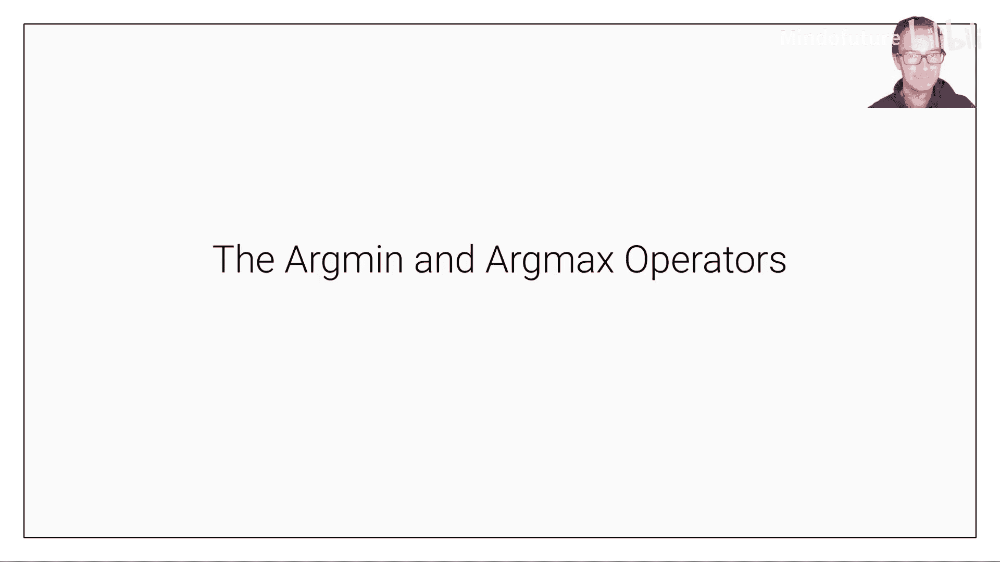

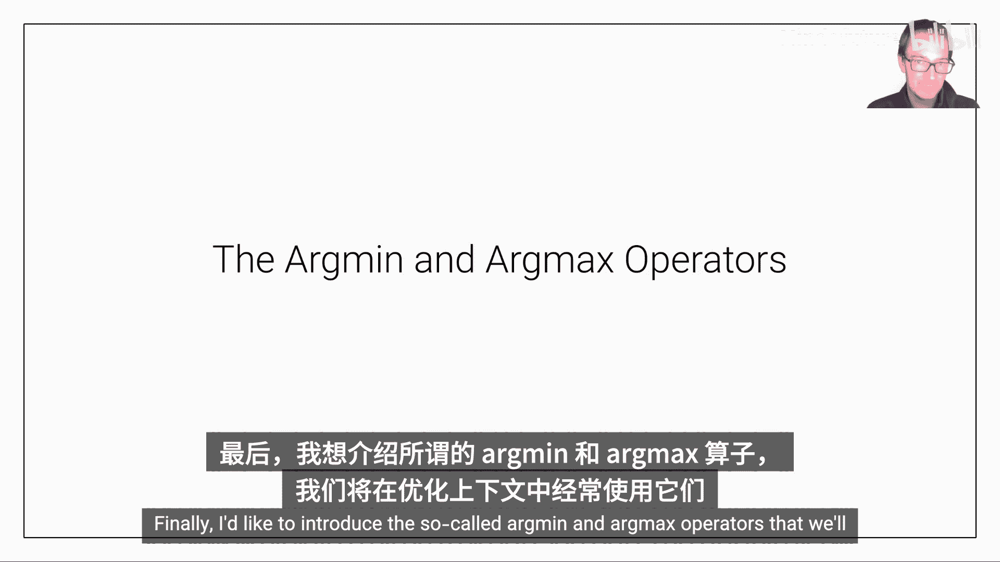

在本节课中，我们将学习优化问题中两个非常重要的算子：Argmin和Argmax。它们用于寻找使函数取得最小值或最大值的输入参数，而不是函数值本身。这在机器学习和深度学习的参数优化中非常常见。

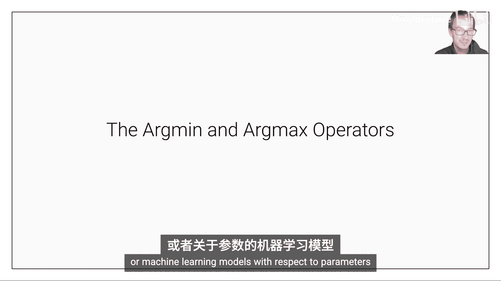

## 算子的定义 📖

上一节我们介绍了函数极值的概念，本节中我们来看看如何精确地描述取得这些极值的点。

设 \(\mathcal{X}\) 表示一个集合，\(f(x)\) 是定义在该集合上的函数。Argmin和Argmax算子的定义如下：

*   **Argmin**：函数 \(f(x)\) 关于 \(x\) 的Argmin，是**所有使得函数值在定义域上取得最小值的 \(x\) 的集合**。其数学表达式为：
    \[
    \underset{x \in \mathcal{X}}{\operatorname{argmin}} f(x) = \{ x \in \mathcal{X} \mid f(x) = \min_{z \in \mathcal{X}} f(z) \}
    \]
    简单来说，它返回的是**最小值点的位置（自变量）**，而不是最小值本身。

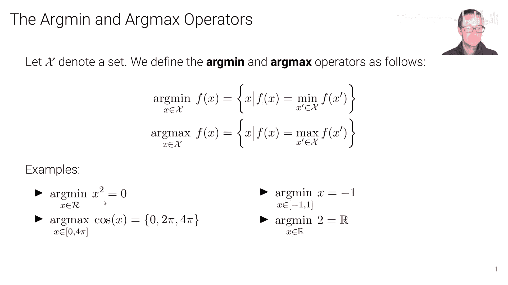

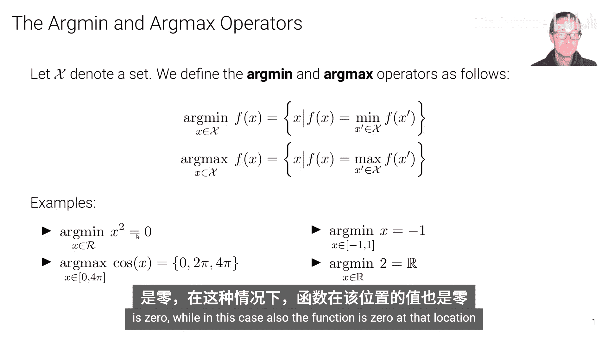

*   **Argmax**：函数 \(f(x)\) 关于 \(x\) 的Argmax，是**所有使得函数值在定义域上取得最大值的 \(x\) 的集合**。其数学表达式为：
    \[
    \underset{x \in \mathcal{X}}{\operatorname{argmax}} f(x) = \{ x \in \mathcal{X} \mid f(x) = \max_{z \in \mathcal{X}} f(z) \}
    \]
    同样，它返回的是**最大值点的位置**。

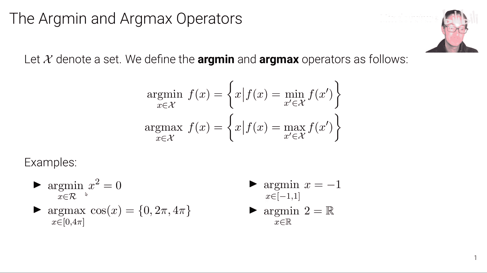

## 示例解析 🔍

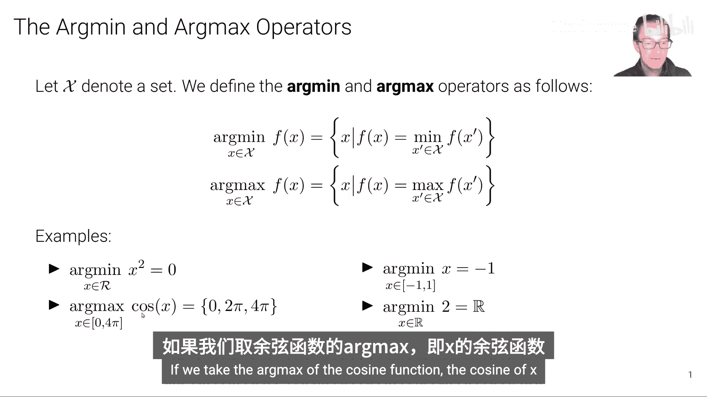

为了更清晰地理解这两个算子，让我们通过几个具体的函数例子来看一看。

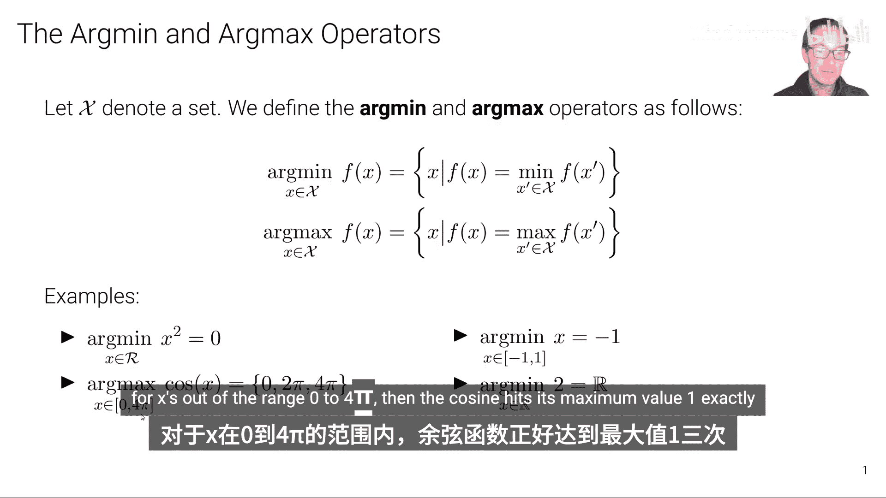

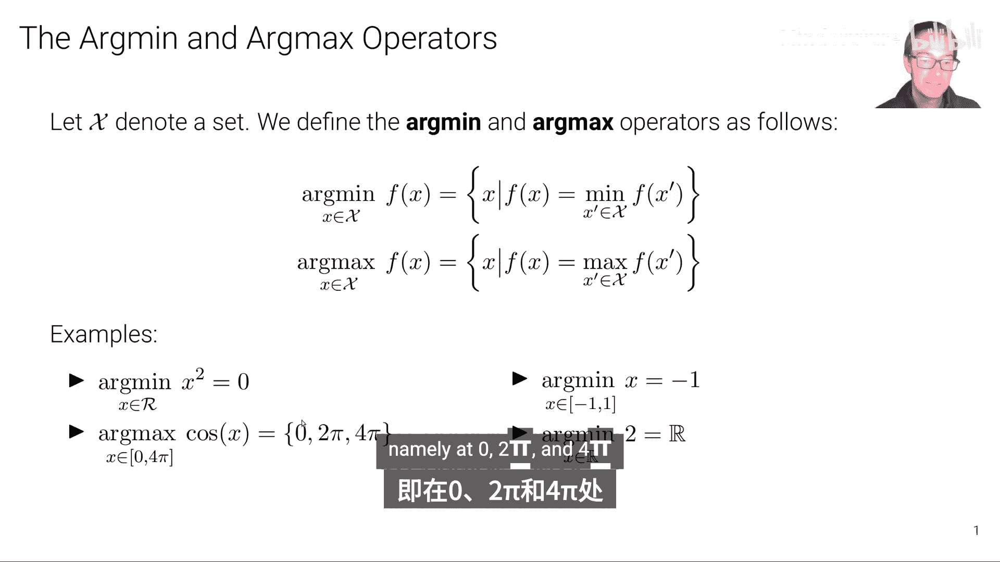

以下是几个Argmin和Argmax的计算示例：

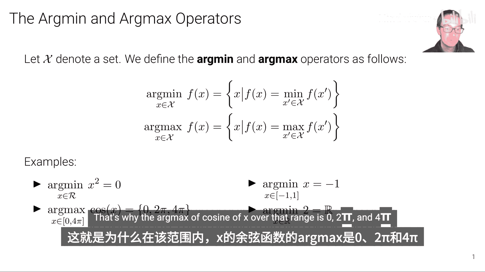

1.  **平方函数**：考虑函数 \(f(x) = x^2\)。
    *   \(\underset{x}{\operatorname{argmin}} \ x^2 = 0\)
    *   解释：函数在 \(x=0\) 处取得最小值0。Argmin返回的是这个位置 `0`，而不是最小值 `0`。

2.  **余弦函数**：考虑函数 \(f(x) = \cos(x)\)，定义域 \(x \in [0, 4\pi]\)。
    *   \(\underset{x \in [0, 4\pi]}{\operatorname{argmax}} \ \cos(x) = \{0, 2\pi, 4\pi\}\)
    *   解释：余弦函数在区间 \([0, 4\pi]\) 内，在 \(x=0, 2\pi, 4\pi\) 这三个点都取得了最大值1。因此，Argmax返回的是一个包含三个元素的集合。

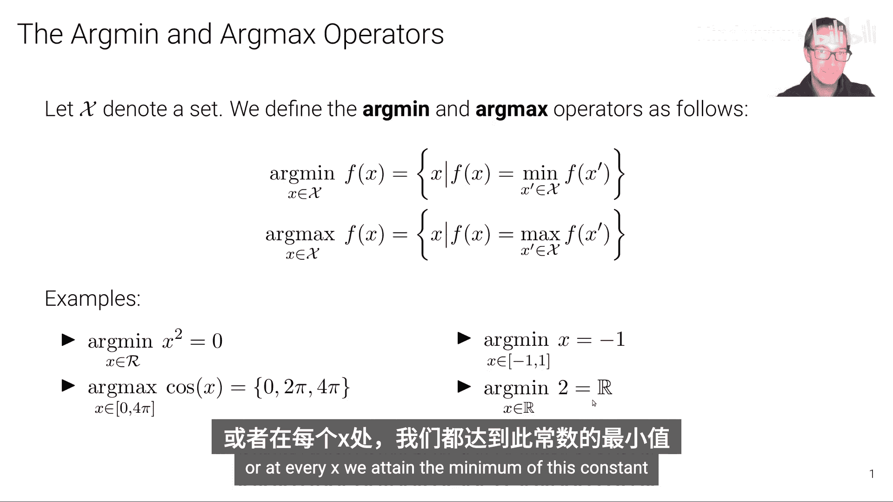

3.  **线性函数**：考虑函数 \(f(x) = x\)，定义域 \(x \in [-1, 1]\)。
    *   \(\underset{x \in [-1, 1]}{\operatorname{argmin}} \ x = -1\)
    *   解释：在这个区间内，函数在 \(x=-1\) 处取得最小值。

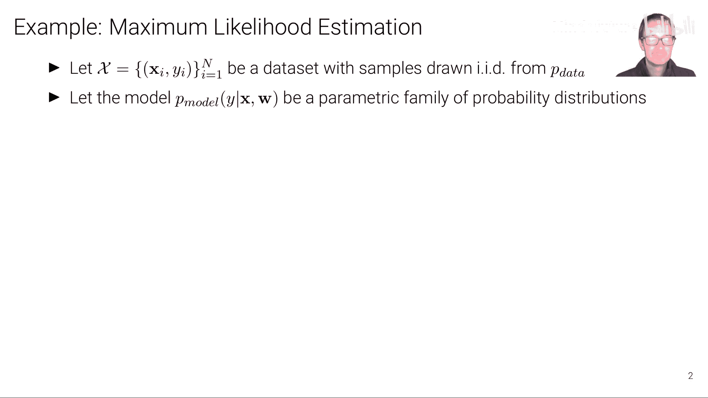

4.  **常数函数**：考虑函数 \(f(x) = c\)（c为常数），定义域为所有实数 \(\mathbb{R}\)。
    *   \(\underset{x \in \mathbb{R}}{\operatorname{argmin}} \ c = \mathbb{R}\)
    *   \(\underset{x \in \mathbb{R}}{\operatorname{argmax}} \ c = \mathbb{R}\)
    *   解释：因为函数值处处相等，所以每一个 \(x\) 都同时是“最小值点”和“最大值点”。因此，Argmin和Argmax的结果都是整个实数集。

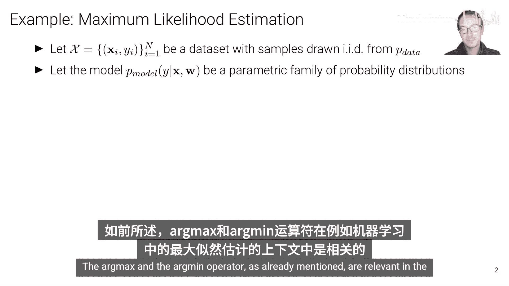

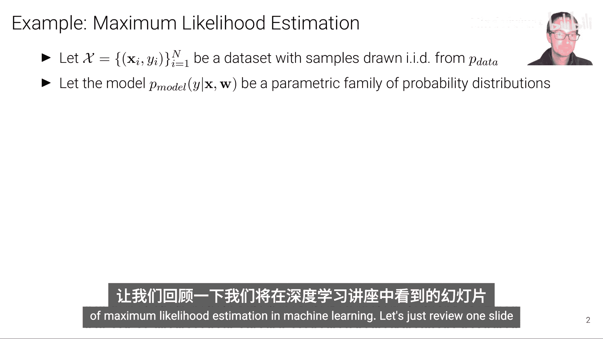

## 在机器学习中的应用 🤖

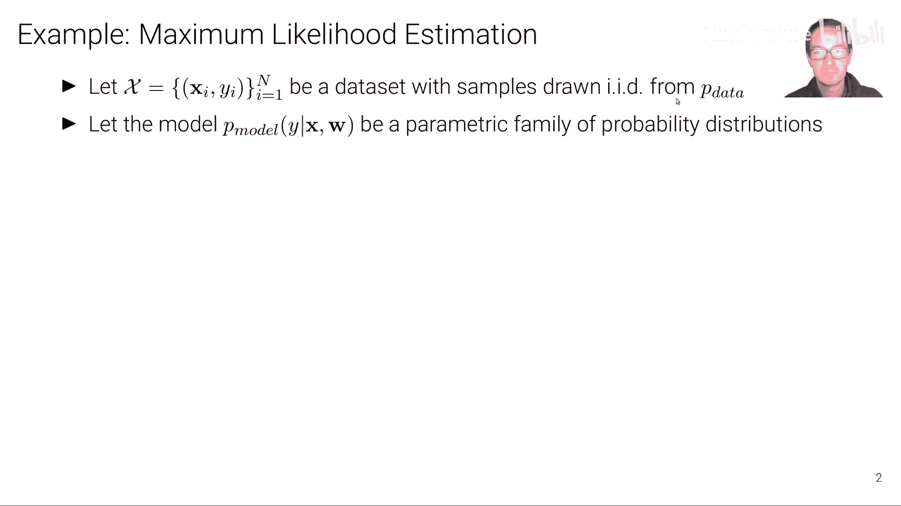

理解了算子的基本概念后，我们来看看它们在机器学习中的一个核心应用场景：最大似然估计。

Argmax算子在机器学习中至关重要，尤其是在**最大似然估计**中。我们的目标是找到一组模型参数，使得观测到的数据在该模型下出现的“可能性”最大。

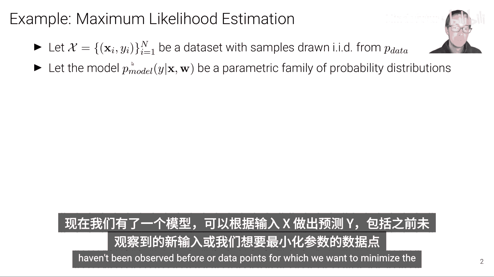

假设我们有一个数据集 \(\mathcal{D}\)，包含从真实数据分布中独立同分布采样得到的样本 \((x, y)\)。我们有一个参数化的模型 \(P_{\text{model}}(y|x; \mathbf{w})\)，它表示在给定输入 \(x\) 和参数 \(\mathbf{w}\) 时预测 \(y\) 的概率分布。

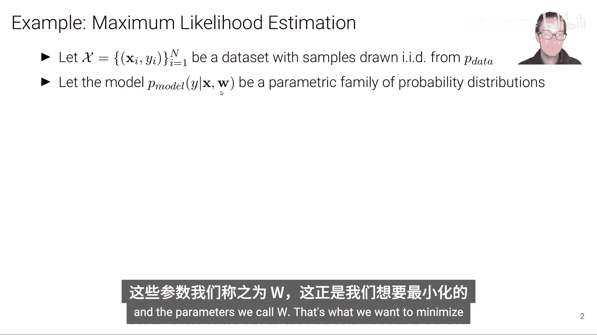

那么，参数 \(\mathbf{w}\) 的**条件最大似然估计** \(\hat{\mathbf{w}}\) 可以定义为：
\[
\hat{\mathbf{w}} = \underset{\mathbf{w}}{\operatorname{argmax}} \ P_{\text{model}}(\mathcal{D}; \mathbf{w})
\]

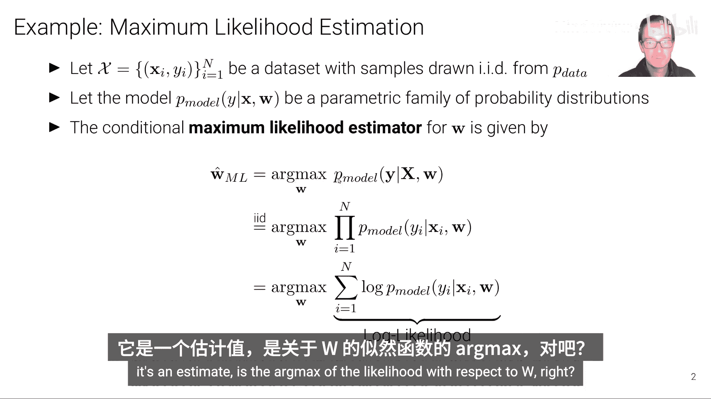

利用数据样本独立同分布的假设，联合概率可以分解为每个数据点概率的乘积：
\[
\hat{\mathbf{w}} = \underset{\mathbf{w}}{\operatorname{argmax}} \prod_{(x,y) \in \mathcal{D}} P_{\text{model}}(y|x; \mathbf{w})
\]

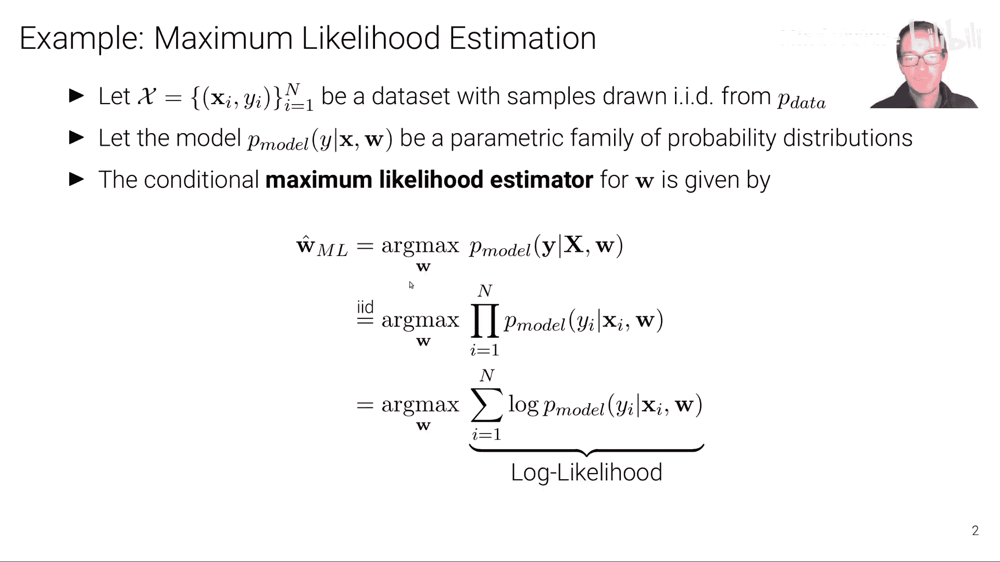

由于对数函数是单调函数，最大化乘积等价于最大化其对数之和（即对数似然）：
\[
\hat{\mathbf{w}} = \underset{\mathbf{w}}{\operatorname{argmax}} \sum_{(x,y) \in \mathcal{D}} \log P_{\text{model}}(y|x; \mathbf{w})
\]

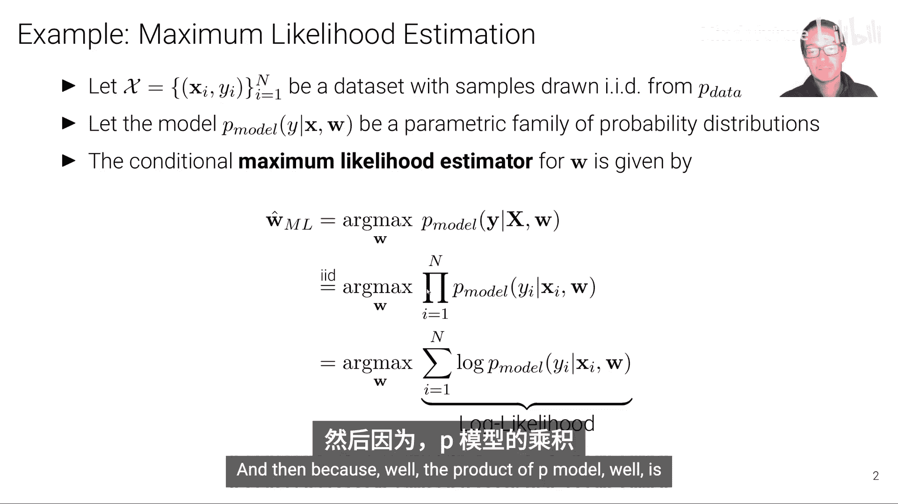

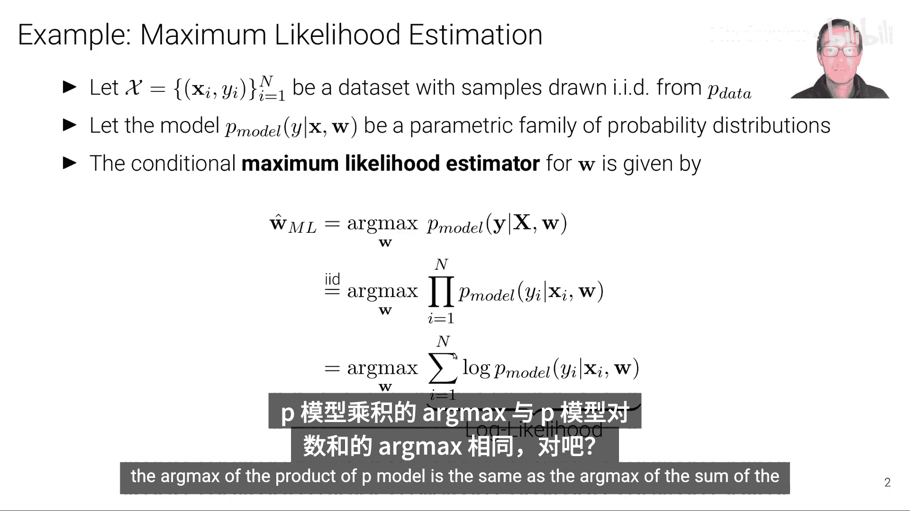

我们可以看到，最终的目标就是寻找使**对数似然函数**取得最大值的参数 \(\mathbf{w}\)。Argmax算子清晰地描述了这一优化问题的解。

## 总结 📝

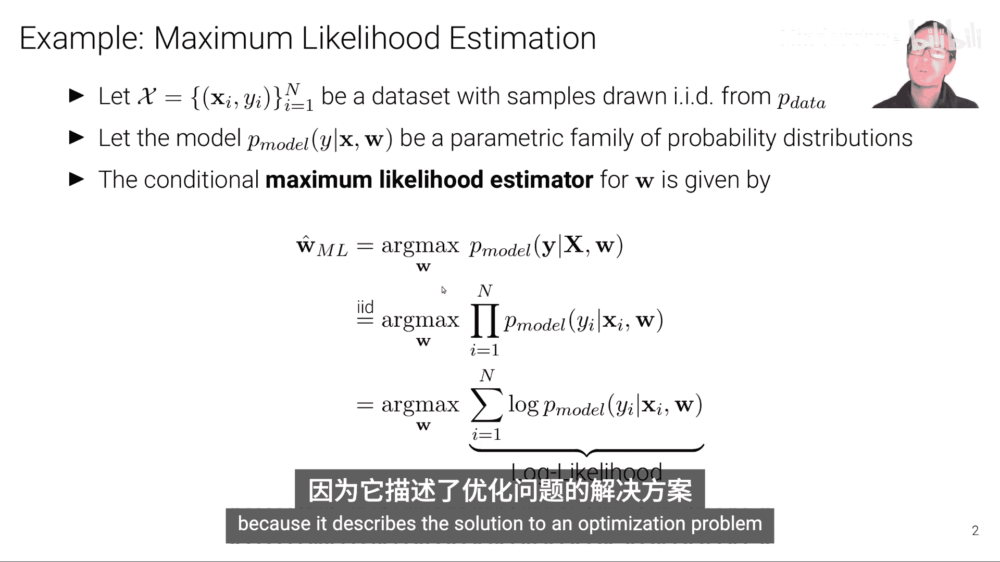

本节课中我们一起学习了Argmin和Argmax这两个核心的数学算子。
*   **Argmin** 返回使函数取得**最小值**的输入变量的集合。
*   **Argmax** 返回使函数取得**最大值**的输入变量的集合。
它们与简单的`min`/`max`函数（返回极值本身）有本质区别。这两个算子在优化问题中，特别是在机器学习的模型参数估计（如最大似然估计）中，扮演着定义“最优解”的关键角色。理解它们有助于我们更精确地阅读和构建机器学习的目标函数。