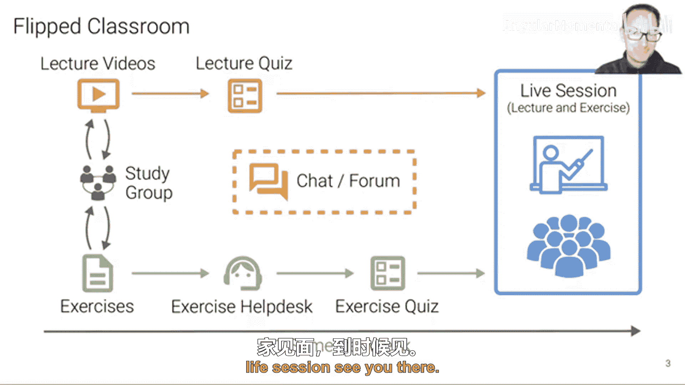

# 001：课程简介与组织架构 🎓

在本节课中，我们将要学习蒂宾根大学《深度学习》课程的整体介绍与组织架构。我们将了解课程的基本信息、教学形式以及每周的学习流程。

欢迎来到蒂宾根大学的《深度学习》课程。我是安德烈亚·盖格，本门课程的讲师。深度学习是机器学习的一个分支，在过去十年中，它不仅席卷了工业界，也深刻影响了学术界。每年都有新的、更激动人心的进展出现。你们中的许多人可能都听说过它。

我想用一段你们可能熟悉的前总统的发言来开始这门课。

> 大家好，我是巴拉克。欢迎来到蒂宾根大学的深度学习课程。众所周知，深度学习已经彻底改变了从计算机视觉、医学、生物信息学到自然语言处理等众多研究领域。它也让智能系统（如自动驾驶汽车）更自然地与环境交互迈进了一步。深度学习是更广泛的机器学习方法家族的一部分，基于人工神经网络。深度模型从大型数据集中学习，以预测未见过的输入（如图像、文本或音频）的结果，并且它们在这方面表现得非常出色，超越了该领域大多数经典的基准方法。事实上，这段视频是由一个名为“神经语音木偶”的深度模型完全自动生成的。我的脸和声音都不是真实的。因此，我也可以在这门课上改变我的声音。安德烈亚和他的团队将告诉你开始学习深度学习所需知道的一切。希望你们喜欢这门课。

这段视频展示了深度学习在生成式人工智能领域的强大能力，它本身就是一个深度学习模型的应用实例。

---

这门课程采用所谓的“翻转课堂”形式进行教学。这意味着我们在现场课之前，会通过YouTube平台提前提供讲座视频和作业。然后，我们所有人会在现场课中重新聚在一起，以面对面的形式共同讨论困难的主题和你们的问题，也可能完成一些我们在现场课中提出的小任务或回答的问题。

因此，提前观看这些讲座视频对于你们从现场课中有所收获至关重要。我们也建议你们与同学组成学习小组，在课前讨论讲座视频的内容以及练习题。

为了提供一个自我评估和自我激励的机制，我们提供了在线的“讲座测验”。你们可以通过这些测验评估自己，并为期末考试赚取一些加分。这些测验也为我们提供了必要的反馈，以便更深入地讨论班上大多数同学难以理解的主题。

我们为讲座和练习都提供了这种测验。此外，对于练习，我们还提供了一个在线的Zoom帮助台，你们可以直接从本课程的助教那里获得指导和帮助来解决练习。我们还提供了一个在线聊天室或论坛，你们可以非常快速地获得关于讲座视频或练习问题的反馈。

一个典型的学期周流程如下：
*   观看讲座视频。
*   尝试解决练习题。
*   咨询学习小组或练习帮助台。
*   完成练习测验。
*   带着所有这些知识和问题参加现场课，我们将在现场课中与其他同学一起更详细地讨论这些问题。

以上就是我现在想说的全部内容。我非常期待在我们的第一次现场课上见到你们。

---

本节课中，我们一起学习了蒂宾根大学《深度学习》课程的基本介绍和独特的“翻转课堂”教学模式。我们了解到课程将通过提前发布的视频、练习题、在线测验、帮助台和论坛来支持学习，最终在现场课中进行深入讨论和答疑。这种设计旨在鼓励主动学习和协作。