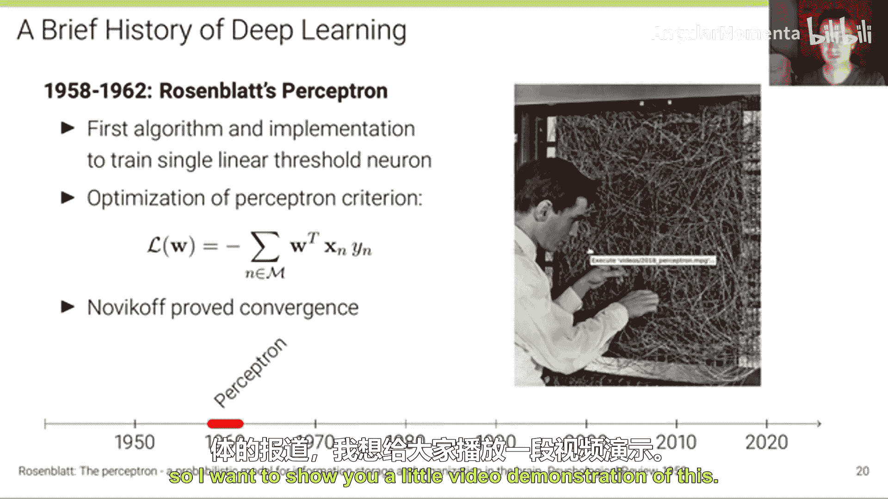
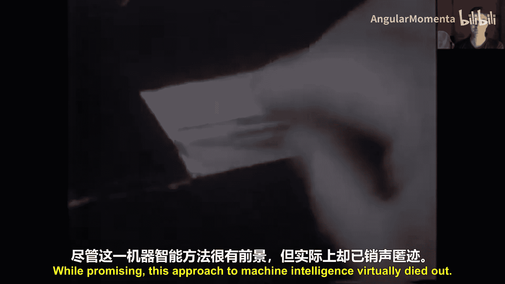
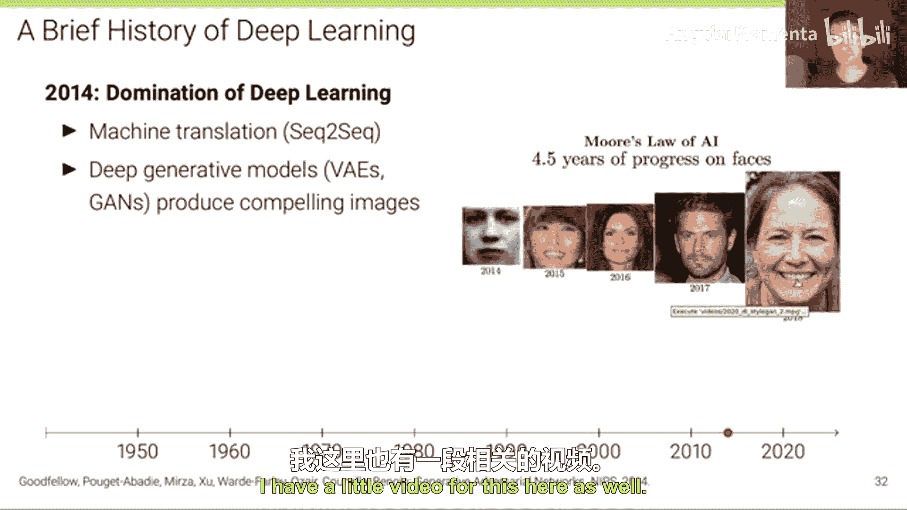
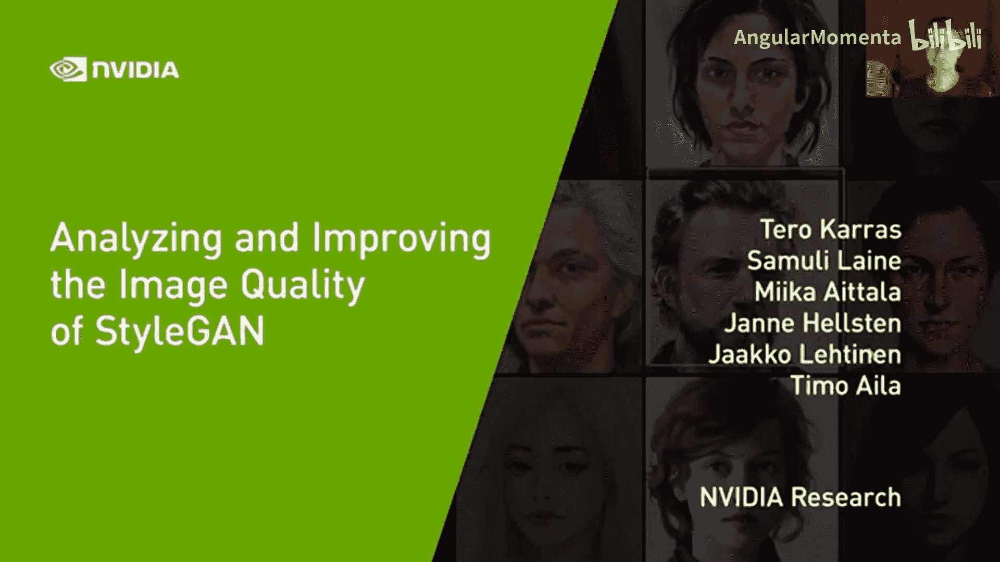
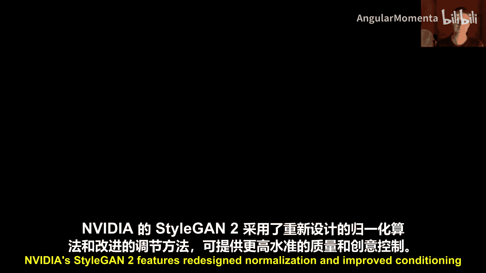
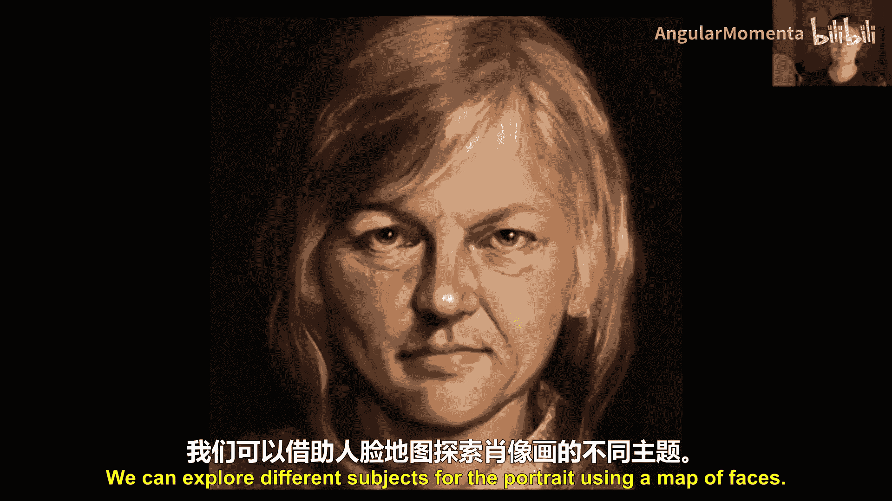
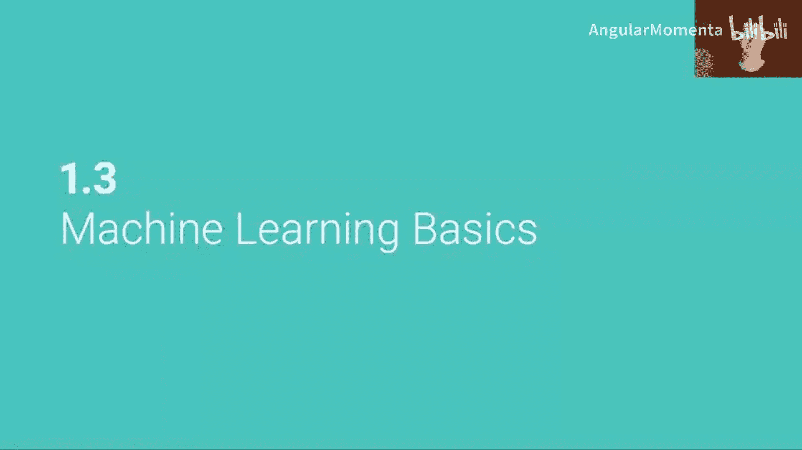

# 002：历史简介 🧠

在本节中，我们将简要回顾深度学习的发展历程。我们将看到，深度学习并非一蹴而就，而是经历了几个关键的发展阶段，每个阶段都有其独特的贡献与挑战。

深度学习的发展经历了三个主要阶段。这些阶段并非从一开始就被称为“深度学习”，而是随着时间推移逐渐形成的。

## 第一波：控制论时代（1940s-1960s）⚙️

第一波浪潮被称为控制论时代，也被视为深度学习的“黄金时代”。当时，研究人员使用简单的大脑计算模型来模仿生物学习，并学习简单的规则。

这些模型在分类简单模式方面取得了成功。然而，人们逐渐意识到，这些简单模型不足以解决更复杂的任务，这导致了相关研究的衰退。

### 早期神经元模型

1943年，McCulloch和Pitts提出了一个早期的神经激活计算模型，称为线性阈值单元或神经元。

该模型的核心是一个基于线性计算的阈值函数。其公式可以表示为：

**`f(x) = sign(W·x)`**

其中，`x` 是输入数据或特征，`W` 是权重。如果权重与特征的乘积大于0，则输出+1；如果小于0，则输出-1。这是一个二元决策模型。

研究表明，这个简单的操作比基本的“与”门或“或”门更强大，后者只是该计算的特例。但在当时，还没有有效学习权重的方法。

### 感知机的诞生

1958年，Rosenblatt开发了著名的感知机。这既是一种算法，也是一个实际的硬件实现，用于训练单个线性阈值神经元。

它使用感知机算法进行训练，该算法优化了所谓的感知机准则。这与我们今天使用基于梯度的反向传播优化方法有很大不同。

感知机算法关注所有被错误标记的样本集合 `M`，并基于真实标签（+1或-1）最小化一个损失函数，以期在算法的下一次迭代中正确分类这些样本。

对于这个简单模型，这是一个最优的做法。虽然不能保证以最少的迭代次数收敛到解，但已被证明，如果解存在（即两类数据是线性可分的），算法将收敛到正确的解。

感知机的成功引起了媒体的广泛关注，它被展示用于区分男女性别面孔等任务。然而，这种成功也导致了过度的炒作和期望。

## 第二波：联结主义时代（1980s）🔗

在20世纪80年代，深度学习常被称为或与“联结主义”相关联。联结主义认为，智能行为是通过大量非常简单的单元或计算细胞实现的。

正是在这个时代，反向传播、序列模型等非常重要的算法被开发出来。然而，这一发展处于阴影之中，被其他领域的发展所掩盖，因此也被称为“黑暗时代”。

被掩盖的原因是，虽然这些算法在简单例子上有效，但由于缺乏算法、计算力和数据，无法在计算机视觉等领域的复杂、具有挑战性的现实世界任务上取得重大突破。

### 神经认知机与卷积的灵感

1979年，福岛邦彦提出了神经认知机，它是当今我们仍在广泛使用且最成功的模型之一——卷积神经网络的前身。

福岛邦彦的神经认知机深受Hubel和Wiesel在20世纪50年代对猫视觉皮层（V1区）实验的启发。他们发现视觉皮层中有不同类型的神经细胞：对边缘方向敏感的“简单细胞”和对精确位置不敏感的“复杂细胞”。这一伟大发现于1981年获得了诺贝尔奖。

神经认知机模仿了这些简单和复杂细胞，提出了一个由S细胞（简单）和C细胞（复杂）组成的多层处理网络。这基本上实现了我们今天所知的卷积和池化——深度神经网络中两个最基本的操作。然而，当时还没有反向传播算法，学习是通过基于强化的学习规则进行的。尽管如此，该模型架构对今天非常成功的模型产生了重要启发。

### 反向传播算法的复兴

反向传播算法在1961年就已为人所知，但第一个经验性的成功是在1986年由Rumelhart、Hinton和Williams展示的。

反向传播算法至今仍是深度学习研究的主要工具。它之所以如此重要，是因为它能够高效地计算深度神经网络中关于网络权重的梯度。这些网络拥有数百万甚至数十亿的参数，因此在学习算法的每次迭代中，高效计算权重更新至关重要，而反向传播算法提供了这种能力。它使得基于梯度的学习能够应用于深度网络，这在当时是一个重大突破。

### 长短期记忆网络

1997年，Schmidhuber和Hochreiter提出了现在著名的长短期记忆网络。早在1991年，Hochreiter就在他的学位论文中阐述了梯度消失和梯度爆炸的问题，这在序列建模任务中尤为严重。

LSTM通过结合反馈循环以及“遗忘门”和“输入门”，有效地在很长的时间跨度上桥接了梯度流，从而高效地存储信息。这彻底改变了自然语言处理领域，尽管它的广泛认可和引用在2014-2015年左右才达到高峰，当时人们证明在大数据集和大算力下它效果极佳。LSTM已成为谷歌等主要科技公司机器翻译和语言识别技术的核心组件。

## 第三波：深度学习革命时代（2006至今）🚀

从2006年至今，深度学习才真正被称为“深度学习”，我们可以称之为革命时代。人们证明，通过更深的网络、更大的数据集和更强的计算能力，深度学习能够取得最先进的结果，几乎主导了不同领域和学科的排行榜。

### 卷积神经网络的崛起

1998年，Yann LeCun提出了卷积神经网络，它使用反向传播算法进行端到端训练。它通过卷积实现空间不变性，通过最大池化进行下采样，并利用权重共享的思想来减少参数量。

这篇论文真正的新意在于，首次证明了这些之前就已存在的卷积网络可以用反向传播算法非常有效地训练，并在标准机器学习任务（如MNIST手写数字分类）上取得了非常好的结果。然而，当时的结果尚未能扩展到人们感兴趣的复杂计算机视觉问题上，因此卷积神经网络在2006年至2010年左右才真正开始流行。

### ImageNet与AlexNet的突破

一个重大的突破是AlexNet在ImageNet数据集上的演示。ImageNet是一个包含1000个类别、数百万张标注图像的大规模视觉识别挑战赛数据集。

2012年，多伦多大学的Hinton团队通过调整基本的卷积神经网络（他们称之为AlexNet），赢得了这个计算机视觉界非常重要的基准测试。这对计算机视觉研究者来说是一个真正的突破和启示，他们第一次看到深度学习技术不仅能用于简单的28x28像素数字识别任务，也能用于视觉社区感兴趣的、极具挑战性的任务。

这次成功的背后是多种因素的结合：大规模标注数据集（如ImageNet）的可用性、GPU计算能力的普及，以及更深、更好的神经网络架构。这真正点燃了深度学习的革命之火。

### 泛化能力与特征迁移

深度学习的一个成功故事在于其出色的泛化能力。研究表明，可以在一个非常通用的任务（如ImageNet分类）上训练卷积神经网络，然后只需为特定任务更新最后一层（如支持向量机或神经网络的最后一层），即使使用很少的数据，也能获得与传统技术相竞争甚至更好的性能。

这意味着，基于通用任务学习的CNN能够产生非常高层和抽象的特征，这些特征对各种各样的任务都极其有用。这展示了深度学习模型的通用性和强大能力。

### 网络可视化与对抗样本

2014年，Zeiler和Fergus发表了一篇关于可视化深度神经网络所学内容的论文。他们发现，网络的更高层捕获了更抽象的语义信息（如狗的脸、轮子、眼睛），而较低层则捕获基本的梯度信息。这为了解这些“黑箱”模型提供了见解。

同样在2014年，研究也展示了这些强大网络的另一面：它们可以很容易被“对抗样本”愚弄。通过对图像添加人眼难以察觉的微小扰动，就能使分类器以高置信度给出完全错误的预测。这发展成了一个独立且活跃的研究领域。

### 生成模型的飞速进展

从2014年左右开始，事情发展得极其迅速。深度学习在计算机视觉、自然语言处理、医学和生物信息学等多个领域占据主导地位。

深度生成模型取得了令人震惊的进展。这些模型以无监督的方式训练数据集的生成过程。在短短几年内，从生成粗糙的图像，发展到能生成以假乱真、难以与真实照片区分的高质量图像，例如StyleGAN系列模型。

### 强化学习与游戏AI

2015年，DeepMind展示了如何将深度神经网络与强化学习巧妙结合，让智能体通过随机探索和奖励信号，学会玩多种Atari游戏，而无需观察任何人类游戏过程。

2016年，DeepMind进一步展示了在更复杂的围棋游戏上的突破，其程序AlphaGo首次击败了职业棋手。2017年，其升级版AlphaZero无需学习人类棋谱，完全通过自我对弈，不仅掌握了围棋，还掌握了多种其他游戏。

### 语言模型的变革

在自然语言处理领域，2017年和2018年的两篇重要论文——Transformer和BERT——带来了变革。Transformer表明，可以用注意力机制非常有效地取代经典的循环或卷积结构。BERT则证明，可以在海量无标签文本上对模型进行有效的预训练，然后在特定任务上微调即可获得最先进的结果。

### 3D深度学习与多模态

从2016年起，深度学习也开始攻克更难的领域，如3D深度学习。出现了能够有效预测体素、点云、网格或隐式表示的模型，例如仅从一张2D RGB图像就能预测出3D重建结果。

### 大规模语言模型与未来挑战

2020年，OpenAI的GPT-3模型出现，它拥有1750亿参数，使用海量计算资源在文本库上训练。这个模型一经训练，就能解决许多不同的任务，如编写可编译的代码、创作诗歌、撰写新闻等，产生了巨大影响。

## 总结与未来挑战 📈

本节课中，我们一起回顾了深度学习从控制论、联结主义到现代革命的简要历史。我们看到了关键模型和算法的诞生，如感知机、反向传播、CNN、LSTM、Transformer等，以及大数据和强算力如何共同推动了这场革命。

然而，仍然存在许多挑战等待下一代研究者去解决：
*   **数据依赖**：许多成功依赖于有监督学习，需要大量昂贵的标注数据。趋势正回归到无监督和自监督学习。
*   **交互学习**：人类通过与物体互动来学习，而不仅仅是静态数据集。机器人学和计算机视觉社区正在融合。
*   **准确性与鲁棒性**：在自动驾驶等安全关键领域，需要远超当前图像识别精度的模型。模型需要对新领域和对抗样本更具鲁棒性。
*   **归纳偏差与可解释性**：理解模型的归纳偏差及其影响非常重要。
*   **计算与能效**：大规模模型训练需要巨大的计算集群，而人脑仅需数百瓦。
*   **伦理与法律问题**：伴随着技术进步，产生了诸多伦理和法律问题。

最后，留给我们思考的问题是：过去几年我们见证的“AI摩尔定律”（错误率每年大约减半）在未来几年是否会持续？这尚不明朗。深度学习的旅程仍在继续，充满了机遇与挑战。