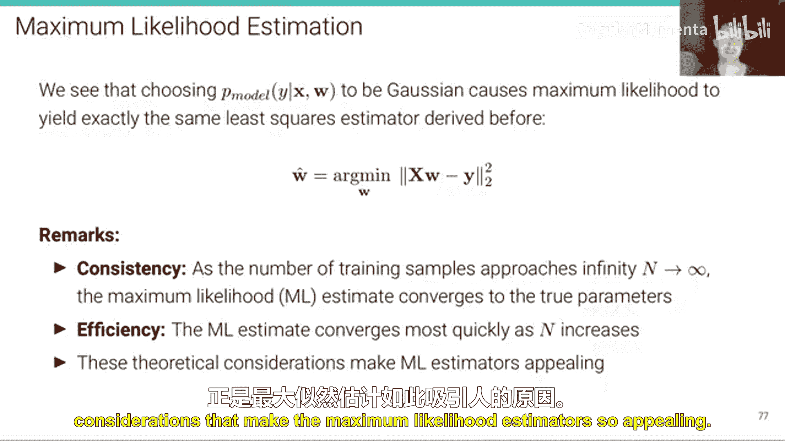

# 003：机器学习基础

在本节课中，我们将学习机器学习的一些基础概念。我们将介绍不同类型的学习问题，并重点探讨监督学习中的回归问题，特别是线性回归和多项式曲线拟合。我们还将讨论模型选择、过拟合与欠拟合、正则化以及最大似然估计等核心概念。

## 学习问题的分类

上一节我们介绍了本课程的整体结构，本节中我们来看看机器学习中不同类型的学习问题。根据所使用的数据或提供的监督信号，学习问题主要可以分为以下几类：

*   **监督学习**：使用由数据-标签对组成的数据集来学习模型参数。即输入 **X** 和输出 **y**，共有 **N** 个这样的配对。例子包括分类、回归或结构化预测问题。
*   **无监督学习**：使用没有标签的数据集来学习模型参数。这里只是一个输入 **X** 的数据集。例子包括聚类（如K均值算法）、降维或生成模型。
*   **自监督学习**：使用由数据-数据对组成的数据集来学习模型参数。即我们有 **x** 和 **x'** 配对。例子包括自监督立体视觉和光流估计，或对比学习。
*   **强化学习**：通过从稀疏奖励中进行主动探索来学习模型，而不是使用固定的数据集。即有一个智能体与环境交互。例子包括深度Q学习、策略梯度和行动者-评论家方法。

在本讲座中，我们将涵盖前三种学习问题。

## 监督学习：分类、回归与结构化预测

现在，让我们从监督学习问题开始。具体来说，我们来看看分类、回归和结构化预测之间的区别。

*   **分类**：目标是使用一个函数 **f** 从输入 **x** 预测一个离散的类别标签。
*   **回归**：目标是从任意输入 **x** 预测一个连续的变量。
*   **结构化预测**：输入和输出都是结构化对象。

这里的区别在于，在分类或回归中，我们预测的是一个一维的量，而在结构化预测中，我们预测的是一个高维的量。今天我们将重点讨论回归问题。

以下是这些问题的可视化概述：

这是一个非常通用的机器学习模型 **f** 的图示，它有一些参数 **W**，接收输入 **X** 并预测输出 **y**。与我们机器学习从业者相关的有两个主要任务：

1.  **学习任务**：在监督学习的情况下，从训练集的 **x** 和 **y** 对中估计参数 **W**。
2.  **推理任务**：在训练或学习阶段之后，给定这个固定的 **W**，我们想使用这个模型进行新的预测。即对于一个新输入 **X**，我们希望在给定已学习的固定 **w** 的情况下执行该函数，并预测出对应的 **y**。

让我们看一些具体例子：

*   **分类示例（图像分类）**：输入是一张图像（来自空间 **R^(宽×高)**）。模型将其映射到一个二元变量（例如，是海滩或不是海滩）。
*   **回归示例（股票价值预测）**：输入是一个股票价值序列（**R^n**）。输出是一个单一的数字（例如，明天的股票价值）。这是一个连续的数字，因此是回归问题。
*   **结构化预测示例**：
    *   **语音识别**：输入是音频信号，输出是一个句子（单词序列）。
    *   **语义分割**：输入是一张图像，输出是一个标签图（为每个像素分配语义类别标签）。
    *   **3D重建**：输入是一组图像，输出是一个3D重建模型（例如，用体素网格表示）。

以3D重建为例，假设我们想预测一个 **32^3** 维的输出（即 **32^3** 个体素），每个体素用一个二元变量表示（占用或空闲）。那么可能的重建数量是 **2^(32^3)**，这是一个极其巨大的数字，甚至超过了宇宙中的原子数。因此，我们无法枚举所有可能的重建，必须采用更结构化的方法。

## 线性回归

现在让我们回到回归问题，看看所谓的线性回归。在线性回归中，我们希望以线性的方式对模型参数进行预测。

设 **X** 表示一个大小为 **n** 的数据集。设 **(x, y)** 是该数据集 **X** 中的元素，其中输入可以是高维的，输出是一维的（**y** 是一维变量）。目标是为先前未见过的输入 **x** 预测 **y**。

我们定义一个误差函数 **E**，它衡量沿 **y** 方向的位移。例如，上图中绿色数据点与红色模型预测之间的红色短线就是误差。模型由参数 **W** 指定。这些基本上是模型产生的误差，我们希望最小化总体误差或所有误差的总和。

在线性回归中，我们为该函数选择一个线性模型。函数表示为线性模型，即权重向量 **W** 与输入特征 **x** 的内积：**f(x; w) = w^T x**。

误差函数简单地是所有数据点上模型预测 **f** 与观测值 **y** 之间在 **y** 方向上的差值平方和。这里的小 **i** 索引数据集中的元素。

我们可以将其重写为：**E(w) = Σ_i (w^T x_i - y_i)^2**。

使用线性代数，我们可以更优雅地写出这个表达式：**E(w) = ||X w - y||_2^2**。这里，矩阵 **X** 包含所有数据点特征 **x_i** 作为行向量，**w** 是权重向量，**y** 是包含数据集中所有 **y_i** 的向量。这基本上是将这些 **x** 和 **y** 逐行堆叠成一个线性系统。

为了获得这个能量函数 **E** 的最小值，我们需要遵循梯度并将其设为零。计算该表达式关于 **W** 的梯度：**∇_w E(w) = 2 X^T (X w - y)**。

由于这里的误差函数是关于 **W** 的二次凸函数，其最小化器有闭式解。设梯度为零：**X^T X w = X^T y**。解出 **w**：**w = (X^T X)^{-1} X^T y**。这个矩阵常被称为摩尔-彭罗斯伪逆或伪逆，因为它允许我们计算非方阵的逆，是这个最小二乘问题的最小化器。

## 多项式曲线拟合与过拟合

线性最小二乘允许我们拟合数据的线性模型，但通过使用非线性变换将输入转换为非线性特征，我们也可以用闭式解估计例如多项式的参数，这被称为多项式曲线拟合。

现在我们选择一个 **M** 阶多项式来建模数据集 **X**。这个多项式可以简单地写成单项式 **x^j** 的和：**f(x; w) = Σ_{j=0}^{M} w_j x^j**。我们可以用与之前相同的方式将其写成权重向量转置乘以特征向量，其中特征向量由单项式堆叠而成：**[1, x, x^2, ..., x^M]**。

这允许我们使用一个非常简单的线性表达式来表示这个多项式曲线拟合模型：它在 **W** 上是线性的，但在输入 **x** 上不是线性的。我们可以用与线性回归问题相同的形式来表述这个误差函数：**E(w) = ||Φ w - y||_2^2**，其中矩阵 **Φ** 的每一行是单个数据点的特征向量（单项式）。

让我们看看不同阶数 **M** 的多项式曲线拟合结果：

*   **M=0（常数）**：欠拟合。无法很好地拟合训练集或测试集。
*   **M=1（线性）**：欠拟合。
*   **M=3**：对于这个数据集，得到了相当合理的结果。
*   **M=9**：由于有10个自由度（10个数据点），可以将训练误差降为零。但拟合实际上是过拟合：虽然完全拟合了绿色训练点，但对蓝色新测试点的预测不一定好，曲线振荡剧烈。

选择正确的阶数 **M** 是一个模型选择问题。在机器学习中，我们不仅希望模型在训练集上表现良好，更希望在新的、先前未见过的输入（测试集）上表现良好，这被称为**泛化**。

我们通常假设训练数据和测试数据是独立同分布地从数据分布 **P_data(x, y)** 中抽取的。

**术语回顾**：
*   **容量**：模型可以表示的函数的复杂性。
*   **欠拟合**：模型过于简单，即使在训练集上误差也不低。
*   **过拟合**：训练误差很小，但泛化误差（测试误差）很大。

我们希望避免这两种情况，找到一个在测试集上表现良好的模型。

以下是泛化误差随多项式阶数 **M** 变化的示例图：训练误差随着 **M** 增加持续下降，但测试误差在达到某个阶数后开始上升，这正是发生过拟合的时候。

## 模型选择与正则化

为了选择最佳模型，我们需要将数据集划分为训练集、验证集和测试集。我们使用验证集来选择超参数（例如多项式阶数、神经网络的学习率）。重要的是，测试集通常只评估一次，其真实标签可能不可用。

接下来我们看看**岭回归**。这是另一种降低模型复杂度的方法，不是直接改变多项式的阶数，而是通过添加一个正则化项。我们有一个可以调整的连续参数。

岭回归问题的误差函数如下：**E(w) = ||X w - y||_2^2 + λ ||w||_2^2**。与之前模型相比的变化用红色标出。

新增的项称为惩罚项或正则化器，它告诉模型在良好拟合的同时，也要让权重 **w** 变小（通过超参数 **λ** 控制强度）。过拟合行为通常发生在权重变得非常大时，正则化有助于避免这种情况。这个问题在 **W** 上也是二次的，因此也有闭式解：**w = (X^T X + λ I)^{-1} X^T y**。

通过选择合适的正则化强度 **λ**，我们可以在欠拟合和过拟合之间找到平衡点，获得更好的泛化性能。

## 估计量的偏差与方差

更抽象地看，我们讨论估计量及其偏差和方差。我们将函数 **g** 称为估计量，如果它将数据集 **X** 映射到一组模型参数 **W**（记为 **ŵ**）。一个好的估计量返回的参数集接近真实值。

由于数据集是从基础数据分布中随机抽取的，因此任何关于数据的函数都是随机的，**ŵ** 本身也是一个随机变量。这引出了偏差和方差的术语以及所谓的偏差-方差困境。

*   **估计量的偏差**：在所有可能数据集上估计值的期望与真实参数值之差。如果偏差为零，则估计量是无偏的。好的估计量偏差小。
*   **估计量的方差**：估计值 **ŵ** 在所有可能数据集上的方差。好的估计量方差也低。

偏差-方差困境指出，我们不能同时拥有低偏差和低方差，必须进行权衡。总误差可以数学表达为偏差平方、方差和不可约误差之和。我们希望选择模型复杂度，使总误差最小化，这发生在偏差和方差之间取得平衡时。

## 最大似然估计

在本单元的最后部分，我们将讨论最大似然估计，这是从概率角度对之前结果的一种重新解释。

现在假设模型是一个概率分布的参数族。即从概率角度看，模型实际上给出了在给定输入 **X** 和参数 **W** 的条件下，输出 **y** 的分布，而不是 **y** 的点估计。

在这种情况下，**W** 的条件最大似然估计量由下式给出：**ŵ_MLE = argmax_w p(y | x; w)**。

利用数据独立同分布的假设，这等于最大化所有数据点个体概率的乘积。取对数（单调函数不改变最大值点），将乘积转化为求和，得到**对数似然**函数。

如果我们假设模型分布是高斯分布，其均值是 **x** 和 **W** 的线性函数（即之前的线性表达式），方差为 **σ^2**。将其代入最大似然估计表达式，经过推导，我们发现最大化对数似然等价于最小化之前的最小二乘误差函数。因此，选择高斯分布作为模型分布会使最大似然估计量产生与之前推导的最小二乘估计量完全相同的结果。

最大似然估计器是统计学习理论中一个非常重要的工具，因为在温和的假设下，已知最大似然估计器是**一致**的（当训练样本数趋于无穷时，收敛到真实参数）和**高效**的（收敛速度最快）。它在模型的概率解释和最小二乘公式之间提供了很好的联系。

## 总结

本节课中，我们一起学习了机器学习的基础知识。我们首先了解了监督学习、无监督学习、自监督学习和强化学习等不同类型的学习问题。然后，我们深入探讨了监督学习中的回归问题，从简单的线性回归出发，扩展到多项式曲线拟合，并指出了过拟合与欠拟合的现象。为了解决过拟合，我们介绍了通过验证集进行模型选择以及使用岭回归进行正则化的方法。接着，我们从统计角度探讨了估计量的偏差与方差困境。最后，我们介绍了最大似然估计，将其与最小二乘法联系起来，并理解了其作为概率框架基础的重要性。这些概念为后续深入学习神经网络和深度学习奠定了坚实的基础。