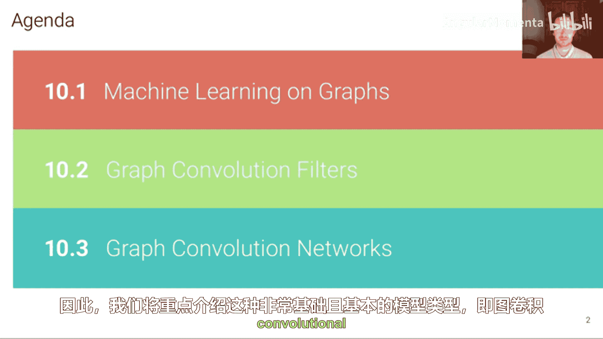
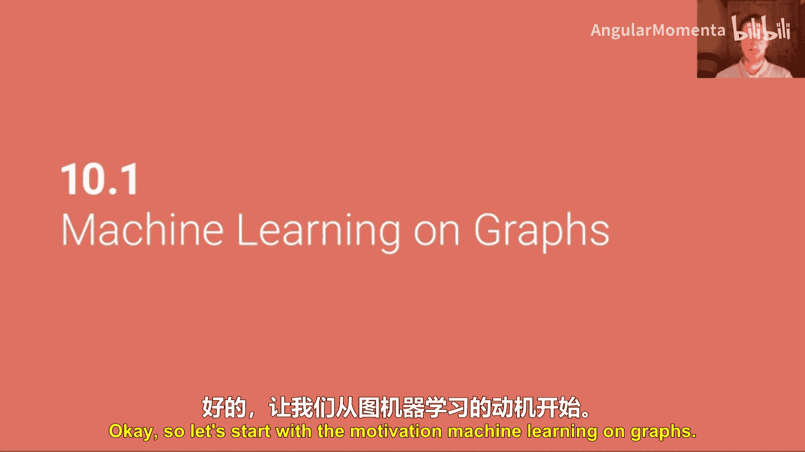
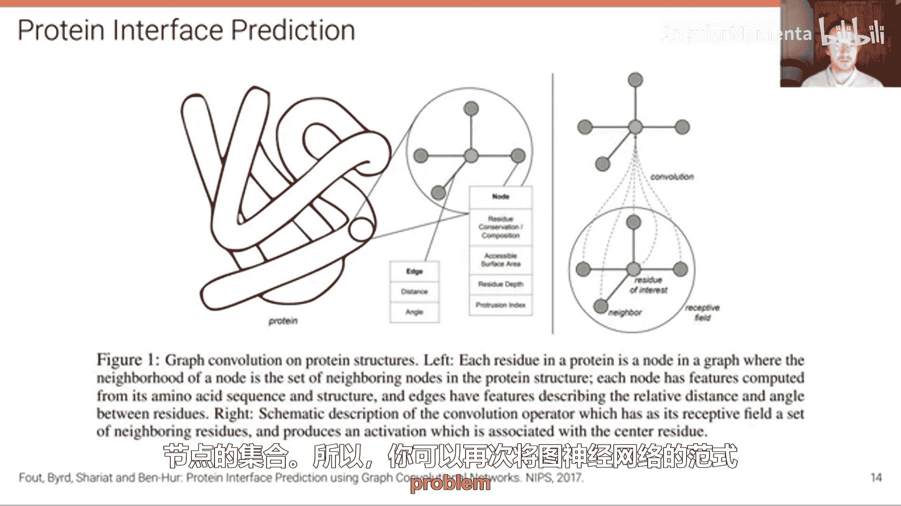
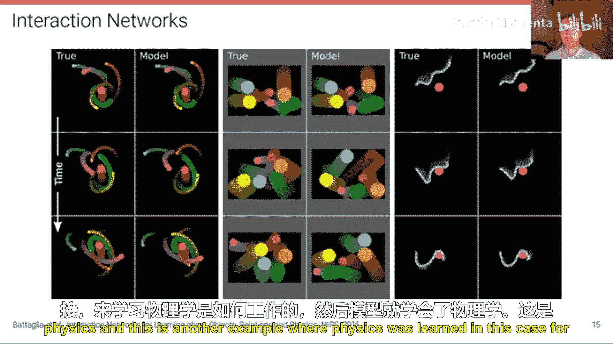
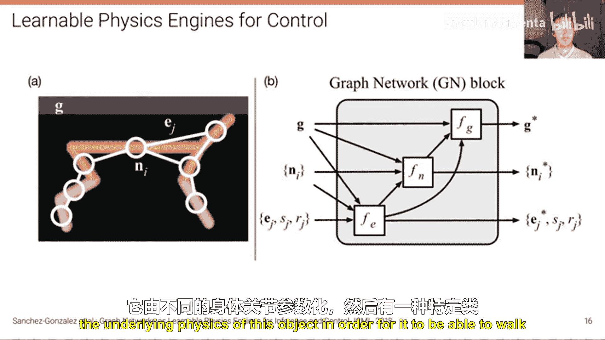
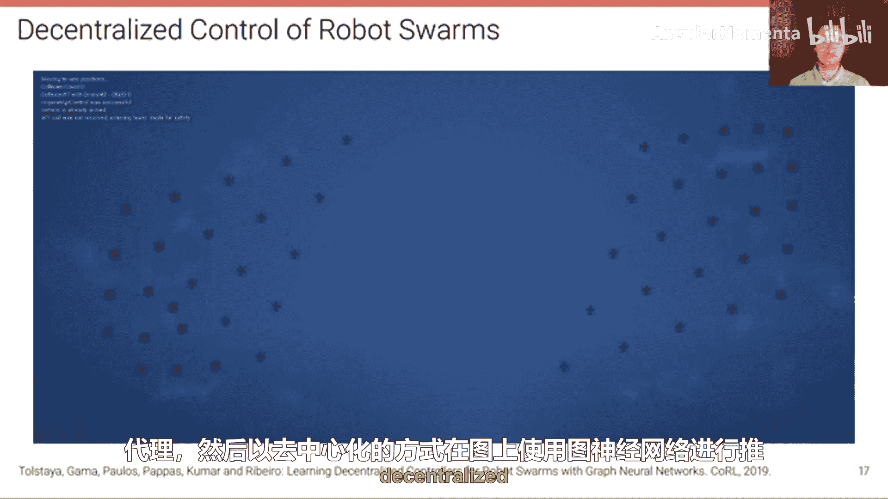
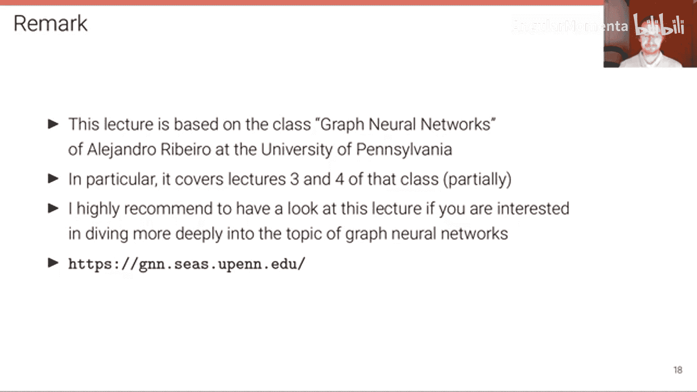

# 004：图上的机器学习 🧠

在本节课中，我们将要学习图神经网络。这是一种以图上的信号作为输入，并产生图上信号作为输出的神经网络类别。我们将从学习图神经网络的动机和应用开始，然后深入其核心构建模块——图卷积滤波器，最后介绍图卷积网络这一具体实例。

## 动机：为什么需要图上的机器学习？🤔

我们已经知道，多层感知机是非常灵活的函数逼近器。事实上，一个仅包含单个隐藏层（假设该层足够宽）的MLP，就能够逼近我们想要的任何函数。

然而，我们也看到MLP的规模难以扩展。例如，当输入维度非常高时（比如一张百万像素的图像），模型中的参数量会急剧膨胀，从而导致模型过拟合。

对于生活在规则网格上的结构化信号（如一维时间网格或二维图像网格），卷积神经网络可以解决这个问题。但CNN的问题在于，它们只适用于这种规则的网格结构数据。

许多数据无法轻易地用这种规则格式来描述。例如，具有图结构的分子就很难被放入规则的网格格式中。因此，我们在这节课中试图寻找一种模型类别，它比MLP更具扩展性，同时又比CNN更灵活。我们想要一种介于两者之间的模型：既能泛化CNN使其更灵活，又能处理大型、高维的数据集。

下图是同一个论点的另一种说明。我们知道，我们可以用卷积网络很好地处理左侧的网格结构数据，因为假设我们具有平移等变性，就可以用相对较少的参数处理此类数据。现在的问题是，我们如何为右侧所示的通用图构建神经网络？答案就是图神经网络，或者其一个具体实例——图卷积网络。我们的目标与处理左侧CNN时一样，也要利用图的局部结构。我们希望利用图的局部连接结构作为先验信息，以构建泛化能力良好的模型。

图是信号结构的描述符，信号存储在节点中。图中深色代表节点，浅色代表边，边表达了信号分量之间的相似性。在二维卷积网格（如图像网格）中，边也表达了邻近关系，因为从一个点到另一个点需要经过若干“跳”。

然而，在这种更通用的图表述中，网格不需要是规则的，边的权重甚至可以彼此不同。我们将要定义的图卷积，就像在二维网格上定义的卷积一样，将是基于图结构编码的矩阵所构成的多项式。直观上，我们就像在二维网格结构上应用卷积滤波器一样，在图结构上应用滤波器。

在下图的说明中，我们想为红点计算一个值。我们通过计算绿色和红色元素与卷积滤波器的点积来实现。现在，我们试图为右侧的通用图寻找等效操作，通过利用局部性来实现。如图所示，绿点也仅距离红点一跳之遥。如果我们构建一个更大的滤波器（我们可以用即将开发的公式轻松做到），我们也可以覆盖更大的邻域。例如，这是一个覆盖两跳的邻域，而这里我们也有一个距离目标节点两跳的滤波器。

在深入细节之前，我们先看一些应用，了解这为什么有用。

## 应用：图神经网络能做什么？🚀

以下是图神经网络的一些可能应用：
*   **分子性质预测**：图神经网络是绝佳的工具，因为分子本身就是图结构或可以轻松表示为图。
*   **生物物种分类**：可以在图（此处是树）上进行推理，这也可以用图神经网络轻松建模。
*   **语言处理**：经常需要处理解析树，而解析树也是图，因此可以纳入图神经网络范式。
*   **场景图生成**：输入是图像，运行物体检测器得到物体提议，但这些物体是相互关联的。通过学习它们之间的关系（例如，两个特定语义类别如鸟和树枝的相对位置），我们可以做出更好的预测。右侧展示了一个可能的场景图，它不仅包含物体，还推断出了它们之间的关系，这是比仅代表物体的一组边界框更丰富的表示。
*   **视频多目标跟踪**：可以将此问题表示为图，节点是每一帧中的检测结果，目标是跨时间关联检测结果，找出最可能的轨迹。我们可以将其表述为一个图，将所有可能的连接建模为图，并找出哪些连接能导致正确的跟踪结果。
*   **作者归属**：观察来自两位不同作者的大量文本，构建一个关于频繁共现功能词的图。功能词是能反映作者特定写作风格的非重要词汇。根据作者使用两个功能词紧密相邻的频率，我们可以推断其写作风格。处理这个图（节点是功能词）可以让我们区分文本的可能作者。
*   **推荐系统**：节点代表客户，边代表他们在产品评分方面的平均相似性。当我们想推断某个客户对某个产品的可能评分时，可以利用与该客户评分相似的其他客户的已知评分来进行推断。
*   **学习分子指纹**：由于分子固有的图结构，这是图神经网络的另一个重要应用。例如，在特定实验中，目标是预测分子的毒性，这自然可以用图语言来表述。
*   **蛋白质界面预测**：蛋白质中的每个残基是图中的一个节点，节点的邻域是蛋白质结构中的相邻节点集。然后可以再次应用图神经网络范式对这些蛋白质进行预测。
*   **交互网络**：目标是学习物理属性，而无需将这些知识注入模型。例如，观察多个物体如何随时间相互吸引或绕轨道运行（想象行星），使用图神经网络对这些物体之间的关系建模，以产生与真实情况相似的预测。还有台球场景，球可能相互碰撞或与墙壁碰撞，我们想预测此类序列的未来状态；或者右侧的布料落在红色刚性物体上并因此变形，我们可以通过将布料建模为一组通过图连接的节点来学习物理规律。
*   **物理控制学习**：例如，一个参数化不同身体关节的小型行走物体，某种图神经网络推断该物体的底层物理规律，使其能够行走。
*   **无人机集群控制**：图神经网络非常擅长于此，因为我们可以非常本地化地处理信息，然后通过无线方式将信息发送给其他智能体，接着以去中心化的方式，使用图神经网络在图之上实现推理，例如，以获得特定的编队飞行。

关于动机的最后一点说明：本讲座基于宾夕法尼亚大学 Alejandro Ribeiro 的《图神经网络》课程，特别是涵盖了该课程第三和第四讲的部分内容。这是一个非常棒的讲座，如果你有兴趣更深入地研究图神经网络这个主题，我强烈建议你进一步观看。

## 总结 📝

本节课中，我们一起学习了图神经网络的基本概念。我们首先探讨了在图数据上进行机器学习的动机，认识到对于非规则网格结构的数据（如分子、社交网络、知识图谱等），传统的MLP和CNN存在局限性，而图神经网络提供了一种更灵活且可扩展的解决方案。接着，我们浏览了图神经网络在多个领域的广泛应用，包括分子性质预测、场景理解、推荐系统、物理模拟和机器人控制等，这些应用展示了图神经网络的强大能力和通用性。最后，我们了解到本课程内容基于更深入的专题课程，为有兴趣的学者提供了进一步学习的路径。在接下来的章节中，我们将深入探讨图神经网络的核心构建模块——图卷积滤波器。