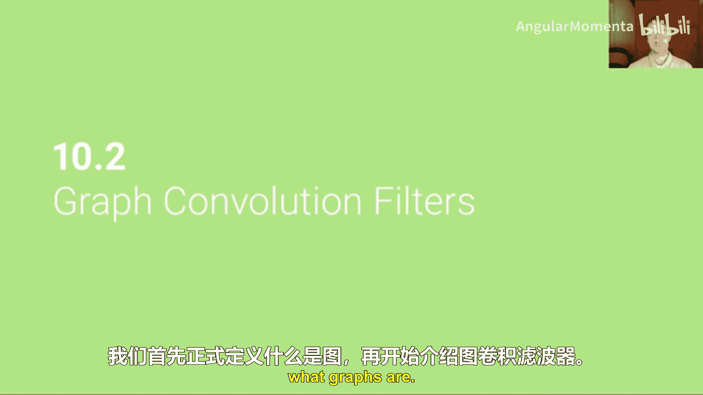
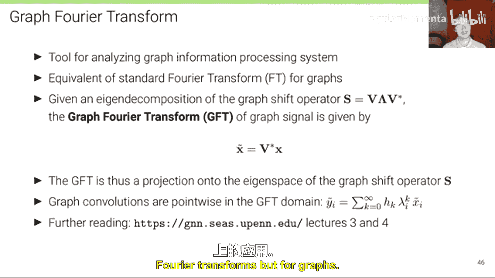

# 005：图卷积滤波器 📊

在本节课中，我们将学习图卷积滤波器的核心概念。图卷积是图神经网络的基础构建模块，它允许我们在图结构数据上执行类似卷积的操作。我们将从图的正式定义开始，逐步介绍图信号、图移位算子，并最终理解图卷积滤波器的工作原理。

---

## 图的定义

我们首先通过观察所谓的有向图来正式定义图。

有向图是一个三元组 `G = (V, E, W)`。
*   `V` 代表顶点集，有时也称为节点。它被定义为一组 `n` 个标签，即从 `1` 到 `n` 的整数集合，其中 `n` 是顶点数量（例如，图中为5）。
*   `E` 是边集，由标签的有序对 `(i, j)` 组成。在图卷积的上下文中，我们将边 `(i, j)` 解释为节点 `j` 对节点 `i` 产生影响。这种直觉与图通常的定义方式略有不同。
*   `W` 是权重集，与每条边 `(i, j)` 关联的权重 `w_ij` 是一个实数。它决定了节点 `j` 对节点 `i` 的影响强度，但不决定节点 `i` 对节点 `j` 的影响强度（后者由 `w_ji` 决定）。

我们通过顶点之间的箭头来绘制这样的图。箭头总是从施加影响的节点 `j` 指向被影响的节点 `i`。例如，边 `(1, 2)` 在图中表示为从节点2指向节点1的箭头。边 `(i, j)` 与边 `(j, i)` 不同。在有向图中，我们可以只有 `(i, j)`，也可以两者都有，并且它们的权重可以不同。

一个图被称为**对称的**或**无向的**，如果它的边集和权重是对称的。这意味着如果边 `(i, j)` 在边集中，那么边 `(j, i)` 也必须在边集中，并且 `w_ij = w_ji`。我们在图中用双向箭头表示这种连接。

一个图被称为**无权重的**，如果它没有权重，或者等价地说，所有权重都为1。在这种情况下，图结构仅告诉我们哪些节点在边连接性上是“接近”的，但每条边不包含关于两个节点彼此之间“接近程度”的任何额外信息。

在实践中，我们遇到的大多数图实际上都是加权的。如果我们拥有这种加权信息，我们应该将其考虑在内，因为它是先验知识的一部分。我们能够纳入计算的先验知识越多，我们的预测效果就越好。

---

## 图移位算子

现在我们来讨论定义图的变换，即图的数学表述。有多种选项可以定义此变换，它们都源自图的结构（顶点、边和权重集）。

我们在这里定义的所有算子都是移位算子。第一个定义的算子是最简单的，即邻接矩阵。

**邻接矩阵**
对于一个图 `G`，其邻接矩阵 `A` 是一个稀疏矩阵，其非零元素恰好定义在有边（或有权重）的位置。具体来说，`A_ij = w_ij` 当且仅当边 `(i, j)` 在边集 `E` 中。如果图是对称的，那么邻接矩阵也是对称的，即 `A = A^T`。

接下来，我们定义邻域和度。

**邻域与度**
节点 `i` 的**邻域** `N(i)` 是影响节点 `i` 的所有节点的集合。数学上，`N(i) = { j | (i, j) ∈ E }`。节点 `i` 的**度** `d_i` 是其所有入射边权重的总和。在无权图的情况下，度就是入射边的数量。度衡量了有多少节点以及它们对特定节点的影响强度。

**度矩阵**
度矩阵 `D` 是一个对角矩阵，其对角线元素是各个节点的度，即 `D_ii = d_i`。度矩阵也可以用邻接矩阵表示为 `D = diag(A * 1)`，其中 `diag` 操作将向量转换为对角矩阵，`1` 是全1向量。

下一个图移位算子是拉普拉斯矩阵。

**拉普拉斯矩阵**
具有邻接矩阵 `A` 的图的拉普拉斯矩阵 `L` 定义为度矩阵减去邻接矩阵：`L = D - A`。其元素可以明确地写为：
*   非对角线元素：`L_ij = -w_ij`
*   对角线元素：`L_ii = Σ_{j∈N(i)} w_ij`

图上的拉普拉斯矩阵称为图拉普拉斯算子，它在图上具有与规则域上的拉普拉斯算子（梯度的散度）相似的性质。它衡量信号在图上变化的平滑度或曲率。

我们可以对邻接矩阵和拉普拉斯矩阵进行归一化，这在图非常不均匀时特别有用。

**归一化算子**
归一化邻接矩阵定义为：`Ā = D^{-1/2} A D^{-1/2}`。
归一化拉普拉斯矩阵定义为：`L̄ = D^{-1/2} L D^{-1/2} = I - Ā`。
使用这些归一化矩阵作为移位算子，可以归一化节点间的影响，在处理异构图时具有优势。

**图移位算子**
图移位算子 `S` 代表我们学过的任何图矩阵表示。具体来说：
*   对于邻接矩阵，`S = A`
*   对于拉普拉斯矩阵，`S = L`
*   对于归一化邻接矩阵，`S = Ā`
*   对于归一化拉普拉斯矩阵，`S = L̄`

如果图是对称的，移位算子也是对称的。我们将图移位算子定义得如此宽泛的原因是，虽然 `S` 的具体选择在实践中很重要，但我们将要进行的分析适用于任何选择。因此，从现在开始，我们将只考虑通用的 `S`。

---

## 图信号与扩散

我们已经讨论了图移位算子，现在来看看图信号。

考虑一个具有 `n` 个节点的图 `G`，由其移位算子 `S` 表示。图信号 `x` 是一个 `n` 维向量，它为每个节点分配一个实数值标量。`S` 编码了 `x` 各分量之间预期的邻近性或相似性。

输入信号 `x` 与图移位算子 `S` 的乘法会在图上产生一个扩散信号。数学上，我们写作 `y = Sx`。这实现了一个局部操作，其中节点的值与其邻居节点的值混合。每次应用移位算子，信息仅沿着一条边（一跳）传播。通过多次应用 `S`，我们可以获得一个扩散序列。

**扩散序列**
扩散过程可以递归地写为：`x_{k+1} = S x_k`，其中 `x_0` 是输入信号。等价地，我们可以将其写为幂序列：`x_k = S^k x_0`。在实践中，递归形式（矩阵-向量乘法）计算效率更高，而幂序列形式在数学分析上有时更方便。

---

## 图卷积滤波器

现在，我们准备定义图卷积滤波器。如前所述，图卷积滤波器是图卷积网络的基本构建模块。

给定代表所考虑图的移位算子 `S` 和一些滤波器系数 `h_k`（标量），一个图卷积滤波器是移位算子 `S` 上的一个多项式。

**图卷积滤波器定义**
图卷积滤波器 `H(S)` 定义为：
`H(S) = Σ_{k=0}^{∞} h_k S^k`

将此滤波器应用于信号 `x` 的结果是：
`y = H(S)x = Σ_{k=0}^{∞} h_k S^k x`

这意味着滤波器系数 `h_k` 决定了扩散序列 `S^k x` 中特定扩散状态的重要性。这些系数可以在图卷积滤波器中学习。与卷积神经网络中的卷积核不同，在图卷积中，我们无法关联相对位置（如图像中的左上、右上像素），因为图结构是置换不变的。因此，我们将滤波器定义为移位算子幂序列 `S^k` 上的权重。

在实践中，我们无法计算无限项，因此使用有限滤波器。

**有限图卷积**
考虑一个由移位算子 `S` 支持的信号 `x` 和一个有限滤波器 `H`（截断到 `K-1` 阶）。图卷积的输出为：
`y = H(S)x = Σ_{k=0}^{K-1} h_k S^k x`

我们看到，图卷积实际上是扩散序列元素 `S^k x` 的加权线性组合。每个 `S^k x` 作为一个特征，我们对它们进行加权线性组合。

我们可以使用框图来可视化此操作。图卷积迭代地应用移位、加权和求和。从输入 `x` 开始，我们将其与 `h_0` 相乘得到 `h_0 x`。然后，将 `x` 移位得到 `Sx`，与 `h_1` 相乘后加到之前的输出上。重复此过程，每次将信号再次移位，与相应的系数相乘并累加，最终得到卷积输出。

---

## 作为特例的时间卷积

有趣的是，我们定义的最一般形式的图卷积，实际上包含了重要的特例，如一维时间卷积。

时间卷积只是移位输入的线性组合。如果我们考虑一个简单的线图，其中节点 `i` 影响节点 `i+1`（即边 `(i+1, i)`），那么该图对应的邻接矩阵（假设为无权图）是一个次对角线为1的矩阵。用这个矩阵乘以输入向量，会产生一个移位后的向量。

因此，时间卷积是线图邻接矩阵上的一个多项式，可以使用我们之前定义的相同图卷积操作来表达。如果我们让移位算子成为任意图的移位算子，而不仅仅是线图，那么我们就回到了更一般的图卷积。

---

## 图傅里叶变换简介

最后，简要提一下图傅里叶变换。这是一个更大的主题，但它是分析图信息处理系统的重要工具。

给定图移位算子 `S` 的特征分解 `S = U Λ U^T`，图信号 `x` 的图傅里叶变换定义为将信号投影到移位算子的特征空间上：`x̂ = U^T x`。

在傅里叶域中工作的好处是，类似于常规傅里叶域，图卷积在傅里叶域中变为逐点乘法。整个卷积算子变成了一个逐点算子。如果你对这个主题感兴趣，可以进一步查阅相关讲座。

---

## 总结

在本节课中，我们一起学习了图卷积滤波器的核心内容。我们从图的正式定义开始，介绍了顶点、边和权重的概念。然后，我们探讨了多种图移位算子，包括邻接矩阵、拉普拉斯矩阵及其归一化形式，并将它们统一为通用的图移位算子 `S`。

接着，我们定义了图信号以及通过 `S` 进行信号扩散的过程。基于此，我们引入了图卷积滤波器，它被定义为移位算子 `S` 上的多项式，其输出是扩散序列的加权线性组合。我们还看到，经典的一维时间卷积是图卷积在特定图结构（线图）下的一个特例。

最后，我们简要提及了图傅里叶变换的概念，它将卷积运算转换到频域，简化了分析。图卷积滤波器是构建更复杂图神经网络模型的基础，理解其原理至关重要。