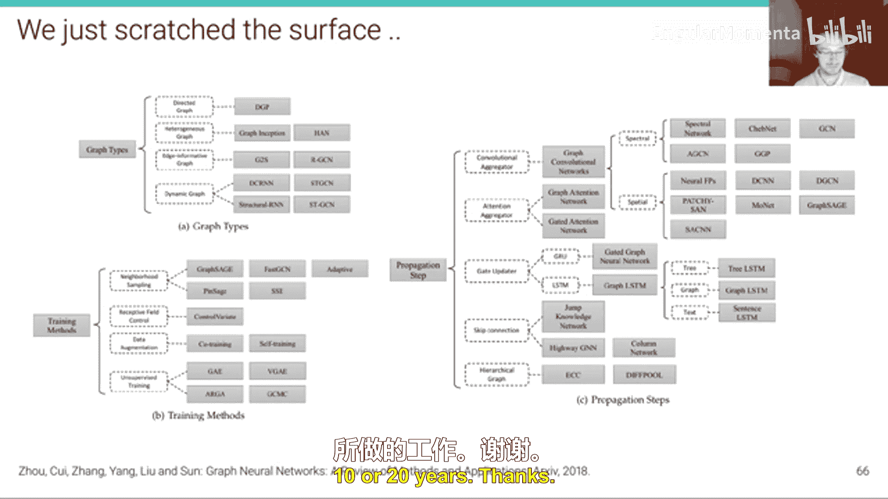

# 006：图卷积网络

在本节课中，我们将要学习图卷积网络。我们将从如何定义图上的卷积滤波器开始，逐步深入到如何学习这些滤波器，并将其堆叠成多层网络。我们还将探讨如何将单输入单输出的网络扩展到多输入多输出的情况，并理解图卷积网络相较于多层感知机的优势与特点。

## 图滤波器的学习

上一节我们介绍了如何用系数 **H** 定义图上的卷积滤波器。本节中我们来看看如何学习这些图滤波器，即学习这些滤波器的系数。

我们想要学习这些图滤波器的系数，并将这些图滤波器像多层感知机那样堆叠成层状网络。我们希望将多个线性变换与非线性激活函数组合在一起，形成多层结构。首先，让我们观察单个图滤波器，它相当于多层感知机中的单个线性层，并了解如何学习这些滤波器。

我们用 **D** 表示数据集，它包含图上的输入和输出信号，以及图表示本身。这个数据集由三元组 **(X_i, Y_i, S_i)** 组成。这个数据集可能包含来自不同图的元素。我们可以训练一个图滤波器，使其对不同的图表示具有鲁棒性，只要测试集中的图来自相同的分布。尽管这些图并不完全相同，我们仍然可以用这样的图神经网络处理它们，因为训练图和测试图的 **S** 都是已知的，并且图滤波器已经学会了在整个图分布上良好工作。这就是图神经网络的美妙之处：你可以在一个图集合上训练图神经网络，并将其应用于不同的图上。如果只是在顶点上定义多层感知机，这是不可能实现的。

现在，让我们定义图滤波器 **F_H**，它以输入信号 **X** 和图移位算子 **S** 为参数。用我们之前讲座中的符号表示，预测输出 **Ŷ** 就是这个图滤波器的输出：**Ŷ = F_H(X, S)**。这仅仅是图移位算子 **S** 的 **K** 次幂多项式与 **X** 的乘积，系数为 **H_k**，这些系数现在是模型的参数，因此我们在函数 **F** 中将其标为下标。

在训练期间，我们像在经验风险最小化中通常做的那样，寻求最小化一个损失函数。我们试图找到最优系数 **H***，以最小化这个目标函数。该目标函数简单地是整个数据集上某个损失函数的总和，该损失函数用于比较模型的预测信号 **Ŷ** 和真实的输出信号 **Y**。重要的是，这个优化仅针对滤波器系数 **H**。输入 **X**、输出 **Y** 以及以图移位算子形式提供的图表示 **S**，都是作为先验信息给出的。

在某些情况下，我们可能不关心推断与输入信号形状相同的输出信号。当输出 **Y** 的维度与输入信号不同，或者本身不是一个图信号时，我们只需向模型添加一个读出层。我们也会为稍后将看到的模型这样做。

我们使用 **n** 表示图中顶点或节点的数量，这意味着输入信号是一个 **n** 维向量。现在我们假设输出是一个 **m** 维向量，其中 **m ≠ n**。因此，我们可以取这个 **n** 维图滤波器的预测，并将其乘以一个 **m × n** 维的矩阵，即所谓的读出矩阵 **R**，以匹配维度。通常，**R** 不是学习得到的，而是算法或算法设计者的设计选择。

以下是读出层的典型示例：
*   如果我们只想读取单个节点的值，那么这个读出层就对应一个单位向量，其中“1”位于我们想要读取的对应分量上。
*   如果我们想对所有图信号元素进行求和或平均池化，那么我们可以取全1向量的转置，并将其与输出相乘，从而对所有元素求和。

读出层用于产生与输入图信号维度 **n** 不同的输出。例如，求和读出层对于处理分类问题很有用，其中输入是图和图信号，输出是一个特定的类别。

## 图卷积网络

以上是关于学习图滤波器的内容，你可以将其视为单层图网络。然而，还缺少一样东西，这让我们更接近图卷积网络，那就是图感知机。图感知机也是单层图网络，但它们将我们之前看到的图滤波器与一个非线性函数 **σ** 结合起来，这个非线性函数可以是逐点的 sigmoid、tanh 或 ReLU，就像我们在多层感知机中应用它们一样。

通过添加这样的非线性，我们向使模型更具表达能力迈进了一步。之前的模型只能学习线性映射。现在，在这个线性映射之上加上一个非线性函数，我们可以学习至少是非线性的、表达能力稍强的映射，从而捕捉更大的函数类别。它相当于神经网络的感知机。如果在这里使用 sigmoid，它基本上可以进行分类。

现在，为了定义图卷积网络，我们取这些图感知机，并像多层感知机那样，递归地将这些图感知机组装成层。我们这里有一个图感知机，其中 **H** 现在有一个额外的层索引 **L**，**X** 也有一个层索引。我们取前一层的信号，将其与 **S** 的 **K** 次幂相乘，然后乘以标量系数 **H_{L, k}**，接着应用非线性激活函数，得到下一层的信号。然后我们递归地添加更多这样的层，最后可能还有一个额外的读出层。当然，我们假设 **X_0** 是输入信号，所以我们从 **X** 开始。这只是一个递归定义，即图感知机的递归应用。

作为具有 **L** 层的图卷积网络的简写符号，我们简单地写成预测是 **F_{ℋ}(X, S)**，其中 **ℋ** 现在包含所有层的系数向量。这等于这个递归的最后一个元素 **X_L**。我多次提到这一点，因为图移位算子 **S** 是作为先验信息提供给模型的，它编码了图结构。

这是一个三层模型的框图，展示了其工作原理：我们有第1、2、3层，输入信号 **X**，然后我们将该信号与此处的幂级数（系数为 **H_{1, k}**）相乘，得到 **C**，接着将其通过逐点非线性函数（本例中为 sigmoid），得到 **X_1**。然后对 **X_1** 进行相同操作得到 **X_2**，再对 **X_2** 操作得到 **X_3**。你可以看到 **S** 在每一层总是相同的，我们使用相同的幂级数，但系数会变化。这里的红色系数是这个模型的可学习参数。这就是一个图卷积网络。更具体地说，它是一个处理信号的图卷积网络，其中每个节点有一个实数标量。

学习图卷积网络与学习图滤波器的工作原理相同。我们再次有数据集 **D**，其中该数据集的不同元素可以对应不同的图。然后我们有图卷积网络 **F_{ℋ}(X, S)**。在训练期间，我们寻求最小化某个损失函数，该函数衡量预测 **F_{ℋ}(X, S)** 与真实输出信号 **Y** 之间的差异。这个优化是针对所有滤波器系数 **ℋ** 进行的。图移位算子 **S** 作为先验信息给出，数据集可能包含多个不同的图实例。经验表明，与多层感知机类似，更深的图卷积网络由于卷积和非线性的分层堆叠而效果更好。这与卷积神经网络完全相同，在卷积神经网络中，你也有卷积和非线性堆叠在一起。

## 与多层感知机的比较

如前所述，图卷积网络比卷积神经网络更灵活，但比多层感知机灵活性差，因为它们是多层感知机的一个特例。

如果我们考虑一个非常简单的多层感知机形式，它具有逐点非线性函数 **σ**（例如 sigmoid），并暂时忽略偏置，我们可以使用此表示递归地定义它。现在，如果我们将其与图卷积网络进行比较，我们看到以红色突出显示的可训练参数。我们看到这个模型更灵活，因为我们可以使用这个模型来表示右边的模型。所以图卷积网络是这种多层感知机的一个特例。我们也有一个线性变换，但在图卷积网络的情况下，我们有一个投影到 **S^K** 矩阵上，然后只有一个标量系数 **H**；而在多层感知机中，我们可以学习一个任意的矩阵 **W**，它可以等价于此处的幂级数，也可以不等价。

因此，图卷积网络是多层感知机的一个特例。换句话说，它们在训练集上会达到更高的训练损失。在这种情况下，我们为所有数据点使用相同的 **S**，即相同的图和图表示，因为在多层感知机中，我们无法在不同的图上执行，因为多层感知机根据定义不具备图卷积网络所具有的置换等变性。

所以，图卷积网络是多层感知机的一个特例。假设我们有一个足够好的训练算法，多层感知机看到的训练误差总是小于或等于图卷积网络的训练误差。乍一看这可能有点违反直觉，但这里重要的是，图卷积网络对图信号的泛化能力更好，因为它们能够通过使用图移位算子 **S** 来利用编码在图移位算子中的图信号的内部对称性，而多层感知机则不能。模型在训练集上的表现可能稍差，但对同一图上的新信号或新图的泛化能力却要好得多。

此外，图卷积网络是此比较中唯一可以处理不同图的模型。在训练期间和推理时，我们都可以将此模型应用于不同的图。我们可以对不同的图进行卷积，因为 **S** 向模型告知了图的结构。我们总是通过 **S** 进行投影，所以 **X** 的维度与 **S** 相关联，而不是与某些全局训练的参数矩阵 **W** 相关联。这就是图卷积的美妙之处。

这里有一个关于泛化特性的小图示。假设训练示例都与左边所示的示例信号有些相似。顺便说一下，信号强度在这里用蓝色的深浅表示。我们在顶点9处有强信号，在顶点10处有较弱信号，在顶点5和6处没有信号。现在，多层感知机会学会相当正确地预测看起来像中间信号的信号。但是，如果我只见过看起来像左边这样的训练示例，要泛化到右边这样的信号是不可能的。因此，如果在测试时将此作为多层感知机的输入，而训练时只观察到类似左边的示例，预测很可能非常糟糕。然而，图卷积网络在这种情况下会成功，因为它知道图的底层结构。它基本上通过了解图的结构沿着图执行卷积，因此可以推断出在节点6的输入附近有具有强激活的节点。所以这里的模式与这里的模式相同，只是发生在图中的不同节点上。这就是等变性，我们在卷积神经网络中看到的平移等变性在这里表现为图卷积的等变性。

## 多输入多输出图卷积网络

到目前为止，我们看到的图卷积网络在其输入特征数量上是有限的，特别是我们假设信号是一维的，即图中每个顶点的输入信号有一个标量。这既限制了输入，也限制了中间表示，因此我们想将其推广到允许多个特征，即允许向量，现在每个顶点都有一个特征向量。所以我们首先定义滤波器组。

滤波器组将一个图信号以矩阵形式输出。这里我们有一个图信号，这是图中每个节点的一个标量。而滤波器组输出每个节点的一个特征向量。例如，在这种情况下，在节点6处，我们在这个滤波器组的输出中有三个值。它是如何做到的呢？它基本上只是将三个不同的滤波器独立地应用于输入信号 **X**。我们取输入信号 **X**，通过第一个滤波器得到 **C_1**，通过第二个滤波器得到 **C_2**，通过第 **F** 个滤波器得到 **C_F**。这里的每个 **C** 都是一个一维图信号，我们为每个顶点指定了一个实数。但现在我们有 **F** 个这样的信号，因此我们实际上为每个顶点指定了一个特征向量。你可以将其想象成一本书，在书的每一页上，我们指定了一个一维信号，这样如果我们看整本书，每个节点就有一个向量。这就是一个滤波器组。

现在，如果我们假设每个节点有 **F** 个输入特征，并且我们有一个包含 **G** 个滤波器的滤波器组。那么我们使用每个滤波器 **G** 处理每个输入特征 **F**，以产生 **F × G** 个输出。这意味着这个多输入多输出图滤波器会生成每个节点具有 **F × G** 个特征的输出。因此，如果我们在多个层上应用这个，每个节点的特征数量会呈指数增长，这是不可取的。

我们可以这样看：每个节点有多个输入特征，然后在输出端，因为我们有多个滤波器，我们得到这个维度，然后我们有多个输入特征作为第二个维度，所以我们得到每个节点 **F × G** 个特征。在这个图示中，这里的每个 **U** 都是一个图信号，我们为每个节点指定了一个标量。所以在这种情况下，每个节点会有 **F × G** 个标量。

解决这个问题的方法很简单，就是对 **F** 求和。我们对这里的 **F** 求和，以获得恰好 **G** 个特征每个节点。然后我们得到一个操作，将每个节点的 **F** 个特征映射到 **G** 个特征。但这里是一个求和操作。

这看起来有点复杂，但我们可以利用线性代数的优势，用非常紧凑的矩阵符号来表示，这就是你会在许多论文中看到的多输入多输出图滤波器。这可以简单地写成一个矩阵 **C**，等于这个多项式求和：**Σ_{k=0}^{K} S^k X H_k**。其中，矩阵 **C** 的列对应 **G** 个特征值，行对应 **n** 个顶点。然后我们有这个 **n × n** 的图移位算子。接着，我们有一个 **n × F** 的输入信号，即对于图中的每个节点，我们有 **F** 个特征。然后我们有这个特征矩阵 **H_k**，它是 **F × G** 维的。总的来说，我们得到一个 **n × G** 维的矩阵。这与上述公式完全等价。

现在，为了定义一个多输入多输出图卷积网络，我们可以像之前为标准图卷积网络所做的那样，递归地组合这些 **L** 个多输入多输出滤波器层，在标准图卷积网络中，图的每个节点只有一维特征。我们得到这里的表达式，其中 **X_0** 是 **X**，即第一层的输入。这里的 **H_{L, k}** 矩阵是我们想要优化的参数，它们指定了在每一层中，我们从多少个特征减少或增长到下一层的多少个特征。

我们也可以用一个更紧凑的表达式来写：矩阵预测 **Y** 是 **F_{ℋ}(X, S)**，它是该网络最后一层或读出层的输出。其中，这个 **ℋ** 只是出现在此计算中的所有这些矩阵的集合。所以，矩阵 **H** 有两个索引，一个是对层的索引，一个是对 **k** 的索引。图移位算子 **S** 再次只出现一次，并作为先验信息给出，在所有层中都是相同的。

这里我们比较了第一个更简单的图卷积网络和我们看到的多输入多输出图卷积网络。你可以看到操作几乎相同，只是我们用矩阵 **H** 替换了标量 **h**，并且输入和输出现在是矩阵而不是向量了。

## 总结

本节课中我们一起学习了图卷积网络的核心概念。我们从一个简单的图滤波器开始，学习了如何将其系数作为参数进行优化。通过引入非线性激活函数，我们得到了图感知机，这是构建更复杂网络的基础。通过递归堆叠图感知机，我们最终构建了图卷积网络，它能够处理图结构数据并利用其内在对称性进行有效的特征学习。

我们进一步将模型扩展到多输入多输出的情况，引入了滤波器组的概念，并使用矩阵形式简洁地表示了多特征图卷积操作。最后，我们比较了图卷积网络与多层感知机，认识到图卷积网络虽然在训练集上可能表现稍逊，但其通过利用图结构先验知识，在泛化到新图或同一图的新信号方面具有显著优势。

需要指出的是，我们在这节课中仅仅触及了图神经网络的表面。这是一个非常广阔的领域，有专门的完整课程。如果你想深入了解，我推荐阅读关于图神经网络的综述文章，这些文章回顾了过去10到20年该领域的工作。

---
**核心概念公式/代码摘要**

*   **单特征图滤波器**：`Ŷ = F_H(X, S) = Σ_{k=0}^{K} h_k * S^k * X`
*   **图感知机（单层）**：`X_{l+1} = σ( Σ_{k=0}^{K} h_{l,k} * S^k * X_l )`
*   **多特征图滤波器（矩阵形式）**：`C = Σ_{k=0}^{K} S^k * X * H_k`，其中 `X ∈ R^{n×F}`, `H_k ∈ R^{F×G}`, `C ∈ R^{n×G}`
*   **多特征图卷积网络（递归层）**：`X_{l+1} = σ( Σ_{k=0}^{K} S^k * X_l * H_{l,k} )`，`X_0 = X`