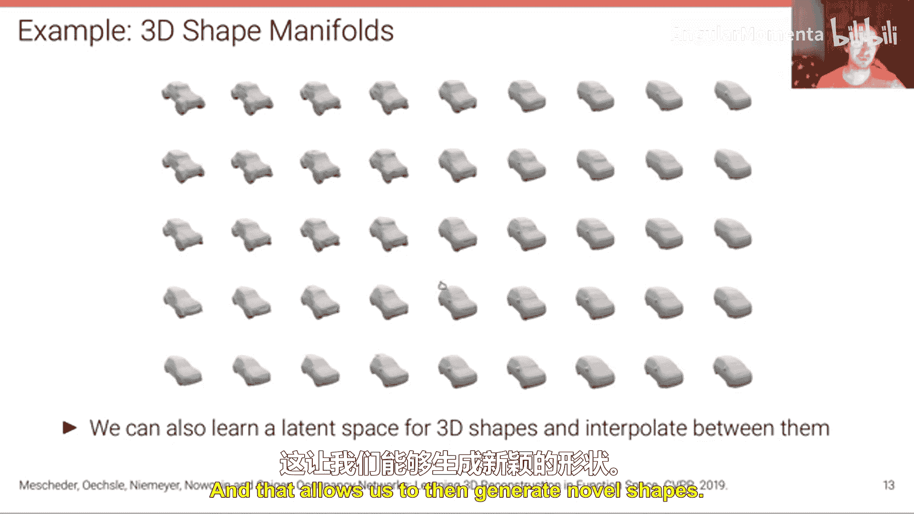
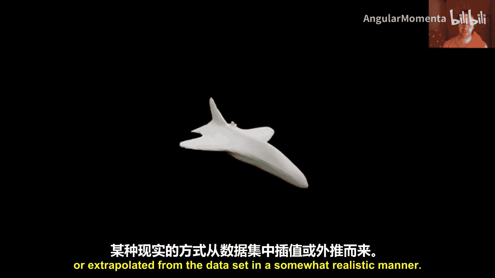

# 007：潜在变量模型与自编码器

在本节课中，我们将要学习生成模型的一个重要分支——潜在变量模型。我们将从基本概念入手，逐步介绍主成分分析、深度自编码器，并最终触及生成式概率建模。这些模型能够从无标签数据中自动学习数据的压缩表示，是深度学习的核心组成部分。

## 潜在变量模型概述

上一节我们介绍了本课程的结构。本节中，我们来看看什么是潜在变量模型。

在之前的课程中，我们始终专注于监督学习。监督学习使用包含输入和期望输出的数据对 `(x_i, y_i)` 来训练模型，例如图像分类和回归任务。

相比之下，无监督学习仅使用没有标签的数据集 `{x_i}` 来训练模型。其目标是仅从原始数据中学习有用的表示，这非常有益，因为获取标签通常很困难。无监督学习技术包括聚类、降维和生成模型等。

一些无监督学习技术使用潜在变量来捕获数据结构。潜在变量模型允许在观测空间和潜在空间之间进行映射。

以下是潜在变量模型的核心定义：
*   设观测空间 `x ∈ R^D`，例如一张 `W×H` 维的图像。
*   设潜在空间 `z ∈ R^Q`，通常 `Q << D`，以实现压缩。
*   模型通常包含两个映射函数：
    *   **编码器** `f_w`: 将观测 `x` 映射到低维潜在表示 `z`。
    *   **解码器** `g_w`: 将潜在表示 `z` 映射回重建的观测 `x̂`。
*   目标是最小化原始输入 `x` 与重建输出 `x̂` 之间的差异。

每个训练数据点都关联一个潜在变量。潜在变量模型可以按以下方式分类：
1.  **线性 vs 非线性**：映射函数是线性还是非线性。
2.  **确定性 vs 随机性**：映射是确定性的还是概率性的。
3.  **仅解码器 vs 编码器-解码器**：是否同时具备编码和解码功能。

以下是本课程涉及的重要技术分类：
*   **确定性模型**：
    *   **线性**：主成分分析。
    *   **非线性**：自编码器。
*   **概率性模型**：
    *   **线性**：概率主成分分析。
    *   **非线性**：变分自编码器。
    *   **仅解码器**：生成对抗网络。

## 自编码器

上一节我们定义了潜在变量模型。本节中我们来看看其中一种最常见的形式——自编码器。

自编码器是一种同时包含编码器 `f_w` 和解码器 `g_w` 的确定性潜在变量模型。它被称为“自”编码器，因为其目标是重建自己的输入。

以下是自编码器的工作流程：
1.  输入向量 `x` 通过编码器神经网络 `f_w`，生成潜在编码 `z`。
2.  潜在编码 `z` 通过解码器神经网络 `g_w`，生成重建的输出 `x̂`。
3.  通过压缩和重建，`x̂` 通常与 `x` 不完全相同。训练目标是最小化 `x` 与 `x̂` 之间的差异（如均方误差）。

以MNIST手写数字为例：输入一张数字图像，编码器将其压缩为一个低维向量，解码器再将该向量重建为一张与原始输入相似但不完全相同的图像。

## 生成模型

上一节我们介绍了确定性的自编码器。本节中我们来看看概率性的生成模型。

生成建模是机器学习中一个广泛的领域，旨在对数据点 `x` 的概率分布 `P(x)` 进行建模。其任务是捕获数据中的结构规律和依赖关系，例如图像像素间的关联。

我们主要关注**生成式潜在变量模型**。与自编码器不同，这类模型中的映射 `f` 和 `g` 不是确定性的，而是对概率分布进行建模。它们允许从学习到的分布中采样新的数据点，因此被称为“生成”模型。

直观地说，生成模型试图为观测数据建立一个“理论”。例如，对于音频波形，潜在变量可能代表说话者的性别或所说的词语序列，用以解释观测到的信号。

一些生成模型（如标准化流）可以计算数据的精确似然 `P(x)`。但大多数模型，如变分自编码器，只能近似 `P(x)`。不过，它们都支持从模型分布中采样生成新的数据样本。

生成式潜在变量模型通常考虑一个简单的贝叶斯过程：
1.  首先，从潜在空间的先验分布 `P(z)` 中采样一个潜在编码 `z`。
2.  然后，给定 `z`，从条件似然分布 `P(x|z)` 中采样一个数据点 `x`。
通过边缘化 `z`，我们可以得到数据的边际分布：`P(x) = ∫ P(x|z)P(z) dz`。
模型的目标是最大化训练数据在该分布下的似然。

我们可以使用图模型（板表示法）来直观表示这个过程。参数 `w` 是全局的，而每个数据点 `x_i` 都关联一个特定的潜在变量 `z_i`。

## 潜在变量模型示例

上一节我们介绍了生成模型的理论框架。本节中我们通过一些具体示例来看看潜在变量模型能做什么。

**线性示例（主成分分析）**
假设有一个二维数据集（蓝点）。应用主成分分析（一种线性潜在变量模型）后，数据被线性投影到一条一维直线（流形）上，得到潜在表示。然后，再从这些潜在表示重建出数据点（橙点）。目标是找到最优的线性投影，使重建点尽可能接近原始点。

**非线性示例（图像流形）**
在更真实的场景中，如MNIST或人脸图像上应用非线性潜在变量模型（如自编码器），可以学习到有意义的潜在空间。在该空间中遍历时，重建的图像会平滑过渡。例如，在MNIST的潜在空间中，数字“7”可以逐渐变为“1”；在人脸潜在空间中，x轴可能对应面部朝向，y轴可能对应表情变化。所有这些结构都是从无标签数据中自动发现的。

**3D形状生成**
一项关于“占用网络”的研究将变分自编码器应用于3D形状表示。这使得模型能够生成训练集中未出现过的新形状，例如通过插值生成介于两种汽车或沙发之间的新物体。

**文本句子插值**
同样可以学习句子序列的潜在空间。在潜在空间中对两个句子进行插值，可以生成一系列语义和句法上连贯过渡的句子。例如，从“I want to talk to you”平滑地过渡到“I want to be with you”。这对于离散的文本数据而言是一项非常具有挑战性的任务。

## 总结

本节课中我们一起学习了潜在变量模型的核心概念。我们首先对比了监督学习与无监督学习，并定义了潜在变量模型的基本框架，即通过编码器和解码器在观测空间与低维潜在空间之间建立映射。接着，我们详细介绍了确定性的自编码器及其工作原理。然后，我们探讨了概率性的生成模型，特别是生成式潜在变量模型所遵循的贝叶斯过程。最后，通过从线性投影到图像、3D形状乃至文本生成的多个示例，我们看到了潜在变量模型在捕获数据内在结构和生成新样本方面的强大能力。这些模型为从无标签数据中学习丰富表示奠定了基础。