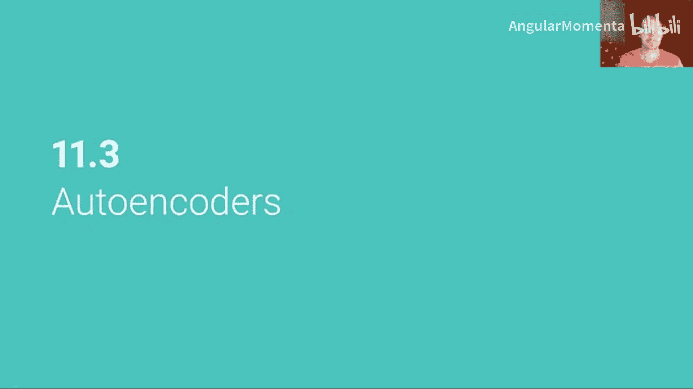

# 008：主成分分析 (PCA) 🧮

在本节课中，我们将要学习主成分分析。这是一种在科学领域，特别是高维数据分析中，最常用的统计工具之一。许多同学可能已经了解PCA，本节将是一个简要回顾。在本课程的语境下，PCA之所以重要，是因为它是一个确定性的线性潜变量模型，是数据分析和降维可视化最基本的方法之一。

## 符号与问题设定

首先，我们来明确符号。我们将数据集表示为 **X**，它是一个矩阵。矩阵的每一行是一个数据向量。因此，数据矩阵有 **N** 行（每个数据点一行）和 **D** 列（数据的维度）。所以 **X** 是一个 **N × D** 的矩阵。

类似地，我们引入一个矩阵 **C** 来表示潜变量。它的每一行存储一个潜码向量。这个矩阵也有 **N** 行，但只有 **Q** 列（**Q** 是一个较小的数，例如2或3）。**X** 是观测到的数据，而 **C** 是未观测到的潜变量，需要从 **X** 中推断出来。

通常，我们假设 **Q** 小于 **D**，因为我们希望模型能产生一个压缩的表示。

在PCA中，我们的目标是学习一个双向映射，即同时拥有一个编码器和一个解码器，因此它是一个自编码器模型。我们希望有一个从潜空间 **C** 到观测空间 **X** 的映射，以及一个从 **X** 回到 **C** 的映射。我们希望这个映射能尽可能多地保留高维空间 **X** 中的信息。

例如，对于图像数据，我们将图像展平为向量，得到一个700维的观测空间。我们希望将维度降低到2或3维。换句话说，我们希望将 **X** 编码成一个潜码 **C**，使得如果我们把 **C** 解码回 **X̂**（其中 **X̂** 是重建结果），那么这个重建结果能很好地近似我们观测到的原始 **X**。在大多数情况下，**X̂** 不等于 **X**，因为对于真实数据集，压缩总是一个有损过程。

## 线性模型与目标函数

现在，我们假设从潜空间到观测空间存在以下线性映射：

**X̂ᵢ = x̄ + Σⱼ Cᵢⱼ Vⱼ**

其中：
*   **X̂ᵢ** 是第 i 个数据点的预测（重建）向量。
*   **x̄** 是整个数据集的均值向量。
*   **Vⱼ** 是第 j 个基向量。
*   **Cᵢⱼ** 是潜变量矩阵 **C** 中第 i 行、第 j 列的元素。
*   求和从 j=1 到 Q。

我们假设偏移量是均值 **x̄**，基向量 **V** 构成一组标准正交基。均值是在没有任何潜变量信息时最好的预测起点。而选择标准正交基是为了能很好地张成空间，并且我们希望这个基的朝向能最大程度地解释数据集。

我们模型的目标是最小化 L2 重建损失，该损失是关于潜变量 **C** 和正交基 **V** 的函数：

**L(C, V) = Σᵢ || X̂ᵢ - Xᵢ ||² = Σᵢ || (x̄ - Xᵢ) + Σⱼ Cᵢⱼ Vⱼ ||²**

我们的目标是找到最优的 **C** 和 **V** 来最小化这个损失。

## 优化潜变量 C

首先，我们优化潜变量 **C**。将损失函数展开，并利用 **V** 是标准正交基的性质（即 **Vⱼᵀ Vⱼ = 1**），我们可以得到损失函数的表达式。

为了最小化损失函数关于 **C** 的部分，我们对 **Cᵢⱼ** 求导并令其为零。这可以得到一个闭式解：

**Cᵢⱼ* = - Vⱼᵀ (x̄ - Xᵢ)**

这里，星号 (*) 表示最优值。将这个最优解代回损失函数，我们得到在 **C = C*** 时的损失值。

## 优化基向量 V 与特征值问题

上一节我们找到了最优的潜变量 **C***，本节我们来看看如何优化基向量 **V**。

将 **C*** 代入损失函数后，损失可以重写为：

**L(C*, V) = - Σⱼ Vⱼᵀ S Vⱼ + 常数项**

其中 **S** 是所谓的散布矩阵，它是数据协方差矩阵的非归一化版本：

**S = Σᵢ (x̄ - Xᵢ)(x̄ - Xᵢ)ᵀ**

现在我们需要优化关于 **V** 的损失。为了避免平凡解（例如 **V=0**），我们需要加入约束条件：基向量必须是标准正交的，即 **Vⱼᵀ Vⱼ = 1**。我们使用拉格朗日乘子法将这个约束整合到优化问题中。

构造拉格朗日函数并关于 **Vⱼ** 求导，令其为零，我们得到一个熟悉的方程：

**S Vⱼ = λⱼ Vⱼ**

这正是特征值问题！我们发现，**λ** 和 **V** 是散布矩阵 **S** 的特征值和特征向量。

此外，我们观察到 **Vⱼᵀ S Vⱼ = λⱼ**。这意味着损失函数 **L(C*, V)** 可以通过选择 **S** 的前 **Q** 个最大特征值所对应的特征向量作为基向量 **V** 来最小化。这些特征向量解释了数据中最大的方差。

## PCA 的编码器与解码器

通过上述推导，我们得到了PCA的线性模型。我们可以非常简洁地写出PCA的解码器和编码器。

解码器（从潜码 **C** 重建数据 **X**）：
**X̂ = x̄ + V C**

编码器（从数据 **X** 得到潜码 **C**）：
**C = Vᵀ (X - x̄)**

这里，矩阵 **V** 的列就是对应于前 **Q** 个最大特征值的特征向量。

以下是PCA的完整步骤：
1.  给定数据集 **X**，计算数据均值 **x̄** 和散布矩阵 **S**。
2.  计算 **S** 的特征分解。
3.  选取前 **Q** 个最大特征值对应的特征向量，组装成矩阵 **V**。
4.  使用上述线性映射进行编码和解码。

## 方差最大化视角

我们之前从最小化重建误差的角度推导了PCA。然而，PCA也可以从最大化潜变量方差的角度来理解，这为我们提供了另一种直观解释。

考虑一维编码情况：**c = vᵀ (x - x̄)**。我们的目标是最大化潜变量 **c** 的方差。可以证明，**c** 的方差正比于 **vᵀ S v**。

因此，在标准正交基的约束下，最大化所有潜变量维度上的方差之和，同样会引导我们求解特征值问题 **S v = λ v**，并选择最大特征值对应的特征向量。**Vⱼᵀ S Vⱼ** 的值就是沿着第 j 个主成分方向的方差（如果 **S** 经过数据点数量归一化，就是协方差）。

## 实例与应用

让我们看一些例子来理解PCA的实际效果。

**二维数据示例**：我们有一个二维数据集，假设使用一维潜空间（Q=1）。PCA会找到数据散布最大的方向（第一主成分），并将所有数据点投影到这条线上。重建点则位于这条投影线上。如果使用二维潜空间（Q=2），则重建误差为零，因为没有进行压缩，但这失去了降维的意义。

**MNIST 手写数字**：在MNIST数据集上，使用不同数量的主成分进行重建。仅用2个基向量时，重建图像非常模糊。随着基向量数量增加（例如50个），重建图像细节更加丰富。底部展示了均值图像和前几个主成分（特征向量），可以看到算法自动从数据中学到了最主要的变换模式（如旋转、拉伸、平移）。

**人脸图像 (Eigenfaces)**：PCA也可以应用于经过良好裁剪的人脸图像。仅用3个主成分就能获得不错的重建效果。更重要的是，我们可以在低维潜空间中对数据点进行分类，这通常更高效。例如，使用3个PCA成分进行人脸/非人脸分类可以达到79%的准确率。同时，特征向量（“特征脸”）被重新排列成图像后，可以直观看到前几个成分主要捕捉光照和低频变化，而后面的成分则包含更多高频细节。

## 总结

本节课中，我们一起学习了主成分分析。我们首先介绍了PCA作为一种线性自编码器模型，其目标是最小化L2重建误差。我们详细推导了如何通过求解散布矩阵的特征值问题，来获得最优的编码器和解码器。我们还探讨了PCA的另一种视角：最大化潜变量空间的方差。最后，我们通过二维数据、手写数字和人脸图像的实例，直观展示了PCA在降维、重建和特征提取方面的应用。PCA是理解数据结构和进行预处理的一个强大而基础的工具。