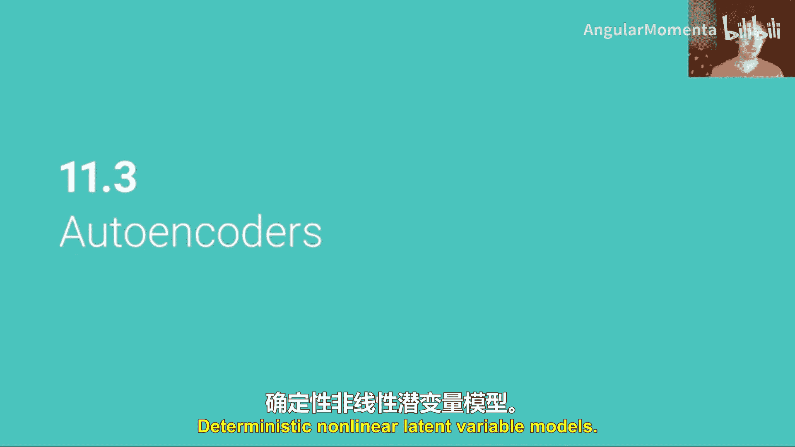
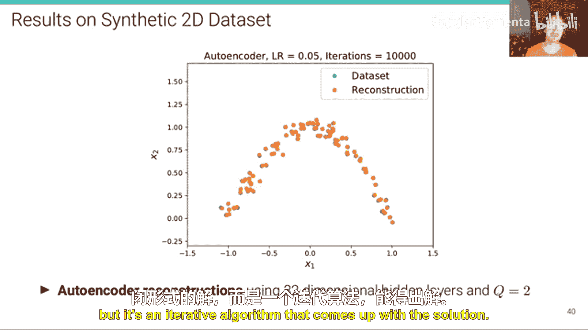
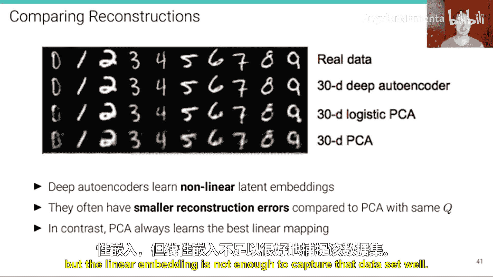
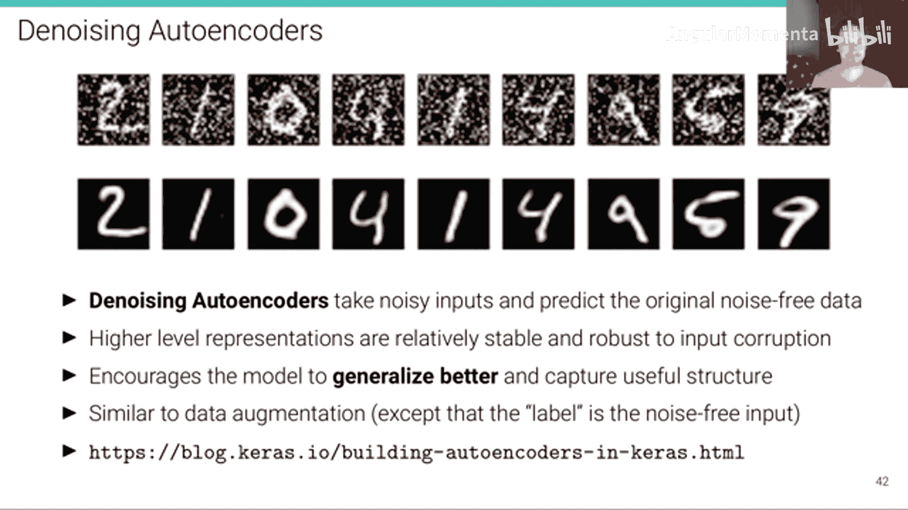

# 009：自动编码器

在本节课中，我们将要学习自动编码器。这是一种确定性的非线性潜变量模型，可以看作是主成分分析的非线性扩展。我们将探讨其基本原理、与PCA的关系，并通过实例观察其效果。

## 从PCA到自动编码器

上一节我们介绍了PCA，它是一种确定性的线性模型。本节中我们来看看**自动编码器**，它是一种确定性的非线性模型。

上图展示了自动编码器的结构。它与我们之前见过的模型图非常相似，区别在于编码器函数和解码器函数不再被假设为线性，而是由参数为 **W** 的神经网络表示。这个网络可以是卷积神经网络、多层感知机、循环网络或图神经网络等。

在通用自动编码器中，整个模块可以看作一个神经网络，其输出就是自身的输入。中间存在一个瓶颈层，旨在压缩信息，但与PCA不同，这种压缩是以非线性方式进行的。与PCA一样，其目标是最小化重构误差，最常用的重构误差是L2损失。

## 自动编码器与PCA的关系

自动编码器与PCA之间存在特定关系。PCA是自动编码器的一个特例。

如果我们假设从 **X** 到 **C** 的编码器映射 **F**，以及从 **C** 到 **X̂** 的解码器映射 **G**，都是线性的，且没有任何激活函数。换句话说，我们有：

**C = A * X + a**

**X̂ = B * C + b**

在这种情况下，整个映射变为线性。将 **C** 代入解码器表达式，得到 **X̂ = B * (A * X + a) + b**，可以简化为另一个线性矩阵 **C** 的映射：**X̂ = C * X + c**。我们知道，如果最小化L2重构误差，该映射的最优解 **W*** 由PCA给出。因此，如果我们假设编码器和解码器都是没有激活函数的线性层，那么两者是等价的。

## 实验结果对比

接下来，我们通过一些实验结果来比较自动编码器的不同变体与PCA。以下是几种模型的对比：

1.  **简单PCA模型**：在示例中，将二维空间映射到一维空间。
2.  **线性自动编码器**：仅使用线性层执行相同操作，应得到与PCA相同的结果。
3.  **非线性自动编码器**：通过非线性方式映射到一维空间。具体路径为：二维空间 -> 32维隐藏层 -> 一维潜空间 -> 32维解码器隐藏层 -> 重构输出。
4.  **二维潜空间非线性自动编码器**：将潜空间维度从一维改为二维，观察其变化。

使用教育框架实现了这三种模型，并获得了以下可视化结果。

图中蓝色点表示二维玩具数据集，它是一个从0到π的余弦曲线。黄色点是重构点，连接蓝点和对应黄点的黄色线段表示重构误差。

以下是编码器和解码器均只有一个线性层、潜空间维度为一的自动编码器的训练过程：
*   **第1次迭代**：模型随机初始化，重构是随机投影。
*   **第10次迭代**：模型开始收敛，重构误差低于初始值。
*   **第50次迭代**：重构效果继续改善。
*   **第1000次迭代**：重构结果稳定。

将最终结果与使用一维潜空间的主成分分析结果对比，发现两者无法区分。这从经验上证明了具有线性编码器和解码器层的自动编码器与PCA是等价的。然而，重构误差仍然很大，因为这个二维空间中的流形是弯曲的，而非线性的。

接下来，我们实现并训练了之前提到的非线性自动编码器，其编码器和解码器均有32维隐藏层。
*   **初始化**：随机初始化。
*   **第10次迭代**：重构误差减小，但重构点仍接近一条线。
*   **第50次迭代**：这条线开始分裂成多个线段，以更好地逼近流形形状。
*   **第300次迭代**：重构误差已大幅减小。由于数据点本身带有噪声，即使使用一维潜空间，误差也无法降至零，但会变得非常小。
*   **第10000次迭代**：非线性自动编码器已经捕捉到了该流形的近似形状。

出于好奇，我们使用相同模型但将潜空间维度改为二维进行实验。
*   经过训练后，自动编码器能够精确地重构数据集。这是因为使用二维空间时，我们实际上不需要压缩信息。虽然在这种情况下，自动编码器仍需通过迭代算法（而非封闭解）来发现这个映射关系，但它最终能够实现完美重构。

## 在MNIST数据集上的应用

我们可以在MNIST数据集上做同样的实验。下图展示了一些重构结果。

*   第一行：真实数据。
*   第二行：深度自动编码器的重构结果。
*   第三行：逻辑PCA模型的重构结果。
*   第四行：标准PCA的重构结果。

可以看到，在相同的潜空间维度下，这种非线性自动编码器能产生更清晰、更锐利的重构图像。相比之下，PCA总是学习最佳的线性嵌入，但线性嵌入不足以很好地捕捉数据集的复杂结构。

## 去噪自动编码器

最后，介绍一种称为**去噪自动编码器**的变体。

去噪自动编码器接收带噪声的输入，并试图预测原始的无噪声数据。例如，我们有一个像MNIST这样的无噪声数据集，然后为其添加一些高斯噪声。去噪自动编码器的思想是，通过添加这种噪声，模型能够学习到更稳定、更高层次的表示，这些表示对这些输入损坏具有鲁棒性。这鼓励模型更好地泛化，捕捉数据中更有用的结构和统计特征，并且不会像普通自动编码器那样容易过拟合。其思想与数据增强非常相似，本质上就是对输入进行数据增强，只不过这里我们处理的是无监督学习问题，其标签就是无噪声的输入本身。结果显示，这些数字被很好地去噪了。

## 总结

本节课中我们一起学习了自动编码器。我们了解到自动编码器是PCA的非线性推广，通过神经网络实现编码和解码。当编码器和解码器为线性时，自动编码器等价于PCA。通过实验，我们观察到非线性自动编码器能够更好地捕捉复杂、弯曲的数据流形，并在MNIST数据集上产生比PCA更清晰的重构结果。此外，我们还介绍了去噪自动编码器，它通过向输入添加噪声来学习更鲁棒的特征表示，其思想类似于无监督学习中的数据增强。