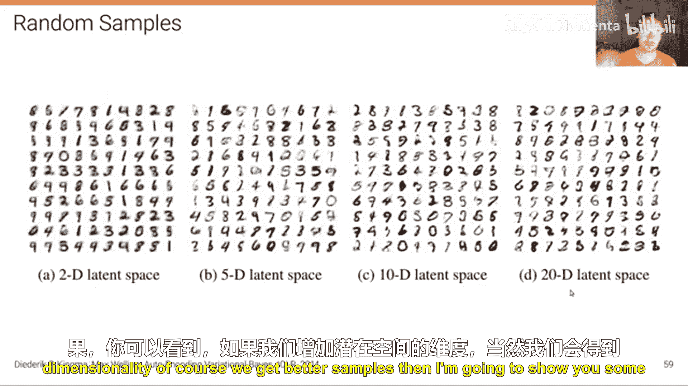
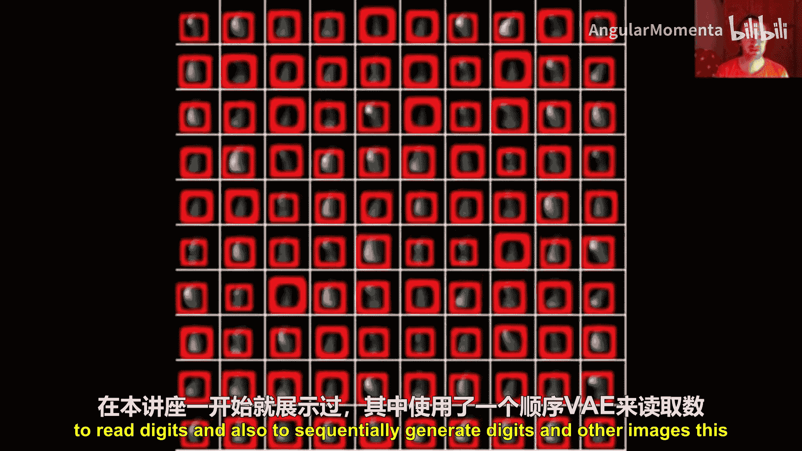
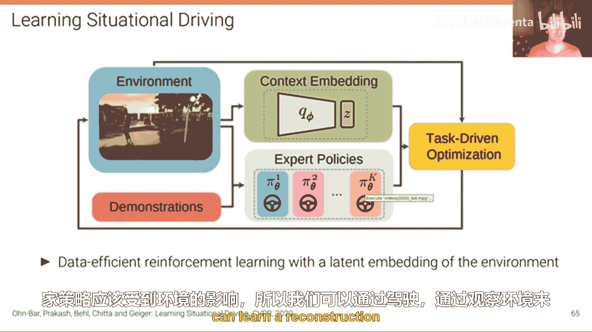
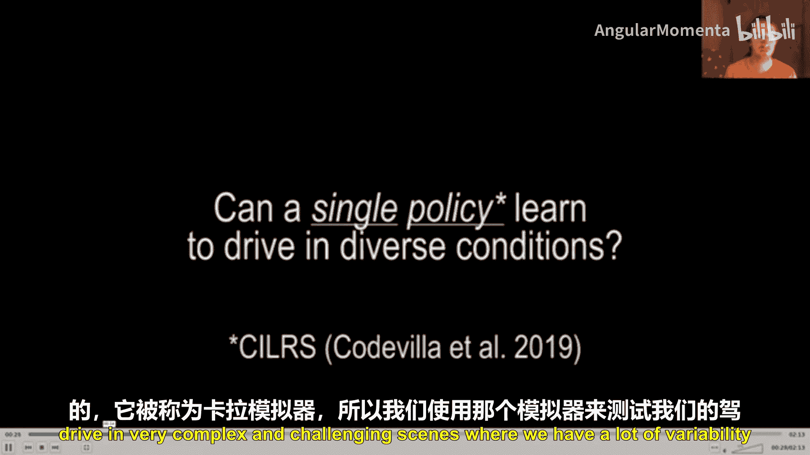
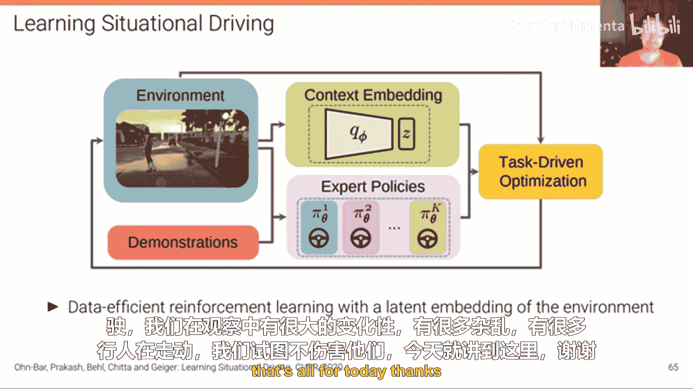

# 010：变分自编码器 (VAE) 🧠

在本节课中，我们将要学习第一个概率性隐变量模型——变分自编码器。这是当今最流行的生成模型之一。之前我们讨论了确定性模型，现在我们将从概率视角来看待具有自编码特性的隐变量模型。

## 概述

首先，我们回顾一下数据的贝叶斯模型。这是本讲介绍中的公式，它描述了一个生成过程：对隐变量 **z** 有一个先验分布 **P(z)**，以及给定 **z** 时数据 **x** 的似然 **P(x|z)**。对 **z** 积分，就得到了数据 **x** 的边缘似然 **P(x)**，这正是我们想要最大化的目标。

当然，由于我们有 **P(z)** 并对 **z** 积分，这个表达式就是条件似然 **P(x|z)** 关于从先验分布中抽取的变量 **z** 的期望。

为了构建这个模型，我们需要做一些假设，使其易于处理。

## 模型假设

以下是使模型可行的关键假设：
*   我们首先假设先验模型 **P(z)** 是可采样且可计算的。
*   我们还假设似然模型 **P(x|z)** 也是可计算的。

这意味着我们可以从 **P(z)** 中采样，并且对于任何给定的 **x** 和 **z**，我们都可以计算 **P(z)** 和 **P(x|z)** 的概率质量或密度。

这些假设对于自回归模型（如语言模型）成立，但对于许多其他模型（如带环的图模型）则不成立，后者需要使用信念传播等近似方法。在变分自编码器的背景下，我们将考虑非常简单的参数化分布（如高斯分布），并通过神经网络进行参数化，以实现易于采样的特性。

## 目标函数与挑战

为了找到最佳的模型参数 **W**，一个合理的方法是**最小化负对数似然**（或交叉熵）。我们希望找到 **W*** 作为在整个数据分布 **x** 上的期望的最小化者，或者用我们的数据集（来自数据分布的样本）来近似这个期望。

然而，不幸的是，即使有了我们的假设，计算 **P_W(x)** 仍然是难以处理的。计算这个期望之所以困难，是因为搜索空间太大。我们是在一个可能高达数十维的隐空间上操作，虽然它比观测空间小，但仍然很大。为了准确估计这个量，我们需要抽取大量样本，这对于单次梯度步长来说计算量过大。

因此，直接优化是难以处理的。

## 变分自编码器的核心思想

VAE 的核心思想是通过引入另一个模型组件来规避这个问题，这个组件称为**识别模型**（或编码器），同样由参数 **W** 参数化，记作 **Q_W(z|x)**。给定一个数据点 **x**，我们试图用一个概率模型来编码它，预测出给定数据点时 **z** 的分布。

在自编码器的语境中，**P(x|z)** 是解码器，而 **Q(z|x)** 是编码器。我们尝试训练这个近似模型，使其逼近真实但未知的后验 **P_W(z|x)**。这个识别模型不需要完全精确，只要它能比一个非常宽泛的先验分布提供更好的指引，它就是有用的。联合训练这个模型会得到一个收敛更快且变得可处理的自编码器。

## 证据下界 (ELBO)

我们使用识别模型 **Q** 来寻找似然的一个易于处理的**下界**，这个下界被称为**证据下界**，因为它是对数似然（有时被称为证据）的一个下界。

通过对数似然的推导，我们可以得到负对数似然的上界。这个上界表达式包含一个 **KL 散度项**（衡量识别模型 **Q** 与先验 **P(z)** 的差异）和一个**重构项**（衡量给定 **z** 时重构 **x** 的好坏）。

注意，**Q(z|x)** 和 **P(x|z)** 在这里扮演了自编码器的角色：**Q** 作为编码器将 **x** 映射到 **z**，**P** 作为解码器将 **z** 映射回 **x**。这就是它被称为变分自编码器的原因——从这些方程中自然涌现出了自编码结构。

## VAE 的实践设定

在 VAE 中，识别模型 **Q(z|x)** 通常被选择为一个由神经网络参数化的**多元高斯分布**。这使得 KL 散度项的计算变得非常简单。同样，似然 **P(x|z)** 也由神经网络参数化：对于二值观测，通常选择伯努利分布；对于实值观测，则选择高斯分布或拉普拉斯分布。

具体来说，对于识别模型，我们有一个神经网络，它接收输入 **x**，经过若干层（如 MLP）后，输出高斯分布的均值向量 **μ** 和对角协方差矩阵的对角元素 **σ²**。先验 **P(z)** 通常简单地选择为标准高斯分布（均值为0，协方差矩阵为单位矩阵）。

在这种高斯假设下，KL 散度项有一个简单的解析解，易于微分和优化。

## 重参数化技巧

然而，对于重构项，虽然前向传播可以通过采样轻松计算，但反向传播需要**对采样操作进行微分**，而采样操作本身依赖于需要优化的参数。直接处理会得到高方差的梯度估计器，效果不佳。

Kingma 和 Welling 在他们的 VAE 论文中提出了**重参数化技巧**来解决这个问题。该技巧将采样操作从计算图中移出，放到输入层。对于高斯分布，我们可以先从标准高斯分布中采样一个噪声变量 **ε**，然后通过一个确定性的变换 **z = μ + σ ⊙ ε** 得到 **z**。这样，**μ** 和 **σ** 是 **x** 和 **W** 的确定性函数（通过神经网络），而随机性仅来自输入噪声 **ε**。这使得我们可以通过这个确定性路径进行反向传播，从而获得低方差的梯度。

在实践中，对于每个数据点 **x**，通常一个 **ε** 样本就足够了，特别是在使用合理大小的迷你批次（如64或128）时。

## VAE 的表达能力

VAE 的表达能力非常强。它本质上实现了一个从简单隐分布（如标准高斯）到复杂数据分布的映射。通过神经网络的非线性变换，我们可以将简单的隐分布转换成输出空间中非常复杂的分布。例如，通过精心设计的非线性映射，可以将高斯分布的点映射成一个环状分布。

## 应用与结果

VAE 已被广泛应用于众多领域：
*   **图像生成**：可以学习人脸、手写数字等数据的内在流形，并能从隐空间随机采样生成新样本。
*   **序列建模**：与循环神经网络结合，用于序列数据的生成。
*   **解耦表示学习**：通过特殊的训练方案，可以在弱监督下解耦潜在因子，如姿态、光照、纹理等。
*   **运动预测**：从静态图像预测可能的多模态未来运动。
*   **3D形状学习**：学习3D物体的隐空间表示。
*   **环境嵌入**：在自动驾驶等领域，通过观察环境学习其重建表示，所得的隐编码可作为解决驾驶任务的有用线索。

## 总结

本节课我们一起学习了**变分自编码器**。我们从概率视角出发，理解了直接优化数据似然面临的挑战，并引入了识别模型来构造易于优化的证据下界。我们详细探讨了 VAE 的模型假设、目标函数（包含 KL 正则项和重构项），以及使训练可行的关键技术——**重参数化技巧**。最后，我们看到了 VAE 强大的表达能力及其在图像生成、表示学习等多个领域的成功应用。VAE 作为一种重要的深度生成模型，为我们提供了连接概率图模型与深度学习的优雅框架。