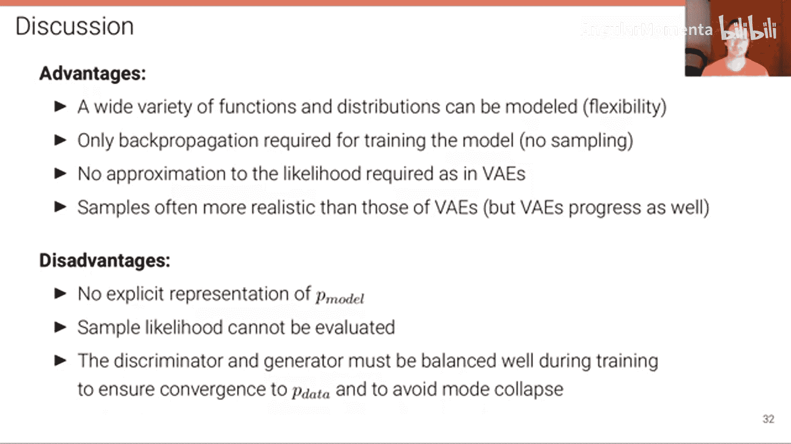

# 011：生成对抗网络（GANs）📊


在本节课中，我们将要学习生成对抗网络（GANs）。这是一种非常流行的生成模型，它使用了一种全新的、对抗性的训练范式来学习数据分布。与上节课介绍的变分自编码器（VAE）不同，GANs没有编码器，并且不直接对似然函数进行建模。

上一节我们介绍了变分自编码器，本节中我们来看看另一种强大的生成模型——生成对抗网络。

## 生成模型回顾

在开始之前，让我们简要回顾一下第11讲中介绍的隐变量模型。隐变量模型在观测空间 **x** 和维度通常低得多的隐空间 **C** 之间建立映射。每个训练数据点都与一个隐变量相关联，因此 **C** 被称为隐变量。模型可以是线性或非线性、确定性的或随机的，并且可能包含也可能不包含编码器 **F**。

以下是部分已提出的隐变量模型分类：

*   **主成分分析 (PCA)**：线性，确定性，无编码器。
*   **自编码器 (AE)**：非线性，确定性，有编码器。
*   **变分自编码器 (VAE)**：非线性，随机性，有编码器。
*   **生成对抗网络 (GAN)**：非线性，随机性，无编码器。

生成模型通常指任何从数据分布 **P_data** 中学习一个模型分布 **P_model** 的模型。其目标可能是评估特定数据点的似然、进行推断，或者从该分布中采样。

*   **显式密度模型**：显式地表示或建模密度。
    *   **可处理的密度**：例如 PixelRNN。
    *   **近似密度**：例如变分自编码器（VAE），使用变分近似。
*   **隐式密度模型**：仅能从 **P_model** 中生成样本，无法评估密度。**生成对抗网络（GANs）** 是这类模型中最著名的代表。

## GANs 基本原理

GANs 放弃了显式建模密度或似然。相反，它们使用一个对抗过程，其中两个模型（有时也称为“玩家”）同时被训练以竞争一个目标，因此这通常也被称为一个“两人博弈”。具体来说，这两个玩家是**生成器 G** 和**判别器 D**。

*   **生成器 G**：捕获数据分布。它负责学习一个模型分布 **P_model**，以近似数据分布 **P_data**，从而能够生成看起来像来自数据分布的新数据点。
*   **判别器 D**：估计一个样本是来自真实数据分布还是生成器。它输出一个概率：如果认为输入样本来自真实数据分布，则输出接近 1；如果认为来自生成器（假样本），则输出接近 0。

生成器 **G** 的目标是最大化判别器 **D** 犯错的概率，即“欺骗”判别器。判别器 **D** 的目标是更好地区分真实与伪造的样本。通过让这两个玩家进行博弈，我们可以得到一个能近似数据分布的生成器。

GANs 的一个优点是训练只需要反向传播，而许多其他生成模型需要更复杂的算法。它不需要近似推断，也不需要通常存在混合问题的缓慢马尔可夫链。虽然有一些关于最优性和收敛性的理论结果，但它们需要很强的假设。

## GANs 的形式化定义

让我们更正式地定义 GAN。沿用我们的常用符号，令 **x ∈ R^D** 表示一个观测值（例如一张图像），其中 **D** 是维度。令 **P(C)** 是隐变量 **C ∈ R^Q** 上的先验分布，其中 **Q** 是隐空间的维度。

我们有一个参数为 **W_G** 的生成器网络 **G**，它将隐代码映射到数据空间，即 **G: C → x**。由隐空间先验 **P(C)** 和确定性函数 **G** 共同诱导出的分布，我们称之为模型分布 **P_model**。

令参数为 **W_D** 的判别器网络 **D** 从观测空间映射到一个概率值，即 **D: x → [0, 1]**。判别器网络的最后一层通常使用 Sigmoid 激活函数将输出映射到 [0, 1] 区间。

判别器 **D** 和生成器 **G** 进行以下两人极小极大博弈，价值函数为 **V(G, D)**：

**min_G max_D V(D, G) = E_{x∼P_data}[log D(x)] + E_{c∼P(C)}[log(1 - D(G(c)))]**

这里，**E** 表示期望值。

*   **判别器 D 的目标 (max_D)**：对于来自 **P_data** 的真实样本 **x**，希望 **D(x)** 接近 1（最大化 **log D(x)**）；对于生成器生成的假样本 **G(c)**，希望 **D(G(c))** 接近 0（最大化 **log(1 - D(G(c)))**）。
*   **生成器 G 的目标 (min_G)**：希望生成的样本 **G(c)** 能欺骗判别器，使其输出接近 1（即最小化 **log(1 - D(G(c)))**，因为当 **D(G(c))** 接近 1 时，此项值很小）。

## 训练算法与梯度技巧

在实践中，我们使用迭代数值优化算法。在内部循环中将 **D** 优化到收敛在计算上是不可行的，并且会导致在有限数据集上过拟合。因此，通常的做法是交替优化这两个目标：先进行 **K** 步（例如 1 到 5 步）优化判别器 **D**，然后进行一步优化生成器 **G**，并使用足够小的学习率。这有助于平衡判别器和生成器的重要性，对于模型收敛至关重要。

以下是基本的 GAN 训练算法：

```
while 未收敛:
    for k 步:
        从数据分布 P_data 中采样一个批次（大小 B）的真实样本 {x}
        从隐变量先验 P(C) 中采样一个批次（大小 B）的噪声样本 {c}
        通过**上升**其随机梯度来更新判别器 D:
            ∇_{W_D} (1/B) Σ [log D(x) + log(1 - D(G(c)))]
    从隐变量先验 P(C) 中采样一个批次（大小 B）的噪声样本 {c}
    通过**下降**其随机梯度来更新生成器 G:
        ∇_{W_G} (1/B) Σ [log(1 - D(G(c)))]
```

在训练早期，生成器性能很差，判别器可以轻易地以高置信度将生成样本判别为假（**D(G(c))** 接近 0）。这会导致 **log(1 - D(G(c)))** 的梯度饱和，变得非常小，从而生成器 **G** 难以获得有效的梯度进行更新。

为了解决这个问题，可以使用一个**梯度技巧**：不训练 **G** 去最小化 **log(1 - D(G(c)))**，而是改为训练 **G** 去**最大化 log(D(G(c)))**。这会导致相同的纳什均衡点，但在训练早期能提供更强的梯度。

## 理论结果简述

原始 GAN 论文提出了一些理论结果：

1.  **最优判别器 (Proposition 1)**：对于任意固定的生成器 **G**，最优判别器 **D*_G** 为：
    **D*_G(x) = P_data(x) / (P_data(x) + P_model(x))**
2.  **全局最优性 (Theorem 1)**：当且仅当 **P_model = P_data** 时，虚拟训练准则 **C(G) = V(G, D*_G)** 达到全局最小值 **-log 4**，且此时 **D*_G(x) = 1/2**。
3.  **收敛性 (Proposition 2)**：如果 **G** 和 **D** 有足够的容量，并且在每次更新中判别器都能达到其最优值，同时生成器（或模型分布）的更新能改进虚拟训练准则，那么 **P_model** 会收敛到 **P_data**。

这些理论结果基于很强的假设（如无限模型容量、判别器每次都能达到最优），在实践中难以完全满足。神经网络参数化的 **G** 会引入临界点，交替优化只能保持 **D** 接近其最优解，因此实践中 GANs 可能不收敛甚至振荡。然而，经验表明，通过精心平衡 **G** 和 **D** 的训练，GANs 通常能产生非常好的结果。

## 模式崩溃问题


GANs 的一个主要失败模式是**模式崩溃**。它源于极小极大博弈使得训练比简单地最小化损失函数更困难。在模式崩溃中，生成器学会了产生高质量但多样性很低的样本，只覆盖数据分布的一部分模式。直观上，这可能是因为生成器发现只专注于欺骗当前判别器的一种“有效”模式更容易，而忽略了其他模式，导致生成样本缺乏多样性。


以下是几种应对模式崩溃的策略：


*   **鼓励多样性**：例如，让判别器考察整个小批量样本的统计特性，而不是单个样本。
*   **预见性对抗**：例如，通过“展开”判别器未来几步的更新，让生成器在更新时能预见到判别器的应对策略。
*   **经验回放**：不时地向判别器展示旧的生成样本，减少其在模式间跳跃。
*   **训练多个 GAN**：希望多个生成器能覆盖更多模式（计算成本高）。
*   **使用改进的目标函数和正则化**：例如 WGAN（Wasserstein GAN）及其梯度惩罚（Gradient Penalty）变体，能带来更好的训练稳定性。

## 优势与劣势

最后，我们来总结一下 GANs 的优势与劣势。

**优势**：
*   能够建模非常广泛和复杂的函数与分布，非常灵活。
*   训练仅需反向传播，无需采样或近似似然（如 MCMC 或 VAE 中的变分推断）。
*   生成的样本质量通常非常高，视觉上更逼真。

**劣势**：
*   没有模型分布或似然的显式表示，无法评估样本的似然。
*   训练框架更复杂， notoriously hard to train。需要仔细平衡生成器和判别器的训练，以确保收敛并避免模式崩溃等问题。
*   调整超参数和正则化项通常需要大量经验。



本节课中我们一起学习了生成对抗网络（GANs）的基本原理、形式化定义、训练算法以及相关的理论概念和挑战。GANs 通过一个巧妙的对抗博弈框架，绕过了直接对复杂数据分布建模的困难，成为当前最强大的生成模型之一。尽管训练存在挑战，但其在图像生成等领域产生的惊人效果，推动了深度学习生成模型的飞速发展。