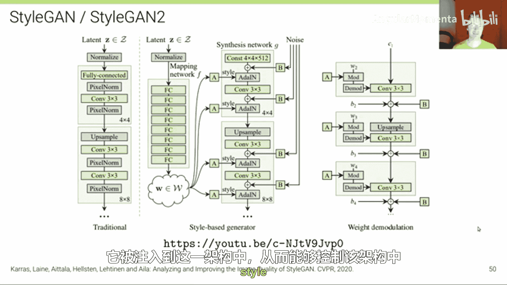

# 012：生成对抗网络（GAN）的发展 🚀

在本节课中，我们将学习生成对抗网络（GAN）自诞生以来的关键发展历程。我们将从最初的架构探索开始，逐步了解如何通过改进训练稳定性和网络设计，最终生成以假乱真的高质量图像。

---

## 概述

生成对抗网络（GAN）自其开创性论文发表以来，在领域内引发了一场真正的革命，催生了大量关于其应用和改进的后续研究。在本单元中，我们将简要概述该领域的一些近期发展。这堪称人工智能领域的“摩尔定律”。下图展示了四年半时间里，GAN在人脸图像生成质量上的惊人进步。

你可以看到原始GAN论文中的结果，并将其与今天获得的结果进行比较。如今的结果令人印象深刻，社区中的许多人都对能够生成如此高保真度和丰富细节的图像感到震惊。

---

## DCGAN：迈向高质量图像生成的第一步

上一节我们提到了GAN的诞生，本节中我们来看看第一个重要的改进——DCGAN。它本质上是对可能架构的搜索空间进行系统性探索，以找到在“最小最大”双玩家博弈框架下表现良好的结构。

以下是DCGAN发现的一组基本设计准则，这些准则能产生高质量的图像模型：
*   **卷积替代池化**：在判别器中使用步幅卷积（`stride convolutions`）替代池化层，在生成器中使用分数步幅卷积（`fractional stride convolutions`）进行上采样。
*   **批量归一化**：在生成器和判别器中都使用批量归一化（`batch normalization`）。
*   **移除全连接层**：对于更深的架构，移除了全连接隐藏层。
*   **激活函数选择**：在生成器中，除输出层使用`Tanh`外，其余层使用`ReLU`激活函数；在判别器的所有层中使用`Leaky ReLU`激活函数。

这是一项非常彻底和系统的实证研究，旨在找出哪些架构表现良好。由于GAN训练 notoriously 困难，正确设置这些超参数至关重要。他们展示了在更具挑战性的数据集（如卧室场景）上生成的样本，这些样本比原始GAN论文中的结果看起来真实得多。卧室场景对于在图像域操作的2D生成模型来说非常复杂，因为其中物体的布局、视角和外观存在巨大差异。

此外，他们还展示了随机潜在代码插值（`random latent code interpolations`）的示例。例如，在底部的序列中，一个看起来像电视的物体逐渐变形为窗户。他们还在论文中展示了可以进行简单的向量算术运算。具体做法是：取带有眼镜的男性样本的平均潜在向量，减去不带眼镜的男性样本的平均向量，再加上不带眼镜的女性样本的平均向量，然后对结果向量添加一点高斯噪声。最终他们得到了类似的结果：可以“拿”一个戴眼镜的男人，“去掉”眼镜，然后“加上”一个女人，最终得到一个戴眼镜的女人。这表明模型学习到了有语义意义的信息。

---

## GAN的评估指标：FID

随着GAN模型的爆炸式增长，如何评估生成模型变得尤为重要。由于许多高性能的生成图像模型无法进行精确的似然计算，因此需要一个标准化的评估指标。目前一个常用（尽管不完美）的指标是**Fréchet Inception Distance**。

FID是一种用于评估生成对抗网络（GAN）生成图像质量的指标。它通过比较生成图像与真实图像在预训练的Inception V3网络深层特征上的分布差异来实现。FID度量的是两个多维高斯分布之间的Fréchet距离。

**公式**：
假设模型特征分布为高斯分布 \( N(\mu_m, \Sigma_m) \)，真实数据特征分布为高斯分布 \( N(\mu_r, \Sigma_r) \)，则FID距离为：
`FID = ||μ_m - μ_r||^2 + Tr(Σ_m + Σ_r - 2(Σ_m Σ_r)^{1/2})`

其核心思想是，在预训练的Inception V3网络的深层，特征被认为具有更丰富的语义信息。比较这些特征的分布，比比较网络浅层的局部、低级特征更有意义。在提出该指标的原始论文中，作者证明了它的有效性：例如，向图像添加噪声、模糊图像或混入其他分布的图像，都会导致FID值上升。

然而，FID是一个衡量图像保真度和与数据分布相似性的指标，它**无法测量或防止模式崩溃**，也不能很好地判断模型生成的图像是否很好地覆盖了整个数据分布。

---

## 提升训练稳定性：WGAN与梯度惩罚

GAN领域的一个重大进展是**Wasserstein GAN**。在原始GAN中观察到，高维空间中的低维流形通常重叠很少，如下图所示的两条线。当两个分布的支持集没有重叠时，原始GAN的判别器会饱和，导致梯度消失。

WGAN使用**Earth Mover‘s距离**（又称Wasserstein距离）替代Jensen-Shannon散度，这种距离度量能够处理支持集不重叠的情况，并提供有意义的梯度，从而有助于稳定GAN的训练。

另一项使GAN训练更可行、更稳定且减少超参数调整需求的主要进展是引入了**正则化器**，例如**梯度惩罚**。例如，在一篇论文中引入了一个非常简单的梯度惩罚正则项，即对判别器关于输入x的梯度进行惩罚。理论上可以证明，这能局部地促进收敛。下图对比显示，标准GAN的参数在振荡而不收敛，而使用梯度惩罚的两个版本则随时间推移收敛到均衡点。

使用此类梯度惩罚的**DCGAN**已被证明可以产生高质量样本，其质量远高于原始DCGAN论文中的结果，且无需依赖许多为经验性稳定训练而引入的技巧。仅使用一个非常朴素的DCGAN网络并加上梯度惩罚，就能获得如下图所示的卧室或教堂样本。

值得注意的是，在某些教堂样本中，你甚至可以看到网络建模了一个小小的“Shutterstock”水印，因为许多训练图像中都有这个水印，因此它被模型记住并作为数据分布的一部分生成了出来。

---

## 图像到图像的翻译：CycleGAN

GAN不仅可以用于从潜在代码生成图像，还可以用于**在两个域之间进行翻译**，即将一个域（例如X）中的图像转换到另一个域（例如Y）中的图像。在一篇名为《使用循环一致对抗网络进行非配对图像到图像翻译》的论文中，就应用了这种跨域翻译的思想。

该模型联合训练两个域之间的前向和后向映射（此时域本身成为了潜在变量），使用了不同的损失函数：一个**循环一致性损失**，用于衡量一个样本从一个域映射到另一个域再映射回原始域后，与原始样本的对齐程度；以及GAN中经典的判别器损失。

利用这类模型，我们可以将一张输入照片转换成特定风格的画作，只需在未配对、未对齐的真实世界照片和特定画家风格的画作集上进行训练即可。然后，我们还可以将生成的画作映射回原始图像域，并使用重建损失来使两者尽可能一致。当然，这其中存在一些模糊性，例如下图中的红花被转换成了黄花。

这种模型的应用非常有趣，可以实现马和斑马之间的转换、冬季和夏季场景的转换、航拍照片和地图的转换、建筑立面图与其实语义标签的转换，以及线条画和实物照片之间的转换等。你甚至可以在一些网络演示中交互式地体验它。

---

## 迈向高分辨率：渐进式增长GAN

为了进一步提升GAN的性能，**渐进式增长GAN**提出了一种新思路：从低分辨率（如4x4像素）开始训练GAN，然后在训练过程中逐步为生成器和判别器添加更多层，以达到越来越高的分辨率。

通过这种渐进式增长的过程，他们能够生成非常逼真的图像，分辨率高达1024x1024像素（1兆像素），这在之前是无法实现的。这也是当今最先进的GAN模型所使用的基本方法之一。

---

## 挑战复杂数据集：大规模条件GAN

另一个研究小组分析了GAN如何扩展到更复杂的数据集，特别是**ImageNet**。由于其巨大的多样性，ImageNet很难建模。他们尝试将**类别条件GAN**（其中类别标签也作为GAN的输入）扩展到ImageNet，并在512x512像素的较大分辨率下进行了实验。

他们证明，即使没有渐进式增长，只要拥有非常大的模型、非常大的小批量大小，以及随之而来的大型计算集群（这是在谷歌规模上完成的），这也是可能的。他们引入了一些使这项工作成功的重要技巧，例如生成器的正交正则化和潜在空间裁剪。他们探索了不同正则化策略的变体，并特别分析了通过这些正则化策略实现的稳定性与性能之间的权衡。他们发现了一个权衡点：加入这些正则化器可以获得更稳定、更收敛的行为，但另一方面，会损害FID指标衡量的性能。

因此，他们提出监控生成器和判别器权重矩阵的**谱**（奇异值），以确定模式崩溃何时发生（如下图所示），并在这些位置停止训练。他们发现，与判别器的正则化策略相比，这种**早停策略**能带来更好的FID分数。

---

## 当前最先进技术：StyleGAN

**StyleGAN**和**StyleGAN2**被认为是当今最先进的GAN模型。我强烈建议你观看相关的演示视频，效果令人印象深刻。

StyleGAN在训练中使用了正则化策略，但采用了一种新颖的网络架构。与传统架构中潜在代码直接输入生成模型不同，在StyleGAN中，潜在代码通过全连接层映射成不同层次的**风格代码**，这些风格代码被输入到生成器架构的不同层中。生成器从一个常量代码开始，此外还有一个额外的噪声向量也被注入到不同层中。这种设计允许在架构的不同分辨率上**控制细粒度的风格**。

通过这种方式，他们合成的图像比以往任何生成模型合成的图像都更加逼真。通过改变刚刚提到的输入噪声（即采样不同的输入噪声），他们可以获得非常复杂的随机变化，例如在下图放大的绿色方框中，每根发丝的变化都各不相同，而每一种变化本身又是连贯且自然的。

这个模型的一些结果可以在“This Person Does Not Exist”网站上看到。每次刷新该网站，你都会从该模型得到一张新的图像。许多人正是因为这个StyleGAN2模型生成图像的质量而感到兴奋。它生成的图像非常逼真，人类很难将其与真实图像区分开来，除非你非常熟悉这类模型，否则很难看出它的缺陷。它可以生成不同类型的人类，包括男性和女性，不同的发色，有胡子或没胡子，卷发或直发，戴眼镜或不戴眼镜等。

---

## 总结

本节课中，我们一起学习了生成对抗网络（GAN）的关键发展脉络。我们从奠定基础的DCGAN开始，了解了如何通过架构改进生成更真实的图像。接着，我们探讨了评估生成模型质量的FID指标，以及解决训练不稳定问题的WGAN和梯度惩罚技术。然后，我们看到了GAN在图像翻译（CycleGAN）和高分辨率生成（渐进式增长GAN）方面的强大能力。最后，我们介绍了当前最先进的StyleGAN系列模型，它们通过创新的架构设计，能够生成几乎无法与真实照片区分的高质量人脸图像。GAN的发展历程展示了通过持续的研究和创新，生成模型的性能如何实现了质的飞跃。