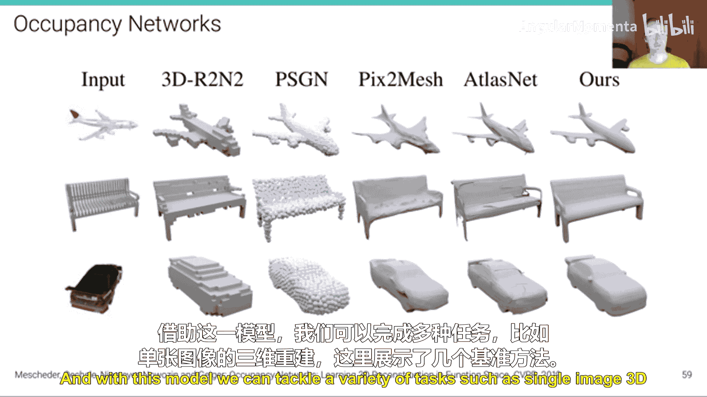
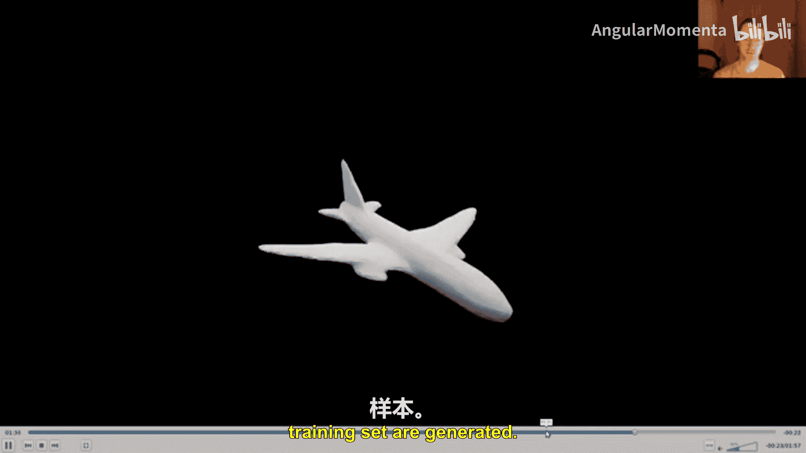
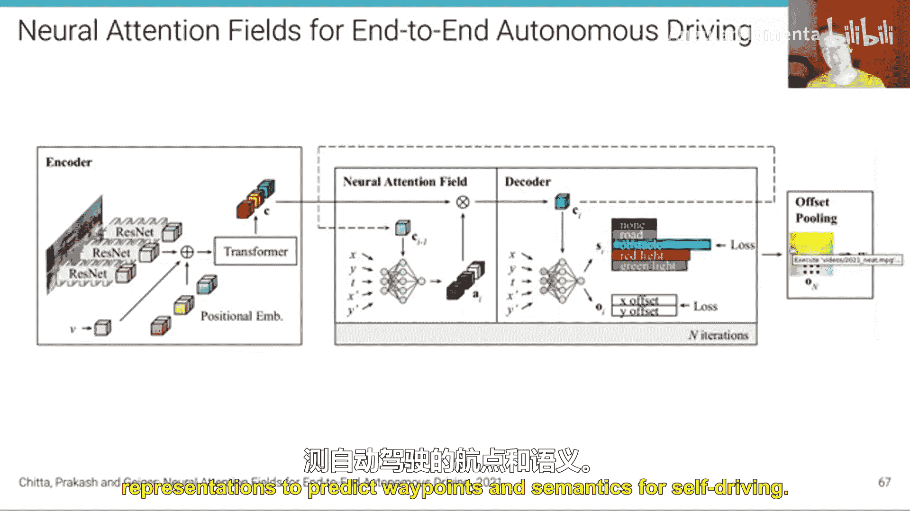
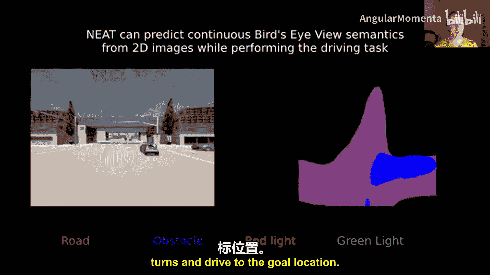
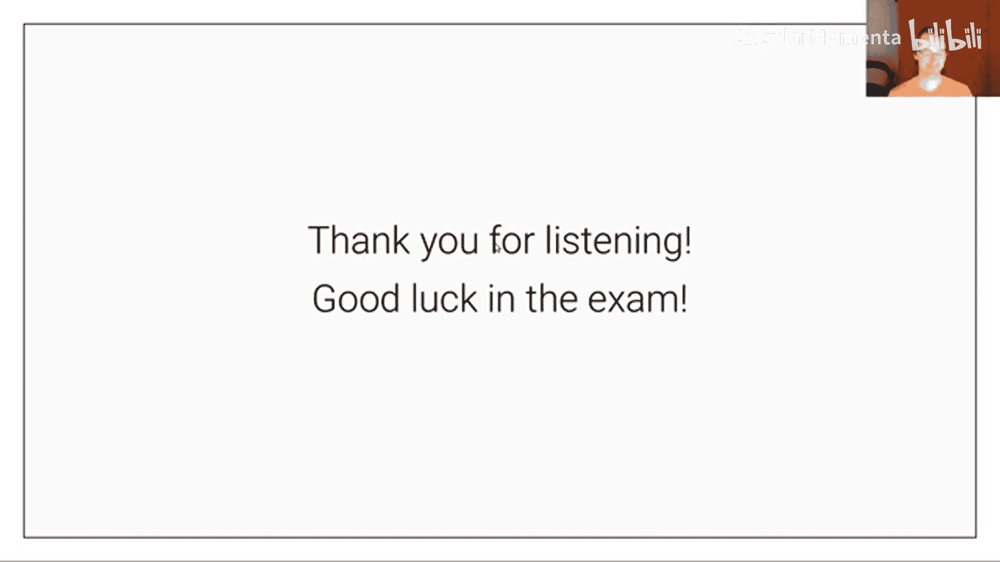

# 013：AVG的研究成果

在本节课中，我们将学习蒂宾根大学自主视觉研究小组如何将深度学习应用于日常研究，涵盖3D重建、生成模型、自动驾驶等多个前沿领域的具体研究成果。

## 概述

上一节我们介绍了深度学习的基础知识。本节中，我们将通过自主视觉研究小组的实际研究案例，展示深度学习在复杂3D环境理解与交互中的应用。这些案例包括从单张图像进行3D重建、生成新形状、处理动态4D数据，以及构建自动驾驶系统。

## 3D重建与隐式表示

为了理解复杂的3D环境，一个核心任务是进行3D重建，即从一张或多张图像中预测物体的三维形状。传统方法使用体素、点云或网格等显式表示，但这些方法在细节表现上存在局限。

我们的关键思路是采用隐式表示。在CVPR 2019发表的论文《Occupancy Networks》中，我们提出将3D表面视为一个神经分类器的决策边界，而非显式地表示形状。

具体而言，我们训练一个神经网络分类器。该网络的输入是一个3D坐标点 `x` 和一个条件（例如一张图像），输出是该点位于物体内部的占用概率 `p`。决策边界（例如概率为0.5的等值面）就定义了物体的表面形状。

以下是该模型的核心公式描述：

`f_θ(x, c) → p`，其中 `p ∈ [0, 1]`

利用这个模型，我们可以完成多种任务。

以下是该模型的一些应用示例：

*   **单图像3D重建**：仅输入一张2D图像（左），模型能重建出细节丰富的3D形状（右），其效果优于基线方法，并接近真实情况。
    
*   **从噪声点云重建**：即使输入是稀疏且带有噪声的点云（左），模型也能学习并重建出正确、平滑的水密表面（右）。
*   **无条件生成模型**：该隐式表示也可用于变分自编码器，在潜在空间中进行插值，生成训练集中未出现过的新样本。
    

## 扩展到4D与外观建模

上述隐式模型可以进一步扩展。

首先，我们将其扩展到4D（3D空间+时间）。在ICCV 2019的工作中，我们提出了一种方法：模型在特定时间点表示形状的占用情况，同时学习一个4D速度场。通过求解一个常微分方程（ODE）来获得物体的运动轨迹，并可以通过ODE反向传播来更新模型参数，从而学习4D重建。

其次，我们可以用这些技术对物体表面的光场进行建模。这本质上是建模物体表面每个点的外观，该外观取决于观察视角和光照位置。给定一张输入图像和一个3D几何模型（如CAD模型），我们可以训练神经网络来推断一个模型，之后可以任意改变光照和视角进行渲染。模型能够准确捕捉阴影变化、处理多个光源（环境光照）并生成物体表面的镜面反射效果。

## 大规模场景与无监督学习

最初的隐式模型难以扩展到大型场景。为此，我们开发了将隐式模型与3D卷积思想相结合的方法，使其能够处理房间级别的大规模场景重建，例如在Matterport数据集上的表现。

更进一步的挑战是无监督学习。我们探索了是否能够仅从无结构的图像集合中学习这些隐式模型（这里特指一种称为辐射场的隐式模型），其中每个场景只有一张图像，且我们不知道相机的参数和姿态。我们提出的模型证明这是可能的。仅从一组RGB图像出发，我们可以恢复出一个解耦的表征，之后可以分别操纵相机视角、物体形状或外观，并生成新的RGB渲染图、深度图或3D几何。

## 语义解耦与生成模型

3D建模的另一个方面是从无监督的3D点云中恢复语义信息。给定一组物体的3D点云，我们的目标是恢复出有语义意义的部件，这些部件组合起来能构成合理的形状。我们使用了一种基于流的生成模型（一种具有显式似然表示的深度生成模型）来实现这一目标。该模型在人体、手部以及各种ShapeNet物体上都成功恢复了有意义的部件。

解耦是当前重要的研究方向。给定一组图像，我们试图分离出生成图像的根本因子，例如物体的形状、纹理或背景信息。我们通过向模型引入弱偏置，使其能够自动学习将这些因果因子解耦。一旦获得这种解耦表征，我们就可以任意组合形状、纹理和背景。研究表明，使用这种干预数据训练的分类器，比仅在原始数据集上训练的分类器更加鲁棒。我们还可以在潜在空间中进行遍历，探索解耦因子的变化。

## 感知与控制的结合：自动驾驶

我们不仅对感知感兴趣，也对将感知与控制相结合感兴趣。我们认为，只有在实际反馈循环（如机器人系统、自动驾驶汽车）中审视控制问题，才能学习如何开发更好的视觉系统。

以下是我们在该领域的一些探索：

*   **学习端到端驾驶策略的中间表示**：我们发现，为学习驾驶策略标注正确的部分，比提供非常详细的语义标注更重要。过于详细的类别标签可能会使视觉抽象模型感到困惑，反而导致策略驾驶效果变差，尽管标注花费了更多时间。
*   **更好的自动驾驶模型**：自动驾驶是一项复杂的任务，需要将高维输入信息（多传感器图像、激光雷达、RGB信息、地图等）整合成一个紧凑的表征以做出驾驶决策。为此，我们开发了一个模型，将本课程中学到的Transformer架构与上述隐式表示相结合，用于预测自动驾驶的路径点和语义信息。
    
    训练出的驾驶策略仅以多个图像作为输入，能够学习遵守交通规则、为行人和车辆停车、正确转弯并驶向目标地点。
    

## 总结

本节课中，我们一起学习了自主视觉研究小组如何利用深度学习解决3D视觉中的核心问题。我们从隐式表示的3D重建出发，看到了其在生成模型、4D动态建模和外观建模上的强大能力。接着，我们探讨了如何将其扩展到大规模场景以及进行无监督学习。然后，我们了解了语义解耦在理解物体构成方面的重要性。最后，我们看到了如何将先进的感知模型与控制系统结合，应用于像自动驾驶这样的复杂现实任务中。这些研究展示了深度学习在推动机器感知与交互边界方面的巨大潜力。

如果您对我们的研究感兴趣，推荐您访问我们的研究博客，那里有关于我们近期工作的简短介绍。

非常感谢您的聆听，也感谢您参与本课程的学习。祝您考试顺利！

