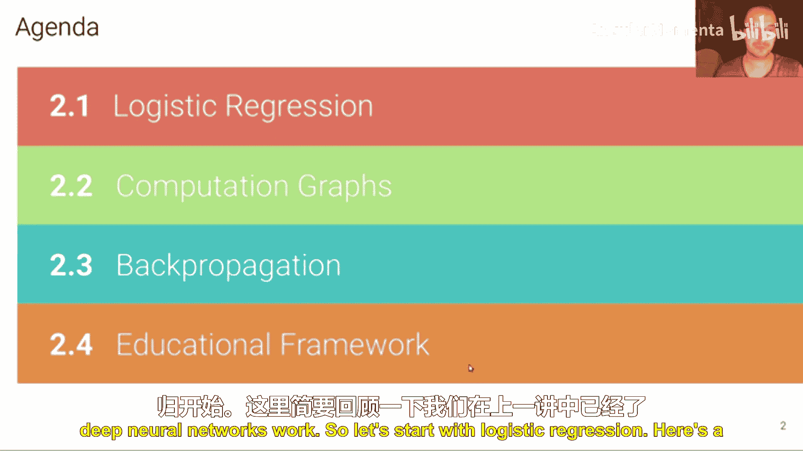
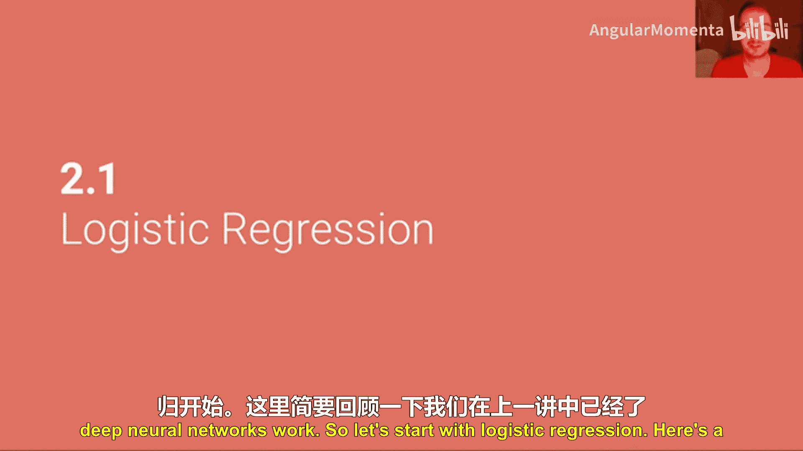
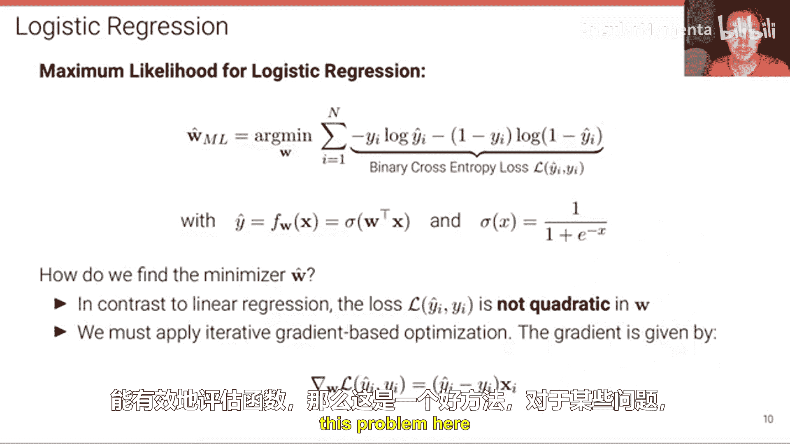
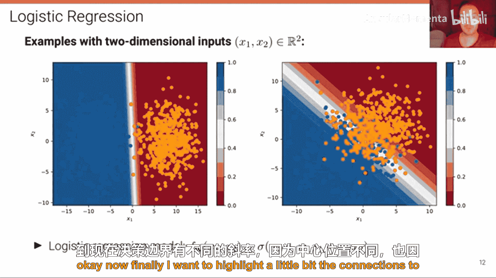
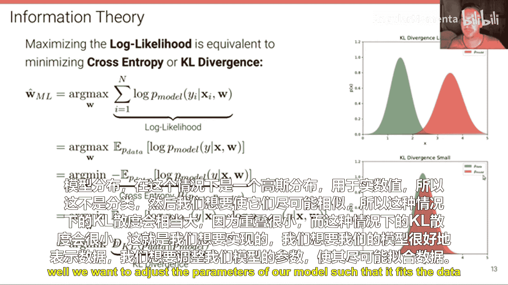

# 014：逻辑回归与计算图

在本节课中，我们将要学习分类问题，并引入逻辑回归模型。我们还将初步了解计算图的概念，这是理解深度神经网络工作原理的重要一步。

上一讲我们讨论了线性回归及其最大似然解释。本节中，我们来看看分类问题，特别是二分类问题。

## 逻辑回归问题

以下是监督学习问题设置的简要回顾。

我们有一个模型，它试图从输入 X 预测输出 Y。该模型 F 由参数 W 参数化。在机器学习中，我们需要解决两个基本问题：学习问题和预测问题。学习问题是从训练集中估计模型的参数 W。训练集由 X 和 Y 对组成。学习之后，我们固定参数 W，然后可以使用该模型对未见过的输入 X 进行新的预测 Y。

上次我们讨论了回归问题，其中输出是一维实数。今天，我们将考虑分类问题。输入同样可以是任何结构化对象。输出是一个二元变量，因为它只有两种可能性。例如，我们试图对图像进行分类，判断它是否描绘了海滩。

我们已知条件最大似然估计器。更准确地说，我们通常使用对数似然估计器，这出于数值稳定性、数学原因以及与信息论概念的联系等考虑。我们将其估计值记为带“帽子”符号的 W_hat。

现在我们要执行二分类。输出只能取两个可能的离散标签，为简化起见，设为 0 或 1。问题在于，在这种情况下我们应该如何选择模型分布？高斯分布不是一个好的选择，因为它建模的是连续分布。伯努利分布是适合此问题的分布，它精确地建模了这个二分类问题。

伯努利分布如下所示。其中 y_hat 是某个模型的预测值。y 是来自我们数据集的真实标签。如果 y 是 0，则选择 (1 - y_hat) 项。如果 y 是 1，则选择 y_hat 项。可以将 y_hat 视为预测正类（类别 1）的概率。

y_hat 是依赖于输入 X 和可训练参数 W 的预测值，我们将其记为函数 F_W(x)。为了简化公式，我们暂时继续使用 y_hat 这个符号。

总之，我们假设伯努利分布，其中 y_hat 是 F_W(x) 的简写。另一个问题是我们应该如何选择 y_hat 或 F_W(x)。模型分布是一个离散分布，因此 F_W 必须在 0 和 1 之间，必须是一个适当的概率。

我们如何有效地实现这个要求？我们可以使用所谓的压缩函数或 sigmoid 函数。我们选择 F 作为线性函数的 sigmoid 函数。Sigma 表示 sigmoid 函数，其表达式为 1 / (1 + e^{-x})。

我们取权重和 x 的线性组合，然后通过一个非线性变换 sigma。我们选择这种形式的 Sigma 是因为它是一个特殊的形式。sigmoid 函数 sigma 将无界的实数范围映射到 0 到 1 的区间，这正是我们需要的，因为该函数的输出必须在 0 和 1 之间才能成为一个概率。

这也被称为逻辑回归的原因，因为这是逻辑函数，有时也称为逻辑传递函数。这是处理分类问题时的要求。

现在让我们把它们结合起来。我们使用之前的最大似然估计器。对于模型分布，我们在此处插入伯努利分布，其中 y_hat 是 W^T x_i 的 sigmoid 函数。

由于我们有这个表达式的对数，我们可以稍微转换一下。我们可以将乘积的对数拆分为对数的和。然后，我们可以通过在前面加上负号，将最大化问题转化为最小化问题。在机器学习中，我们通常不最大化似然，而是最小化损失函数，这就是我们这样写的原因。

后面这个项在机器学习社区中有一个特定的名称，称为**二元交叉熵损失**。我们用符号 L 表示损失。高损失是不好的，低损失是可取的，因此我们希望最小化损失。我们希望计算所有数据点上这些个体损失总和的最小值。

在机器学习中，我们经常使用更通用的术语“损失”而不是线性回归中使用的“误差”。原因是损失项更通用。它不一定是观测值之间的误差，它也可以是，例如，我们想要编码的归纳偏差，或者是对网络权重的正则化器，或者是一些更难以描述为误差的复杂对象。损失函数是一个更通用的术语。

这个公式有以下解释：我们想要最小化的是经验数据分布 P_data（由训练集定义）和模型分布之间的差异。我们想找到模型的参数，使得模型的预测与我们的数据最相似，实际上两个分布是相同的。

## 二元交叉熵损失

现在我们只看单个数据点 i 的这个表达式，这就是我在这里写下的二元交叉熵损失。

我们可以将二元交叉熵损失重写如下：如果 y_i 等于 1，那么我们考虑第一项，因为第二项消失了（1-1=0）。如果 y_i 等于 0，那么第一项显然消失。如果真实标签是 1，我们考虑蓝色曲线；如果真实标签是 0，我们考虑红色曲线。

我们希望最小化这条曲线。这些曲线何时最小？对于 y 等于 1 的蓝色曲线，如果预测值 y_hat 也接近 1，我们得到一个较小的值。相反，如果预测值接近 0 而真实标签是 1，则损失很高。类似地，对于真实标签为 0 的情况，我们希望最小化损失，使得预测值 y_hat 也接近 0。这非常直观。

实际上，这意味着如果对于数据点 i，预测的 y 接近或等于真实的 y，则损失 L 最小。这个损失函数可以扩展到两个以上的类别。我们可以将其视为概率，在有两个类别的情况下，因为这是一个二维单纯形，我们这里有 1 减去第一项，但我们可以考虑更高阶的单纯形，其中有多个输出，是超过两个类别的离散分布。我们将在后面的讲座中讨论这个问题。

让我们更直观地看一下这个结果。一个简单的一维例子：在 x 轴上是我们的一维特征输入。然后我们想在正类和负类之间进行分类。我们从数据中观察到的只是 x 值，然后我们想判断特定的 x 值是属于正类还是负类。可以看到它们是离散的，只取值 1 或 0。

这是数据集：我们有一组绿色的正样本和一组红色的负样本（负样本对应 y_i = 0）。我们想要拟合一个逻辑回归模型，它具有这样的逻辑曲线。这是一个非常简单的模型，基本上只采用偏置加上权重乘以这里的 x 值，这是一个非常简单的线性项，然后通过图中所示的非线性变换。

如何用概率和损失函数来解释这一点？分类器的概率就是这条曲线。对于正样本，用这些绿色条显示，每个绿色条基本上一直延伸到曲线，因为这是模型分配给这些正值的概率。

对于正值，这并不理想。即使总体上这是理想的分类器，例如，这个数据点的样本仅以大约 0.4 的概率被分类为正值，因此根据我们的分类器，它属于负类的机会更高。但我们想要优化的标准是，对于所有数据点，我们希望最大化这些被正确分配的概率。

不幸的是，仅凭这些特征，不可能完美地做到这一点，因为我们不仅有正点，还有负点，这些是负点的概率。在左侧，我们相当有信心。对于这个异常值，我们实际上有更高的概率属于正类区域。我们必须保持这种平衡，我们想要训练一个代表整个数据集的分类器。这就是我们计算的交叉熵的总和，它平衡了这些数据点的影响。

现在我们可以把所有这些概率放在一起。我们可以把它们放在底部。同样，红色是负类，绿色是正类。我们现在想要优化的基本上是这些概率，我们希望最大化它们，或者等价地，我们希望最小化负对数，这就是这里的负对数。例如，这个被错误分类的红点，其正确类别的概率很低，损失也很高。这是有道理的。然后我们要做的是最小化所有这些负对数概率的平均值或总和。这基本上就是我们在做的事情的直观理解。

## 模型优化

现在，这是我们一直在研究的逻辑回归的完整最大似然模型。我们试图找到最优权重 W，它是所有数据点上的二元交叉熵损失，其中模型通过线性函数的逻辑函数来预测 y_hat。

现在的问题是，我们如何实际优化这个？在线性回归的情况下，这很容易，因为损失是 W 的二次函数。现在，在这种情况下，损失不再是 W 的二次函数。如果你看这个损失，W 出现在 sigmoid 内部，这已经是一个非线性函数，然后我们通过这个非线性函数，再取这个非线性函数的对数，这也是一个非线性函数，所以这是线性模型的高度非线性变换。因此，我们没有像在线性回归任务的二次情况下那样简单的表达式。

在这种情况下，如果没有封闭形式的解析解，我们需要应用一些基于梯度的迭代优化技术。幸运的是，我们可以计算梯度。因此，我们可以使用基于梯度的优化器，从某个初始化开始，沿着梯度缓慢地到达局部最小值。实际上，在这种情况下，情况很好，因为尽管这不是一个容易最小化的二次函数，我们需要应用这个迭代算法，但它仍然是一个凸函数。可以证明这个问题是一个凸问题，所以我们知道如果我们应用基于梯度的优化，我们不会陷入局部最优，最终会得到全局最优，这很好。但我们不能一步或解析地达到它，我们需要应用迭代的基于梯度的算法。

对于所有需要梯度的基于梯度的优化算法，我们需要计算这个梯度。这是 Nabla 算子，简单地说，我们想计算这个函数相对于 W 的梯度向量。

好在机器学习中，这些机器学习问题的损失函数通常实际上是一个一维量，这里也是如此。这意味着这不是一个雅可比矩阵，而只是一个向量，它是一个一维量，我们为其计算相对于多个权重的导数。关于这个特定目标函数的好处是，尽管第一步求梯度看起来相当复杂，但当你进行解析推导时，它会大大简化，这是二元交叉熵损失对于这个逻辑回归模型的梯度的最终形式。它有一个非常简单的形式：(y_hat - y) * x。

既然我们能够解析地计算这个梯度，我们就可以将其应用于迭代的基于梯度的优化器中，该优化器试图逐步走向最优值。我们可以使用的最简单的优化器，也是如今在深度学习中大量使用的，称为梯度下降。我们选择步长 eta 和容差值 epsilon，然后需要初始化我们优化的权重，记为 W_0。上标是时间或迭代索引。然后我们重复直到这个向量 V 小于某个 epsilon。我们迭代一个计算梯度的过程。这个向量 V 就是整个数据集上函数的梯度。我们可以将这个梯度算子拉到数据点的求和内部。所以我们需要做的实际上是计算损失的总和。当我们计算那个梯度时，我们可以把这个梯度拉到求和内部，这就是这里发生的情况。然后我们优化这个，直到梯度变小，直到我们收敛到这个函数的一个极值。

有几种变体效果更好。一种是线搜索，你沿着梯度的方向前进，但搜索最小值。如果你能高效地评估函数，那么这样做是很好的。对于某些问题，你甚至可以通过使用共轭梯度法做得更好，你不是沿着梯度的方向，而是沿着某个共轭方向，这能更直接地带你到最优值。还有其他技术，如 LBFGS 等。但所有这些技术的共同点是它们都需要梯度。这就是我们为此问题解析推导出的结果。

## 逻辑回归拟合结果

现在让我们看看使用这种迭代梯度优化器进行逻辑回归拟合的一些结果。这是一个二维示例。底部的公式显示，函数 F_W 现在基于两个输入 x1 和 x2，是一个二维域。我们有一个基于这些变量的线性组合加上某个偏置项 w0 的逻辑函数。当我写粗体 X 时，我指的是一个 x 向量，通常我也在那里包含偏置值。这意味着如果我写一个粗体，第一个元素总是 1，然后其他元素是 x1, x2 等。对于这个简单的二维情况，我把它写得很明确，所以我们有偏置，我们有三个权重，但有两个输入。

我们有两个不同的数据集。在左侧，蓝点是正类，红点是负类。我们尝试拟合这个逻辑回归模型。可以看到这产生了一个线性决策边界。但我们也能优化斜率，这给了我们一些关于混淆的指示。白线表示 0.5 的位置，我们会将一个新点分类为恰好可能属于两个类别。如果它稍微在白线右边，我们的分类器更可能将其分类为负类；如果稍微在左边，则更可能分类为正类。

在右侧，情况略有不同，因为这两个数据集、这两个簇重叠更多，所以混淆更多。它们的排列也略有不同，中心与这里不同。你可以看到现在决策边界有不同的斜率，因为中心位于不同的位置，也因为点之间有更多的混淆，分类器也通过具有较小的斜率表现出相同的更多混淆行为。因此，蓝类和红类之间的过渡不像这里那样迅速。这可以通过权重 w0, w1, w2 来建模，即这个 sigmoid 函数的斜率。

## 与信息论的联系

最后，我想强调一下与信息论的联系，尽管我们时间不够，无法深入细节，但联系非常紧密且有趣。特别是，最大化对数似然实际上等价于最小化交叉熵或 KL 散度，这两者都是信息论中的基本量。

在顶部，我们有我们的对数似然最大化问题。这与之前相同，我们有模型分布。我们想找到参数 w，最大化所有数据点上模型概率的对数和。这被称为对数似然。

我们可以使用期望来重写这个。我们在这里所做的实际上是查看数据分布上的经验估计。如果我们在这里写 1/N，那就是均值，那么我们将查看数据分布的经验估计。但 1/N 相对于 W 是常数，所以它被吸收到 argmax 算子中。但暂时把这个方程看作开头有 1/N。那么这将完全对应于期望算子的定义，这基本上是对数据点概率的期望。每个数据点都是基于抽样的估计。所以我们现在有 y 和 x。如果我在这里写一个期望，因为空间不够，我只写 P_data 的期望，因为我们知道期望是关于什么的，是关于数据分布的，即 (x, y) 对。更正确地说，我本应在这里写一对括号 (x, y)，从数据分布中抽样，这实际上就是这里发生的情况，我们有来自数据分布的 n 个样本，这就是为什么它等价于为这些样本 x 和 y 写关于数据分布的期望。然后在参数中是与这里相同的项。

所以我们有关于数据分布的模型分布的期望。当然，我们可以用 argmin 来写这个 argmax，如果我们在这里把加号换成减号，和之前一样。我们这样做是因为现在这变成了信息论中一个非常著名的量，称为交叉熵，它是数据分布和模型分布之间的交叉熵，并且与熵和 KL 散度有紧密联系。

我们也可以做的是，我们可以取这个项，并在这个参数内部添加对数数据概率 P_data(y|x)。为什么我们可以这样做？因为数据概率，这个数据分布不依赖于 w，所以它改变了这个函数的值，但相对于 W 是常数，所以我们可以直接加上它。这不会改变这个表达式的最小化器。所以这样写是正确的。现在，我们这里的最后一项与这个期望一起，如果你把它分解进去，它也是一个线性算子。是交叉熵，第一项只是数据分布的熵。

所以我们看到，我们有效地有交叉熵减去熵。这在信息论术语中称为 Kullback-Leibler 散度（KL 散度）。KL 散度是一种散度，它是两个分布相似性的度量，这就是我们在本单元前面已经提到的。所以我们试图最小化的，这里有一个很好的直观理解，通过计算参数的最大似然估计，我们试图最小化两个分布之间的距离，更准确地说，是由数据集给出的经验数据分布与给定其参数 w 的模型分布之间的距离。

这是一个例子。假设绿色的是数据分布，红色的是模型分布（对于实数值的高斯分布，而不是分类）。那么我们想让它们尽可能相似。所以这种情况下 KL 散度会相当大，因为重叠很小；而这种情况下的 KL 散度会很小。这就是我们想要实现的：我们希望我们的模型能很好地表示数据，我们希望调整模型的参数，使其尽可能好地拟合数据。

本节课中我们一起学习了逻辑回归模型，它用于解决二分类问题。我们引入了 sigmoid 函数将线性输出映射为概率，并定义了二元交叉熵损失函数。我们还探讨了如何使用梯度下降等迭代方法来优化模型参数，因为逻辑回归的损失函数没有封闭解。最后，我们了解了最大似然估计与最小化数据分布和模型分布之间的 KL 散度是等价的，这建立了与信息论的联系。这些概念是理解更复杂神经网络模型的重要基础。