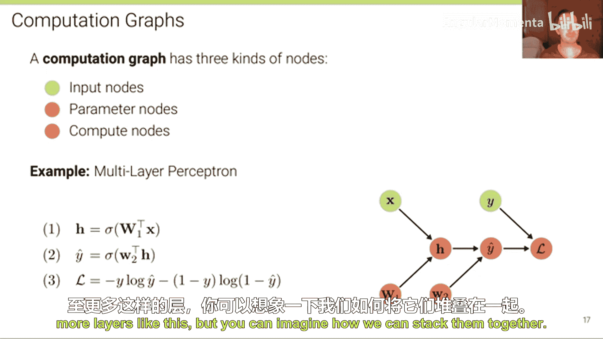

# 015：计算图 🧮

在本节课中，我们将学习**计算图**这一核心概念。计算图是理解复杂计算、以及在这些长计算链中高效计算梯度的基础工具。

## 概述

上一节我们讨论了逻辑回归模型的最大似然估计。本节中，我们来看看如何通过计算图来分解复杂计算，并高效地计算梯度。

## 计算图简介

在之前的幻灯片中，我们看到了逻辑回归模型的最大似然估计量。

最小化这个估计量需要求解一个没有解析解的非线性目标函数，因此必须使用基于梯度的优化器。这意味着我们需要计算这个表达式的梯度。

幸运的是，在上述逻辑回归的例子中，梯度计算相对简单。其公式为：预测值减去真实标签，再乘以输入数据点 `i`。公式可以表示为：

**梯度公式：** `∇ = (ŷ_i - y_i) * x_i`

然而，对于本课程感兴趣的更复杂模型（尤其是深度神经网络），梯度计算通常不会如此简单。这些模型包含大量计算层，我们无法通过纸笔手动推导出数百万乃至数十亿参数的梯度。

因此，核心问题在于：我们如何高效地计算一般情况下的梯度？这个问题在深度学习历史上曾长期存在。直到20世纪80年代，人们首次证明了高效计算梯度的可行性，这推动了深度学习的突破。

## 计算图的核心思想

计算图的核心思想，是将复杂的计算分解为一系列非常简单的、原子级的赋值操作序列。我们称这个序列为**计算图**，也有人称之为“源代码”，因为它就像一行行执行的计算机程序或汇编代码。

**前向传播**接收训练点 `X` 和 `Y` 作为输入，并计算出一个损失值。正如我们将看到的，这个损失的梯度可以通过**反向传播**（或称后向传播）来计算，这也就是下一单元要讲的**反向传播算法**。

本幻灯片的关键信息是：**前向传播和反向传播都可以高效计算**。这是因为我们可以利用**动态规划**的思想，即存储并重用中间结果，而不是在每次前向或反向传播时都重新计算它们。这种计算的分解与重用，是反向传播算法成功的关键。没有它，我们将无法将算法应用于如今规模庞大的模型。优化拥有数百万或数十亿参数的深度网络将是不可想象的。正因如此，能够调整深度模型中海量参数的反向传播算法，至今仍是深度学习的核心驱动力。

## 计算图的构成

现在，让我们具体看看计算图是什么。在本课程中，我们将计算图定义为包含三种节点的结构：

*   **输入节点**（绿色）：没有参数，是学习问题的输入，即数据集进入计算图的地方。例如，图中的 `x` 和 `y`。
*   **参数节点**（橙色）：存储模型的参数。这是我们想要更新的部分。在反向传播梯度时，我们最终感兴趣的就是这些参数的梯度，因为更新将应用于此。
*   **计算节点**（红色）：执行计算操作。在我们的设定中，损失函数也是一个计算节点。中间的计算节点接收输入（例如输入节点、之前的计算节点或参数），并产生一个结果，完成一次变量赋值。

通过这种图形化的表述，我们可以将复杂计算分解为一系列更简单的计算。

## 计算图实例：线性回归

这里我们看一个线性回归的具体例子。在线性回归中我们需要做什么？右侧的“源代码”展示了我们需要计算的四行赋值代码，可以将其视为汇编代码。

以下是计算步骤：

1.  首先，将一维输入 `x` 与一维参数 `w1` 相乘，结果赋值给变量 `u`。代码表示为：`u = w1 * x`
2.  接着，加上偏置项 `w0`，将 `u` 与 `w0` 相加，结果赋值给预测值 `ŷ`。代码表示为：`ŷ = u + w0`
3.  然后，从预测值 `ŷ` 中减去真实值 `y`，得到差值并赋值给变量 `c`。代码表示为：`c = ŷ - y`
4.  最后，为了计算L2损失，我们对差值 `c` 取平方，并将结果赋值给损失变量 `L`。代码表示为：`L = c²`

这就是我们将线性回归问题（本可以写成一行）分解为一系列原子操作序列的方式。

## 计算图的粒度

我们可以选择不同级别的**粒度**。上面的例子使用了非常精细的粒度。但我们也可以使用更粗的粒度，这取决于我们希望这些原子单元有多大，以及我们能处理何种级别的原子操作。

例如，在您将使用的教育框架中，可能有一个负责**仿射变换**的单元，它同时包含了乘法和偏置加法。在这种情况下，我们可以将步骤1和2合并，计算图随之改变。现在，步骤1和2坍缩为一步，直接从 `x` 计算 `ŷ`。

我们还可以将损失计算也合并，例如直接计算 `(ŷ - y)²`。这样，整个计算图可能只剩下两个计算步骤。因此，书写计算图有多种方式，具体取决于我们想如何实现以及我们能高效实现多复杂的操作。

## 更多示例：逻辑回归与多层感知机

以下是逻辑回归的另一个例子。输入 `x` 首先经过一个仿射变换（参数为 `w0`, `w1`）得到 `u`，然后 `u` 通过一个非线性σ函数（如Sigmoid）得到预测值 `ŷ`。最后，使用二元交叉熵损失函数比较 `ŷ` 与真实标签 `y`。

我们也可以用向量形式表示，用一个权重向量 `w` 和一个扩展的输入向量 `[1, x]`（以包含偏置）来简化表示。在实际的教育框架中，我们将使用向量操作。

我们还可以将两个这样的操作堆叠起来。这已经是对下一讲（第3讲：多层感知机）的初步预览。多层感知机是我们考虑的第一个深度模型，它之所以“深”，是因为它拥有超过一层（这里指除输入层外的层）。在本例中，我们有一个隐藏层和一个输出层，共两层。而逻辑回归模型只有输出层一层。

在这个计算图中：
1.  输入 `x` 通过权重矩阵 `W1` 进行仿射变换。
2.  结果向量经过元素级的非线性函数（如ReLU），生成隐藏特征向量 `h`。
3.  向量 `h` 再与权重向量 `w2` 相乘得到一个标量。
4.  该标量通过Sigmoid非线性函数得到预测值 `ŷ`。
5.  最后应用二元交叉熵损失。

通过这个例子，你已经可以看到我们如何优雅地使用计算图来建模不同粒度，以及如何堆叠更大的计算。这仍然是一个非常小的模型。在本课程后面，我们将讨论拥有50、100甚至更多层的深度网络，但你可以想象我们如何将它们连接在一起。

## 总结

本节课中，我们一起学习了**计算图**的基本概念。我们了解到，计算图通过将复杂计算分解为原子操作的序列，并利用动态规划思想存储和重用中间结果，使得前向传播和反向传播都能高效进行。这是现代深度学习能够训练海量参数模型的基础。我们还通过线性回归、逻辑回归和多层感知机的例子，直观地看到了计算图的构建方式和不同的粒度选择。理解计算图是掌握后续反向传播算法的关键一步。