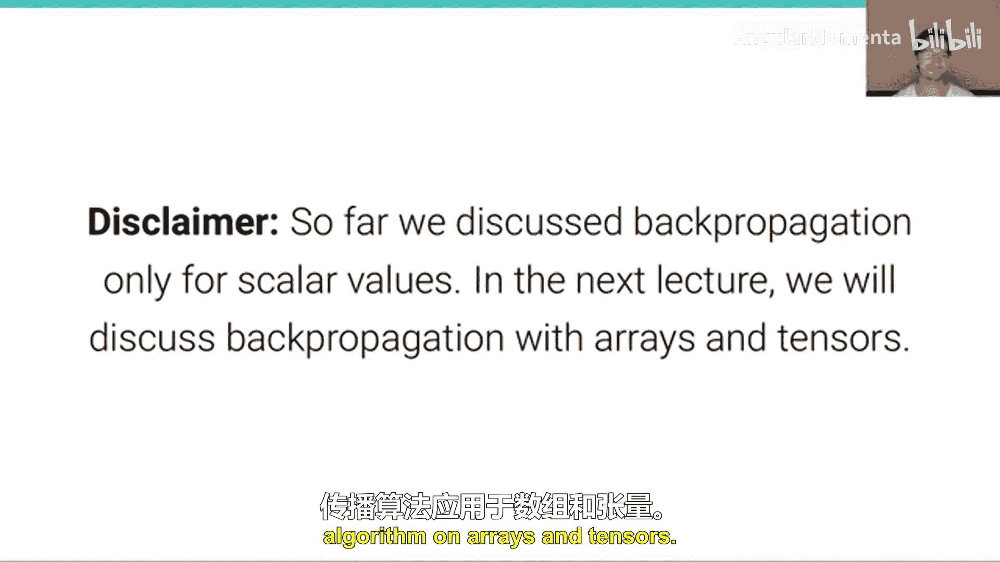

# 016：计算图与反向传播 🧠

在本节课中，我们将要学习深度学习中的一个核心算法：反向传播。我们将看到如何通过计算图来高效地计算复杂损失函数关于数百万参数的梯度，这是训练神经网络的基础。

## 概述

在第三单元中，我们终于要介绍反向传播算法。

请记住，大多数最大似然问题没有闭式解。因此，我们需要利用基于梯度的优化技术。为了使用这种基于梯度的优化器，我们需要找到模型负对数似然关于模型参数 **W** 的梯度。

更一般地说，我们想要做的是关于参数 **W** 优化一个损失函数。这里我们有一个用花体 **L** 表示的损失函数，它依赖于一个数据集。粗体的 **y** 和 **x** 再次表示整个数据集，按行堆叠，以及参数向量 **W**。

如果我们根据单个数据点将其写出来，我们得到所有数据点之和的梯度，因为我们假设数据是独立同分布采样的，所以这是每个数据点的损失函数项 **L(y_i, x_i, W)**。**n** 表示我们数据集中的数据点数量。

因为梯度算子是线性的，我们可以将其提取到求和符号之外。所以这等于所有数据点的损失函数关于参数 **W** 的梯度之和。在这个符号中，我使用了 **x_i** 和 **y_i** 作为数据集元素。

在接下来的内容中，我们将考虑关于单个数据点的梯度计算，所以我们只关注这里的这个表达式。如果我们想找到关于整个数据集的梯度，我们只需要对所有为每个数据点估计的梯度进行求和。

所以基本上，从这个表达式，我们得到一个向量，它是这个标量值损失函数关于所有参数的梯度，在我们的神经网络中可能有数百万个参数。然后我们为每个数据点 **i** 计算这样一个梯度向量，然后我们对所有数据点的这些梯度向量进行逐元素求和，以获得关于整个数据集总损失函数的梯度向量。

一旦我们有了这个梯度，我们就可以沿着梯度方向迈出一步，这被称为梯度下降。因此，关于整个数据集 **X** 的梯度是通过对所有单个梯度求和得到的。在接下来的幻灯片中，我们将看看如何实际高效地计算这些梯度，这并非易事，因为在大型神经网络中，我们有数百万个这样的参数。因此，这个计算必须非常快，因为我们需要进行很多梯度下降步骤才能到达局部最小值。

## 链式法则：反向传播的基石

为了理解反向传播算法，我们基本上只需要理解一个规则，这个规则我们在高中就已经知道了，那就是链式法则。

链式法则告诉我们，如果我们有两个函数 **F** 和 **G** 的串联，这里我们有一个函数 **F**，它依赖于函数 **G** 的结果，而函数 **G** 依赖于某个值 **x**。那么函数 **F** 关于变量 **x** 的导数等于函数 **F** 关于函数 **G** 的导数乘以函数 **G** 关于 **x** 的导数。

所以这是链式法则的最简单形式。现在，我们在这节课中还需要用到所谓的多元链式法则。

多元链式法则关注的是函数的组合，其中在一个函数的参数中，我们有一组函数，这些函数中的每一个都依赖于同一个变量 **x**。这就是这两者之间的区别：这里我们只有 **f(g)**，而这里有 **f(g1, ..., gm)**，所有这些函数 **g1** 到 **gm** 都依赖于同一个变量 **x**。我们想要计算的是这个函数组合关于变量 **x** 的导数。

多元链式法则告诉我们，这个导数就是所有单个链式法则的和。所以是 **F** 关于 **g_i** 的导数乘以 **g_i** 关于 **x** 的导数，然后对所有函数 **i** 求和。

这两个规则真的是我们在整个讲座中将要应用的唯一内容。

## 一个简单的例子：链式法则的应用

让我们看看反向传播算法的最简单形式，这是最基本的例子之一，基本上只是链式法则的一种略微不同的形式。

目前，我们不对节点类型做任何区分。请记住，在计算图中，我们定义了输入节点、参数节点和计算节点。现在，我们只考虑节点，所以这里所有的节点都是红色的。这是我们之前用于计算节点的颜色，但此刻我们不打算做任何区分。我们唯一想做的就是计算关于这些节点中任何一个的梯度。

所以我们想计算这个最终输出节点的梯度，我们在这里称之为 **L** 表示损失。实际上，在这种情况下，它不一定是一个损失函数，也可以是 **C** 等。在这个简单表达式中，它不一定是损失，但因为我们在后面总是将损失视为输出节点，所以我也在这里使用了损失符号。我们感兴趣的是这个损失关于损失本身、变量 **y** 或变量 **x** 的梯度。

这是一个非常简单的计算图，其中 **y** 依赖于 **x**，**L** 依赖于 **y**。我们想要在这里表达的表达式就是 **L = 2 * x^2**，并且我们按照上一讲讨论的方式，将其分解为计算图中的原子操作，如下所示。

第一步，我们计算 **y** 作为 **x** 的平方。第二步，我们计算 **L** 作为 **2 * y**。将两者组合，我们得到 **2 * x^2**。

现在我们要做的是，在运行这个前向传播之后，也就是在计算了特定输入 **x** 的 **L** 值之后，我们将运行一个所谓的反向传播。这就是反向传播名称的由来。所以我们将首先沿着黑色箭头的方向运行前向传播，以便从输入 **x** 计算 **L**。

假设 **x** 为 1，那么我们将有 **L = 2**。然后我们将运行反向传播，我将在接下来的幻灯片中用蓝色箭头表示，同时我们从输出节点（在我们的例子中总是 **L**）反向传播梯度到每个单独的节点，这样在每个单独的节点，我们都可以读出关于该节点的梯度，即 **L** 关于这些节点中每一个的梯度。

我将在这里使用两种不同的颜色来表示两种不同类型的量。我将使用红色表示反向传播的梯度。我将使用蓝色表示局部梯度，即基于这里的赋值公式、基于特定节点存在的局部函数形式局部计算的梯度。

反向传播从输出节点 **L** 开始。它向后计算梯度。它做的第一件事是计算 **L** 关于自身的梯度，这显然是 1。所以 **L** 关于 **L** 的偏导数是 1。

请注意，在这个符号中，我们总是在某种程度上滥用导数运算符。所以我们总是使用偏导数来表示我们正在计算关于该整个表达式中任何可能参数的导数。即使那个参数可能只出现在该表达式的内部函数中。所以每当我写 **L** 关于任何变量的偏导时，我指的是输出节点关于这些内部变量中任何一个的梯度。

为了现在计算 **L** 关于 **y** 的梯度（这是我想先做的，我把它写在 **y** 下面的底部），我需要做的是应用链式法则，即我需要计算 **L** 关于 **L** 的梯度乘以 **L** 关于 **y** 的梯度。

在这里看起来有点荒谬，因为我们真正感兴趣的只是 **L** 关于 **y** 的梯度。但你会看到，如果我们在这个简单的计算图中进一步向后走，以这种形式书写是有意义的。

显然这是正确的，如果我们把这里的 **L** 消掉，那么这和 **L** 关于 **y** 的梯度完全一样。那么 **L** 关于 **y** 的梯度是多少呢？它是 2，我们可以从这个表达式中看到。所以 **L** 关于 **y** 的梯度是 **L** 关于 **L** 的梯度乘以 **L** 关于 **y** 的梯度，即 1 乘以 2，等于 2。所以我们现在已经将梯度反向传播到这里。

现在我们可以再向前一步，我们从第二个表达式这里向后走，现在我们在计算第一个表达式，关于第一个变量的梯度，这是我们在前向传播中首先计算的。

我们做完全相同的事情。所以现在我们计算 **L** 关于 **x** 的梯度。这就是我们想要计算的。这正好是我们发送到这里的信息，再次是链式法则：它是 **L** 关于 **y** 的梯度乘以 **y** 关于 **x** 的梯度。显然这是正确的，这和 **L** 关于 **x** 的梯度相同，因为这里的偏 **y** 消掉了。

现在，**L** 关于 **y** 的梯度我们已经计算过了，这是从这个节点反向传播的梯度，我们已经将其反向传播到这里，所以这是我们在前一次迭代中已经计算好的东西。

所以我们现在唯一需要做的就是乘以局部梯度，即 **y** 关于 **x** 的梯度，也就是 **2x**。这就是这里发生的情况：**L** 关于 **x** 的梯度等于 **L** 关于 **y** 的梯度乘以 **y** 关于 **x** 的梯度。而 **L** 关于 **y** 的梯度是我们在这一点计算的值乘以 **2x**，这是一个局部梯度。现在我们已经找到了 **L** 关于 **x** 的梯度。

你可以想象，我们可以在这样的链或树中进一步向后走，以便将梯度反向传播得更远。我们最终感兴趣的当然是反向传播梯度到参数函数的权重，比如逻辑回归器或神经网络。我们将在接下来的幻灯片中看到这一点。

## 具体数值示例

这也许有点抽象，所以让我们把它变得非常具体。

我们在这里做的是插入实际的数字。所以 **L** 关于 **L** 的梯度是 1。我们把它插在这里，然后乘以 **L** 关于 **y** 的梯度，即 2。1 乘以 2 是 2。所以这里的梯度，**L** 关于 **y** 的梯度，就是我们在这里计算的值。我们已经将其反向传播到这里。可以想象这些箭头反向传播了从先前节点和局部梯度计算出的梯度到这个位置，所以我们只是把它复制到这里。

现在这个值来到这里，它是这里相同的表达式。我们再次乘以它，我们将反向传播的梯度（在这种情况下不是 2）乘以局部梯度，即 **2x**。所以我们得到 **4x**。我们将这个梯度 **4x** 发送到这个位置，所以我们在这里得到 **4x**。

正如你所看到的，**L** 关于 **x** 的梯度显然是 **4x**。当然，当你在计算机上实现这个以进行实际的前向和反向传播时，你会为 **x** 填入实际的值，即当前输入和输出的值。你也知道参数向量 **W** 的当前状态值。对于 **x** 和 **y**，以及对于 **W**（我们这里还没有 **W**，我将在下一张幻灯片中看到），但在特定迭代中的所有值，我们都有已知的值。所以我们总是会插入实际的梯度，而不是这里的这些符号梯度，但我们实际上会有我们在这里输入的真实值。

## 抽象形式与分支情况

我们已经让它更具体了一些，现在让我们再次让它更抽象一些。

我在这里所做的是用抽象函数替换了这些函数的具体定义。所以我在这里写的是，不是 **y**，而只是函数 **y(x)**；不是 **L**，而只是损失函数 **L(y)**。所以表达式读起来像这样：**L(y(x))**。这是我能表达这个特定计算图的最通用形式。

在这个小的通用形式中，我有反向传播：**L** 关于 **y** 的梯度是节点 **L** 处的梯度乘以局部梯度。因为这总是 1，所以我这里只有局部梯度。然后 **L** 关于 **x** 的梯度，这里的这个值，是 **L** 关于 **y** 的梯度（即我之前计算的）乘以 **y** 关于 **x** 的梯度（这里的局部梯度），通过反转这个箭头。

所以这是最简单的例子，基本上只是应用了两次链式法则。现在让我们看一个稍微困难一点的例子。这是一个我们有一个出度大于 1 的情况的例子。出度指的是从一个特定节点出发的连接数量。之前我们有一个链，所以每个节点都有一个出站连接，现在在这种情况下，**y** 有多个出站连接。**y** 发送到 **u** 和 **v**。

所以我们在这个特定情况下看这个损失函数：**L(u(y(x)), v(y(x)))**。这个例子中的前向传播如下所示。

**y** 被计算为 **y(x)**。所以这是我们在输入 **x** 处评估的关于 **x** 的函数。然后我们评估 **u(y)** 和 **v(y)**，就是这两个。我在这里使用了相同的迭代编号，因为它们基本上是同时处理的，所以它们是分支出来并同时处理的。然后我们有 **L**，它同时依赖于 **u** 和 **v**。

现在让我们计算反向传播。再次从输出节点 **L** 开始。我们有 **L** 关于 **u** 的梯度，是 **L** 关于 **L** 的梯度（即 1）乘以 **L** 关于 **u** 的梯度。类似地，**L** 关于 **v** 的梯度是 **L** 关于 **L** 的梯度乘以 **L** 关于 **v** 的梯度。

到目前为止一切顺利。这是第三步。现在让我们看第二步，再向前一步。**L** 关于 **y** 的梯度是多少？现在情况与之前不同了。在这种情况下，**u** 和 **v** 都将梯度信息发送到这个变量 **y**。即，**u** 发送 **L** 关于 **u** 的梯度（这是在 **u** 位置计算的值）乘以从 **u** 到 **y** 的局部梯度。类似地，**v** 发送 **L** 关于 **v** 的梯度（这是在先前反向传播算法迭代中存储在这里的值）乘以从 **v** 到 **y** 的局部梯度。

那么这个表达式应该读作什么？回想一下我们之前看到的多元链式法则，我们这里的情况完全相同。如果你看这个损失函数，我们有一个损失，它依赖于 **y**，而 **y** 是两个函数 **u** 和 **v** 的参数，**u** 和 **v** 都依赖于 **y**。所以如果我忽略 **y** 的参数 **x**，这个损失函数将读作 **L(u(y), v(y))**。

我们从多元链式法则知道，**L** 关于 **y** 的梯度是 **L** 关于 **u** 和 **u** 关于 **y** 的梯度之和，加上 **L** 关于 **v** 和 **v** 关于 **y** 的梯度之和。所以这仅仅是在一个特定节点处应用多元链式法则。这就是我在这里写的内容。当然，这两项都有蓝色的局部贡献和红色的反向传播全局贡献。

重要的是要记住，每当我们有这样一个出度大于 1 的情况，每当一个变量发送到多个变量，每当我们有像这样的表达式时，我们需要在反向传播过程中对梯度求和。这就是这里发生的情况。基本上就是这样。

然后在最后一步，因为我们还没有完成，我们计算 **L** 关于 **x** 的梯度，正如我们已经知道的，是 **L** 关于 **y** 的梯度（这基本上是我们在上一步中计算的和）乘以局部梯度 **y** 关于 **x** 的梯度。当然，这是一个抽象的例子，我们不知道每个单独函数的确切形式，所以除非我们详细指定这个函数，否则我们无法进一步研究。

## 算法实现思路

现在我们基本上已经准备好实现反向传播算法了。

我们如何在 Python 中实现这个反向传播算法？一个方便的方法，也是教育框架所做的，是将每个变量或节点视为具有某些属性的对象。例如，值和梯度。

假设我们有一个变量 **x**，它有一个值，这些值是在前向传播中计算的。它还有梯度，这些梯度在反向传播中被更新。

值是在前向传播中计算的，这基本上只是用 Python 写出这个程序，即赋值序列。在那里，**x** 的值基本上是输入，比如图像或任何作为输入进入模型的信号。然后我们有 **y** 的值，是函数 **Y** 在 **x** 值处的评估。然后 **u** 的值是函数 **U** 在 **y** 值处的评估。**v** 的值是函数 **V** 在 **y** 值处的评估，而 **y** 值已经在这里计算过了。最后，我们有损失函数，它简单地依赖于对损失函数 **L** 的评估，而 **L** 依赖于已经在这里计算出的 **u** 值和 **v** 值。

类似地，我们可以再看一下反向传播，我在这里使用了红蓝符号来表示它是梯度的反向传播全局分量还是梯度的局部贡献。

我们如何实现反向传播？首先，我们会将梯度设置为 0，因为我们将以加法方式更新它们，所以我们从将所有梯度（**x**, **y**, **u**, **v** 的梯度）设置为 0 开始。

然后我们从 **L** 关于 **L** 的梯度开始，我们知道它是 1。所以这是这里的这一项。每当我使用符号 **L.grad** 或 **U.grad** 时，我的意思基本上是损失（输出节点）关于该变量的梯度。例如，**y.grad** 是损失 **L** 关于变量 **y** 的梯度。

现在我们已经用 **L.grad = 1** 初始化了，现在我们可以计算 **U.grad**，所以这是这个方程：**L.grad**（即 1）乘以局部梯度 **∂L/∂U**，在前向传播中计算出的 **U** 和 **V** 值处评估。所以这里需要注意的是，我们需要前向传播中计算出的值，因为我们需要在这些特定位置评估梯度。所以这真的是一个具体的值，梯度函数在特定值处的评估返回的梯度值。梯度本身是一个函数，在这种情况下它在 **U** 和 **V** 处评估。

类似地，对于 **V**，它是 **L** 关于 **v** 的梯度，这是一个函数，在 **U** 和 **V** 的值处评估。

然后是 **y**，现在这是一个特殊情况，由于我们之前看到的多元链式法则，我们有一个和。所以我们在这里简单地执行这行代码两次：一次我们添加 **u** 的梯度贡献，一次我们添加 **v** 的梯度贡献。两者都是全局分量乘以局部分量，局部分量在 **y** 的值处评估。

最后，我们更新 **x** 的梯度，作为 **y** 的梯度乘以 **y** 关于 **x** 的局部导数，在 **x** 的值处评估。

## 机器学习实例：逻辑回归

让我们看一个更接近机器学习的真实例子，我这里展示的例子是我们之前已经见过的逻辑回归例子，也是在计算图前向传播的背景下。

这是我们之前已经见过的公式。**BCE** 表示二元交叉熵损失。

这里发生的基本上就是，我们有一个线性函数 **u**，它线性组合 **w0**, **w1** 和 **x**。所以是这个线性函数 **u**。然后我们有 sigmoid 操作，它返回 **ŷ**，并以 **u** 作为输入。最后，我们使用二元交叉熵函数将 **ŷ** 与 **y** 进行比较，该函数定义如下。

在顶部，由于空间原因，我只使用了缩写 **BCE**，所以这基本上就是左边整个表达式写成一行。

这是前向传播。现在让我们看看反向传播。特别是，我们想要做的是，在这种情况下，与之前不同的是，我们想要计算梯度，但我们并不对这个图中任何变量的梯度都感兴趣。例如，我们对这些绿色输入变量的梯度不感兴趣。我们可以计算它们，有时我们确实会计算，比如在风格迁移的情况下，输入实际上被修改了，这就是反向传播算法的美妙之处，它可以计算关于任何变量的梯度，甚至可以通过执行两次来计算二阶导数。

但在这里的情况下，当我们对训练参数和学习逻辑回归模型的参数感兴趣时，我们真正感兴趣的只是将梯度从 **L** 反向传播到 **w1** 和 **w0**，这样我们就得到了 **L** 关于 **w1** 和 **w0** 的梯度，然后这些梯度被用于我们迭代循环中基于梯度的优化，以更新模型的参数。

所以在这里你可以看到，我们现在使用了我们在前一单元中定义的相同符号，其中绿色是输入变量，橙色是参数变量。我们感兴趣的是关于参数的梯度。红色是计算节点。

让我们将反向传播算法应用于这个例子。再次，我们从 **L** 关于 **L** 的梯度开始，在输出节点处是 1。但我们不是反向传播到 **y**，我们只是反向传播到 **ŷ**。那么 **L** 关于 **ŷ** 的梯度是多少？它是 **L** 关于 **L** 的梯度（即 1，所以这部分消掉了）乘以 **L** 关于 **ŷ** 的梯度，它就是这个表达式。所以如果你计算这个项的梯度，你会得到这个表达式。

然后在第二步，我们计算 **L** 关于 **u** 的梯度，它是 **L** 关于 **ŷ** 的梯度（我们在上一步计算的）乘以 **ŷ** 关于 **u** 的局部梯度。而 **ŷ** 关于 **u** 的梯度就是 sigmoid 函数关于其输入的导数，即 **σ(u) * (1 - σ(u))**。

我建议将这两个推导作为练习，它们非常简单但也很有启发性，这样你就能看到如何从这个表达式得到这个表达式，以及从这个表达式得到这个表达式，它们都是这些表达式的梯度。

现在我们有了这些局部梯度相对紧凑的项。最后我们做的是，我们计算 **L** 关于 **w0** 的梯度，作为全局贡献，即从算法前一次迭代反向传播的梯度 **L** 关于 **u**，乘以 **u** 关于 **w0** 的梯度。而 **u** 关于 **w0** 的梯度是 1。所以我们最终得到 **L** 关于 **u** 的梯度。

我们可以对 **w1** 做同样的事情：关于 **w1** 的梯度是 **L** 关于 **u** 的梯度（从前一次迭代）乘以 **u** 关于 **w1** 的梯度。**u** 关于 **w1** 的梯度是 **x**。所以我们最终得到 **L** 关于 **u** 乘以 **x**。

当然，当我们在计算机上应用反向传播算法时，我们在前向传播中计算值，然后在反向传播中计算梯度，并立即在前向传播中计算出的值处评估它们。

## 总结

在本单元中，我们学到的是，我们可以将数学表达式写成计算图。这将复杂的表达式分解为更简单的计算，这些计算是可处理的，并且我们可以应用高效的动态规划来求解前向传播中的值和反向传播中的梯度。

因此，值在前向传播中被高效计算，梯度在反向传播中被高效计算。这确实是为什么反向传播至今仍然是深度学习的主要推动力的原因，因为它允许我们计算梯度，特别是使用并行计算硬件。这是一个高度可并行化的算法。

我们可以在几秒或几分钟内计算一个目标函数（损失函数）关于数百万甚至有时数十亿参数的梯度。

前向传播是前向方向，反向传播是反向方向。我们还看到，在反向传播中，如果有这种头对头的关系，多个传入的梯度会被求和。这里没有发生，但之前在这个例子中发生了，在多层感知机的情况下也会发生，在神经网络中相邻层之间有全连接关系，因此有很多节点发送到下一层的多个节点。这种求和是应用多元链式法则的结果。

关于这一点真正美妙的是链式法则的应用和这种模块化，即每个节点只需要知道如何计算关于其自身参数的梯度。这基本上就是我们在前面的例子中以蓝色显示的内容：我们只需要计算这些局部梯度，我们不需要知道图中任何其他节点的任何信息。它是高度分解的。如果我们能分解事物，这总是好的，它使事情变得更简单。

最后一点说明，当我们现在想要应用这个前向-反向传播（反向传播算法）来优化模型的参数（如逻辑回归器）时，我们当然需要计算整个数据集的梯度。我们刚刚讨论的只是关于单个数据点的梯度计算。我们取了一个数据点，并将其通过这个计算图，以便计算该单个数据点的损失。在这种情况下是 **x_i**，然后与 **y_i** 比较。但我们需要的是整个目标函数的梯度，假设数据是独立同分布的，它只是所有数据点的所有梯度之和。

所以我们需要有效地做的是多次应用这个反向传播算法，即应用与我们数据集中数据点数量相同的次数，以获得整个数据集的损失函数关于参数 **W** 的梯度。

因此，我们应用反向传播算法 **n** 次，得到梯度，然后利用这个梯度，我们可以在基于梯度的优化算法的内循环中执行一次梯度更新步骤。

一个小小的免责声明：到目前为止，我们只讨论了标量值的反向传播算法，但在下一讲中，我们将看到如何将反向传播算法应用于数组和张量。

本节课中，我们一起学习了反向传播算法的核心思想：通过计算图分解复杂计算，利用链式法则和多元链式法则，从输出层向输入层反向传播梯度，从而高效地计算出损失函数关于所有参数的梯度，为后续的梯度下降优化奠定了基础。