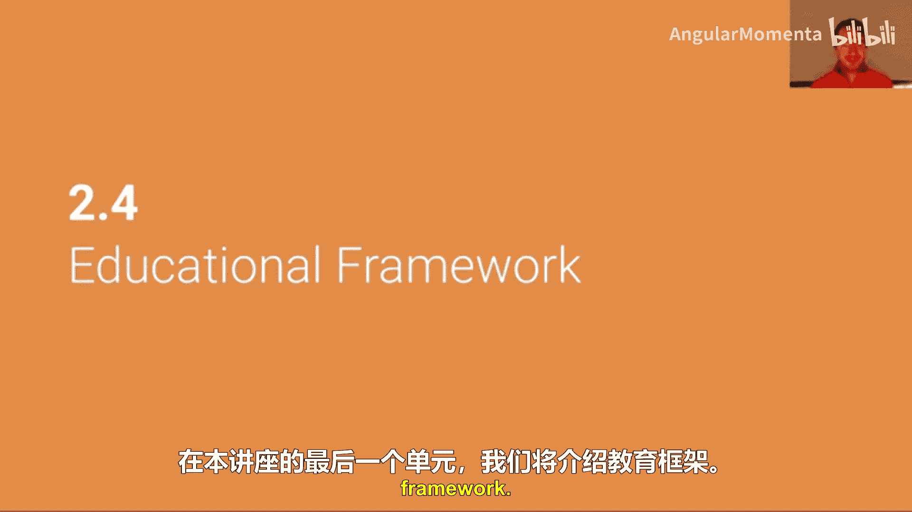
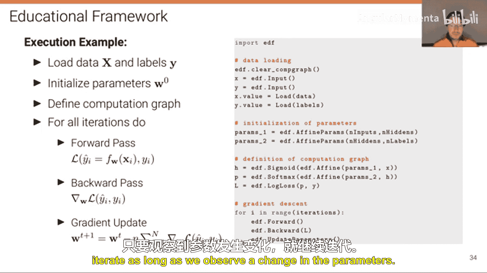

# 017：计算图与教育框架 🧠

在本节课中，我们将学习如何通过一个名为“教育框架”的简洁Python实现，来具体实践梯度下降算法。我们将深入理解计算图的内部工作原理，并看到如何用代码实现前向传播与反向传播。

在上一节中，我们介绍了在计算图上执行梯度下降的完整算法流程。本节中，我们来看看如何用Python代码实现这个算法。

## 算法回顾与实现目标

首先，让我们用计算图上的梯度下降简单训练流程来总结之前单元的内容。

使用反向传播算法，我们首先选择步长 **η** 和容差值 **ε**。然后，我们在迭代0时将参数 **W** 初始化为某个值（例如随机值）。这是参数的初始状态。

现在，我们重复以下步骤，直到梯度的大小（即 **||∇L||**）低于容差阈值 **ε**：
1.  对于每个数据点，计算前向传播和反向传播，以计算损失函数关于参数 **W** 的梯度。
2.  通过累加所有单个数据点的梯度来计算总体梯度。
3.  沿着负梯度方向，以步长 **η** 更新参数。

这就是计算图上的梯度下降算法。问题是，我们如何在Python中实现它？

## 引入教育框架 (EDF)

在本系列讲座的前半部分，我们将使用所谓的“教育框架”。这是一个由150行Python/NumPy代码实现的深度学习框架，由人工智能先驱之一、芝加哥TTI的David McAllister在其授课背景下建立。

这个教育框架让我们能够深入理解深度学习框架的内部运作机制，这非常重要。在听讲座或报告时，很容易错过深入理解概念实际如何工作所需的细节。只有通过自己实现这些概念，才能很好地理解之前遗漏了什么。实现过程能让我们精确地定位自己不理解或仍有欠缺的地方，这就是其重要性所在。

我们使用这个教育框架的另一个原因是它非常紧凑，让我们能够理解每一行代码。它只有不到150行的Python/NumPy代码，没有使用任何其他库，因此我们可以轻松地逐行查看并尝试理解每一行代码的作用。

## 框架设计概览

让我们更详细地看看这个教育框架。它使用Python，这意味着变量绑定到对象。例如，我们有描述输入、标签或计算图中特定计算节点的变量，也有作为这些变量属性的值。

计算图中不同类型的节点被实现为类。我们有输入类、参数类和计算节点类。之前介绍计算图时，我们为图中不同类型的节点关联了不同的颜色：输入节点为绿色，参数节点为橙色，计算节点为红色。现在，我们为这些节点中的每一个定义类模板，以便我们可以从这些类模板继承更具体的实现。

例如，对于计算节点，我们可以继承一个名为 `Sigmoid` 的类，它实现了逻辑回归模型或深度神经网络中的S型非线性激活功能。

## 核心类定义

以下是基类的抽象定义：

**输入类** 有一个初始化函数和一个用于添加梯度的函数（为空），因为我们不关心向输入变量添加梯度，也因为输入变量不依赖于任何其他变量。

**参数类** 有一个初始化函数，用于复制并存储该参数的值，并将这些参数追加到一个全局参数向量中，因为稍后我们需要对这些参数求和以获得计算结果。它还有一个用于累加梯度的函数，该函数简单地沿数据维度对所有梯度求和（我们稍后会解释）。参数类还有一个更新参数函数，用于沿梯度方向更新参数，这是在梯度下降中使用的。

**计算节点类** 也有一个添加梯度的函数，因为我们也需要更新计算节点本身的梯度。

## 前向与反向传播执行

为了执行计算图，我们需要定义前向函数和反向函数。

前向函数接收输入 **x** 和 **y** 以及参数的当前状态 **W**，并从左到右遍历计算图，计算所有中间值，直到头节点 **L**（本例中为损失）。我们将所有这些计算节点存储在一个列表 `comp_nodes` 中，并以从左到右的方式存储它们。这意味着当我们遍历这个排序列表中的任何特定节点时，我们知道所有先前的节点都已被计算，因此我们可以利用它们的值。

因此，在反向传播算法的前向传递中，我们只需遍历排序后的计算节点列表，并对每个计算节点应用在该节点内部实现的前向函数。

对于反向传递，我们首先将所有计算节点和所有参数的梯度设置为0。然后我们反向遍历（这是Python中反向遍历排序列表的表示法），从 **L** 开始，通过迭代调用每个计算节点的反向函数，将梯度向后传播，向其父节点发送梯度更新。我们将在下一张幻灯片中看到这一点。

最后，我们有一个更新参数函数，它遍历参数列表，并为每个参数调用更新参数函数。

## 向量化计算的重要性

需要说明的是，前向和反向函数分别在整个数据集上计算前向和反向传递。这样做的原因是矩阵运算非常高效，因为它们在Python中得到了非常高效的实现。而如果我们使用循环遍历数据集，速度会慢得多。因此，利用这种向量化非常重要。

此外，如果我们有GPU硬件可用，我们甚至可以并行化这个计算，因为每个单独数据点的前向传递是相互独立的，每个单独数据点的反向传递也与其他数据点的反向传递独立。因此，我们可以使用并行计算硬件并行运行所有这些前向和反向传递。

## 计算节点实例：Sigmoid函数

让我们看一个计算节点的具体例子：Sigmoid函数。其公式为 **σ(x) = 1 / (1 + e^{-x})**，Sigmoid函数的梯度可以简单地用Sigmoid函数本身来表示：**σ'(x) = σ(x) * (1 - σ(x))**，这带来了一种高效的实现。

右侧可以看到Sigmoid类的Python定义，它继承自 `ComputationNode` 类。它有三个函数：初始化函数、前向函数和反向传播函数。

在初始化时，我们简单地将节点本身添加到计算节点列表中，并在该类中存储其父节点（`self.x = x`）。在反向传递中，我们实现上述梯度函数，并将其与节点本身的反向传播梯度（`self.grad`）相乘，然后将此结果作为消息进一步传递给父节点。这就是我们在上一单元讨论的内容：我们不是对类本身执行操作，而是查看存储在 `self.x` 中的父节点，并向该计算节点 **X** 添加一个梯度。我们添加的正是我们发送的这个消息，也就是我们在上一单元用红色和蓝色说明的梯度的全局分量和局部分量。

全局分量是 `self.grad`（Sigmoid计算节点本身的梯度），局部分量是Sigmoid关于 **x** 的导数（即 **σ(x) * (1 - σ(x))**）。这里我们可以利用导数可以用Sigmoid本身表示这一事实，因此我们可以简单地利用前向传递中计算好的值。

需要注意的是，在这个反向路径中，梯度被发送到了父节点 `self.x`。

## 完整示例：组装与运行

现在让我们把所有内容整合起来，执行一个具体的最小示例。这是一个非常小的多层感知机（我们实际上会在下一讲讨论），但你可以将其视为两个堆叠在一起的逻辑回归模型。

右侧再次可以看到源代码，左侧是描述性说明。

我们首先导入教育框架，然后清空计算图（在执行任何计算图操作之前，我们都应该这样做）。接着加载数据：对于 `x.value`（输入类的一个实例），我们加载数据；对于 `y.value`，我们加载标签。

然后我们初始化两组参数，更具体地说，是两组仿射变换参数 `params1` 和 `params2`。这些参数接收输入节点数和该特定层的输出节点数作为输入。在这个简单的模型中，我们从 **N_input** 个输入节点到 **N_hidden** 个隐藏节点，再到 **N_labels** 个输出标签。

根据这些定义，我们可以定义计算图本身，它简单地表示为函数的串联，非常优雅。在这个特定示例中，我们有一个依赖于参数和输入 **x** 的仿射变换，后跟一个Sigmoid非线性激活，这产生了隐藏层 **h**。隐藏层 **h** 是另一个仿射变换的输入，后跟一个Softmax变换（我们尚未在本讲座中讨论Softmax变换，这将在讨论多类分类问题时介绍）。Softmax的输出是一个概率向量 **p**，然后我们可以将其输入到对数损失（即 **p** 和标签 **y** 之间的交叉熵函数）**L** 中。

这样就指定了计算图。然后，我们可以通过循环所有迭代来执行梯度下降算法：运行前向传递，然后从头节点 **L**（损失）开始运行反向传递，最后更新参数，并持续迭代，直到我们观察到参数的变化小于某个阈值。

---

**本节课总结**：在本节课中，我们一起学习了如何通过一个精简的教育框架（EDF）在代码层面实现计算图上的梯度下降。我们了解了框架的核心类结构（输入、参数、计算节点），明确了前向传播与反向传播的执行流程，并强调了向量化计算的重要性。最后，我们通过一个简单的多层感知机示例，看到了如何将这些组件组装起来并运行完整的训练循环。这个实践过程有助于我们深入理解深度学习框架底层的运作机制。