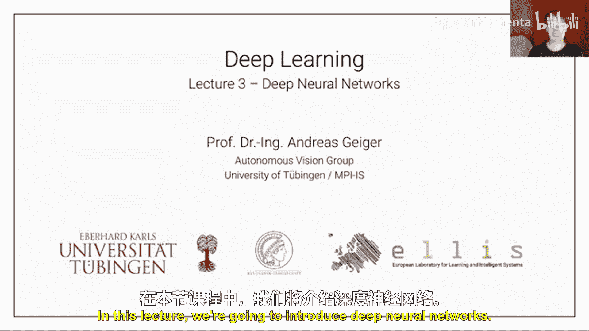
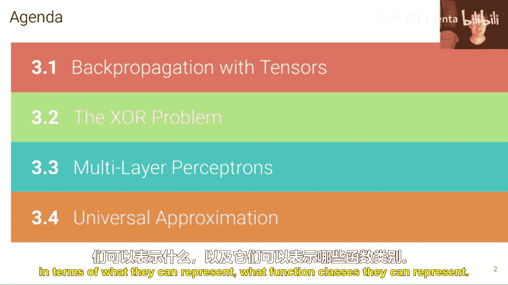
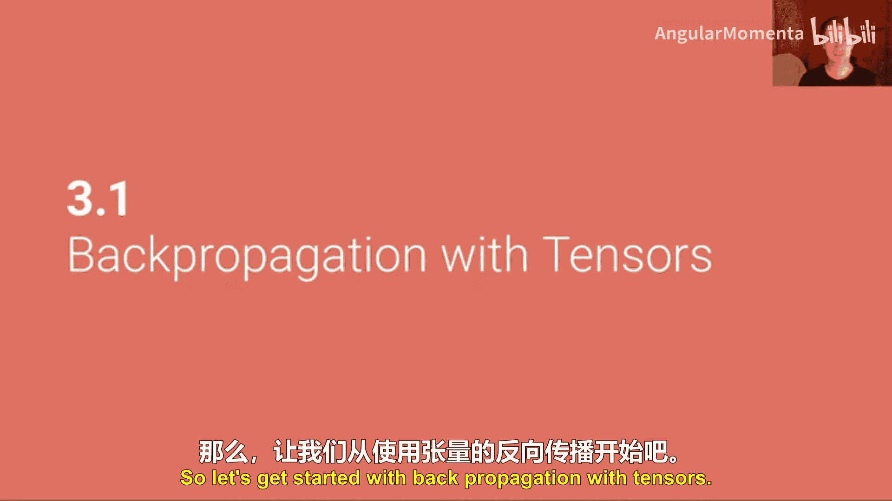
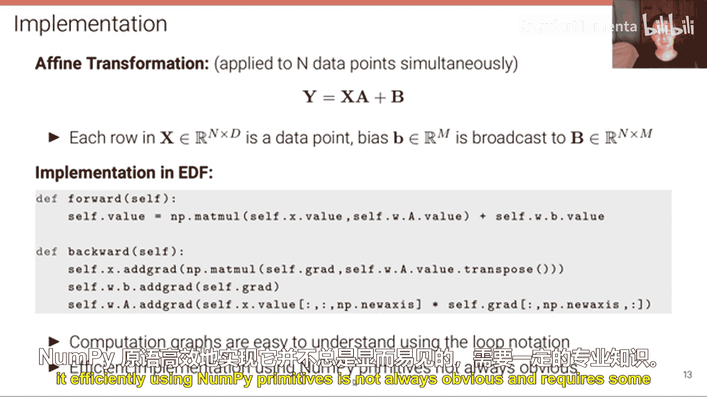
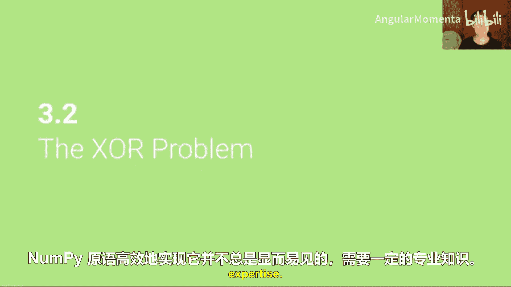

# 018：张量反向传播 🧮







在本节课中，我们将学习深度神经网络的基础。我们将从回顾反向传播算法开始，并将其扩展到处理向量和矩阵（统称为张量）的运算。理解张量上的反向传播是构建和训练复杂神经网络模型的关键。

上一节我们介绍了标量计算图上的反向传播，本节中我们来看看如何将相同的原理应用于处理向量和矩阵的运算。

## 计算图回顾 📊

反向传播算法的目标，是计算损失函数相对于计算图中任何变量的梯度。其过程分为两步：
1.  **前向传播**：按照计算顺序（黑色箭头方向）计算每个变量的值。
2.  **反向传播**：从损失函数节点开始，沿反向应用链式法则，将梯度传播回图中的所有节点。

在实现上，我们将计算图中的每个变量视为一个对象，它拥有 `值` 和 `梯度` 两个属性。前向传播计算 `值`，反向传播计算 `梯度`。

## 从标量到张量 🚀

之前我们处理的是标量运算。例如，一个简单的变换：`y = sigmoid(w*x + b)`，其中 `x`, `w`, `b`, `y` 都是标量。

然而，在深度神经网络中，我们更常处理向量和矩阵。例如，一个仿射变换接一个Sigmoid激活函数：
`y = sigmoid(A * x + b)`
这里，`x` 是输入向量，`A` 是权重矩阵，`b` 是偏置向量，`y` 是输出向量。Sigmoid函数是逐元素应用的。

一个重要的观察是：在深度学习中，计算图的最终输出（损失函数）几乎总是一个**标量**。这意味着，损失函数 `L` 相对于图中任何变量 `V` 的梯度 `dL/dV`，其形状（维度）与 `V` 本身相同。例如，如果 `A` 是一个 3x3 的矩阵，那么 `dL/dA` 也是一个 3x3 的矩阵。

## 核心原理：分解为标量运算 🔍

处理张量反向传播的关键在于认识到：**任何向量/矩阵运算都可以写成标量运算的循环**。

以前面的仿射变换为例，其前向传播可以分解为以下标量运算的循环：

```python
# 假设 u = A * x， y = sigmoid(u + b)
# 初始化向量 u
for i in range(u_dim):
    u[i] = 0

# 计算矩阵向量乘法 A*x
for i in range(A_rows):
    for j in range(A_cols):
        u[i] += A[i, j] * x[j]

# 计算 y = sigmoid(u + b)
for i in range(y_dim):
    y[i] = sigmoid(u[i] + b[i])
```

既然所有运算都已被分解为标量操作，我们就可以直接应用之前为标量推导的链式法则和反向传播规则。梯度计算被简化为对每个标量索引应用相同的规则。

例如，在反向传播中计算 `dL/dA[i,j]`：
1.  它只依赖于那些在计算 `u[i]` 时使用了 `A[i,j]` 的路径。
2.  根据链式法则：`dL/dA[i,j] = (dL/du[i]) * (du[i]/dA[i,j])`。
3.  其中 `du[i]/dA[i,j] = x[j]`。
4.  因此，`dL/dA[i,j] = (dL/du[i]) * x[j]`。

通过对所有索引 `i`, `j` 进行循环，我们就可以计算出整个梯度矩阵 `dL/dA`。这种方法可以推广到任意维度的张量。

## 小批量处理：提升效率的关键 ⚡

在深度学习中，我们希望尽可能利用硬件（如CPU的SIMD指令或GPU的并行核心）来加速计算。直接使用Python循环执行标量运算效率极低。

因此，我们引入了**小批量**处理。核心思想是：**一次性将多个数据样本（一个批次）输入计算图，并并行计算它们的损失和梯度**。

对于之前的仿射变换例子，假设我们有 `N` 个数据点。我们可以将输入组织成一个矩阵 `X`，其中每一行是一个数据样本：
`X` 的形状为 `[N, input_dim]`

那么，对整个批次的变换可以写为高效的矩阵运算：
`Y = sigmoid(X @ A.T + b)`
这里 `@` 表示矩阵乘法，`b` 通过广播机制加到每个样本上。`Y` 的形状为 `[N, output_dim]`。

在反向传播时，我们一次性计算损失函数 `L` 对整个批次数据的平均梯度。根据标量循环原理推导出的梯度公式，现在需要对应地使用矩阵运算来实现：

*   `dL/dX = dL/dY @ A`
*   `dL/dA = X.T @ dL/dY`
*   `dL/db = sum(dL/dY, axis=0)` （对批次维度求和）

这些矩阵运算能被NumPy、PyTorch等框架极度优化，在GPU上并行执行，速度比纯Python循环快数个数量级。

## 总结 📝

本节课中我们一起学习了张量上的反向传播。
1.  **基本原理**：通过将张量运算分解为标量运算的循环，我们可以将标量反向传播的链式法则直接应用过来。
2.  **维度保持**：由于损失函数是标量，任何变量的梯度都与该变量本身形状相同。
3.  **高效实现**：小批量技术允许我们使用高效的矩阵/向量库（如NumPy、CUDA）并行处理多个样本，这是现代深度学习得以快速训练的核心。
4.  **实践注意**：虽然从标量循环的角度理解梯度计算很简单，但将其转化为最高效的张量运算实现（如特定的矩阵乘法、转置和求和）需要专业知识。深度学习框架为我们封装了这些复杂的细节。





理解张量反向传播是打开深度神经网络大门的第一把钥匙。在接下来的章节中，我们将利用这个工具来构建第一个真正的深度网络——多层感知机。