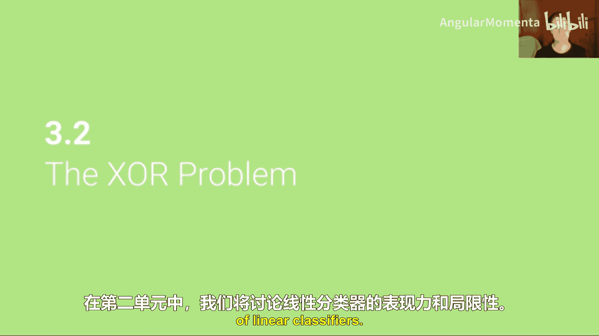
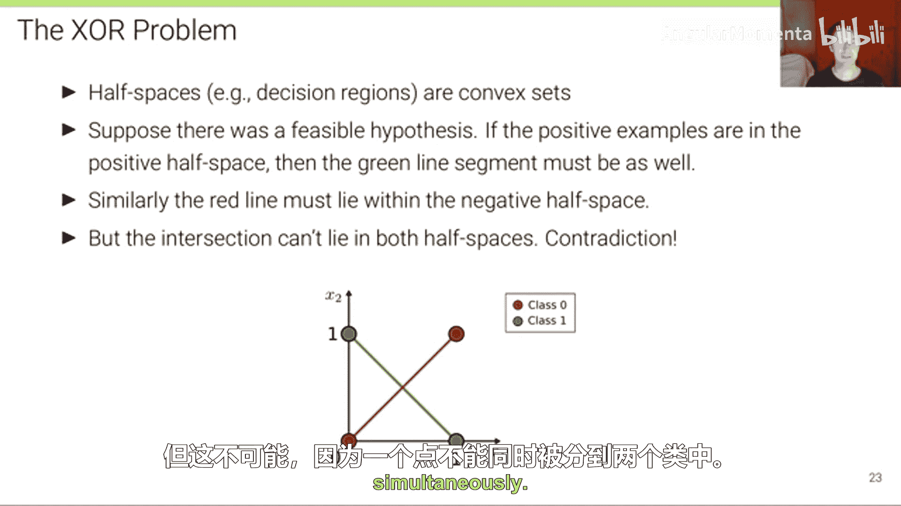
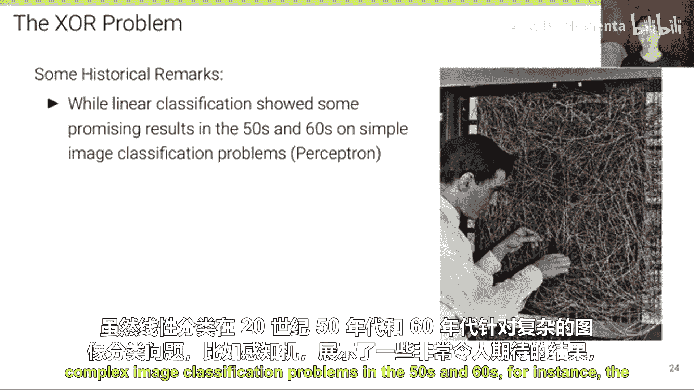
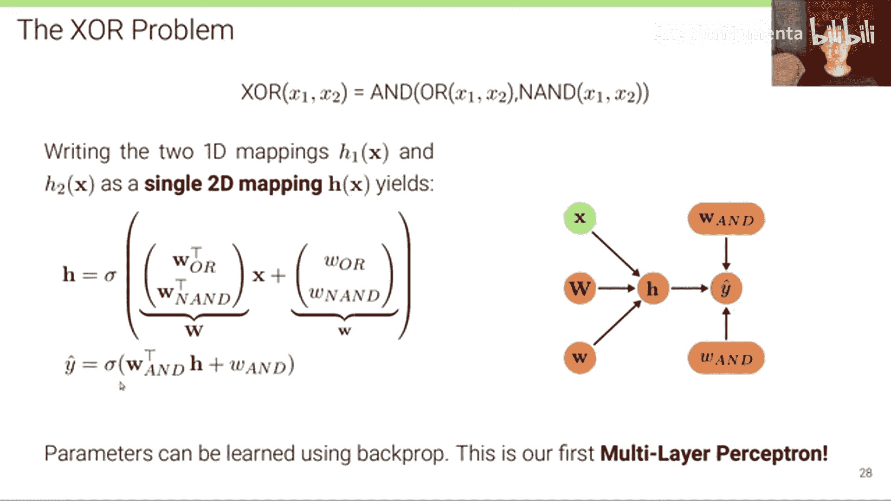

# 019：XOR问题与深度神经网络 🧠

在本节中，我们将探讨线性分类器的表达能力及其局限性。我们将从一个简单的逻辑回归模型出发，分析它能解决哪些问题，并最终揭示其核心限制——无法解决线性不可分问题，例如经典的XOR（异或）问题。为了解决这个问题，我们将引入多层感知机（MLP）的概念，这是构建深度神经网络的基础。

## 线性分类器的决策边界

首先，回顾上一讲中的逻辑回归模型。该模型在权重向量 **w** 和输入向量 **x** 之间进行线性（或仿射）变换，得到一个标量。这个标量随后通过一个Sigmoid非线性函数，将其从实数轴映射到0到1的范围内。

**公式**：`z = w^T x + w_0`，`y_hat = σ(z) = 1 / (1 + e^{-z})`

这个介于0和1之间的结果被解释为输入 **x** 属于类别1的概率。现在的问题是：如此简单的线性分类器能解决哪些问题？

为了理解这一点，我们考虑一个二维逻辑回归问题。模型有三个参数：权重向量 **w** 的两个维度分量 `w_1`、`w_2` 以及偏置项 `w_0`。模型的决策边界位于 `z = 0` 处，因为此时Sigmoid函数的输出恰好为0.5。换句话说，当 `w^T x + w_0 > 0` 时，我们判定为类别1；反之，则判定为类别0。

**公式**：
*   决策边界：`w^T x + w_0 = 0`
*   判定为类别1：`w^T x + w_0 > 0`
*   判定为类别0：`w^T x + w_0 < 0`

在二维输入空间中，这个决策边界是一条直线，它将空间一分为二。

## 线性分类器能解决的简单问题

现在，让我们看一些这个简单分类器可以解决的具体问题，例如一些基本的逻辑（布尔）运算符。我们使用二维输入，共有四种可能的输入组合：(0,0), (0,1), (1,0), (1,1)。

以下是OR（或）运算符的真值表及其在二维空间中的可视化：

*   **OR运算符**：当任一输入为1时，输出为1。
    *   目标：找到参数 **w** 和 `w_0`，使得分类规则能正确分离类别0（红色点 (0,0)）和类别1（绿色点 (0,1), (1,0), (1,1)）。
    *   通过观察，我们可以找到一条直线（决策边界）来分离它们。例如，选择 **w** = [1, 1]^T，`-w_0 = 0.5`（即 `w_0 = -0.5`）。可以验证，这个设置能正确分类所有点。

*   **AND（与）运算符**：仅当两个输入均为1时，输出为1。
    *   同样，决策边界的法线方向与OR类似，但偏置项需要改变。可以选择 **w** = [1, 1]^T，`-w_0 = 1.5`（即 `w_0 = -1.5`）。

*   **NAND（与非）运算符**：AND运算结果的取反。
    *   这可以通过反转AND运算符的决策边界来实现。例如，选择 **w** = [-1, -1]^T，`-w_0 = -1.5`（即 `w_0 = 1.5`）。

由此可见，简单的线性分类器可以表示一系列基本的逻辑运算。

## 线性分类器的局限：XOR问题

然而，当我们面对XOR（异或）运算符时，情况变得棘手。XOR的定义是：当两个输入不同时，输出为1；相同时，输出为0。

从可视化中可以看出，两个红色点((0,0)和(1,1))彼此对立，两个绿色点((0,1)和(1,0))也彼此对立。无法找到一条直线将红色点和绿色点完全分开。无论是OR还是NAND的决策边界，都只能正确分类三个点，而错误分类第四个点。

这引出了一个关键结论：**XOR问题是线性不可分的**。

### 线性不可分的正式证明

我们可以更正式地理解这一点。首先，回顾一下凸集的定义：一个集合S是凸集，如果连接其中任意两点的线段上的所有点也都属于S。

**公式**：若 `x1, x2 ∈ S`，则对任意 `λ ∈ [0, 1]`，有 `λx1 + (1-λ)x2 ∈ S`。

线性分类器的决策区域（即判定为某个类别的所有点构成的区域）是**半空间**。半空间是由一条直线界定的无限区域，它是一个凸集。

现在，假设存在一个线性分类器能解决XOR问题。那么所有绿色点（类别1）必须位于同一个半空间（正半空间）内，所有红色点（类别0）位于另一个半空间（负半空间）内。由于半空间是凸集，连接两个绿色点的线段上的所有点也必须是绿色（类别1）。同样，连接两个红色点的线段上的所有点也必须是红色（类别0）。

观察XOR的四个点，连接(0,1)和(1,0)的线段，与连接(0,0)和(1,1)的线段，会相交于中点(0.5, 0.5)。根据凸集性质，这个交点必须同时属于“绿色线段”和“红色线段”，即它必须同时被分类为类别1和类别0，这是矛盾的。因此，这样的线性分类器不存在。

## 历史背景与启示

这一局限性在历史上具有重要意义。尽管线性分类器（如感知机）在20世纪50-60年代在图像分类等问题上显示出潜力，但其无法解决XOR这类简单非线性问题的缺陷很快暴露出来。明斯基和帕佩特在1969年的《感知机》一书中详细论述了这些限制，导致神经网络研究在70年代陷入低潮。

然而，现实世界中的问题大多是非线性的。那么，我们该如何解决非线性问题呢？

## 解决方案：特征变换与多层感知机

### 方法一：手工特征工程

一种思路是模仿多项式曲线拟合，将数据映射到更高维的特征空间。例如，对于XOR的二维输入 `x = [x1, x2]^T`，我们可以构造一个三维特征向量 `ψ(x) = [x1, x2, x1*x2]^T`。

在这个三维空间中，原本线性不可分的点变得可以用一个平面（三维空间中的线性决策边界）来分离。这类似于支持向量机（SVM）中使用核函数的思想。

另一个例子是，在原始笛卡尔坐标 (x, y) 中线性不可分的数据，转换到极坐标 (r, θ) 空间后，可能变得线性可分。这说明了**数据表示的重要性**。

然而，手工设计有效的特征变换非常困难，且依赖于领域知识。在深度学习兴起之前，这曾是计算机视觉等领域的主流方法（如设计SIFT特征描述子）。

### 方法二：表示学习与多层感知机

更强大的方法是让算法自动学习合适的特征表示，这就是**表示学习**的核心思想。我们不再手动指定特征变换函数，而是设计一个包含可学习参数的函数族（例如神经网络），并通过优化算法（如梯度下降）从数据中学习出最佳的函数。

回到XOR问题，我们如何用学习的方式解决它呢？观察发现，XOR运算可以通过组合我们已经能用线性分类器实现的OR、NAND和AND运算来表达：

**公式**：`XOR(x1, x2) = AND( OR(x1, x2), NAND(x1, x2) )`

这意味着我们可以构建一个计算图（神经网络）来实现这个逻辑：

1.  第一层（隐藏层）：并行计算 `h1 = OR(x1, x2)` 和 `h2 = NAND(x1, x2)`。这里 `h1` 和 `h2` 是隐藏单元，我们观测不到它们的真实值，但网络会计算它们。
2.  第二层（输出层）：计算 `y_hat = AND(h1, h2)`，得到最终的XOR预测。

由于OR、NAND、AND都可以用逻辑回归单元（线性变换+Sigmoid激活）实现，我们可以将这个计算图具体化为：

**代码/公式描述**：
*   隐藏层：`h = σ(W * x + b)`。其中 `W` 是一个2x2矩阵（堆叠了OR和NAND的权重向量），`b` 是偏置向量。`σ` 是Sigmoid函数，按元素作用。
*   输出层：`y_hat = σ(w_out^T * h + b_out)`。其中 `w_out` 和 `b_out` 是AND运算的参数。

这就构成了一个**多层感知机（MLP）**——我们第一个真正的深度神经网络模型！它包含一个输入层、一个隐藏层和一个输出层。关键在于，隐藏层 `h` 是输入 `x` 的一个非线性变换，它学习到了一个使原始问题（在 `x` 空间线性不可分）在新空间（`h` 空间）中变得线性可分的表示。

这个模型的优美之处在于它是完全可微的（使用了Sigmoid而非不可微的阶跃函数）。因此，我们可以随机初始化所有参数（`W`, `b`, `w_out`, `b_out`），然后利用训练数据（XOR的四个样本），通过梯度下降算法和反向传播算法来优化这些参数，从而自动学习到解决XOR问题的网络权重，而无需我们手动设置。

## 总结

本节课我们一起深入探讨了线性分类器的能力与局限。我们首先看到线性模型可以解决如OR、AND等线性可分问题。随后，我们遇到了经典的XOR问题，并从几何和凸集理论的角度理解了其线性不可分的本质。为了突破这一限制，我们介绍了两种思路：一是手工进行特征空间变换，二是构建多层感知机进行表示学习。我们重点展示了如何通过组合简单的线性分类器（逻辑回归单元）来构建一个能解决XOR问题的多层神经网络，并指出这种模型可以通过梯度下降进行端到端训练，自动学习有效的特征表示。这为后续深入学习复杂的深度神经网络奠定了重要基础。