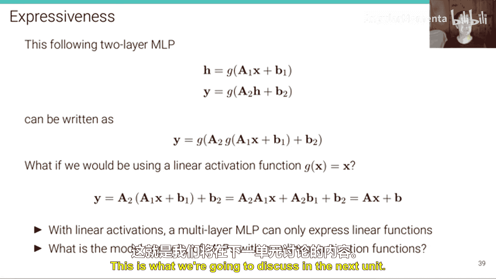

# 020：多层感知机 🧠

在本节课中，我们将正式介绍多层感知机。这是一种前馈神经网络，通过堆叠多个非线性层来学习数据的复杂表示，是深度学习的核心架构之一。

## 什么是多层感知机？

上一节我们介绍了神经网络的基本单元。本节中，我们来看看如何将这些单元组合成更强大的模型。

多层感知机是一种前馈神经网络。“前馈”意味着网络结构是分层的，且层与层之间没有反馈连接。信息从输入层开始，单向地向前传递，经过一系列隐藏层，最终到达输出层。

它由多个非线性函数组合而成。例如，一个函数 \( F(x) \) 可以被分解为多个隐藏层函数的组合：
\[
F(x) = f_3(f_2(f_1(x)))
\]
其中，\( f_1, f_2, f_3 \) 代表不同的隐藏层。

*   **隐藏层**：所有非输出层的层都被称为隐藏层。它们不直接接收训练标签（监督信号），其目标是学习对最终预测或分类有用的特征表示。
*   **神经元**：每一层都由多个神经元组成。每个神经元执行一个“仿射变换 + 非线性激活函数”的操作。
*   **全连接**：在多层感知机中，每一层的每个神经元都与前一层的所有神经元相连接。这是其架构的一个关键特征。
*   **深度**：模型中计算链的长度称为模型的深度。堆叠多个隐藏层就得到了“深度”模型，这也是“深度学习”一词的由来。

> **注意**：“多层感知机”这个名称可能有些误导。现代神经网络使用反向传播训练，并采用可微的非线性激活函数（如Sigmoid、ReLU），这与早期不可微的阈值单元“感知机”算法不同。因此，它更像是阈值单元的平滑近似。

## 网络架构解析

理解了基本概念后，我们来具体看看一个多层感知机的结构是什么样的。

下图展示了一个典型的多层感知机架构示例：

以下是该架构的关键组成部分说明：

*   **输入层**：位于最左侧，接收原始数据。
*   **隐藏层**：图中展示了三个隐藏层。同一层内的神经元之间没有连接。
*   **输出层**：位于最右侧，产生最终预测。
*   **连接方式**：每一层的神经元都与前一层的所有神经元全连接。例如，第二个隐藏层的某个神经元会接收第一个隐藏层所有三个神经元的输入。
*   **深度**：深度指计算层的数量（不包括输入层）。图中网络有3个隐藏层和1个输出层，因此深度为4。
*   **宽度**：宽度指一层中神经元的数量。例如，第一个隐藏层宽度为3，第二个为2。

网络的深度和宽度是核心的设计参数，我们可以根据具体任务（如数据量大小、问题复杂度）自由选择。对于简单任务和小数据，通常使用参数更少的浅层或窄网络以防止过拟合。

## 向量化表示与表示学习

从计算视角看，每一层实际上是在对数据表示进行变换。

在向量表示下，一个隐藏层 \( \mathbf{h}^{(l)} \) 的计算可以写为：
\[
\mathbf{h}^{(l)} = g^{(l)}(\mathbf{A}^{(l)} \mathbf{h}^{(l-1)} + \mathbf{b}^{(l)})
\]
其中：
*   \( \mathbf{h}^{(l-1)} \) 是上一层的输出向量。
*   \( \mathbf{A}^{(l)} \) 和 \( \mathbf{b}^{(l)} \) 是该层的权重矩阵和偏置向量（参数）。
*   \( g^{(l)}(\cdot) \) 是逐元素应用的非线性激活函数。

这种层级变换的视角引出了**表示学习**的核心思想。假设我们将最后一个隐藏层的输出记为 \( \psi(x) \)，即输入 \( x \) 学习到的新表示。

在分类任务中，输出层通常就是一个逻辑回归分类器（线性分类器）。因此，前面所有隐藏层的目标，就是将原始数据 \( x \) 变换成一个新的表示空间 \( \psi(x) \)，使得在这个新空间中，不同类别的数据变得**线性可分**。

理想情况下，随着数据通过每一层，其表示会变得越来越易于区分，最终在最后一个隐藏层形成线性可分的格局，以便输出层轻松完成分类。下图直观展示了这一过程：通过多层变换，原始空间中复杂的决策边界（红色曲线）在表示空间中变成了一个简单的线性边界。

## 激活函数

激活函数的非线性是网络获得强大表达能力的关键。以下是一些常用的激活函数：

*   **Sigmoid**：早期受神经科学启发，但容易饱和，导致梯度消失，训练缓慢。
*   **ReLU（整流线性单元）**：目前最流行的激活函数之一。公式为 \( f(x) = \max(0, x) \)。它在正区间梯度恒定，能有效缓解梯度消失问题，加速训练。虽然它在 \( x=0 \) 处不可微，但在实践中表现良好。
*   **Leaky ReLU 等**：ReLU 的变体，旨在解决神经元“死亡”问题。

选择不同的激活函数会显著影响网络的训练动态和最终性能。

## 神经科学启发（简要）

这些模型被称为“神经网络”是因为其设计受到了大脑的启发。大脑中的神经元也是分层结构，每个神经元接收来自其他多个神经元的输入信号，进行整合（类似线性组合），然后通过轴突产生输出（类似激活函数）。突触的强度决定了信号传递的权重。

然而，**本课程的核心目标不是模拟大脑**。我们关注的是如何构建具有强大**统计泛化能力**的模型。现代深度学习的架构和训练方法（如反向传播）与大脑的实际运作方式有根本性不同。我们只是从大脑的结构中获得灵感，旨在开发出在任务上表现优异的实用模型。

## 如何训练多层感知机？

训练多层感知机，我们使用**随机梯度下降**及其变种。

*   **动机**：对于大型数据集（如数百万张图片），计算整个数据集的梯度（批量梯度下降）效率极低。随机梯度下降通过每次迭代随机抽取一小部分数据（**小批量**）来计算梯度，这是一种对真实梯度的有噪估计，但计算效率高，且随机性有时有助于跳出局部极小值。
*   **算法步骤**：
    1.  **初始化**：随机初始化所有权重参数，设定学习率和小批量大小。
    2.  **循环**：
        a. **采样**：从数据集中随机抽取一个小批量数据。
        b. **前向传播**：将小批量数据输入网络，计算每一层的激活值以及最终的输出 \( \hat{y} \)。
        c. **反向传播**：计算损失函数关于所有参数（各层的 \( \mathbf{A} \) 和 \( \mathbf{b} \)）的梯度。
        d. **参数更新**：沿着梯度负方向，以学习率为步长，更新所有参数。
    3.  **终止**：在独立的验证集上监控性能。当验证误差不再下降（可能开始过拟合）时停止训练。

**关于小批量的说明**：由于GPU内存限制，小批量大小通常远小于数据集总大小。但在后续演示的小型例子中，我们可以使用整个数据集作为“批量”。

## 实践演示：解决XOR问题

现在，让我们运用所学知识来解决经典的XOR（异或）问题。我们使用一个在线演示工具来训练一个简单的MLP。

我们构建一个具有以下结构的网络：
*   输入层：2个神经元（对应XOR的两个输入）。
*   隐藏层：1层，包含2个神经元（使用 `tanh` 激活函数，因其收敛性优于Sigmoid）。
*   输出层：1个神经元（使用 `softmax`，在此二分类情况下等价于Sigmoid）。

我们并不手动设置权重来模拟AND/OR门，而是**随机初始化权重**，然后让随机梯度下降算法自动学习。经过训练，网络成功地学习到了一个决策边界，将XOR问题的四个点正确地分为两类（红 vs 绿），验证了MLP解决非线性可分问题的能力。

进一步，我们可以尝试更复杂、数据点更多且更不易分离的数据集。通过调整**隐藏层的宽度**（神经元数量），可以观察到模型复杂度的变化：
*   神经元较少时，决策边界相对简单。
*   随着神经元数量增加（例如增加到50个），决策边界变得非常复杂，几乎可以完美拟合训练数据，但很可能导致**过拟合**。

这说明**网络架构本身（如层宽、层深）就是一种正则化手段**。除了显式的权重衰减（后续会讲），简单地减少神经元数量也是控制模型复杂度、防止过拟合的有效方法。

## 表达能力与非线性激活的重要性

最后，我们来探讨多层感知机的表达能力。一个两层MLP的方程可以写为：
\[
\hat{y} = g_2(\mathbf{A}_2 \cdot g_1(\mathbf{A}_1 \mathbf{x} + \mathbf{b}_1) + \mathbf{b}_2)
\]

**关键问题**：如果我们使用**线性**激活函数（即 \( g(x) = x \) ）会怎样？更深的网络会比单层线性分类器表达能力更强吗？

**答案是否定的**。如果所有激活函数都是线性的，那么无论网络多深，整个模型都可以被简化为一个单一的线性变换：
\[
\hat{y} = \mathbf{A}_2 (\mathbf{A}_1 \mathbf{x} + \mathbf{b}_1) + \mathbf{b}_2 = (\mathbf{A}_2 \mathbf{A}_1) \mathbf{x} + (\mathbf{A}_2 \mathbf{b}_1 + \mathbf{b}_2) = \mathbf{A}’ \mathbf{x} + \mathbf{b}’
\]
这并没有引入任何新的表达能力，只是增加了冗余参数，可能使优化更困难。

**结论**：**非线性激活函数是深度网络获得强大表达能力的根本原因**。没有它们，深层网络等价于浅层线性模型。

那么，对于具有非线性激活函数的MLP，其模型能力如何？是更深更好，还是更宽更好？需要多深才能表达任意复杂的函数？这将是下一单元要讨论的核心内容。

---

**本节课总结**

本节课中，我们一起学习了：
1.  **多层感知机**的基本定义和核心特性：前馈、全连接、包含隐藏层。
2.  网络的**深度**和**宽度**是重要的设计参数。
3.  从**表示学习**的角度理解MLP：每一层都在学习将数据向更线性可分的方向变换。
4.  常用**激活函数**（如ReLU）的作用及其重要性。
5.  使用**随机梯度下降**和**反向传播**来训练MLP的流程。
6.  通过实践看到MLP可以解决XOR等非线性问题，并理解了**架构本身是一种正则化**。
7.  明确了**非线性激活函数**是深度模型超越线性模型表达能力的必要条件。