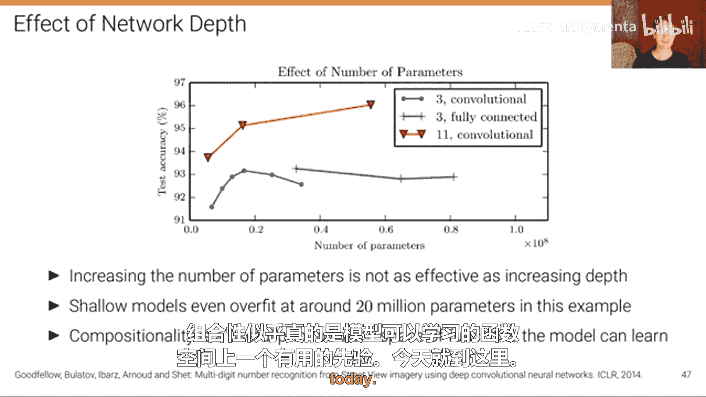

# 021：通用逼近定理 🧠

在本节课中，我们将要学习多层感知机的表达能力。具体来说，我们将探讨一个被称为“通用逼近定理”的重要理论结果，它解释了为什么即使只有一个隐藏层的神经网络，也能以任意精度逼近任意连续函数。我们还将讨论该定理的局限性，以及为什么在实践中，深度（即更多层）比宽度（即每层更多神经元）更为重要。

---

## 通用逼近定理 📜

上一节我们介绍了神经网络的基本结构。本节中，我们来看看一个关于其表达能力的核心理论：通用逼近定理。

该定理指出，**一个仅包含单个隐藏层的多层感知机，只要其隐藏层神经元数量足够多，就能够以任意精度逼近任意定义在紧致集上的连续函数**。这是一个非常深刻的结果，也是深度学习的理论基础之一。

该定理最早由Cybenko等人证明，随后被其他研究者在更一般的情况下推广。其数学表述如下：

设 σ 是任意连续且有界的“挤压”函数（例如Sigmoid函数）。那么，形如下式的有限和：

**G(x) = Σᵢ [ cᵢ · σ( Aᵢ x + bᵢ ) ]**

在连续函数空间 **C(Iⁿ)**（定义在n维单位立方体 Iⁿ 上）中是稠密的。换言之，对于该空间中的任意连续函数 **f(x)** 和任意精度 **ε > 0**，总存在一个如上定义的函数 **G(x)**，使得对于单位立方体中的所有 **x**，都有：

**| G(x) - f(x) | < ε**

该定理的严格证明涉及测度论，超出了本课程的范围。因此，我们将跳过形式化证明，转而通过一些具体案例来直观理解其为何成立。

---

## 从离散（二进制）情况理解 🧩

为了获得直观理解，我们首先观察一个更简单的情况：离散的二进制输入/输出函数。

假设我们有一个三维二进制输入 **x = (x₁, x₂, x₃)**，每个分量取值0或1，因此共有 **2³ = 8** 种可能的输入组合。我们想用一个单隐藏层的MLP来预测一个一维的二进制输出 **y**。

我们暂时假设隐藏层神经元是**线性阈值单元**，其函数形式为：

**h(x) = 𝟙[ A·x + b > 0 ]**

其中，**𝟙[·]** 是指示函数（条件为真时输出1，否则输出0），**A** 是权重向量，**b** 是偏置。这本质上是一个阶跃函数。

以下是关键思路：我们可以设计网络，让每个隐藏神经元专门识别一种特定的输入组合。

例如，要识别输入向量 **(0, 1, 1)** 并输出1，我们可以设置一个神经元的参数如下：
*   权重 **A = [-1, 1, 1]**
*   偏置 **b = -0.5**

计算过程如下：
*   当输入为 **(0,1,1)** 时：**A·x + b = (-1*0)+(1*1)+(1*1)-0.5 = 1.5**，大于0，神经元激活（输出1）。
*   当输入为 **(1,1,1)** 时：**(-1*1)+(1*1)+(1*1)-0.5 = 0.5**，仍大于0。为了确保只对(0,1,1)激活，我们需要更精细地调整偏置，例如设为 **-1.5**，这样(1,1,1)的输入和为 **0.5**，将不大于0。

通过这种方式，我们可以为8种可能的输入组合各设置一个神经元。然后，输出层只需根据这些神经元的激活状态，组合出最终结果 **y**。

然而，这种方法存在一个明显问题：对于 **d** 维二进制输入，我们需要 **2ᵈ** 个隐藏神经元。这是一个**指数级**的增长，当输入维度稍高时，模型将变得不可行。这引出了该定理的第一个重要局限。

---

## 从硬阈值到软阈值 🔄

上一节我们使用了不可微的硬阈值单元，这不利于基于梯度下降的学习。本节中我们来看看如何用可微的“软”阈值单元来解决这个问题。

解决方案是使用如Sigmoid这样的可微激活函数来近似硬阈值函数。观察Sigmoid函数 **σ(x) = 1 / (1 + e⁻ˣ)**，我们可以通过调整其输入尺度来使其变得“更陡峭”。

以下是不同尺度参数下的Sigmoid函数：
*   **σ(x)**：标准的S形曲线。
*   **σ(5x)**：曲线变得更陡，更接近阶跃函数。
*   **σ(50x)**：曲线几乎与阶跃函数无法区分。

因此，我们拥有一个可微的“软”阈值替代品。通过使用足够大的权重，我们可以让Sigmoid函数在训练中表现得像一个可微的阶跃函数，从而既能利用通用逼近定理的理论保证，又能使用梯度下降算法进行有效训练。

---

## 通用性的局限与深度的重要性 ⚠️➡️🚀

虽然通用逼近定理表明宽而浅的网络（单隐藏层）是“万能”的，但这在实践中存在重大局限。

以下是通用逼近定理的几个关键局限：
1.  **需要指数级宽度**：如上文二进制例子所示，逼近复杂函数可能需要隐藏层神经元数量随输入维度指数增长，导致计算和内存成本不可接受。
2.  **无法保证泛化**：“万能”仅代表表示能力，不代表学习能力。一个拥有海量参数的宽网络很容易简单地**记忆**训练数据，导致严重的过拟合，而无法在未见过的测试数据上（即泛化）表现良好。

那么，什么才是更有效的路径呢？近二十年的研究揭示，**网络的深度（层数）比宽度（每层神经元数）更为关键**。

深度网络引入了一个强大的**归纳偏置**：**复杂的函数可以由一系列更简单的函数组合（嵌套）而成**。这与我们对自然世界的认知相符（复杂系统由简单模块层级化构成），也使得深度网络能够：
*   **更紧凑地表示复杂函数**：用更少的参数实现相同的功能。
*   **获得更好的泛化性能**：经验表明，深度网络在测试集上的表现通常远优于同等参数量的浅层网络。

一个经典的例子是**奇偶校验函数**（判断二进制向量中1的个数是否为奇数）。可以证明，用浅层网络实现该函数需要指数级数量的神经元，而用一个深层网络则只需要线性数量的神经元。

---

## 深度为何有效：空间折叠的直观解释 📐

为什么深度比宽度更有效？这里提供一个基于特定激活函数（绝对值整流单元）的几何直观解释，称为“空间折叠”。

想象输入数据所在的空间是一张白色的纸（以二维为例）。每个使用绝对值激活的神经元，其作用就像沿着由权重和偏置定义的“镜面轴线”对空间进行**镜像折叠**。

通过叠加多个这样的层（即增加深度），我们可以对这张“纸”进行多次折叠。每一次折叠都在空间中创建新的对称轴。仅仅通过几层这样的操作，就能快速创造出非常复杂的对称模式，而要使用单层网络（仅增加宽度）来描绘同样的复杂模式，则需要指数级多的神经元。

这个直觉表明，**深度网络通过层级化的“折叠”或“变换”，能够高效地构建出复杂的函数形态**。对于ReLU等更常用的激活函数，也存在类似但更复杂的几何解释。

---

## 实证结果 📊

理论需要实证支持。在Goodfellow等人的论文中，在一个多位数分类任务上进行了实验。

实验结果清晰地显示：
*   随着隐藏层数量的增加（深度增加），测试准确率持续提升。
*   更深网络的性能上限显著高于浅层网络。

当然，训练深度网络也存在挑战，例如梯度消失/爆炸问题，这需要通过归一化、残差连接等技术来解决（将在后续课程讨论）。但总体而言，只要设计得当，从深度获得的收益是仅增加宽度无法比拟的。

另一项对比实验进一步证实了这一点。在卷积神经网络（一种具有强大归纳偏置的深度网络架构）中：
*   对于一个3层的网络，当参数数量增加到约2000万时，由于过拟合，测试准确率开始下降。
*   对于一个11层的更深网络，即使参数数量继续增加，测试准确率仍然在提升，表现出更好的泛化能力。

这些实证结果强有力地表明，**函数的可组合性（深度所强化的偏置）是模型所能学习函数空间上一个非常有用的先验假设**。

---

## 总结 ✨

本节课中我们一起学习了：
1.  **通用逼近定理**：单隐藏层的多层感知机，在宽度足够时，可以逼近任何连续函数。
2.  **定理的直观理解**：通过二进制例子，我们看到了如何用隐藏神经元“记忆”特定模式，但也揭示了其需要指数级宽度的局限。
3.  **从硬阈值到软阈值**：使用Sigmoid等可微激活函数，可以在保持逼近能力的同时实现梯度下降训练。
4.  **深度的重要性**：通用逼近定理在实践中受限于过拟合和计算成本。深度网络通过引入“函数可组合”的强归纳偏置，能够用更少的参数更紧凑地表示函数，并获得更优的泛化性能。
5.  **深度有效的直观解释**：“空间折叠”等概念为深度网络的高效性提供了几何视角。
6.  **实证证据**：实验结果表明，增加网络深度通常比增加宽度更能有效提升模型性能。

总而言之，虽然浅层网络在理论上是“万能”的，但正是深度赋予了现代神经网络解决复杂现实问题的强大能力和效率。