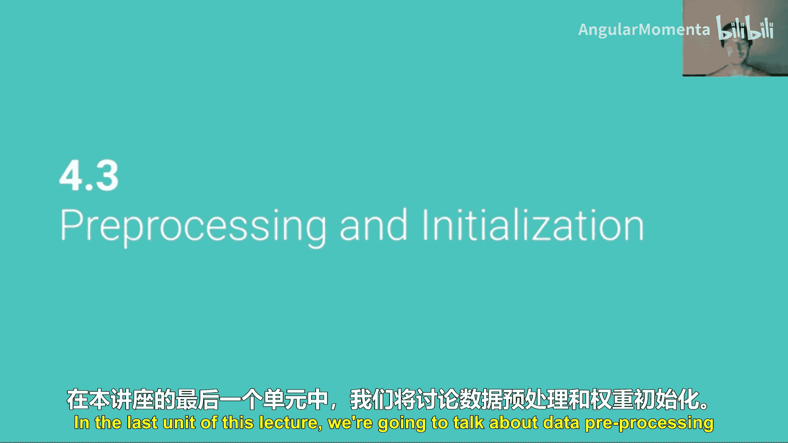
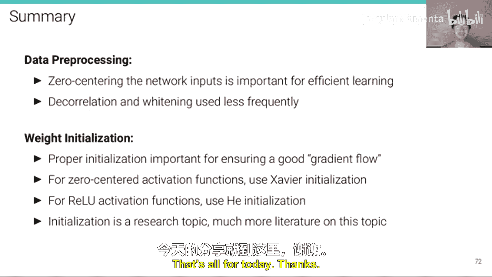

# 024：数据预处理与权重初始化 🧠

在本节课中，我们将要学习深度神经网络训练前的两个关键步骤：数据预处理和权重初始化。正确的处理与初始化对于网络能否成功学习至关重要。

## 数据预处理 📊

上一节我们讨论了激活函数需要零中心化的重要性。本节中我们来看看为什么输入数据本身也需要进行类似的预处理。

考虑一个线性层和激活函数 `G`。如果所有输入 `X` 都是正数，并且大多数激活函数的梯度 `G'` 也为正，那么所有参数的梯度将具有相同的符号（即上游梯度 `∂L/∂G` 的符号）。这会导致梯度更新效率低下。因此，不仅每一层的激活需要零中心化，输入数据本身也应如此。

这就是为什么在将数据输入神经网络之前，通常需要进行预处理。最常见的预处理是零中心化。

以下是常见的数据预处理步骤：

1.  **零中心化**：计算数据集中每个特征维度（例如，图像的每个颜色通道）的均值，然后从每个数据点中减去该均值。公式表示为：`X_centered = X - mean(X)`。
2.  **归一化**：在零中心化之后，有时还会将数据除以每个特征维度的标准差，使得数据的标准差为1。公式为：`X_normalized = X_centered / std(X)`。
3.  **去相关与白化**：更高级的预处理包括通过乘以经验协方差矩阵的特征向量来去除数据相关性，或通过除以协方差矩阵特征值的平方根来进行白化，使数据在各个维度上具有单位方差且不相关。这类似于对数据应用PCA（主成分分析）。

直观上，零中心化数据的好处在于，它能使决策边界的小幅调整不会立即导致巨大的分类错误，从而使优化过程更加稳定。

在实际应用中，白化并不常用，人们发现零中心化是真正必要的。不同网络架构的具体做法略有不同：
*   **AlexNet**：减去在整个训练集上计算出的平均图像。
*   **VGGNet**：仅减去每个颜色通道的均值（共3个值）。
*   **ResNet**：减去每个通道的均值并除以每个通道的标准差。

## 权重初始化 ⚖️

现在，让我们转向另一个关键话题：如何初始化网络中的权重参数。回想一下，我们使用随机梯度下降算法进行训练。该算法简单，但一个核心问题是：如何初始化数量可能高达数百万的权重？

最简单的想法是将所有权重初始化为一个常数（例如0）。但这会导致严重问题：网络每一层中的所有神经元在初始时完全对称。在正向和反向传播中，它们会进行完全相同的计算和更新，从而无法学习到有意义的、多样化的特征表示。因此，这种初始化方式不可行。

接下来，我们以一个多层感知机为例，其单层可表示为带参数 `A` 和 `B` 的仿射变换与激活函数 `G` 的组合。我们将重点分析使用 `tanh` 和 `ReLU` 激活函数的情况。

### 初始化不当的问题

一种天真的改进方法是从小标准差（如 `sigma = 0.01`）的高斯分布中随机采样权重。但这会导致深层网络的激活值迅速向0收缩。在反向传播时，梯度也会随之消失，无法有效地更新浅层网络的权重。

相反，如果从较大标准差（如 `sigma = 0.2`）的高斯分布中采样权重，则可能导致大多数激活值进入 `tanh` 或 `sigmoid` 函数的饱和区。在饱和区，激活函数的梯度接近于0，同样会造成梯度消失，阻碍学习。

### 正确的初始化方法

因此，我们需要为权重设置合适的初始化方差。Xavier Glorot 等人提出，对于零中心化的激活函数（如 `tanh`），应从方差为 `1 / D_in` 的分布中采样权重，其中 `D_in` 是该层输入的维度。这被称为 **Xavier初始化**。

其原理是，假设输入 `X` 和权重 `W` 独立同分布、均值为零，且激活函数在零点附近的导数为1（`tanh` 符合此条件）。为了确保信号在通过网络层时方差不发生剧烈变化（避免爆炸或消失），需要令 `Var(W_i) = 1 / D_in`。这样，输出 `y` 的方差将近似等于输入 `X_i` 的方差。

然而，Xavier初始化假设激活函数是零中心化的。对于 **ReLU** 激活函数，由于其输出始终非负，不再满足零均值假设。直接使用Xavier初始化会导致激活分布逐渐向零偏移。

针对 ReLU，Kaiming He 等人提出了 **He初始化**。其解决方案很简单：将权重的方差加倍，即从方差为 `2 / D_in` 的分布中采样。这补偿了ReLU函数“砍掉”一半负值区域所损失的方差，从而在多层传播中保持激活值的方差稳定。

## 总结 📝

本节课中我们一起学习了深度神经网络训练前的两项基础且重要的工作：

1.  **数据预处理**：对输入数据进行零中心化是高效学习的关键，它有助于稳定优化过程。去相关和白化等技术使用频率较低。
2.  **权重初始化**：正确的初始化对于保证梯度在网络中有效流动至关重要。它确保了所有参数都能在训练初期获得有意义的梯度更新。
    *   对于 `tanh` 这类零中心化激活函数，推荐使用 **Xavier初始化**（方差为 `1 / D_in`）。
    *   对于 **ReLU** 激活函数，推荐使用 **He初始化**（方差为 `2 / D_in`）。

权重初始化本身是一个活跃的研究领域，有更多深入的文献，本课程无法全面覆盖。掌握这些基础知识将为构建和训练有效的深度学习模型打下坚实基础。

今天的内容就到这里。谢谢！