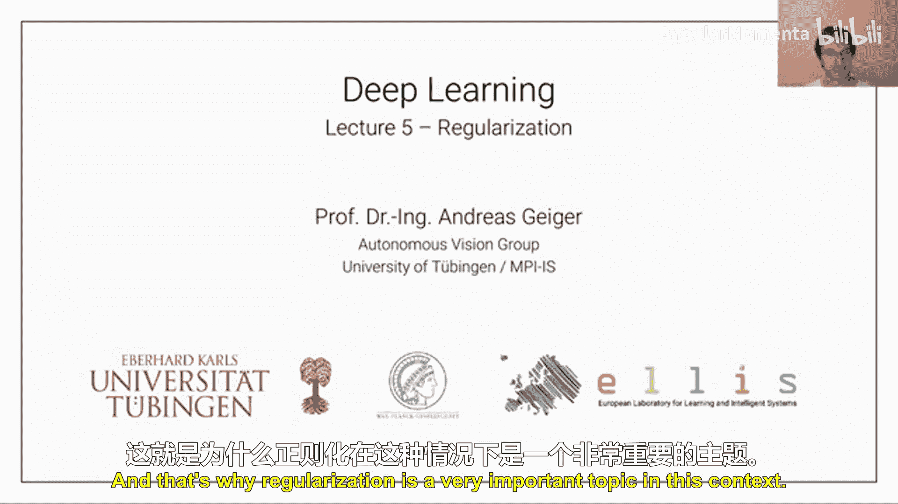
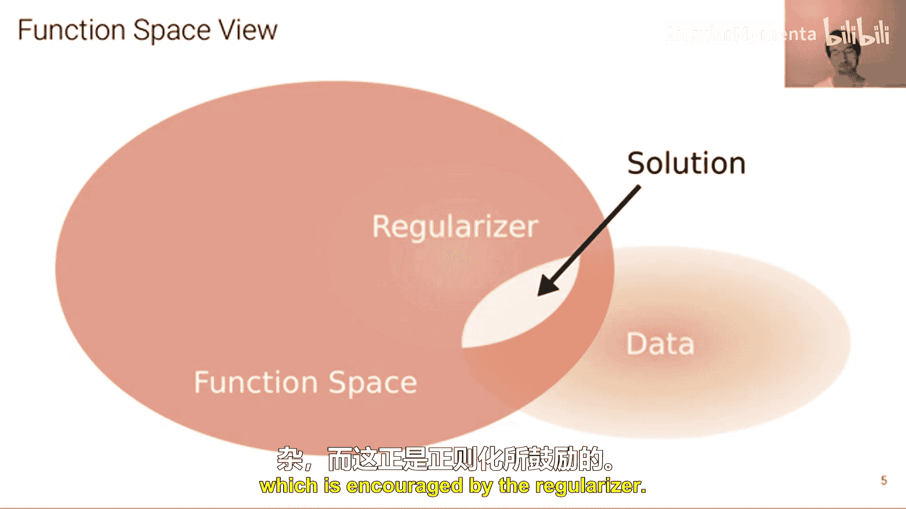
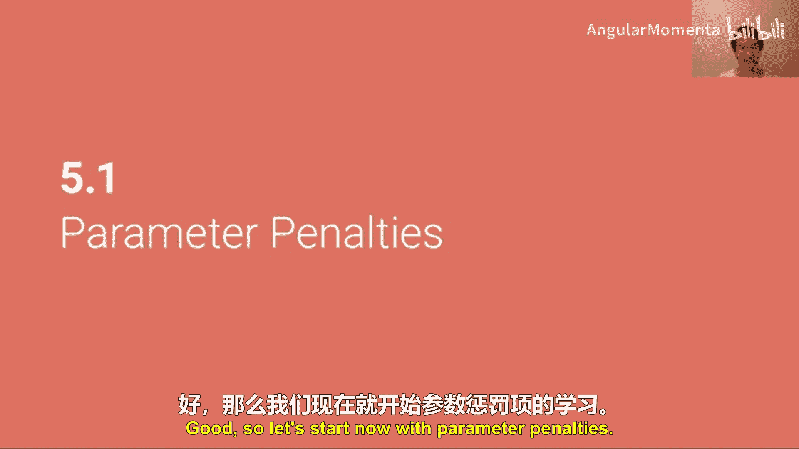
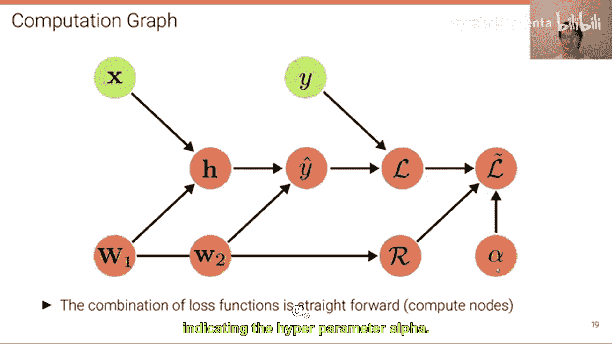

# 025：正则化与参数惩罚 🛡️

在本节课中，我们将要学习深度学习中一个至关重要的概念：正则化。我们将从最基础的参数惩罚方法开始，探讨如何通过约束模型参数来防止过拟合，从而提升模型的泛化能力。

## 概述

在之前的课程中，我们简要地在线性回归的背景下讨论过正则化。今天，我们将更广泛地探讨这个主题，并特别关注其在深度神经网络中的应用。正则化对于深度神经网络尤为重要，因为这类模型通常拥有大量参数，有时甚至超过了训练样本的数量。因此，正则化是控制模型复杂度的关键工具。

本讲座分为五个单元。在第一单元中，我们将讨论参数惩罚。在第二单元中，我们将介绍早停法。接着，我们将探讨集成方法，以及深度学习领域流行的一种特定集成方法——Dropout。最后，我们将讨论数据增强，它也可以被视为一种特殊的正则化形式。

在开始之前，让我们简要回顾第一讲中关于模型容量、过拟合和欠拟合的内容。下图展示了用不同次数的多项式拟合一组绿色数据点的结果。

左侧是一次多项式拟合，中间是三次多项式拟合，右侧是九次多项式拟合。我们可以看到，如果模型容量过低，即模型不够灵活、参数过少，训练误差和测试误差都会很高，这被称为欠拟合。另一方面，如果模型容量过高，例如九次多项式有10个参数，模型可以完美拟合训练集，甚至将训练误差降至零，但测试误差或泛化误差会非常大，模型无法很好地泛化，这被称为过拟合。

在深度神经网络的背景下讨论正则化时，我们的目标是将一个过于灵活的模型从第三种状态（过拟合）调整到第二种状态（容量适中）。这是因为对于任何现实世界的问题，手动指定具有少量参数的“正确”表示形式非常困难。相反，指定一个能够表示更广泛函数类的大型模型（如多层神经网络）要容易得多，然后通过软约束来限制这个函数类，从而实现正则化。这就是为什么我们要从第三种状态转向第二种状态。

下图左侧展示了不同次数多项式拟合的训练误差和泛化误差。我们可以看到，泛化误差的最小值出现在中间区域。

因此，如果我们从右侧的过拟合状态转向实现良好泛化的点，我们实际上是在付出代价，即增加偏差以减少方差。在过拟合状态下，参数估计器具有较大的方差和较低的偏差。在实践中，我们当然希望两者都小。但我们的期望是，如果我们愿意支付稍高的偏差代价，就可以显著减少方差，从而获得更好的泛化效果。目标始终是最小化泛化误差，尽管我们使用了像深度神经网络这样指定了非常灵活的大型函数族的模型。

下图从非常直观的层面很好地阐释了这一点。

它说明了数据和正则化器都是对函数空间的约束。它们共同约束了我们估计器的可能输出，即可能的解空间。红色区域代表这个神经网络可以表示的所有映射（函数）。正则化器通过对函数空间施加软约束来限制空间，使得接近该函数空间中特定位置的函数更有可能被选择。同样，训练数据也通过最小化负对数似然误差（最大化数据似然）来约束函数空间。我们寻求的解位于函数空间、正则化器和数据约束的交集附近。即使我们使用非常大的深度网络，自然界的复杂性仍然可能超过我们能表示的所有函数，因此我们总是在做近似，但正则化器鼓励我们做出一个既能很好拟合数据又不太复杂的近似。

## 参数惩罚

现在，让我们从参数惩罚开始。

我们使用之前的通用符号，用 `X` 表示数据集，其中所有行是输入，所有行是输出（本例中是一维输出，但可以更多）。用 `W` 表示模型参数。在多层感知机中，`W` 是一个将所有权重矩阵展平并拼接起来的大向量。

我们可以通过向损失函数添加一个参数范数惩罚项 `R(W)` 来限制有效模型容量。因此，数据集 `X` 和参数 `W` 上的总损失等于原始未正则化的损失加上对参数 `W` 的正则化项：

`L̃(X, W) = L(X, W) + α * R(W)`

其中 `α` 是一个控制正则化强度的超参数，可以通过交叉验证等方法选择。从这个方程可以看出为什么这被称为参数范数惩罚，因为惩罚项不依赖于数据集，只依赖于参数，并且通常实现为参数 `W` 的简单范数。

我们的正则化器应该量化参数的大小或模型容量。我们希望只有少数参数是活跃的，即拥有一个容量小但仍能很好拟合数据的模型。最小化总损失 `L̃` 会同时减小 `L` 和 `R`，因此这里存在 `L` 和 `R` 之间的竞争。我们希望通过将它们组合成一个单一目标来同时优化这两项，从而鼓励模型既拟合数据又不太复杂。

通常，`R` 只应用于仿射层的权重，而不应用于偏置。原因是我们希望偏置保持灵活，鼓励偏置接近零通常不是一个好主意。其次，权重的数量远多于偏置，因此约束偏置不那么重要。在没有关于问题的任何先验知识的情况下，我们希望使权重向量 `W` 更接近零，因为小权重会导致更简单的解，这对于深度神经网络也是如此。这是一个鼓励模型简单性的非常简单的正则化器。

下图提供了一个关于此的简单直觉。

假设有两个非常简单的网络对输入 `x` 和 `y` 进行预测。两个网络的输入 `x1` 和 `x2` 几乎相同且接近1，它们都预测输出为2。然而，第二个网络具有更高的权重。因此，如果测试分布与训练分布略有不同，第二个网络的预测会更差。它表示的是相同的东西，但函数更复杂。

下图是参数空间的几何视图。

我们有一个二维参数空间 `W1` 和 `W2`。绿色等高线是目标函数，红色等高线是正则化器。目标函数在这里有一个最小值。当我们应用参数惩罚时，我们添加一个正则化器（本例中是L2正则化器，其等高线是同心圆）。由于这两个相互竞争的目标，如果我们优化联合目标（目标函数与正则化器之和），最优解不再位于原始目标函数的最小值点，而是位于两者之间的某个点。在这个例子中，正则化器显著减小了 `W2` 的值，同时略微增加了 `W1` 的值，但总体上确保了参数向量的L2范数较小。

### L2正则化（权重衰减）

L2正则化是深度学习和机器学习中最常见的正则化形式之一。在深度学习中，它通常也被称为权重衰减。在线性回归的背景下，我们也使用过“岭回归”这个术语。

权重衰减或L2正则化简单来说就是L2惩罚项。正则化项 `R(W)` 是参数 `W` 的平方L2损失：

`R(W) = (1/2) * ||W||₂²`

因此，总目标函数（包含未正则化损失和正则化器）可以写成：

`L̃(X, W) = L(X, W) + (α/2) * WᵀW`

现在，让我们尝试理解这对梯度下降优化有什么影响。在随机梯度下降等算法中，参数更新由以下方程给出：

`W_{t+1} = W_t - η * ∇_{W_t} L̃`

其中 `η` 是步长。我们可以代入 `L̃` 的表达式，其梯度是原始目标函数的梯度加上正则化器的梯度（即 `αW_t`）。因此：

`W_{t+1} = W_t - η * (∇_{W_t} L + αW_t)`

我们可以将其改写为：

`W_{t+1} = (1 - ηα) * W_t - η * ∇_{W_t} L`

从这个形式可以非常直观地看出权重衰减的作用：在每次优化迭代中，我们在进行梯度更新之前，先使前一次迭代的权重衰减。`η` 和 `α` 都是小的正数，所以 `(1 - ηα)` 是一个略小于1的数。我们实际上是在每次梯度更新步骤中使权重变小、更接近原点。

以上是针对单次梯度更新步骤。在整个训练过程中会发生什么？为了分析这一点，让我们做一个简化。设 `W*` 是未正则化目标函数的最优解。考虑在 `W*` 附近对未正则化损失 `L` 进行二次近似 `L̂`：

`L̂(W) ≈ L(W*) + (W - W*)ᵀH (W - W*) / 2`

其中 `H` 是海森矩阵。由于 `W*` 是最优解，梯度为零，所以线性项消失。现在，将正则化项加入这个近似中，得到正则化后的近似目标：

`L̂_reg(W) ≈ L(W*) + (1/2)(W - W*)ᵀH (W - W*) + (α/2) WᵀW`

设 `W̃` 是这个正则化近似目标的最小值。通过求解梯度为零的点，我们可以得到：

`W̃ = (H + αI)⁻¹ H W*`

从这个表达式可以看出，当 `α` 趋近于0时，`W̃` 趋近于 `W*`。当 `α` 增大时，为了更好理解其影响，我们对海森矩阵 `H` 进行特征值分解：`H = QΛQᵀ`。代入上式可得：

`W̃ = Q (Λ + αI)⁻¹ Λ Qᵀ W*`

这意味着，`W*` 中与 `H` 的特征向量对齐的分量被一个因子 `λ_i / (λ_i + α)` 重新缩放。正则化主要影响特征值小的方向。如果特征值 `λ_i` 远小于 `α`，则该方向上的分量会被显著缩小。如果特征值 `λ_i` 远大于 `α`，则缩放因子接近1，正则化影响很小。

从之前的几何图可以直观看出：在 `W1` 方向（本例中曲率低、特征值小），正则化器效果很强，将最优值拉向0。在 `W2` 方向（曲率高、特征值大），原始目标函数的代价很高，因此L2正则化器（具有各向同性的同心圆）的影响要小得多。

### L1正则化

我们也可以看看另一种正则化器，例如L1正则化器。L1正则化器是添加一个惩罚项，其中范数是L1范数，即对参数向量 `W` 的每个元素取绝对值然后求和：

`R(W) = ||W||₁ = Σ_i |w_i|`

与L2正则化器相比，L1正则化器会导致解更加稀疏。从下图的等高线可以看出，L1正则化器（红色菱形等高线）试图将参数 `W1` 挤压到接近0，而另一个参数则相对自由。

让我们通过一个简单的具体数字例子来看这个现象。假设有三个输入特征 `x = [1, 2, 1]`。考虑两个不同的线性分类器（权重向量）：
*   `W1 = [0, 0.75, 0]`
*   `W2 = [0.25, 0.5, 0.25]`

两者与 `x` 的点积结果相同，都是1.5。但L2和L1正则化器对这两个解的偏好不同：
*   L2正则化值：`||W1||₂² = 0.5625`， `||W2||₂² = 0.375`。L2正则化器偏好 `W2`。
*   L1正则化值：`||W1||₁ = 0.75`， `||W2||₁ = 1.0`。L1正则化器偏好 `W1`。

因此，L1正则化器倾向于稀疏解（许多值接近0），而不是值更均匀的解。

下图是一个简单的图形化示例。如果我们要将一张图片分类为“狗”，分类器可能会考虑不同的特征，如“毛茸茸的”、“有两只眼睛”、“有尾巴”等。L2正则化器会考虑所有信息来做决策，而L1正则化器会将所有注意力集中在少数关键特征上，试图通过关注少数特征来对图像进行分类。根据具体应用，可能更倾向于使用L2或L1正则化。

### 与贝叶斯MAP推断的联系

最后，参数惩罚也与贝叶斯最大后验概率推断有联系。例如，L2正则化可以解释为对网络参数 `W` 应用高斯先验的MAP估计。

最大后验概率目标是最大化给定数据后参数的后验概率：`P(W|X)`。根据贝叶斯规则，这等价于最大化似然 `P(X|W)` 乘以先验 `P(W)`。取对数后，得到对数似然加对数先验。如果先验是零均值、协方差矩阵为 `(1/α)I` 的高斯分布，那么对数先验项就变成了 `- (α/2) WᵀW`（忽略常数项）。将最大化问题转化为最小化问题（取负号），我们就得到了L2正则化项。因此，L2正则化等价于假设参数服从高斯先验的MAP估计。

类似地，L1正则化可以解释为对参数 `W` 应用拉普拉斯先验的MAP估计。

### 在计算图中的实现

在代码实现中，例如在深度学习框架里，损失函数只是计算节点。正则化的集成非常直接，就是计算节点的简单组合。未正则化的目标函数 `L` 是一个节点，依赖于参数 `W1` 和 `W2` 的正则化器 `R(W)` 是另一个节点。总损失函数就是这两个节点的加权和，其中超参数 `α` 控制权重。

## 总结

在本节课中，我们一起学习了正则化的核心概念，特别是参数惩罚方法。我们了解到，正则化的目的是通过向损失函数添加惩罚项来约束模型参数，从而在拟合数据和保持模型简单性之间取得平衡，最终目标是提高模型在未见数据上的泛化性能。

我们重点探讨了两种最常见的参数范数惩罚：
1.  **L2正则化（权重衰减）**：它惩罚参数的平方和，倾向于产生较小但非零的权重，使解更平滑、稳定。
2.  **L1正则化**：它惩罚参数的绝对值之和，倾向于产生稀疏解，即许多权重恰好为零，这可以用于特征选择。

我们还从几何视角和贝叶斯推断的角度理解了这些方法，并简要提到了它们在计算图中的实现方式。参数惩罚是正则化工具箱中最基础且强大的工具之一，为后续学习其他正则化技术奠定了基础。