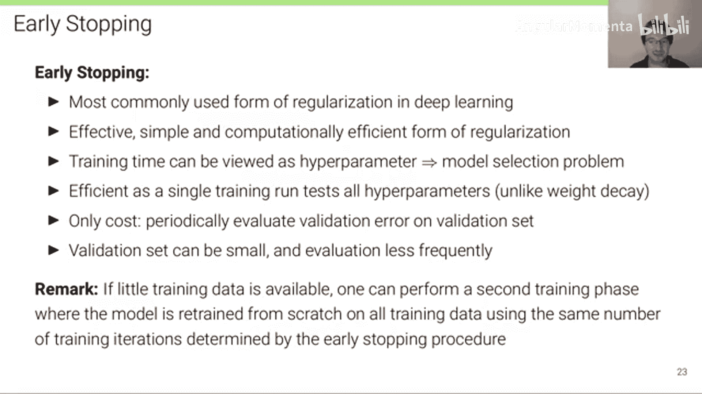

# 026：正则化之早停法 🛑

在本节中，我们将学习一种非常有效且常用的正则化策略——早停法。这是一种简单、计算高效的方法，几乎总是被用于深度学习实践中。

## 概述

上一节我们讨论了权重衰减等正则化方法。本节中，我们来看看另一种策略：早停法。它通过监控验证集性能，在模型开始过拟合之前停止训练，从而防止模型在训练集上表现过好而在新数据上表现变差。

## 训练与验证损失

在训练过程中，我们会迭代整个数据集多次。完整遍历一次数据集称为一个**周期**。一个**迭代**通常指处理一个迷你批次。

如果我们观察训练损失和验证损失随周期或迭代次数的变化，通常会看到以下模式：

*   训练损失（即负对数似然损失）会持续下降，逼近越来越小的值。
*   然而，验证损失在初始快速下降后，会在某个点开始再次上升。

我们关心的是最佳的泛化性能，这通常通过验证误差来近似。因此，我们不希望无限期地训练下去。

## 早停法原理

早停法的核心思想是：我们训练一段时间，直到验证误差停止下降并开始上升，然后返回具有最低验证误差的参数。

具体做法是：在训练期间，我们需要定期在预留的验证集上评估模型性能（进行一次前向传播以计算验证损失）。我们不等待训练误差变得任意小，而是在验证误差一段时间内不再下降（或开始上升）时，提前停止训练。

以下是早停法的基本步骤：

1.  将数据集划分为训练集和验证集。
2.  开始训练模型，并定期（例如每个周期后）在验证集上评估性能。
3.  持续跟踪到目前为止观察到的最佳验证误差及其对应的模型参数。
4.  当验证误差在连续多个评估周期内不再改善（或开始上升）时，停止训练。
5.  恢复并返回具有最佳验证误差的模型参数。

## 与L2正则化的关系

简单的早停策略与L2正则化存在类比。事实上，在某些假设下，两者是等价的。

*   在早停法中，参数优化的轨迹会在到达未正则化目标的最小值 `W*` 之前，于 `W̃` 点停止。
*   在L2正则化中，正则化项惩罚力 `λ` 会迫使正则化损失的最小值 `W̃` 比未正则化目标的最小值 `W*` 更接近原点。

因此，这两种正则化策略具有非常相似的效果。想深入了解，推荐阅读《深度学习》教材第7.8章。

## 早停法的优势与实施要点

早停法是深度学习中最常用的正则化形式，因为它有效、简单且计算高效。

在早停法中，训练时间（迭代次数或周期数）本身可以被视为一个超参数。但它的独特之处在于其超高效性：**它只需要一次训练运行就能测试所有的“超参数”（即不同的停止点）**。因为我们在每次评估验证集时，都能得到一个验证误差。这与权重衰减等需要为不同超参数值重复训练模型的方法不同。

唯一的额外成本是需要定期在验证集上评估验证误差。但这在机器学习中非常普遍，应该是你首先要做的事情。你可以通过以下方式减少成本：

*   使验证集小于训练集（这通常是标准做法）。
*   降低评估频率（例如，每个周期评估一次）。

如果可用的训练数据很少，可以进行第二阶段的训练以利用之前用于评估的验证集。具体做法是：

1.  进行第一次训练运行，以确定通过早停法得到的最佳训练步数（迭代次数或周期数）。
2.  从头开始第二次训练，使用所有训练数据（包括之前的验证集），并按照第一步确定的步数进行训练。

当然，这需要进行两次训练运行，通常只在数据量确实很少，需要验证集数据来获得良好性能时才值得这样做。

## 总结

本节课我们一起学习了早停法这种重要的正则化技术。我们了解到，它通过监控验证集性能并在其开始恶化时提前终止训练，来有效防止过拟合。早停法计算高效，通常只需单次训练即可确定最佳停止点，并且与L2正则化存在理论上的联系。在实际应用中，应养成监控训练与验证损失曲线的习惯，这是模型调试和获得良好泛化能力的关键一步。