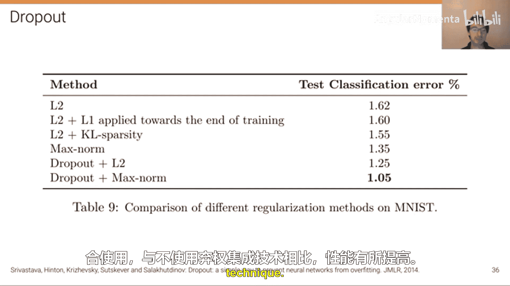

# 028：正则化之Dropout 🎯

在本节课中，我们将要学习一种非常具体且高效的集成方法——Dropout。这是一种在现代深度学习中极为流行的正则化技术，因其简单、高效且在许多模型上效果显著而广受青睐。

---

## 核心思想 🧠

上一节我们介绍了经典的集成方法，本节中我们来看看一种特殊的“即时”集成技术——Dropout。

Dropout的核心思想是：在训练过程中，我们以一定的概率（例如0.5）随机将网络中的神经元“丢弃”（即将其输出设置为0），从而在每次迭代中动态地创建一个不同的简化网络。

考虑上图顶部的例子。这是一个简单的多层感知机，底部是输入，顶部是输出。以概率0.5随机丢弃神经元，意味着移除该神经元的所有输入和输出连接。右侧展示了被移除的神经元及其连接。

## 实现机制 ⚙️

这种机制可以通过一个**二进制掩码**来实现。掩码是一个二进制向量，长度等于网络中神经元的总数。在训练的**每一次迭代**中，我们都会随机生成一个新的掩码，每个神经元以概率p（如0.5）被保留（值为1）或丢弃（值为0）。然后，我们在这个被“瘦身”的网络上进行前向传播和反向传播。

因此，Dropout有效地从一个共享参数的单一网络中，动态地创建了一个庞大的模型集成。这与传统集成方法不同，传统方法中每个模型的参数是独立的，而Dropout中所有“子模型”共享同一套参数。

## 为何有效？ 🤔

以下是Dropout被认为是一种好方法的主要原因：

首先，Dropout是一种有效的正则化手段。它迫使网络学习**冗余的表示**。因为模型无法依赖某些特定的特征来做预测（这些特征可能在某个前向/反向传播中被丢弃），所以它必须以分布式和冗余的方式在网络中表示信息。这降低了模型容量的影响，增强了泛化能力。当然，这也意味着我们通常需要**更大的模型**和**更长的训练时间**。

其次，它能**防止特征的协同适应**。在经典深度学习中，神经元可能会学会“抵消”其他神经元的作用（例如，一个神经元激活很高，另一个激活很低，组合起来产生零值）。这种协同适应通常不是我们希望建模的真实效应。Dropout通过随机丢弃神经元，使得模型学到的表示必须对这种随机性保持鲁棒，从而打破了这种不必要的依赖。

最后，也是其一大优势：与之前介绍的集成方法相比，Dropout在**推理（预测）时只需要一次前向传播**，效率极高。

## 推理时的挑战与解决方案 🧮

然而，Dropout在推理时带来了一个问题：由于随机掩码的存在，模型的输出变得随机。形式上，一个应用了Dropout的神经网络可以写成：
`f_w(x, c)`
其中，`c` 是一个二进制掩码向量，每个元素独立地从伯努利分布中采样（例如，以概率p=0.5取值为1）。

在推理时，我们希望计算整个集成的预测，即对所有可能的掩码 `c` 对应的输出求期望：
`E_c [f_w(x, c)]`
对于有M个神经元的网络，可能的掩码组合有 `2^M` 种，这个求和是**难以直接计算**的。

那么该怎么办呢？让我们考虑一个简单的线性模型（可以看作是神经网络中的一层）：
`f_w(x) = w1*x1 + w2*x2`
其Dropout版本为：
`f_w(x, c) = c1*w1*x1 + c2*w2*x2`， 其中 `c1, c2` 独立地以概率p=0.5取0或1。

在训练时，我们优化的是对所有可能掩码的期望损失。通过计算可以得出，这个期望值等于 `p * f_w(x)`（本例中p=0.5，所以是 `0.5 * f_w(x)`）。

这意味着，为了在训练时达到与原始模型 `f_w(x)` 相同的输出水平，Dropout模型中的权重 `w` 必须学习得更大（大约是原来的 `1/p` 倍）。因此，在推理时，如果我们使用完整的网络（不丢弃任何神经元），为了得到近似的集成预测结果，一个简单有效的方法是进行**权重缩放**：将训练好的所有权重乘以Dropout概率 `p`（或者说，在推理时，每个神经元的输出要乘以 `p`）。

> **注意**：这种权重缩放推理法对于非线性模型只是一种近似，但在实践中被证明效果很好。

## 效果展示 📊

下图展示了一个在MNIST数据集上训练的单隐藏层自编码器的神经元激活可视化。左侧是标准自编码器，右侧是使用了Dropout的自编码器。

我们可以看到：
*   **左侧（无Dropout）**：存在大量协同适应，许多神经元的激活模式嘈杂，它们相互响应并试图纠正彼此的错误。
*   **右侧（有Dropout）**：协同适应显著减少。特征更加清晰、有意义，它们分布在图像的不同位置并对不同类型的输入信号做出反应。

这种更健壮的表示直接带来了更好的泛化性能。从该数据集的测试分类错误率图中也能看出，结合了Dropout和其他正则化技术的模型（最后两个），其性能优于未使用Dropout的模型。

---

## 总结 📝

本节课中我们一起学习了Dropout正则化技术。我们了解到：
1.  Dropout通过在训练时随机“关闭”神经元，动态创建庞大的模型集成，是一种高效的正则化方法。
2.  它迫使网络学习冗余且鲁棒的表示，防止特征间的协同适应。
3.  在推理时，通过简单的**权重缩放**（乘以Dropout保留概率p），可以近似得到集成预测的结果，且只需一次前向传播。
4.  虽然可能需要更大的模型和更长的训练，但Dropout通常能显著提升模型的泛化能力，是现代深度学习工具箱中不可或缺的工具之一。